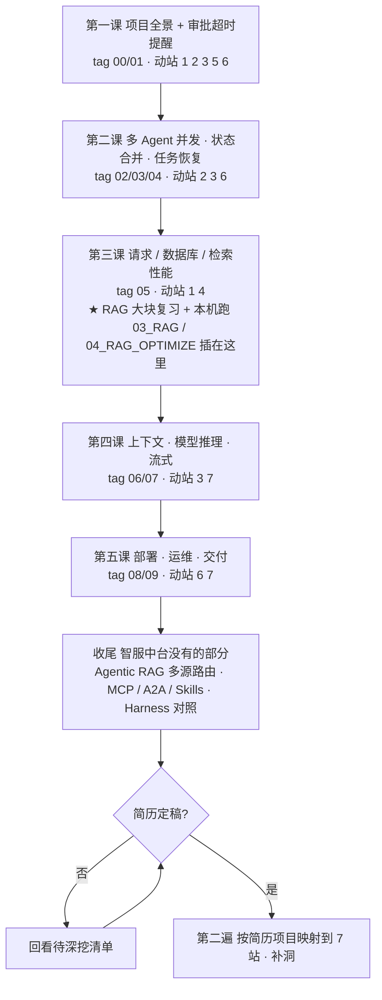

# Agent 复习计划（面试向）· 以智服中台为主干

> 建于 2026-10-04，2026-10-07 改为「项目优先」版本。
> 范围：模块一～四的 Agent / RAG / LangChain / LangGraph 知识，以智服中台（模块七）为主干倒着学。
> 不含模型底层原理（模块五/六另有计划）。简历未定稿，定稿后再做第二遍「按简历项目映射」。

## 0. 总流程

## 1. 为什么这样排

- **项目优先**：面试三句话是「做了什么 / 为什么这样做 / 还有别的做法吗」。学习单位是智服中台里的一个工程决策，不是课件里的一个知识点。
- **知识点倒着学**：读到智服中台某一站，发现需要某个课件知识才讲得清，当场插一段，深度到「为什么这样设计」就停。模块一～四课件降级为索引（见 §5）。
- **7 站主线防孤岛**：每课开头先答「这课动哪几站、上一课哪里不够」，课末往 `面试复习-00-主线地图.md` 填行。智服中台本身就是 7 站的完整版，所以地图会被它填满；课程知识点作为「早期版本」挂在同一站下面。

## 2. 7 站主线（一条请求的生命线）

| 站 | 名字 | 智服中台里在哪 | 挂上来的课件知识 |
|---|---|---|---|
| 1 | 入口 | `app.py` 15 个 router、SSE `conversations/stream.py`、HAProxy | 模块四 FastAPI |
| 2 | 编排 | `agent_runtime/runtime.py build_graph` 三节点循环、`collaboration.py` 并行 | LangChain 链 → LangGraph 图（State/Node/Edge/Send）→ Harness |
| 3 | 状态与记忆 | 任务行 MySQL、`state_merge.py` reducer、`branch_store.py` 持久化、`context.py` 预算压缩、Redis 记忆 | LangGraph State/Reducer/Checkpointer/Store、记忆五范式、上下文工程 |
| 4 | 知识获取 | `knowledge/` + BGE-M3 + Milvus、第三课 §8-9 | RAG 原理 / 向量 / 搭建 / 全链路优化 → Agentic RAG |
| 5 | 外部能力 | `tools.py DEFINITIONS / invoke_tool`、OMS 集成 | Tool 定义 → MCP → A2A → Skills |
| 6 | 控制与护栏 | 权限→锁→幂等→审批、租约 lease_token、取消/人工接管、worker 退出 | 断点 / interrupt / Middleware、Harness 守卫 |
| 7 | 出口与观测 | 草稿流 `streaming.py`、SSE 续传、用量 `model_usage.py`、`monitoring/` | stream modes、评测、LangSmith |

## 3. 五课路线（每课四步）

每课固定：**定位**（动哪几站、上一课哪里不够）→ **先用后懂**（切 tag 看 diff / 跑一个动作，再讲原理）→ **按小节讲**（我通读课件按小节讲，你不自读；每节三问即止）→ **收口**（填 00 地图 + `智服中台.md` 三问 + 口径）。

| 课 | tag | 课件小节重点 | 动的站 | 当场要插的课件知识 | 动手 |
|---|---|---|---|---|---|
| 一 | 00 / 01 | L1 §1-5 全景与执行流程；§6-9 提醒业务与事务；§10 环境 | 1 2 3 5 6 | FastAPI 路由/事务边界（模块四 02）；LangGraph 第 1 篇 State/Node/Edge；LangChain Tool 定义；Harness 守卫（回看已有笔记） | 跑通 00；读 01 diff；`智服中台.md` §6 路线 13 步 |
| 二 | 02 / 03 / 04 | L2 §1-2 并行调用；§4-5 共享状态与 reducer；§6-7 事务版本与租约；§8-9 恢复与接管 | 2 3 6 | LangGraph Send 并行、reducer、Checkpointer vs 自建持久化；interrupt / 人工介入；Middleware（第 3 篇） | 跑 L2 §10 并发恢复实验 |
| 三 | 05 | L3 §1-4 请求耗时/事件循环/排队；§5-6 索引；§8-9 向量检索与缓存 | 1 4 | **★ RAG 大块**：模块二 RAG 原理、向量、搭建、全链路优化四篇；本机跑 `03_RAG`（Milvus）和 `04_RAG_OPTIMIZE`（baseline → 逐项优化比指标） | RAG 本机跑；读 05 diff |
| 四 | 06 / 07 | L4 §1-3 上下文筛选与预算压缩；§4-5 连接与超时；§8-9 草稿流与 SSE 续传；§10 用量 | 3 7 | 记忆五范式 + 上下文工程；LangGraph stream modes；推理部署只回看模块六笔记不展开 | 跑 L4 §11 本地实验 |
| 五 | 08 / 09 | L5 §3 迁移；§4 租约退出；§5 日志指标；§6-7 额度与计量；§8 备份；§10 发布实验 | 6 7 | LangSmith 一页（模块三 8.3）；评测分母怎么定 | 跑 L5 §10 发布实验 |

## 3.5 抓大放小：用 Agent 应用开发的眼光取舍（2026-10-09 定）

依据：00→09 的 src 增量约 1660 行，其中约 1100 行在 `agent_runtime/`；提醒模块约 400 行是纯后端业务；阶段 08 没有 src 改动。

**读码深度规则**：不逐行。每个文件只看「入口函数签名 + 体现设计决策的 5~10 行」，能答「它解决什么问题、为什么这样设计、换个做法会怎样」就停。默认停在最终版 `course/09-course-delivery` 读，只有想看"加了什么"时才对单个文件做 tag 间 diff。

| 档 | 内容 | 怎么学 |
|---|---|---|
| 🔴 精 | 00 `runtime.py` 图（load/model/tools 三节点循环）+ `tools.py` 工具定义与执行；00 `worker.py` 领任务与租约（Agent 为什么要异步跑）；02 `collaboration.py` 并行专业 Agent；03 `state_merge.py` 结果合并；04 `branch_store.py` 分支持久化与恢复；06 `context.py` 上下文预算与压缩；07 `streaming.py` 草稿流与续传 | 讲设计决策 + 看关键几行 + 插对应 LangGraph / 记忆知识 |
| 🟡 懂为什么 | 售后确认→审批→OMS 链路（只记"模型提候选、应用裁决"和幂等编号）；01 提醒为什么和确认同事务（Outbox 思想）；05 工具查询范围 + L3 §8-9 向量检索与缓存；06 模型连接复用；07 用量计量；取消与人工接管 | 每个一两句口径，不看代码 |
| 🟢 跳过 | L3 §1-4 代理转发 / 事件循环；L3 §5-6 索引与 EXPLAIN；L5 迁移、备份、HAProxy、发布实验；09 计量核对调度；`thread_bridge.py`（只被测试用）；前端；各课 §10-12 实验与作业 | 面试被问到再回来查 |

按这个取舍，五课实际分量：第一课中、第二课重、第三课轻（时间让给 RAG 大块）、第四课中、第五课很轻（只留租约退出和日志指标两节口径）。

## 4. 收尾：智服中台没覆盖的部分（每个一页口径）

| 主题 | 课件 | 代码 | 挂哪站 | 口径核心 |
|---|---|---|---|---|
| Agentic RAG 多源路由 / 自纠错 | 模块三 7.2、7.3 | `Agentic_Rag/app` | 站 4 进阶 | 传统 RAG vs Agentic RAG 分界；路由在图里怎么做 |
| ReAct vs Plan-and-Execute | 模块三 1.2 | `ai-agent/AgenticAI/01_LangGraph` | 站 2 | 怎么选 |
| MCP / A2A / Skills | 模块三 2、3、4、7.1 | `06_MCP`、`a2a/` | 站 5 进阶 | 三者和 Tool 的边界 |
| DeepAgents + LangSmith | 模块三 8.x | `DeepAgent/` | 站 2、7 | 规划 / 子 Agent；可观测 |
| Harness × 智保通 | 模块四 | `harness_zbt` | 站 2、6 | 和智服中台同一条脊柱：模型提候选，应用裁决 |

## 5. 课件索引（按需查，不通读）

- 模块二：`01_LangChain Agent 开发框架/1.LangChain核心模块实战指南.md`；`02_RAG 系统与调优实战/1~4`（第三课用）
- 模块三：`1. LangGraph 实战/1~3`（第一、二课用）；`5.记忆五范式`（第四课用）；`2.MCP`、`3/4.Skills`、`7.x A2A+Agentic RAG`、`8.x DeepAgents+LangSmith`（收尾用）
- 模块四：`02-FastAPI`（第一课用）；`01-Harness` + 两篇已有笔记（收尾用）
- 模块一：只在被问到提示词工程时翻 `2.大模型提示词工程实战.md`

## 6. 学习方式四条规则（我来执行）

1. **三问即止**：每个点答完「是什么 / 为什么要 / 怎么选」就翻篇。标准是「不看笔记讲 2 分钟并接一次追问」，不是「心里踏实」。
2. **30 分钟定时盒**：一个点超时我喊停，记入 §7 待深挖清单。同一条在三课里反复出现才回头挖。
3. **先用后懂**：先切 tag 看 diff 或跑一个动作，再讲原理。原理讲到「为什么这样设计」，不讲「内部怎么实现」。
4. **没懂就记录，不当场解决**。

理解分三层：会用 → 懂设计 → 懂实现。面试要第二层。

## 7. 待深挖清单

（学习中追加：点 / 出现在哪课 / 为什么卡）

## 8. 进度锚点

- 2026-10-04：计划建立，加 7 站主线。
- 2026-10-07：改为智服中台主干版。
- 2026-10-09：加 §3.5 抓大放小取舍；读码停在最终版 09，不再切 00。§1 已讲完。
- 2026-10-11：定三条做法。①不手写代码、不重做阶段，理解开发思路即可，标准是每个设计点能答"不这样做会出什么事"；②不起环境，直接看代码，用仓库里老师真实跑过的记录替代（`docs/verification/agent200-transcripts-20260922.md` 约 200 条真实对话；`docs/course/*.md` 并行 / 恢复 / 流式实验记录；24 个离线测试想看哪个行为跑哪个）；③读法 = 拿一条真实对话当线索，沿它在代码里从入口走到最终答复，每站用记录里的真实数据说变量装着什么。**下一步：用 `order-list-01`（"查看我的订单"）这条记录走第一课 §5 执行流程，从 `conversations/api.py accept_message` 进入。** 笔记写 `学习笔记/智服中台.md`（§7 三问 + §8 Q&A），地图填 `面试复习-00-主线地图.md`。
