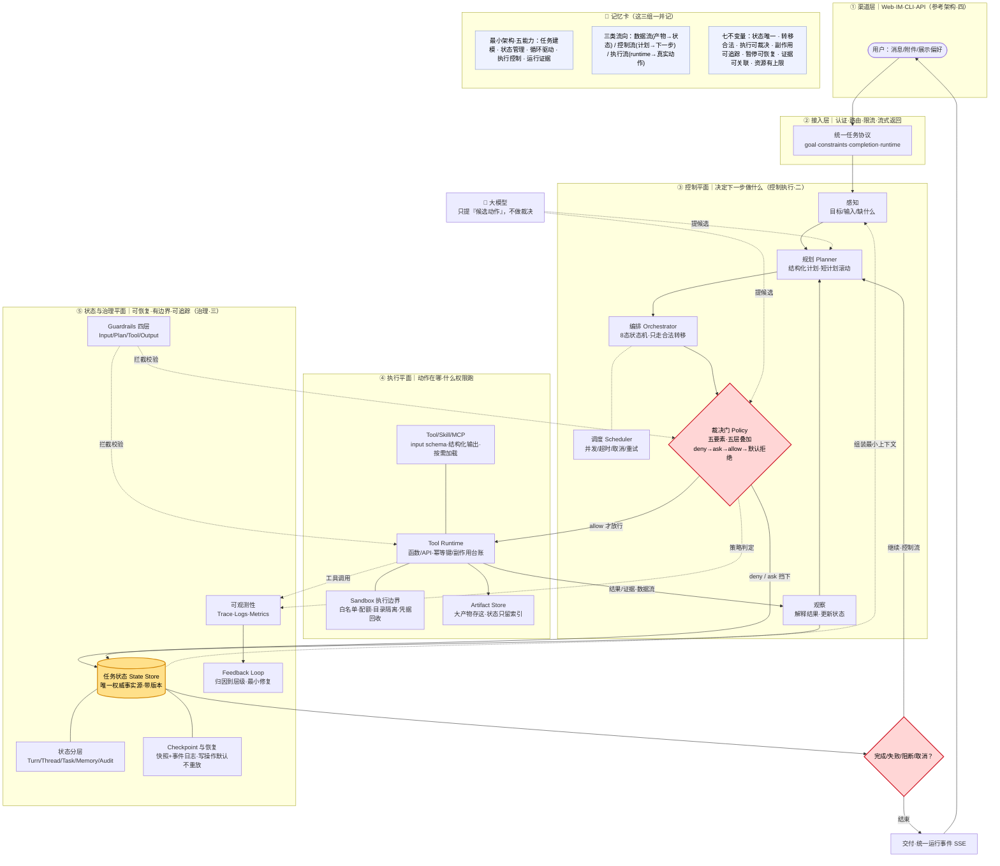
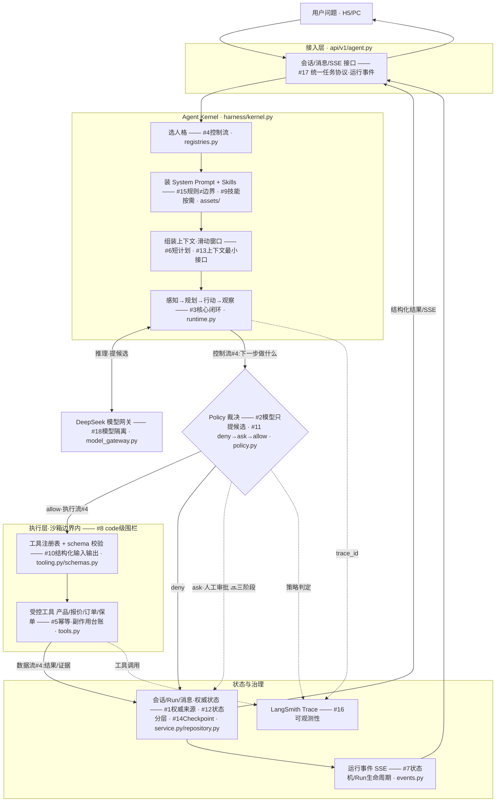
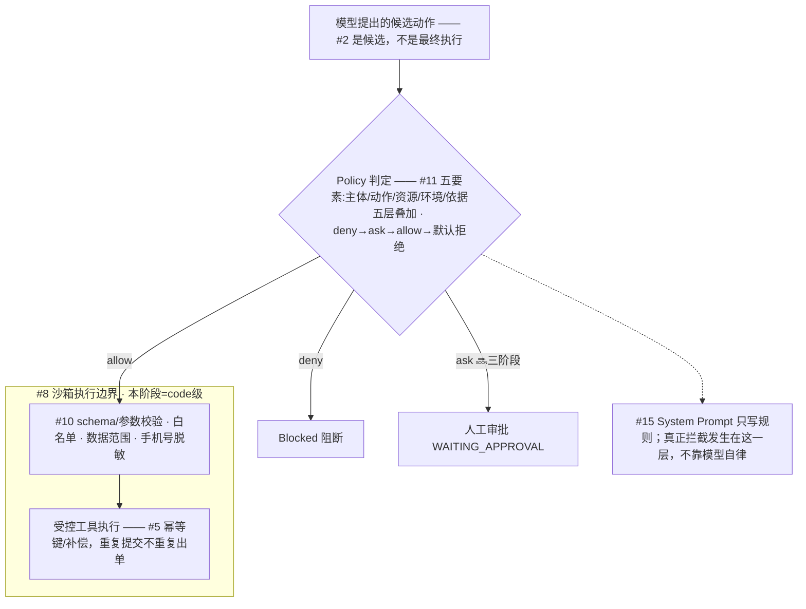
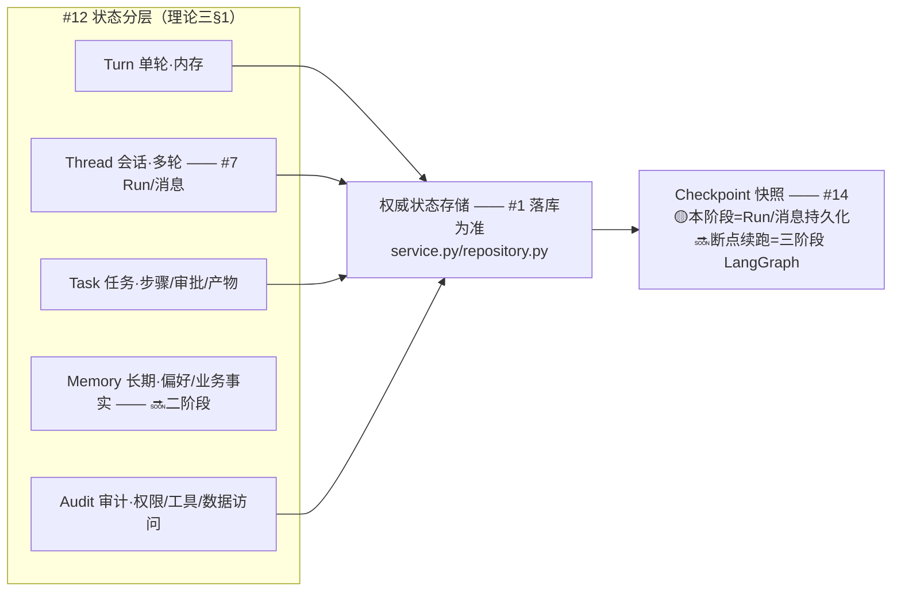
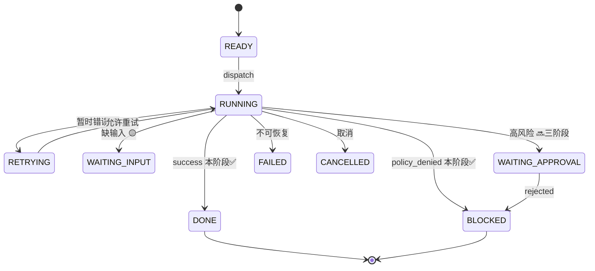

# Harness 理论总结 × 智保通代码对照地图

> **这份文档怎么用**
> 左边是早上学的 Harness 理论（每条都标了出处），中间是它在智保通第一阶段里长什么样，右边是**去哪个代码文件核对**。读代码时拿这份当清单，看懂一条就在最后一列打个勾。
>
> - 理论出处：`模块四/课件/01-Agent Harness：核心理论与参考架构.md`
> - 项目出处：`模块四/课件/03-.../01-智保通第一阶段：整体业务与智能投保 Agent.md`
> - 代码根目录：`harness_zbt/backend/src/zbt/`
> - 阶段标记：✅ 第一阶段就落地　🟡 第一阶段只有雏形/部分　🔜 主要留给二三阶段

---

## 0. 一句话抓住 Harness

> **模型提候选，Harness 管裁决。**
> Harness = 模型推理 + 任务状态 + 执行控制 + 运行证据。它不是让模型“更聪明”，而是保证任务**沿合法路径、以适当权限、在有限资源内**完成，并且**可记录、可恢复、可终止、可审计**。

判断一个系统是不是 Harness，就看它能不能把"目标"变成**受控任务链**——而不只是"能回答问题"。（理论 第一部分§7）

---

## 1. 整体架构图

> **先看 §1.0 这张总图**——一眼看懂 Harness 怎么转；看懂了再往下看 1.1~1.4 的放大图（带 #编号，读代码时定位用）。

### 1.0 全景图（早上四部分全塞进这一张）

> 五个横带 = 参考架构四层 + 治理层；🟡任务状态是圆心，🔴裁决门是关卡；右下角"记忆卡"把 五能力 / 三流向 / 七不变量 也放进来了。

**一句话读法**：用户→接入(统一协议)→控制平面转圈(感知→规划→编排→🔴裁决门)→`allow`才进执行平面(工具/沙箱)→结果回写🟡任务状态→判完成没→继续或交付；治理平面(状态分层/Checkpoint/Guardrails/可观测/反馈)在下面横切,谁都被它记录和约束。下面 1.1~1.4 是这张图局部放大,不想看可跳过。

### 1.1 端到端运行主链路

**三类流向(#4)一眼认**：**控制流**=谁决定下一步（LOOP→Policy）；**执行流**=动作在哪、以什么权限跑（Policy→工具）；**数据流**=结果/产物回写状态（工具→状态）。这三条别塞进 Prompt——各走各的系统。

### 1.2 裁决门放大（#2 #5 #8 #10 #11 #15）

### 1.3 状态分层与 Checkpoint（#1 #7 #12 #14）

### 1.4 任务状态机（#7）——标注本阶段实际走哪几条

本阶段实际主要跑 **READY→RUNNING→DONE** 和 **policy_denied→BLOCKED** 两条；`WAITING_APPROVAL`（审批）、`RETRYING`（重试）、中断恢复是理论完整态，🔜 留给后续阶段。所以你在代码里看到的"状态"会比这张图简单，这是正常的。

---

**四张图各覆盖清单哪几条（自查用）：**

| 图 | 覆盖的清单点 |
| --- | --- |
| 1.1 主链路 | #1 #2 #3 #4 #5 #6 #7 #8 #9 #10 #11 #12 #13 #14 #15 #16 #17 #18（全部） |
| 1.2 裁决门 | #2 #5 #8 #10 #11 #15 |
| 1.3 状态分层 | #1 #7 #12 #14 |
| 1.4 状态机 | #7 |

---

## 2. Harness 理论骨架（按早上那篇原文的四部分，逐块讲清）

> 早上那篇文章就是这四块：**① 核心运行机制 → ② 控制与执行平面 → ③ 状态与治理平面 → ④ 参考架构**。先记这张"四块地图"，再往下看每块的细节。加粗的是要背的。

| 块 | 回答什么 | 里面有什么（下面逐块展开） |
| --- | --- | --- |
| **2.1 核心运行机制** | Harness 是什么、怎么转 | Harness 边界 · **最小架构=五类能力** · 任务状态是核心对象 · 感知-规划-行动-观察闭环 · 三类流向 · 失败重试终止 |
| **2.2 控制与执行平面** | 下一步做什么 + 动作在哪以什么权限跑 | 八组件 · 结构化计划 · 8 态状态机 · 沙箱执行边界 · Tool/Skill/MCP · 权限五要素 `deny→ask→allow` |
| **2.3 状态与治理平面** | 怎么恢复、怎么追踪、怎么改进 | 状态分层 5 层 · 上下文最小接口 · Checkpoint 与恢复四规则 · SystemPrompt vs Guardrails · 可观测性 Trace/Logs/Metrics · 反馈闭环 |
| **2.4 参考架构** | 理论对象怎么变成系统分层 | 渠道/接入/Harness/执行 四层解耦 · 统一任务协议 · **七条架构不变量** |

---

### 2.1 第一部分 · 核心运行机制（Harness 是什么、怎么转）

**一句话**：Harness = 模型推理 + 任务状态 + 执行控制 + 运行证据。模型提候选，Harness 决定"输入怎么进、动作能不能执行、结果怎么写回状态、任务何时结束"。

**① Harness 的边界**——下面这几样都**不是** Harness，别混：

| 对象 | 是什么 | 和 Harness 的关系 |
| --- | --- | --- |
| Prompt | 规定模型怎么理解/表达 | 模型输入，≠运行控制 |
| Context | 当前任务要用的信息 | 运行材料，≠可靠状态存储 |
| RAG | 检索并注入资料 | 上下文来源之一 |
| Tool | 暴露外部能力 | 执行接口，调用权仍归 Harness |
| Workflow | 固定步骤/分支 | 可当 Harness 的确定性骨架 |
| **Harness** | **管任务全生命周期** | **统筹状态/路径/权限/恢复/审计** |

**② 最小架构 = 五类能力**（你问的"最小架构"就是这个）。一个最小可用的 Harness 必须凑齐这五样，缺一样就不算：

1. **任务建模** —— 把自然语言目标转成 目标/约束/输入/完成条件。
2. **状态管理** —— 保存当前步骤、已完成、待解决、产物索引。
3. **循环驱动** —— 组织 规划→执行→观察→下一轮决策。
4. **执行控制** —— 管权限、审批、超时、重试、终止。
5. **运行证据** —— 记录关键输入、动作、结果、错误、策略判定。

最小架构骨架流程（原文§2 那张图）：
`目标输入 → 任务建模 → 【任务状态】→ 规划与编排 → 权限与策略 → 工具/沙箱执行 → 结果与证据 →(回写)【任务状态】→ 判断"完成/等待/阻断" → 继续则回规划，结束则交付`。
**圆心是「任务状态」，一切绕它转。**

**③ 任务状态是核心对象**（最重要一条）：Harness 不围绕"消息"转，而是围绕**显式任务状态**转。状态至少回答：当前目标是什么、已完成什么、下一步是什么、为什么停下、需要什么输入、产生了哪些证据；还要记 状态版本/计划版本/剩余预算/权限主体/已发生的外部副作用。
> **状态库是任务事实的权威来源；模型上下文只是从状态组装出的临时视图，不能反过来当事实源。**

**④ 核心闭环 = 感知→规划→行动→观察**

| 阶段 | Harness 干的事 | 产物 |
| --- | --- | --- |
| 感知 | 识别目标/输入/约束/缺什么 | 初始任务状态 |
| 规划 | 拆成有依赖/完成条件/风险级的步骤 | 结构化计划 |
| 行动 | 在策略允许范围内执行当前步 | 工具结果/中间产物 |
| 观察 | 解释结果、更新状态、定下一步 | 状态变化+证据 |

"终止"≠"成功"。至少分 **completed / failed / blocked / cancelled**；等待输入/审批是**可恢复的暂停**，不算结束。

**⑤ 三类流向（别全塞进 Prompt）**

| 流向 | 内容 | 载体 | 约束 |
| --- | --- | --- | --- |
| 数据流 | 输入/中间结果/产物 | message/file/artifact | 来源/格式/版本 |
| 控制流 | 下一步做什么/何时结束 | state/plan/condition | 分支/终止/重试 |
| 执行流 | 动作在哪/什么权限 | runtime/worker/tool call | 隔离/权限/超时 |

**⑥ 失败·重试·终止**：临时错误→限次退避重试；缺信息→等补充；计划错→重规划；权限拒→审批或终止；取消/预算耗尽→安全中止保状态；**部分成功→先标记已发生副作用**再定 补偿/续跑/人工。每个任务都要有**步数/时间/成本/重试上限**；写操作只有具备**幂等键或补偿**才能自动重放；分布式靠**至少一次 + 幂等 + 副作用台账**，不追求"恰好一次"。

**⑦ 核心判断**：模型能提下一步，**系统必须保留裁决权**；上下文能压缩，**关键状态和证据不能丢**；工具多≠可靠，可靠来自**闭环 / 边界 / 恢复**。

---

### 2.2 第二部分 · 控制与执行平面（下一步做什么 + 动作在哪以什么权限跑）

**一句话**：控制平面决定"下一步做什么"，执行平面负责"动作在哪、以什么权限运行"，两者一起把模型的候选动作变成**受控执行**。

**① 八个逻辑组件**（是"职责边界"，不要求每个都独立部署）

| 组件 | 职责 |
| --- | --- |
| Planner | 把目标拆成候选步骤（只提建议） |
| Orchestrator | 维护状态机和步骤依赖（决定**合法转移**） |
| Scheduler | 队列/并发/优先级/取消 |
| **Policy Engine** | **裁决 允许 / 审批 / 隔离 / 拒绝** |
| State Store | 持久化状态/版本/Checkpoint（保**权威状态**） |
| Tool Runtime | 调函数/API/MCP（执行动作） |
| Sandbox | 隔离 文件/命令/代码/网络 |
| Artifact Store | 存大输入/中间结果/产物 |

判定链：`Goal → Planner → Orchestrator → 【Policy Check】`，四个出口：**allow→工具运行时 / sandbox→沙箱 / ask→人工审批 / deny→阻断**，执行完 → Observation → 回 Orchestrator。

**② 结构化计划**：每步带 类型/依赖/前置/输入输出/风险级/副作用类型/超时/完成条件，**工具步骤和模型步骤要分开**。长任务用**短计划滚动推进**——每轮可调后续步骤，但**已执行的动作和证据不能被静默改写**；重规划只改没执行的部分，并记 变更原因/旧版本/新版本。

**③ 8 态状态机**（限制合法路径，模型**不能绕过审批、不能跳到未声明节点**）：`READY→RUNNING→DONE`，外加 `RETRYING / WAITING_INPUT / WAITING_APPROVAL / BLOCKED / FAILED / CANCELLED`。每个步骤绑 `trace_id`、`cancellation_token`、超时、重试上限、幂等键。（完整图见 §1.4）

**④ 沙箱是执行边界**（靠系统关，不靠模型自律）：路径解析后再校验根目录（防 `../`/软链越界）；文件/网络/CPU/内存/磁盘/时间都设**配额**；上传/工作区/输出目录分离；凭据按需注入、短期有效、用后回收；网络出口白名单；命令用参数数组执行避免 shell 解释。默认策略：读取检索→允许但受目录约束；构建测试→项目内允许设超时；改删文件→参数校验必要时审批；外网→受限并审计；**凭据/生产操作→默认审批或拒绝**。

**⑤ Tool / Skill / MCP**：Tool=一个可调用动作；Skill=完成一类任务的方法/约束/资源；MCP=用统一协议暴露外部工具。工具必须有 **input schema / 结构化输出 / 超时 / 风险级 / 副作用声明 / 审计标识**。**Skill 和工具按需加载**，别一次把全部工具说明塞进上下文；工具返回和检索内容都算**不可信输入**，进上下文前要查 格式/来源/敏感信息。

**⑥ 权限策略**（必须系统执行，不能只写进 Prompt）：一次判定含**五要素**——**主体(谁) / 动作(做什么) / 资源(对什么) / 环境(何处何时) / 任务依据(为什么)**。策略从 组织/租户/会话/步骤/工具**五层叠加**，判定顺序 **`deny → ask → allow → default deny`**，高层禁令不能被低层授权覆盖，并记录 匹配规则/策略版本/理由。

---

### 2.3 第三部分 · 状态与治理平面（怎么恢复、怎么追踪、怎么改进）

**一句话**：这一平面保证**任务可恢复、动作有边界、运行可追踪**。上下文和记忆只是它的数据来源，替代不了可靠状态/权限/审计。

**① 状态分层**（模型上下文可压缩，系统状态不能丢）

| 层 | 内容 | 生命周期 | 存哪 |
| --- | --- | --- | --- |
| Turn | 当前输入+工具结果 | 单轮 | 内存 |
| Thread | 消息/计划/checkpoint | 多轮 | DB / Checkpointer |
| Task | 步骤/审批/错误/产物 | 任务周期 | DB |
| Memory | 稳定偏好/业务事实/工作流模式 | 长期 | 关系库/向量库/文件 |
| Audit | 权限判定/工具调用/数据访问 | 合规周期 | 日志/审计库 |

Thread(交互容器) 和 Task(可执行任务) **不是简单上下级**：一个会话可发多个任务，一个长任务可跨多轮。冲突时以**带版本号的 Task State + 审计事件**为准，不以对话里的自然语言摘要为准。

**② 上下文与记忆的最小接口**：每轮只组装当前决策需要的六样——①系统规则/权限边界 ②当前目标/约束/完成条件 ③当前计划+下一步候选 ④最近必要交互 ⑤工具结果摘要+产物索引 ⑥与任务直接相关的记忆/Skill。长期记忆只存**稳定/可复用/可追溯**的，每条标 来源/范围/置信度/敏感级/有效期；**未经筛选的历史对话不能直接变长期记忆**。

**③ Checkpoint 与恢复**：Checkpoint 至少覆盖 用户输入后 / 工具调用前后 / 文件写入后 / 人工审批后 / 上下文压缩前 / 最终交付前。**Checkpoint=可恢复的状态快照（解决快速恢复）；事件日志=状态为何变化（解决追溯审计）**，两者都要。恢复**四规则**：纯推理步可重新生成；只读工具可重跑但留原证据；**写操作默认不重放**除非有幂等键/补偿；**审批结果必须持久化**，恢复后不得绕过或重复执行。

**④ System Prompt vs Guardrails**：System Prompt 定义模型行为边界，但**不是安全系统本身**；真边界靠 策略引擎/工具校验/沙箱。四层 Guardrail：

| 层 | 查什么 | 例 |
| --- | --- | --- |
| Input | 用户输入 | 注入 / 恶意URL / 越权要求 |
| Plan | 计划步骤 | 生产库写入 / 批量删除 / 高风险外发 |
| Tool | 工具参数 | SQL只读 / 路径边界 / 域名白名单 |
| Output | 最终输出 | PII / 密钥 / 受限数据 |

分工：**提示词让模型遵守规则，Guardrail 检查模型意图，Policy+Sandbox 强制限制真实动作**。外部内容(网页/文档/邮件/检索/工具返回)都可能带**提示注入**，系统要**区分指令与数据**：外部内容只能当证据，不能自行提权/改系统规则/授权工具调用。

**⑤ 可观测性 = Trace + Logs + Metrics**
- **Trace**：串起一次请求的 模型/计划/策略/工具/沙箱/记忆检索/输出护栏，每个 span 记 父子关系/步骤/状态/耗时/关键属性。
- **Logs**：至少含 timestamp/level/trace_id/run_id/step_id/用户/事件类型/决策/原因；**密钥不进日志**，文件只记 hash/大小/类型，大返回写 artifact、日志只留摘要+路径。
- **Metrics**：任务成功率/平均步数/重试次数/策略拒绝次数/审批等待时长/工具错误率/模型成本/沙箱超时/上下文压缩次数。

可观测性 ≠ 审计：审计要更严的 访问控制/保留周期/完整性/不可抵赖，两者可共享 `trace_id` 但不能混为一谈。

**⑥ Feedback Loop（反馈闭环）**：把 用户评价/人工审核/失败trace/策略命中/返工记录 → **归因到层级** → 最小范围修复：模型行为→调 Prompt/上下文；工具→修 schema/参数校验；策略→更新 权限/护栏；知识→修 知识/记忆；流程→调 状态机。**反馈必须落到可验证的改动**（记 症状/根因/修复项/验证指标），目标不是一直"调模型"，而是找到故障所属层级、最小修复、防回归。

---

### 2.4 第四部分 · 参考架构（理论对象怎么变成系统分层）

**一句话**：企业级 Harness 的重点不是加模型能力，而是把**渠道 / 接入 / Harness / 执行 解耦**，让同一套任务系统安全接入 Web/IM/CLI/API。

**① 四层分层**：渠道(只传 用户/消息/附件/展示偏好) → 接入层(认证/路由/流式返回/限流) → Harness(状态/计划/权限/审计) → 执行层(沙箱/工具/文件/外部系统)。

**② 统一任务协议**：多渠道请求先转成**统一任务对象**(request_id / channel / user / goal / constraints / completion_criteria / inputs / runtime…)，运行事件也统一(event / state_version / trace_id / run_id / step_id / status / summary / evidence)。**任何渠道都不能直接改任务状态、绕过策略、或自行宣告任务完成。**

**③ 七条架构不变量**（最值得背，一条 = 一个"绝不能破的规矩"）

| 不变量 | 含义 |
| --- | --- |
| 状态唯一性 | 关键任务事实有唯一权威来源+版本，不由模型文本或多组件各存一份 |
| 转移合法性 | 所有状态变化都过编排器校验，记 触发条件/原因/证据 |
| 执行可裁决 | 模型提候选，策略系统对真实执行保留**最终裁决权** |
| 副作用可追踪 | 外部写入有幂等标识/补偿，能区分 未执行/已执行/结果未知 |
| 暂停可恢复 | 等待输入/审批/中断不丢状态，也不绕过约束 |
| 证据可关联 | 计划/策略/工具/状态变化/产物 用统一标识连成因果链 |
| 资源有上限 | 步数/时间/成本/重试/并发 都受预算约束，不能无界循环 |

> **收尾一句**：Agent Harness 的本质不是一组工具、也不是一段 Agent 循环，而是**一套围绕任务状态建立的受控运行协议**。模型能力决定"可能做到什么"，Harness 决定"这些能力能不能以可验证、可恢复、可治理的方式发生"。

---

## 3. ★ 细节点对照清单（读代码就用这张表）

| # | 理论细节点（出处） | 智保通里长什么样 | 去哪看代码 | 阶段 | ✅ |
| --- | --- | --- | --- | --- | --- |
| 1 | **任务状态是权威来源**，模型上下文只是临时视图（一§3） | 会话 + Run + 消息，落库为准 | `service.py` `repository.py` `models.py` | 🟡 | ☐ |
| 2 | **模型提候选，系统保留裁决权**（一§7 / 四§3） | 金额/资格/状态变更必须走受控工具，模型不能自己生成价格 | `policy.py` `tools.py` | ✅ | ☐ |
| 3 | **核心闭环 感知→规划→行动→观察**（一§4） | `create_agent` 的模型-工具调用循环 | `kernel.py` `runtime.py` | ✅ | ☐ |
| 4 | **三类流向 数据/控制/执行**（一§5） | 数据流=工具结果组卡片；控制流=人格+Policy 准入；执行流=受控工具真正下单 | `tools.py`（数据）`registries.py`+`policy.py`（控制）`runtime.py`（执行） | ✅ | ☐ |
| 5 | **失败/重试/幂等/副作用台账**（一§6） | 订单/模拟支付/出单幂等，重复提交不重复出单 | `tools.py`（下单/支付相关） | ✅ | ☐ |
| 6 | **结构化计划 + 短计划滚动推进**（二§2） | 滑动上下文窗口，只送最近有限轮次 | `kernel.py`（上下文控制） | 🟡 | ☐ |
| 7 | **8 态状态机限制合法路径**（二§3） | Run 生命周期 + SSE 事件(运行开始/工具完成/UI就绪/运行完成) | `events.py` `service.py` | 🟡 | ☐ |
| 8 | **沙箱是执行边界**（二§4） | code 级围栏：工具白名单 + Pydantic 校验 + 受控 Action（无进程/容器/VM 级） | `tooling.py` `policy.py` | ✅ | ☐ |
| 9 | **Tool / Skill / MCP**（二§5） | 工具注册表 + 文件化 `SKILL.md`（MCP 留到三阶段） | `tooling.py` `assets/skills/` | ✅ | ☐ |
| 10 | **工具 input schema + 结构化输出**（二§5） | Pydantic 校验参数、拒绝未声明字段；统一返回 摘要/数据/UI区块/Action | `schemas.py` `tooling.py` `tools.py` | ✅ | ☐ |
| 11 | **权限策略：五要素 · deny→ask→allow · 五层叠加**（二§6） | 人格白名单 + 账号权限 + 数据范围 + 手机号/证件脱敏 | `policy.py` `registries.py` | ✅ | ☐ |
| 12 | **状态分层 Turn/Thread/Task/Memory/Audit**（三§1） | 会话=Thread，Run=Task；Memory(长期记忆)留到二阶段 | `service.py` `repository.py` | 🟡 | ☐ |
| 13 | **上下文与记忆最小接口**（三§2） | 每轮只组装当前需要的历史；跨会话长期记忆 🔜 二阶段 | `kernel.py` | 🟡 | ☐ |
| 14 | **Checkpoint 与恢复**（三§3） | Run/消息持久化有了；真正的断点续跑 🔜 三阶段 LangGraph | `repository.py` | 🟡 | ☐ |
| 15 | **System Prompt ≠ 安全系统，真边界在 Policy/Sandbox**（三§4） | `customer.md`/`operation.md` 只是 Prompt；能不能执行由 policy 定 | `assets/prompts/*.md` vs `policy.py` | ✅ | ☐ |
| 16 | **可观测性 Trace/Logs/Metrics**（三§5） | 每次运行独立 Run + Trace ID 关联 LangSmith，本地运行中心可回放 | `kernel.py`（Trace）`service.py` | ✅ | ☐ |
| 17 | **统一任务协议 + 统一运行事件**（四§2） | SSE 统一事件序列推给 H5 | `events.py` `api/v1/agent.py` `service.py` | ✅ | ☐ |
| 18 | **模型接入隔离**（组件 Tool Runtime / Model） | DeepSeek 配置与 LangChain 模型实例单独隔离 | `model_gateway.py` | ✅ | ☐ |

---

## 4. 建议读代码的顺序（从"装配总览"到"细节零件"）

1. **`main.py`** —— 先看全局装配：Kernel、仓储、Agent 服务、基础设施怎么拼起来（相当于 fastApi 项目里的 main.py，是"总装现场"）。
2. **`harness/kernel.py`** —— 核心。看它怎么把 人格 + Prompt + Skills + 模型 + 工具 + Policy + Trace 组合成一次运行。**对照清单 #3 #6 #16。**
3. **`harness/registries.py`** —— 两个人格怎么各自绑定 Prompt / Skills / 工具白名单。**对照 #4 #11。**
4. **`harness/tooling.py`** + **`harness/schemas.py`** —— 工具契约：注册表、执行上下文、统一返回结构、Pydantic schema。**对照 #8 #9 #10。**
5. **`harness/policy.py`** —— 执行前的裁决：人格/权限/数据范围/副作用。**对照 #2 #11 #15。**
6. **`harness/model_gateway.py`** —— DeepSeek 隔离。**对照 #18。**
7. **`domains/agent/tools.py`** —— 领域工具实现：产品/报价/订单/保单。**对照 #4 #5。**
8. **`domains/agent/runtime.py`** + **`service.py`** + **`repository.py`** —— 运行循环、会话/Run/SSE、持久化。**对照 #1 #3 #7 #12 #14 #17。**
9. **`harness/events.py`** —— 运行事件定义。**对照 #7 #17。**
10. **`api/v1/agent.py`** + **`assets/prompts/*.md`** + **`assets/skills/`** —— 对外接口和人格资产。**对照 #15。**

---

## 5. 边界提醒：哪些是二三阶段才加的（读到发现"没有"别慌）

早上理论里讲过、但第一阶段**故意不做**的（项目 §10 + §8 包含式演进）：

- **完整状态机 + 人工审批(WAITING_APPROVAL) + 中断恢复** → 🔜 第三阶段 LangGraph
- **Checkpointer 断点续跑** → 🔜 第三阶段
- **跨会话长期记忆(Memory 层)** → 🔜 第二阶段
- **Agentic RAG（保险条款向量检索）** → 🔜 第二阶段
- **多模态材料识别 / 退保退款 Worker / MCP** → 🔜 第二、三阶段

> **同一个 Harness 内核，能力一层层往上叠。** 第一阶段先把"裁决 / 白名单 / 幂等 / 可观测"这套**底座**搭好，其余能力是后面阶段在同一内核上加的。所以判断标准不是"这个概念在不在"，而是"它是这一层就落地，还是设计成后面再加"。

---

_生成依据：理论课件 01（四部分全文）+ 项目课件 03/01 + 实际代码目录 `harness_zbt/backend/src/zbt/`（文件已核实存在）。阶段标记为对照两份课件推断，读代码时若发现某条与实际实现不符，就是最好的提问点——拍给我用"对照式"核对。_
