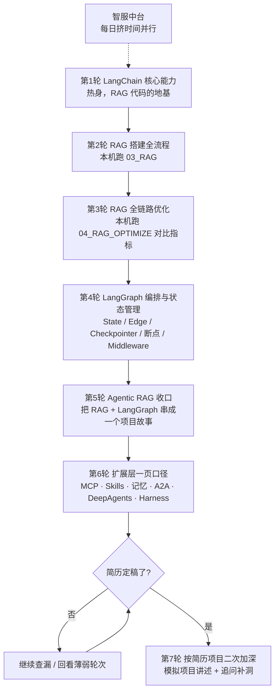

# Agent 复习计划（面试向）

> 建于 2026-10-04。范围：模块一～四 + 模块三下半（Agentic RAG / DeepAgents）。
> 不含模型底层原理（模块五/六已有单独复习计划，见 `学习笔记/模块五-*.md`、`模块六-*.md`）。
> 智服中台每天挤时间并行推进，不并入本计划。
> 本轮目标：先**整体过一遍**，每轮留一页口径；简历定稿后再按项目二次加深、查漏。

## 0. 总流程

每轮固定四件事：**输入**（课件通读，我按小节讲）→ **动手**（跑代码/改一处）→ **面试三件套**（是什么 / 为什么 / 怎么选）→ **产出**（一份 `学习笔记/面试复习-0N-xx.md` 口径卡）。

把 LangChain 放第 1 轮而不是第 3 轮的原因：03_RAG / 04_RAG_OPTIMIZE 全是 LangChain 写的，先把 Runnable、Tool、OutputParser 捋顺，后面两轮读代码不卡壳。

## 0.5 贯穿主线：一条请求的生命线（防知识孤岛）

假想一个「客服问答 Agent 系统」，一条用户请求从进到出经过 7 个站点。之前学过的每个知识点都是某一站的某个版本；七轮复习 = 同一个系统逐轮长大。

| 站 | 名字 | 回答的问题 | 历代版本（学过的东西都挂在这） |
|---|---|---|---|
| 1 | 入口 | 请求怎么进来 | FastAPI（模块四）→ 智服中台 / Agentic_Rag `main.py` |
| 2 | 编排 | 谁决定下一步走哪 | LangChain 链 → LangGraph 图 → Harness 运行时 |
| 3 | 状态与记忆 | 这轮对话记在哪 | LangChain Memory → LangGraph State / Checkpointer / Store → 记忆五范式 |
| 4 | 知识获取 | 答案从哪来 | 朴素 RAG → 全链路优化 → Agentic RAG 多源路由 |
| 5 | 外部能力 | 怎么调外面的东西 | Tool → MCP → A2A（别的 Agent 当工具）→ Skills |
| 6 | 控制与护栏 | 哪里能停、能改 | 断点 / 人工介入 / Middleware → Harness 守卫 |
| 7 | 出口与观测 | 怎么吐出去、怎么看效果 | 流式输出 → 评测 → LangSmith |

**每轮开头先答一句：上一版系统哪里不够用，这轮往哪一站加东西。**

| 轮 | 系统版本 | 这轮动哪几站 | 做完后还不够的地方（引出下一轮） |
|---|---|---|---|
| 1 LangChain | v0 一条链 | 站 2、5 最简版 | 没状态；知识全靠模型记忆 |
| 2 RAG 搭建 | v1 | 补站 4 | 召回不准 |
| 3 RAG 优化 | v2 | 站 4 升级 | 流程写死，不能按情况分支 / 重试 |
| 4 LangGraph | v3 | 站 2、3、6 整体升级成图 | 检索仍是单源一次性 |
| 5 Agentic RAG | v4 | 站 4 装进站 2 的图里，有路由和自纠错 | 工具都是本地函数；单 Agent；没观测 |
| 6 扩展层 | v5 | 站 5 加 MCP / A2A，站 6 加 Harness，站 7 加 LangSmith | 落地工程细节 |
| 智服中台 | 完整版 | 7 站全有 | 复习时当对照物：每轮结束去它代码里找对应那一站 |

**配套产出**：
- `学习笔记/面试复习-00-主线地图.md`：就是上面 7 站。每轮结束往对应站点填一行「这轮加了什么、代码在哪」，复习完它就是整体地图，面试答「怎么设计一个 Agent 系统」直接按它走。
- 每轮口径卡第一句固定写：「我在生命线的第几站，解决了上一版的什么问题」。

## 1. 各轮内容

### 第 1 轮 LangChain 核心能力（热身，短）
- 课件：模块二 `01_LangChain Agent 开发框架/1.LangChain核心模块实战指南.md`、`2.DeepSeek驱动的数据分析Agent实战.md`
- 代码：`ai-example/01_langchain`、`ai-example/02_data_analysis`
- 面试点：Runnable / LCEL 管道怎么拼；ChatModel · PromptTemplate · OutputParser 三件套；Tool 定义与 tool-calling 循环；结构化输出；1.x 的 `create_agent` + Middleware 与旧 AgentExecutor 的区别
- 动手：跑通 `01_langchain/main.py`，改一条链加结构化输出
- 产出：`面试复习-01-LangChain.md`

### 第 2 轮 RAG 搭建全流程（本机跑）
- 课件：模块二 `02_RAG 系统与调优实战/1.RAG核心概念与原理.md`、`2.向量是什么.md`、`3.RAG系统搭建实战.md`
- 代码：`ai-agent/AgenticAI/03_RAG`（`main.py` + `rag.ipynb` + `红楼梦.txt` + Milvus `docker-compose.yml`）
- 面试点：为什么 RAG 而不是微调；加载 → 切分 → Embedding → 入库 → 检索 → 生成 六站各自的选择点；切分策略与 chunk_size / overlap 怎么定；Embedding 模型选型；向量库索引（Flat / IVF / HNSW）与相似度（cosine / IP / L2）；top_k；基础评测指标
- 动手：docker 起 Milvus → 建库 → 问答跑通 → 换一次 chunk_size 看检索结果变化
- 产出：`面试复习-02-RAG搭建.md`

### 第 3 轮 RAG 全链路优化（本机跑，对比指标）
- 课件：模块二 `4.RAG全链路优化：多路召回、查询测优化、Reranker.md` + `数据/test_question.json`、`result.json`
- 代码：`ai-agent/AgenticAI/04_RAG_OPTIMIZE`（`rag.py`、`evaluate.py`、`clean_utils.py`）
- 面试点：按链路分四侧讲，每招都答"解决什么病 / 代价是什么 / 怎么验证"
  - 查询侧：改写、多查询、HyDE
  - 召回侧：BM25 + 向量混合检索、多路召回、RRF 融合
  - 排序侧：Reranker 原理（cross-encoder vs bi-encoder）、放在哪一层
  - 生成侧：上下文压缩、引用溯源
- 动手：先跑 baseline 评测 → 逐个打开优化项 → 记一张指标对比表
- 产出：`面试复习-03-RAG优化.md`（含本机对比表）

### 第 4 轮 LangGraph 流程编排与状态管理
- 课件：模块三 `1. LangGraph 实战/` 三篇 + `5.大模型 Agent 记忆系统设计五大范式.md`
- 代码：`ai-agent/AgenticAI/01_LangGraph`（`react_agent.py`、`plan_execute_agent.py`、`compare_two_modes.py`、`test_redis.py`）、`ai-example/05_langgraph`、`ai-example/07_mem`
- 面试点：
  - 状态：State / TypedDict / Reducer（`add_messages`）；状态怎么在节点间流、怎么局部更新
  - 编排：Node / Edge / 条件边 / Send 并行；子图
  - 持久化：Checkpointer（Memory / SQLite / Redis）+ `thread_id` 做短期记忆；Store 做长期记忆；记忆五范式对应到这两层
  - 控制：interrupt 断点、人工介入、恢复执行；Middleware 各钩子
  - 模式：ReAct vs Plan-and-Execute 怎么选；流式输出 stream modes
- 动手：跑 ReAct vs Plan-and-Execute 对比；给 ReAct 加一个 interrupt 并恢复
- 产出：`面试复习-04-LangGraph.md`

### 第 5 轮 Agentic RAG 收口（串项目故事）
- 课件：模块三 `7.A2A 架构与 Agentic RAG 项目实战/2.Agentic RAG 核心机制.md`、`3.Agentic RAG 多源检索项目实战.md`
- 代码：`Agentic_Rag/app`，按 `state.py → graph.py → tools.py → decision_engine.py → service.py → main.py` 顺序
- 面试点：传统 RAG vs Agentic RAG 的分界；路由 / 多源（Milvus + SQLite + Tavily）/ 自评与重试回路；决策引擎放在图里还是图外；FastAPI 接入与流式
- 动手：跑通 `tests/`，改一条路由规则看图走向变化
- 产出：`面试复习-05-AgenticRAG.md` + 一段 10 分钟项目讲述稿（背景 / 架构 / 难点 / 取舍 / 效果）

### 第 6 轮 扩展层（每个一页，不深挖）
| 主题 | 课件 | 代码 | 口径核心 |
|---|---|---|---|
| MCP | 模块三 `2.MCP指南` | `ai-agent/AgenticAI/06_MCP` | 和 Tool 的边界、三种传输 |
| Skills | 模块三 `3./4.Agent Skills` | 无 | 和 Tool / Prompt 的边界 |
| A2A | 模块三 `7.1 A2A 协议` | `a2a/` | 和 MCP 的分工 |
| DeepAgents + LangSmith | 模块三 `8.x` | `DeepAgent/`、`ai-agent/DeepAgents` | 规划 / 子 Agent / 文件系统；可观测与评估 |
| Multi-Agent 三模式 | 无单独课件 | `Multi-Agent/` | Supervisor / Pipeline / Debate 怎么选 |
| Harness | 模块四 `01-Agent Harness` | `harness_zbt` | 已有两篇笔记，只回看 |
- 产出：`面试复习-06-扩展层.md`

### 第 7 轮 简历定稿后
- 按简历上的项目回到对应轮次二次加深
- 模拟项目讲述 + 追问补洞（到时再定是否开放口述演练）

## 2. 规则
- 每轮先整体过一遍，不在单点上纠缠；查漏留到第 7 轮
- 深度定在面试够用：是什么 / 为什么 / 怎么选；实验细节与操作步骤一笔带过
- 不出题库、不用"面试官会问"格式；每轮产出是口径卡，不是题集
- 课件 .sz / .mp4 视频只在卡住时看，以 md + 代码为主

## 3. 进度锚点
- 2026-10-04：计划建立；加入「一条请求的生命线」7 站主线，`面试复习-00-主线地图.md` 已建空壳。**下一步：第 1 轮 LangChain 核心能力，开头先定位「v0 = 站 2 + 站 5 最简版」，再从 `1.LangChain核心模块实战指南.md` 开始。**
