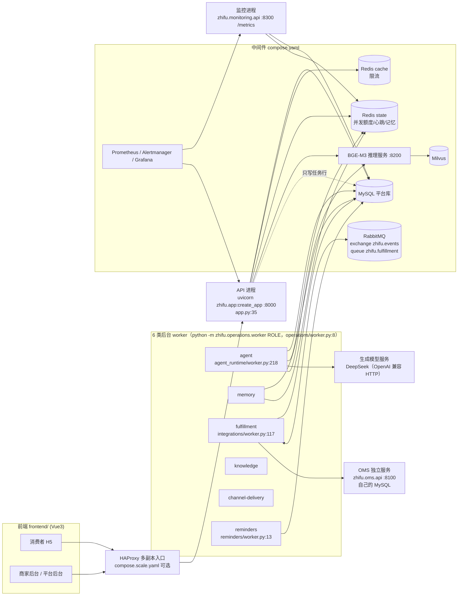
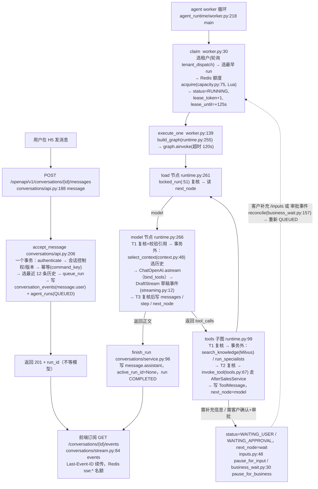
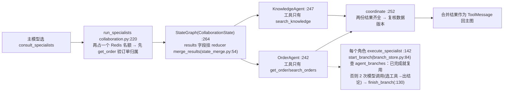
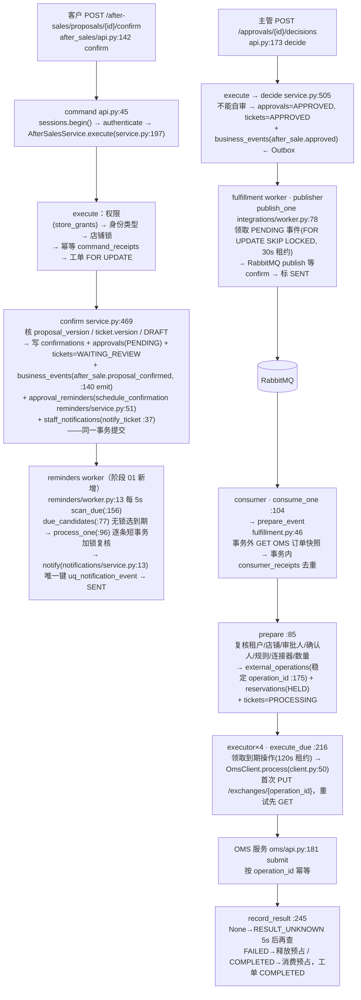

# 智服中台（zhifu-platform）· 企业级客服中台 Agent 系统

> **状态（2026-09-29）**：整体架构地图已备，尚未开始第一课。
> 这份文件 = 读码地图 + 三问笔记（三问正文由我自己填；Q&A 区由 Claude 追加）。

---

## 0. 资料与代码在哪

| 东西 | 位置 | 怎么用 |
|---|---|---|
| 课件网页 | `AI大模型应用开发/1.智服中台…/zhifu-courseware/index.html` | 双击用 Edge/Chrome 打开；`source.html` 是带阶段切换的源码阅读器 |
| 课件正文（md） | 同目录 `articles/lesson-01.md` … `lesson-06.md` | 6 篇 = 5 次直播 + 1 篇简历面试表达；每篇 750~970 行 |
| 补充材料 | `materials/branch-guide.md`（分支与环境操作）、`gpu-deployment-lab.md`（vLLM 部署）、`model-sample-analysis.md` | 第五课/第四课用 |
| **教学代码仓库** | `C:\workspace\zhifu-platform`（VS Code 直接打开这个文件夹） | 已从课件 bundle 拉入 10 个分支 `course/00-…09` 和 10 个 tag `course-00-…09`；`.venv` 已建（Python 3.12，未装 torch） |
| 老师原始远程 | 同仓库的 `origin/main`（3 个提交，与教学分支不同源） | 不用管，教学只看 `course/*` |
| 当前检出 | `course/09-course-delivery`（最终版） | 第一课读 00/01 时执行 `git checkout course/00-handover` |

常用命令（这台机器的 git 没有 `switch`，用 `checkout`）：

```bash
cd /c/workspace/zhifu-platform
git checkout course/00-handover                                   # 切到某阶段
git diff --stat course-00-handover course-01-business-change      # 相邻阶段改了什么
git diff course-01-business-change course-02-parallel-agents -- src/zhifu/modules/agent_runtime/runtime.py
git show course-04-durable-execution:src/zhifu/modules/agent_runtime/branch_store.py
```

> ⚠️ 切分支前 `git status --short` 必须为空。自己的练习代码放到个人分支（如 `study/lesson01`），不要直接改在 `course/*` 上。

---

## 1. 一句话抓住这个项目

**多商家电商的客服 + 售后系统：用户在 H5 聊天 → LangGraph Agent 查订单/查资料/生成换货方案 → 客户确认 → 主管审批 → 后台 worker 经 RabbitMQ 推到外部 OMS 执行换货。**
模型只能"提候选动作"（返回工具名 + 参数），权限、事务、幂等、审批全部由应用代码判定——和智保通"模型提候选，Harness 管裁决"是同一条脊柱。

课程的真正主题是**后端工程**：并发、状态一致、任务恢复、性能测量、流式输出、部署运维。Agent 是载体。

### 课件五层架构图 ↔ 代码目录对照

（图：`zhifu-platform/docs/architecture/zhifu-platform-architecture-v2.png`，标注为"目标架构"）

| 层 | 图上写的 | 代码里实际在哪 | 备注 |
|---|---|---|---|
| 01 接入层 | H5 / 后台 / Webhook / Nginx / FastAPI / SSE | `frontend/`（Vue3+Vite，H5 用 Vant，后台用 Element Plus）；`src/zhifu/app.py` 注册 15 个 router；SSE 在 `modules/conversations/stream.py`；Webhook 在 `modules/channels/` | 多副本入口用的是 HAProxy（`ops/haproxy`），没有 Nginx |
| 02 业务与 Agent 层 | 八个能力格 | `modules/identity`、`channels`、`conversations`、`after_sales`、`knowledge`+`memory`、`agent_runtime`、`billing`（模型与用量）、`integrations`（OMS 集成）；控制面 = `merchant/`（发布 AgentRelease）+ `platform/`；`storefront/` 商城、`notifications/`、`reminders/` | 全部在**同一个进程**里互相直接调用（模块化单体） |
| 03 数据与中间件 | MySQL / Redis×2 / Milvus / RabbitMQ+Celery / OSS | MySQL（`migrations/` 31 个版本）；Redis cache（限流）+ Redis state（并发额度、心跳、记忆）；Milvus + BGE-M3 推理服务（`modules/knowledge/inference.py`，HTTP :8200）；RabbitMQ 用 `aio-pika` 直连（`integrations/worker.py`） | **Celery、OSS 代码里不存在**，只是目标架构 |
| 04 基础设施 | Docker Compose / K8s / vLLM | `Dockerfile`、`compose.yaml`（中间件）、`compose.runtime.yaml`（应用进程）、`compose.scale.yaml`（多副本）；vLLM 材料在课件 `materials/inference/` | K8s、GPU 未实施 |
| 05 运维与交付 | OpenTelemetry / Prometheus / Grafana / pytest | `monitoring/api.py`（独立进程，`/metrics`）+ `core/telemetry.py`；`ops/{prometheus,alertmanager.yml,grafana}`；`operations/release_check.py`；`tests/`（84 个文件，其中 37 个 `*_acceptance.py` 需真实组件） | **OpenTelemetry 不存在** |

---

## 2. 部署拓扑：跑起来的是哪些进程



要点：**API 进程不调模型**。它只把消息和任务写进 MySQL，模型调用全在 agent worker 里；前端靠 SSE 拿进度。

---

## 3. 主链路 A：一条聊天消息怎么变成回复



模型可调的工具（`tools.py:36 DEFINITIONS` + `:46 model_tools`）：`search_orders`、`get_order`、`get_ticket`、`create_exchange_proposal`、`search_knowledge`、`consult_specialists`（发布配置开启协作才有）、`request_clarification`。
**确认、审批、取消、提交 OMS 都不在工具清单里**——模型永远碰不到这些动作。

### 3.1 专业 Agent 协作（第二课，02→04 阶段的增量）



### 3.2 链路 A 的表

| 表 | 谁写 | 装什么 |
|---|---|---|
| `conversations` / `conversation_events` | API + worker | 会话控制权版本、事件序号（SSE 就是读这张表） |
| `agent_runs` | `queue_run`(service.py:20) 写，worker 改 | status / next_node / messages(JSON) / step / lease_token / lease_until / release_snapshot |
| `agent_branches` | `branch_store.py` | 专业角色的请求指纹 + 已完成结果 |
| `model_attempts` / `token_entries` / `token_accounts` | `runtime.py:317`、`budget.py:70 reserve` | 每次模型外呼 STARTED→RECEIVED/UNKNOWN；token 预占与结算 |
| Redis state `agent:active:global*` | `capacity.py` | 全局/交互/后台并发名额（ZSET，150s 过期） |

---

## 4. 主链路 B：确认 → 审批 → 提醒 → 履约 → OMS（不经过模型）



### 4.1 链路 B 的表

| 表 | 关键约束 | 作用 |
|---|---|---|
| `tickets` / `proposal_versions` / `confirmations` / `approvals` | `approvals` 唯一 (proposal_id, proposal_version)；状态 CHECK | 一个方案版本只有一次确认、一次审批 |
| `command_receipts` | PK (tenant, actor, route, key) | Idempotency-Key 幂等：同 key 同 body 返回原响应，不同 body 409 |
| `business_events` | `delivery_status` PENDING→SENT + 租约 | **Outbox**：业务改动和事件同事务写入 |
| `consumer_receipts` | PK (consumer, event_id) | **Inbox**：同一事件不重复消费 |
| `external_operations` / `reservations` | 唯一 (ticket, proposal_version)；`operation_id` 稳定 | 对 OMS 的幂等键 + 库存预占 |
| `approval_reminders` / `staff_notifications` | PK (proposal_id, version)；`uq_notification_event` | 一个方案版本一条提醒；一个收件人一条通知 |

---

## 5. 十个代码阶段的增量地图（学法：00 打底理解型，之后只读 diff）

| 阶段 tag | 课 | 主题 | 新建文件 | 其他改动 | 规模 |
|---|---|---|---|---|---|
| `course-00-handover` | 1 | 接手基线（≈12.5k 行） | — | — | 理解型：懂架构 + 两条主链路 + 能跑通 |
| `course-01-business-change` | 1 | 审批超时提醒 | `modules/reminders/{api,models,schemas,service,worker}.py`、迁移 0028 | `after_sales/service.py`（confirm 里挂 schedule_confirmation）、`app.py`、`operations/worker.py`、`monitoring/api.py` | 12 文件 +478 |
| `course-02-parallel-agents` | 2 | 两个专业 Agent 并行 | `agent_runtime/collaboration.py` | `config.py`、`runtime.py`、`tools.py`、`worker.py` | 5 文件 +309 |
| `course-03-state-consistency` | 2 | 结果合并 reducer + 线程交接实验 | `state_merge.py`、`thread_bridge.py`（只被测试用） | `collaboration.py` | 3 文件 +163 |
| `course-04-durable-execution` | 2 | 分支结果持久化与恢复 | `branch_store.py`、迁移 0029 | `collaboration.py` | 4 文件 +226 |
| `course-05-data-retrieval-performance` | 3 | 订单查询与索引 | 迁移 0030 | `after_sales/models.py`、`tools.py` | 3 文件 +58 |
| `course-06-context-model-performance` | 4 | 上下文预算 + 模型连接复用 | `context.py`、`model_clients.py` | `runtime.py`、`service.py`、`worker.py`、`api.py`、`collaboration.py`、`config.py` | 8 文件 +246 |
| `course-07-streaming-response` | 4 | 草稿流、续传、用量 | `streaming.py`、`model_usage.py` | `runtime.py`、`worker.py`、`conversations/stream.py`、`collaboration.py` | 6 文件 +348 |
| `course-08-deployment-operations` | 5 | 发布检查、停止恢复、备份 | — | **无 src 改动**；`scripts/course/release_exercise.py`、docs、tests | 9 文件 +620 |
| `course-09-course-delivery` | 5 | 用量核对调度 + 交付 | 迁移 0031 | `model_usage.py`、`models.py`、`worker.py` | 4 文件 +84 |

分支 `course/XX` 比 tag `course-XX` 各多 2 个前端提交（"同步H5登录页优化"），**读 diff 一律用 tag**。

---

## 6. 第一课读码路线（🔴 必精读 / 🟡 扫一遍 / 🟢 样板略过）

按程序真实执行顺序，从入口往下：

| 顺序 | 文件:函数 | 标记 | 要拿到的结论 |
|---|---|---|---|
| 1 | `app.py:35 create_app` | 🟡 | 15 个 router 怎么挂；lifespan 建了引擎 + 两套 Redis + 检索客户端 |
| 2 | `core/database.py:20 create_engine`、`core/config.py` | 🟢 | Session 怎么来（`app.state.sessions.begin()`，没有 Depends） |
| 3 | `modules/identity/auth.py:28 AuthContext`、`:50 authenticate`、`:90 authorize_store` | 🔴 | 身份从哪来（服务端验 token），店铺权限查 `store_grants` |
| 4 | `modules/after_sales/api.py:45 command`、`:142 confirm`、`:173 decide` | 🔴 | 事务边界在哪一行 |
| 5 | `modules/after_sales/service.py:197 execute` → `:469 confirm` → `:505 decide` | 🔴 | 检查顺序：权限→身份类型→锁→幂等→业务；哪些表同事务写入 |
| 6 | `modules/after_sales/models.py` | 🟡 | 唯一约束、状态 CHECK |
| 7 | `modules/conversations/api.py:206 accept_message` → `agent_runtime/service.py:20 queue_run` | 🔴 | API 只写任务行就返回 |
| 8 | `agent_runtime/worker.py:30 claim` → `:139 execute_one` | 🔴 | 租约 125s、lease_token、Redis 额度 |
| 9 | `agent_runtime/runtime.py:51 locked_run`、`:255 build_graph`（:414-423 图定义） | 🔴 | 每次提交前复核什么；load/model/tools 三节点循环 |
| 10 | `agent_runtime/tools.py:36 DEFINITIONS`、`:67 invoke_tool` | 🔴 | 工具是怎么复用 AfterSalesService 的 |
| 11 | `operations/worker.py`、`compose.runtime.yaml` | 🟡 | 6 类 worker 怎么起、怎么停 |
| 12 | 阶段 01 diff：`reminders/service.py:51 schedule_confirmation`、`:96 process_one`、`notifications/service.py:13 notify` | 🔴 | 提醒为什么和确认同事务；通知怎么保证唯一 |
| 13 | `tests/test_after_sales.py`、`tests/test_approval_reminders.py` | 🟡 | 测试怎么准备账户/订单 |

第二课起的路线，学到时再在这里追加。

---

## 7. 三问（我自己填）

### 第一课：项目全景与第一次需求交付
- **是什么**：
- **为什么**：
- **怎么做**：

### 第二课：多 Agent 并发、状态同步与任务恢复
- **是什么**：
- **为什么**：
- **怎么做**：

### 第三课：请求、数据库与检索性能优化
- **是什么**：
- **为什么**：
- **怎么做**：

### 第四课：上下文、模型推理与流式响应
- **是什么**：
- **为什么**：
- **怎么做**：

### 第五课：部署、运维与项目交付
- **是什么**：
- **为什么**：
- **怎么做**：

---

## 8. 学习中问过的问题（Claude 追加）

（尚未开始）

---

## 9. 进度锚点

- 2026-09-29：仓库就位、架构地图完成。
- 2026-10-07：改为面试向复习主干（总计划见 `Agent复习计划-面试向.md`）。学法改为：Claude 通读课件按小节讲、三问即止、30 分钟定时盒、先看 diff 再讲原理。**下一步：切 `course/00-handover`，从 lesson-01 §1 开始。**
