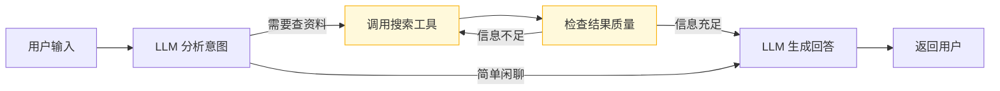

# LangGraph 实战：用图式思维构建大模型 Agent
---

## 一、先搞清楚：为什么需要一张"图"
### 1.1 线性链的困局
如果你用过 LangChain，第一印象大概率是 `Chain`——把 Prompt → LLM → 解析器像水管一样串起来，数据从头流到尾，干净利落。写个 RAG 问答、做个文本摘要，这种 **DAG（有向无环图）** 够用了。

但真实世界的 Agent 场景要复杂得多：

+ 用户说"帮我查一下北京天气，如果下雨就推荐室内活动，否则推荐户外景点"
+ 大模型调了一次搜索工具发现信息不够，得再调一次
+ 调用工具后发现报错了，需要重试或换一个工具
+ 要根据对话历史判断用户意图，决定走哪条处理链路

这些场景有一个共同点：**流程里有循环、有条件分支、有动态决策**。用 Chain 去硬套？不是不行，只是代码会变成一坨嵌套回调，维护起来痛不欲生。



> ▲ 一个典型的 Agent 决策流：条件分支（查资料 vs 闲聊）、循环（信息不足 → 重新搜索），这些用 Chain 写起来非常痛苦。
>

### 1.2 图式思维的解法
LangGraph 的思路很直接：**把整个工作流建模成一张有向图**。

+ 每一步处理 → 图中的 **Node（节点）**
+ 步骤间的流转关系 → **Edge（边）**
+ 系统运行时的中间数据 → 一个全局的 **State（状态）对象**

节点可以读写 State，边可以是无条件直连，也可以根据 State 里的某个字段动态选路。循环？加一条往回指的边就行了。并行分支？让一条边分叉出去就行。

**用 Chain 写 Agent 像是在拼水管，用 LangGraph 写 Agent 像是在画电路图。**

### 1.3 LangGraph 和 LangChain 到底是什么关系
<!-- 这是一张图片，ocr 内容为： -->


一句话：**LangGraph 是 LangChain 生态里的独立模块，专门解决 LangChain 不擅长的事。**

| 维度 | LangChain | LangGraph |
| --- | --- | --- |
| 核心抽象 | Chain（链式流水线） | Graph（有向图） |
| 适合场景 | RAG、摘要、单次 LLM 调用 | 多轮 Agent、工具调用、复杂决策 |
| 控制流 | 单向（DAG） | 任意方向（支持循环） |
| 状态管理 | 链间传参 | 全局 State + Reducer |
| 持久化 | 无内置 | Checkpointer、Store |
| 依赖关系 | 独立使用 | 可独立，也可复用 LangChain 组件 |


** LangChain 和 LangGraph**共享一些底层组件（比如 PromptTemplate、Message 类型），但 LangGraph 的图式编程模型是完全独立的。你甚至可以把 LangGraph 的节点写成纯 Python 函数，一行 LangChain 代码都不碰。

---

## 二、三块积木搭出任意工作流
LangGraph 用三个概念就能描述任意复杂的工作流。理解了它们，后面的代码基本看一眼就懂。

<!-- 这是一个文本绘图，源码为：flowchart TB
    subgraph Core["LangGraph 核心三要素"]
        direction LR
        S[🏗️ State<br/>运行时共享数据] --> N[⚙️ Node<br/>执行逻辑的函数]
        N --> E[🔀 Edge<br/>决定下一步去哪]
        E --> S
    end

    style Core fill:#f8f9fa,stroke:#dee2e6
    style S fill:#d0ebff,stroke:#74c0fc
    style N fill:#d3f9d8,stroke:#69db7c
    style E fill:#fff9db,stroke:#fab005 -->


> ▲ 三要素的闭环关系：节点产出新 State → Edge 根据 State 决定下一个 Node → 循环往复直到 END。
>

### 2.1 State：全局共享的运行时数据
State 本质上就是一个 Python 字典（或 TypedDict / Pydantic BaseModel），存储整个工作流运行时的所有数据。**所有节点都能读、都能写**——这是 LangGraph 的设计特性，不是 Bug。

这种设计让每个节点天然拥有"上帝视角"：大模型节点能看到用户的历史消息，路由节点能拿到上一步的计算结果。代价是如果两个并行节点同时改了同一个字段，你得用 Reducer 来规定合并规则（后面会细讲）。

### 2.2 Node：真正干活的函数
每个 Node 是一个 Python 函数，签名为：

```python
def my_node(state: StateType) -> dict:
    """接收当前 State，返回一个部分更新的字典"""
    result = do_something(state)
    return {"field_to_update": result}
```

几个要点：

+ **输入**：收到的是完整的当前 State
+ **输出**：只返回你**想要更新的字段**，没返回的字段保持不变
+ **可以做的事情**：调 LLM、调 API、查数据库、写文件……没有限制，就是个普通 Python 函数

### 2.3 Edge：决定"下一步去哪"的路由
Edge 分两种：

**普通边（Normal Edge）**：无条件直连，永远从 A 走到 B。

```python
builder.add_edge("node_a", "node_b")  # 执行完 A 一定走 B
```

**条件边（Conditional Edge）**：根据 State 动态决定目标。

```python
def router(state: StateType) -> str:
    """返回下一个节点的名字"""
    if state["score"] > 0.8:
        return "high_quality_handler"
    return "low_quality_handler"

builder.add_conditional_edges("classifier", router, {
    "high_quality_handler": "high_quality_handler",
    "low_quality_handler": "low_quality_handler",
})
```

<!-- 这是一张图片，ocr 内容为： -->


START 和 END 是两个特殊的虚拟节点名，分别代表"图的入口"和"图的出口"。任何图都至少有一条从 START 出发、最终到达 END 的路径。

---

## 三、动手：从零写出第一个图
### 3.1 最简图：一个节点跑到底
先从最简单的开始：定义一个 State，写一个节点函数，用图把它们串起来。

```python
from langgraph.graph import StateGraph, START, END
from typing import TypedDict

# ============================================================
# 第 1 步：定义 State —— 描述整个工作流在运行时的数据结构
# ============================================================
class CounterState(TypedDict):
    """工作流的状态：一个简单的计数器"""
    count: int           # 当前计数

# ============================================================
# 第 2 步：写节点函数 —— 每个节点做一件事
# ============================================================
def step_one(state: CounterState) -> dict:
    """第一个处理节点：count + 1"""
    new_count = state["count"] + 1
    return {
        "count": new_count
    }


def step_two(state: CounterState) -> dict:
    """第二个处理节点：count * 2"""
    new_count = state["count"] * 2
    return {
        "count": new_count
    }


# ============================================================
# 第 3 步：创建 StateGraph 对象
# ============================================================
builder = StateGraph(CounterState)

# ============================================================
# 第 4 步：注册节点，连接边
# ============================================================
builder.add_node("step_one", step_one)       # 把函数注册为节点
builder.add_node("step_two", step_two)

builder.add_edge(START, "step_one")          # START → step_one
builder.add_edge("step_one", "step_two")     # step_one → step_two
builder.add_edge("step_two", END)            # step_two → END

# ============================================================
# 第 5 步：编译图（编译后才可执行）
# ============================================================
graph = builder.compile()

# ============================================================
# 第 6 步：执行
# ============================================================
result = graph.invoke({"count": 1, "log": []})
print(result)
# 输出: {'count': 4}

#显示图结构
from IPython.display import Image,display
display(Image(graph.get_graph().draw_mermaid_png()))
```

> ▲ 最简图的结构：START → step_one → step_two → END，数据沿边单向流动。
>

**关键点总结：**

+ `StateGraph(CounterState)` —— 告诉 LangGraph 你的 State 长什么样
+ `add_node("名字", 函数)` —— 注册节点，名字是后续连边用的标识符
+ `add_edge(A, B)` —— 在 A 和 B 之间拉一条边
+ `compile()` —— **编译图**，在此之前图只是个"模板"，编译后才是可执行的实例
+ `invoke({"count": 1, ...})` —— 传入初始 State，同步执行并返回最终 State

### 3.2 加上条件分支：让图学会做判断
真实场景里很少有"一条路走到黑"的工作流。下面写一个有循环 + 条件判断的图：反复累加计数器，直到超过阈值才停。

```python
from langgraph.graph import StateGraph, START, END
from typing import TypedDict


class CountState(TypedDict):
    count: int


def increment(state: CountState) -> dict:
    """每次调用 count + 1"""
    print(f"当前 count = {state['count']}，执行 +1")
    return {"count": state["count"] + 1}


def router(state: CountState) -> str:
    """
    条件路由函数 —— LangGraph 的"方向控制器"

    返回 END 意味着图执行结束
    返回节点名意味着跳转到那个节点继续执行

    注意：返回的必须是节点名（字符串），不是函数引用
    """
    if state["count"] >= 5:
        print(f"count 已达到 {state['count']}，停止循环")
        return END          # → 结束
    else:
        print(f"count = {state['count']}，继续循环")
        return "increment"  # → 回到 increment 节点


# 构图
builder = StateGraph(CountState)
builder.add_node("increment", increment)

builder.add_edge(START, "increment")

# 条件边：从 increment 出发，根据 router 的返回值决定走哪个目标
# 第三个参数是路由目标映射 —— 告诉 LangGraph router 可能返回哪些值
builder.add_conditional_edges(
    "increment",                    # 从哪个节点出发
    router,                         # 用哪个函数决定方向
    {"increment": "increment", END: END},  # 返回值 → 目标节点的映射
)

graph = builder.compile()
result = graph.invoke({"count": 1})
print(f"最终结果: {result}")

#显示图结构
from IPython.display import Image,display
display(Image(graph.get_graph().draw_mermaid_png()))
```

> ▲ 条件边形成了一个自循环：只要 count < 5，就不断回到 increment；达到 5 后跳到 END。
>

`add_conditional_edges`** 的第三个参数是"路由白名单"。** 如果你的 router 返回了一个不在白名单里的节点名，LangGraph 会抛异常——这是个防御性设计，防止拼写错误导致图跑到不存在的节点去。

---

## 四、状态管理的门道
如果你只写一个节点的图，State 怎么更新都无所谓。但一旦节点多了、有了并行分支和循环，State 的更新方式就变成了一个必须认真对待的问题。

### 4.1 两个流派：覆盖 vs 追加
LangGraph 的 State 更新默认是**覆盖**：节点返回什么，State 字段就变成什么。

```python
# 覆盖模式（默认行为）
class OverwriteState(TypedDict):
    items: list[str]

def node_a(state):
    return {"items": ["a1", "a2"]}    # State.items → ["a1", "a2"]

def node_b(state):
    return {"items": ["b1"]}          # State.items → ["b1"]（覆盖了 a 的结果）
```

但在很多场景里，我们希望后来节点的结果**追加**到已有数据后面，而不是覆盖：

+ 聊天历史：每条新消息追加到 messages 列表末尾
+ 日志记录：每个步骤的日志追加到日志列表
+ 工具调用结果：每个工具返回的结果累加

这时候就需要 `Annotated` 注解了。

### 4.2 Annotated 注解：声明式定义更新规则
Python 的 `Annotated[类型, 元数据]` 可以给类型打标签。LangGraph 利用这个机制让你声明**字段合并函数（Reducer）**。

```python
from typing import Annotated, TypedDict
from operator import add
from langgraph.graph import StateGraph, START, END


class AppendState(TypedDict):
    # Annotated[list, add] 告诉 LangGraph：
    # 当多个节点都要更新 items 时，用 add（即 list1 + list2）合并
    items: Annotated[list[str], add]


def node_x(state: AppendState) -> dict:
    return {"items": ["x1", "x2"]}

def node_y(state: AppendState) -> dict:
    return {"items": ["y1"]}

def node_z(state: AppendState) -> dict:
    return {"items": ["z1", "z2", "z3"]}


builder = StateGraph(AppendState)
builder.add_node("x", node_x)
builder.add_node("y", node_y)
builder.add_node("z", node_z)
builder.add_edge(START, "x")
builder.add_edge("x", "y")
builder.add_edge("y", "z")
builder.add_edge("z", END)

graph = builder.compile()
result = graph.invoke({"items": ["init"]})
print(result["items"])
# 输出: ['init', 'x1', 'x2', 'y1', 'z1', 'z2', 'z3']
#         ↑ 初始值  ↑ x 节点  ↑ y 节点  ↑ z 节点 — 全部拼接在一起

#显示图结构
from IPython.display import Image,display
display(Image(graph.get_graph().draw_mermaid_png()))
```

`Annotated[list[str], add]`** 的底层逻辑：**

+ `add` 来自 Python 标准库 `operator.add`，对列表来说 `add(a, b)` 等价于 `a + b`
+ 每次节点返回 `{"items": [...]}` 时，LangGraph 自动执行 `current_items + new_items`
+ 多个节点之间不会互相覆盖，新内容追到末尾

### 4.3 MessagesState：专为对话场景设计
对话场景是 LangGraph 最高频的应用场景。LangGraph 为此提供了一个预置的 State 类型——`MessagesState`。

```python
from langgraph.graph.message import MessagesState
from langgraph.graph import StateGraph, START, END
from langchain_openai import ChatOpenAI
from langchain_core.messages import HumanMessage

# MessagesState 内部已经定义了 messages 字段，且用 add_messages 做 Reducer
# 等价于：messages: Annotated[list, add_messages]

model = ChatOpenAI(
    model="deepseek-v4-flash",
    api_key="your-api-key",
    base_url="https://api.deepseek.com",
)


def chat_node(state: MessagesState) -> dict:
    """调用 LLM，返回的消息会自动追加到历史里"""
    response = model.invoke(state["messages"])
    return {"messages": [response]}   # add_messages 会处理去重和合并


builder = StateGraph(MessagesState)
builder.add_node("chat", chat_node)
builder.add_edge(START, "chat")
builder.add_edge("chat", END)

graph = builder.compile()

# 执行：传入一条 HumanMessage
result = graph.invoke({"messages": [HumanMessage(content="你好，我是小李")]})
print(result["messages"][-1].content)
```

**MessagesState 的强大之处**：你在 State 里只加了 messages 字段，但整个对话历史都被自动维护了。因为 `add_messages` Reducer 保证了新消息追加到历史末尾（而不是覆盖），所以 LLM 每次都能看到之前的上下文。

如果你除了 messages 还需要其他字段，直接继承 MessagesState 扩展就行：

```python
class MyAgentState(MessagesState):
    user_name: str          # 用户昵称
    session_id: str         # 会话 ID
    tool_call_count: int    # 工具调用次数统计
```

### 4.4 add vs add_messages：差的不止是名字
这俩名字太像了，很多新手在这里掉坑。一句话说清楚：

| 对比维度 | `operator.add` | `add_messages` |
| --- | --- | --- |
| 来源 | Python 标准库 | `langgraph.graph.message` |
| 行为 | 纯拼接 `list1 + list2` | 智能合并 |
| 去重 | ❌ 不去重 | ✅ 相同 ID 的消息会替换旧消息 |
| 类型转换 | ❌ 不转换 | ✅ 自动将 `(role, content)` 元组转为标准 Message 对象 |
| 适用场景 | 简单字符串/数字列表 | **对话消息列表** |


```python
from operator import add
from typing import Annotated, TypedDict
from langgraph.graph.message import add_messages

# ❌ 用 add 存消息 —— 相同消息会重复出现，没有去重能力
class BadState(TypedDict):
    messages: Annotated[list, add]

# ✅ 用 add_messages 存消息 —— 专为 LangChain Message 设计
class GoodState(TypedDict):
    messages: Annotated[list, add_messages]
```

**简单说：凡是存聊天消息，用 **`add_messages`**；其他场景用 **`add`** 或自己写的 Reducer。**

### 4.5 写一个自己的 Reducer
有时候追加和覆盖都不够用，你想要更精细的控制。比如：大部分时候追加列表，但偶尔需要"全量替换"。自己写一个 Reducer 函数就行。

```python
from typing import Annotated, TypedDict
from langgraph.graph import StateGraph, START, END


class ReplaceableList(list):
    """
    自定义列表子类，带一个 replace 标记。

    用法：
    - 普通 list → 追加到已有数据
    - ReplaceableList([...], replace=True) → 全量覆盖已有数据
    """
    def __init__(self, *args, replace: bool = False, **kwargs):
        super().__init__(*args, **kwargs)
        self.replace = replace


def smart_merge(current: list, incoming: list) -> list:
    """
    智能合并函数 —— 作为自定义 Reducer 传给 Annotated。

    签名必须满足 (旧值, 新值) → 合并后的值。
    LangGraph 会在节点返回时自动调用此函数。
    """
    # 检查传入的是否是 ReplaceableList 且标记了 replace=True
    if isinstance(incoming, ReplaceableList) and getattr(incoming, "replace", False):
        return list(incoming)         # 覆盖模式：直接用新数据替换
    return current + list(incoming)   # 追加模式：新数据拼到旧数据后面


class SmartState(TypedDict):
    items: Annotated[list[str], smart_merge]  # ← 使用自定义 Reducer


def add_some(state: SmartState) -> dict:
    """普通列表 → 追加"""
    return {"items": ["apple", "banana"]}

def replace_all(state: SmartState) -> dict:
    """带 replace 标记的列表 → 全覆盖"""
    new_list = ReplaceableList(["reset_data"])
    new_list.replace = True
    return {"items": new_list}

def add_more(state: SmartState) -> dict:
    """再追加一条"""
    return {"items": ["cherry"]}


builder = StateGraph(SmartState)
builder.add_node("add_some", add_some)
builder.add_node("replace_all", replace_all)
builder.add_node("add_more", add_more)
builder.add_edge(START, "add_some")
builder.add_edge("add_some", "replace_all")
builder.add_edge("replace_all", "add_more")
builder.add_edge("add_more", END)

graph = builder.compile()
result = graph.invoke({"items": ["init"]})
print(result["items"])
# 输出: ['reset_data', 'cherry']
#        ↑ replace_all 把 init+apple+banana 全抹了
#                            ↑ add_more 在 reset_data 后面追加 cherry
```

**Reducer 函数的本质**：它是一段"冲突解决逻辑"。当多个执行路径汇合时，或者同一字段被反复更新时，Reducer 决定最终存什么。LangGraph 的 `Annotated` 让你用声明式的方式指定 Reducer，比在每个节点里写 if-else 干净得多。

---

## 五、图的组合与拆分
### 5.1 子图：把复杂逻辑装进黑盒
子图就是把一组相关步骤封装成一个可复用的"黑盒节点"，在主图里当普通节点使用。 就像编程中把一段逻辑抽成函数。

以这个"泡咖啡"案例为例：

1. 子图 coffee_subgraph 封装了"研磨咖啡豆 → 冲泡咖啡 → 加牛奶"三个步骤，它内部有自己的状态流转，对外只暴露出一个节点接口。
2. 主图 只关心宏观流程："拿出杯子 → 做咖啡（子图） → 享用"，不需要知道做咖啡内部有多少步。

使用子图有两个关键好处：

1. 封装与复用：泡咖啡的逻辑可以被多个主流程复用，修改子图内部不影响主图。
2. 关注点分离：主图保持简洁，子图内部细节独立管理。

<!-- 这是一张图片，ocr 内容为： -->


```python
from typing import Annotated, TypedDict
from operator import add
from langgraph.graph import StateGraph, START, END


# ============================================================
# 定义状态
# ============================================================
class CoffeeState(TypedDict):
    logs: Annotated[list[str], add]  # 记录每一步操作

# 子图使用独立的状态 schema，避免共享主图的 logs
# 子图只关心自己内部产生的日志
class SubCoffeeState(TypedDict):
    sub_logs: Annotated[list[str], add]


# ============================================================
# 子图：泡咖啡（内部3个步骤）
# ============================================================
def grind_beans(state: SubCoffeeState) -> dict:
    return {"sub_logs": ["1. 研磨咖啡豆"]}

def brew_coffee(state: SubCoffeeState) -> dict:
    return {"sub_logs": ["2. 冲泡咖啡"]}

def add_milk(state: SubCoffeeState) -> dict:
    return {"sub_logs": ["3. 加牛奶"]}

# 构建子图 — 使用独立的 SubCoffeeState
coffee_builder = StateGraph(SubCoffeeState)
coffee_builder.add_node("grind", grind_beans)
coffee_builder.add_node("brew", brew_coffee)
coffee_builder.add_node("add_milk", add_milk)

coffee_builder.add_edge(START, "grind")
coffee_builder.add_edge("grind", "brew")
coffee_builder.add_edge("brew", "add_milk")
coffee_builder.add_edge("add_milk", END)

coffee_subgraph = coffee_builder.compile()


# ============================================================
# 主图：完整泡咖啡流程
# ============================================================
def prepare_cup(state: CoffeeState) -> dict:
    return {"logs": ["开始：拿出杯子"]}

def make_coffee(state: CoffeeState) -> dict:
    # 子图使用自己的状态，初始 sub_logs 为空
    sub_result = coffee_subgraph.invoke({"sub_logs": []})
    # 把子图的 sub_logs 映射回主图的 logs
    return {"logs": sub_result["sub_logs"]}

def enjoy(state: CoffeeState) -> dict:
    return {"logs": ["完成：喝咖啡 ☕"]}

# 构建主图
main_builder = StateGraph(CoffeeState)
main_builder.add_node("prepare", prepare_cup)
main_builder.add_node("make", make_coffee)  # 使用包装函数（内部做状态映射）
main_builder.add_node("enjoy", enjoy)

main_builder.add_edge(START, "prepare")
main_builder.add_edge("prepare", "make")
main_builder.add_edge("make", "enjoy")
main_builder.add_edge("enjoy", END)

main_graph = main_builder.compile()


# ============================================================
# 运行
# ============================================================
if __name__ == "__main__":
    result = main_graph.invoke({"logs": []})
    
    for step in result["logs"]:
        print(step)
```

### 5.2 Send 分发：一个节点变出 N 个分身
这个功能在 LangGraph 里叫 **Send API**，本质上是一个动态 fan-out 机制：从一个节点派生出多个并行任务，每个任务拿到不同的输入，各自独立执行，最后把结果汇总。

最典型的场景：用户说"帮我对比一下苹果、华为和小米的旗舰机型"。你希望并行查询三个品牌的资料，而不是一个接一个查。

```python
"""
图的拓扑结构：

            START
              │
              ▼
        [parse_query]            ← 节点：解析用户输入，提取品牌列表
              │
              ▼
        route_to_research        ← 条件边路由函数：返回 N 个 Send
              │
              ├─ Send("research_brand", {brand: "苹果"})
              ├─ Send("research_brand", {brand: "华为"})    ← 三个并行
              └─ Send("research_brand", {brand: "小米"})
              │
              ▼  (并行执行)
        [research_brand] × 3     ← 每个品牌独立研究
              │
              ▼  (全部完成后汇总)
        [summarize]              ← 节点：汇总所有报告，输出对比
              │
              ▼
             END
"""
from typing import Annotated, TypedDict
from operator import add
from langgraph.graph import StateGraph, START, END
from langgraph.types import Send


# ══════════════════════════════════════════════════════════════
#  State 定义
# ══════════════════════════════════════════════════════════════
class CompareState(TypedDict):
    """手机对比任务的 State"""
    query: str                                # 用户的原始问题
    brands: list[str]                         # 从 query 中解析出的品牌列表
    reports: Annotated[list[str], add]        # 每个品牌的研究报告（add reducer 自动合并）
    comparison: str                           # 最终的对比总结


# ══════════════════════════════════════════════════════════════
#  节点函数
# ══════════════════════════════════════════════════════════════
def parse_query(state: CompareState) -> dict:
    """
    节点 ①：解析用户输入，提取出要对比的品牌列表。

    实际场景中这里会用 LLM 做实体提取，这里直接硬编码模拟。
    """
    query = state["query"]
    print(f"[parse] 收到问题: {query}")

    # 模拟 LLM 解析：从自然语言中提取品牌名称
    brands = ["苹果", "华为", "小米"]
    print(f"[parse] 解析出 {len(brands)} 个品牌: {brands}")

    return {"brands": brands}


def research_brand(state: CompareState) -> dict:
    """
    节点 ②：研究单个品牌（被 Send 并行调用的目标节点）。

    它不知道总共有几个品牌，也不关心其他品牌在做什么——
    只专注于自己拿到的这一个。

    实际场景中这里会调搜索引擎 API 或 LLM，这里用数据模拟。
    """
    brand = state["brands"][0]  # Send 保证这里只有一个品牌

    # 模拟：查询该品牌的旗舰机信息
    phone_db = {
        "苹果": "iPhone 16 Pro Max | A18 Pro 芯片 | 6.9吋 OLED | 4K 120fps 视频 | iOS 18",
        "华为": "Mate 70 Pro+ | 麒麟 9100 | 6.8吋 OLED | 物理可变光圈 | 鸿蒙 NEXT",
        "小米": "小米 15 Ultra | 骁龙 8 Gen4 | 6.73吋 AMOLED | 徕卡光学 | 澎湃 OS 2.0",
    }

    info = phone_db.get(brand, f"{brand}旗舰机信息暂缺")
    report = f"【{brand}】{info}"

    print(f"  [research] 并行查询 [{brand}] -> {info}")
    return {"reports": [report]}  # add reducer 自动拼到总 reports 里


def summarize(state: CompareState) -> dict:
    """
    节点 ③：所有品牌都研究完了，汇总生成对比结论。

    实际场景中这里会把所有 reports 喂给 LLM，让它生成对比分析。
    """
    print(f"\n[summarize] 开始汇总 {len(state['reports'])} 份报告...")

    # 模拟 LLM 生成的对比总结
    comparison = (
        "━━━━━━━━━━━━━━━━━━━━━━━━━━━━━━━━━━━━\n"
        "         >> 旗舰手机对比总结\n"
        "━━━━━━━━━━━━━━━━━━━━━━━━━━━━━━━━━━━━\n\n"
    )
    for report in state["reports"]:
        comparison += f"  {report}\n"

    comparison += (
        "\n━━━━━━━━━━━━━━━━━━━━━━━━━━━━━━━━━━━━\n"
        "[总结] 三款旗舰各有千秋 --\n"
        "  苹果 iPhone 16 Pro Max：视频拍摄王者，生态闭环体验最佳\n"
        "  华为 Mate 70 Pro+：影像系统物理可变光圈独树一帜\n"
        "  小米 15 Ultra：徕卡光学加持，性价比旗舰首选\n"
        "━━━━━━━━━━━━━━━━━━━━━━━━━━━━━━━━━━━━\n"
    )

    return {"comparison": comparison}


# ══════════════════════════════════════════════════════════════
#  路由函数 —— 核心！返回 Send 列表而不是 dict
# ══════════════════════════════════════════════════════════════
def route_to_research(state: CompareState):
    """
    ★ Send API 的核心：条件边路由函数 ★

    关键规则：
    - 这个函数只能放在 add_conditional_edges 里，不能放进 add_node
    - 普通节点返回 dict（更新 state）
    - 路由函数返回 Send 列表（创建并行任务）或字符串（END / 节点名）

    思想：几个品牌 → 发几个 Send → 启动几次 research_brand

            return [
                Send("research_brand", {"brands": ["苹果"]}),   ─┐
                Send("research_brand", {"brands": ["华为"]}),   ─┤ 全部并行执行
                Send("research_brand", {"brands": ["小米"]}),   ─┘
            ]

    每个 Send 的两个参数：
      参数 1: 目标节点名 —— "派给谁做"
      参数 2: 此分支专属的 state —— "这个任务要什么数据"
    """
    if not state["brands"]:
        return END

    return [
        Send("research_brand", {"brands": [brand]})
        for brand in state["brands"]
    ]


# ══════════════════════════════════════════════════════════════
#  构图
# ══════════════════════════════════════════════════════════════
builder = StateGraph(CompareState)

builder.add_node("parse_query", parse_query)
builder.add_node("research_brand", research_brand)
builder.add_node("summarize", summarize)

# 边
builder.add_edge(START, "parse_query")
builder.add_conditional_edges("parse_query", route_to_research)  # 路由 → 动态 fan-out
builder.add_edge("research_brand", "summarize")                  # 所有并行结果汇聚到 summarize
builder.add_edge("summarize", END)

graph = builder.compile()


# ══════════════════════════════════════════════════════════════
#  运行
# ══════════════════════════════════════════════════════════════
if __name__ == "__main__":
    result = graph.invoke({
        "query": "帮我对比一下苹果、华为和小米的旗舰机型",
        "brands": [],
        "reports": [],
        "comparison": "",
    })

    print(result["comparison"])

```

<font style="color:#DF2A3F;">Send 就是运行时的"复制粘贴"：把同一个节点复制 N 份，每份给不同参数，同时跑。</font>

核心规则

1. Send 只能出现在 add_conditional_edges 的路由函数返回值里
2. 路由函数不能同时作为 add_node 的节点函数
3. 返回 Send 列表则并行执行，返回空列表或 END 则停止
4. 并行结果靠 State 里的 Annotated + reducer 自动合并

什么时候用 Send？

1.  用 Send： 并行任务数量编译时未知，运行时才知道（比如用户说了几个品牌就查几个）
2.  不用 Send： 并行任务数量写代码时已经确定（比如永远 3 条分支，直接画 3 条边即可）

---

## 六、给 Agent 装上记忆
没有记忆的 Agent 就像一条金鱼，上一轮对话的内容下一轮就忘了。LangGraph 内置了一套完整的持久化方案来解决这个问题。

### 6.1 Checkpointer：会话级短期记忆
Checkpointer（检查点机制）是 LangGraph 中负责持久化图执行状态的核心组件。它为Agent提供了"记忆能力"。Checkpointer 的核心思想很简单：**在图的每个节点执行完成后，自动保存一个 State 快照**。同一个 thread_id 的后续调用会从这个快照继续，而不是从零开始。

```python
from langgraph.checkpoint.memory import InMemorySaver
from langgraph.graph import StateGraph, START, END,MessagesState
from langchain_openai import ChatOpenAI
from langchain_core.messages import HumanMessage

# 初始化模型
model = ChatOpenAI(
    model="deepseek-v4-flash",
    api_key="your_api_key_here",
    base_url="https://api.deepseek.com",
)


def chat(state: MessagesState) -> dict:
    """调用 LLM 生成回复"""
    response = model.invoke(state["messages"])
    return {"messages": [response]}


# 构建最简聊天图
builder = StateGraph(MessagesState)
builder.add_node("chat", chat)
builder.add_edge(START, "chat")
builder.add_edge("chat", END)

# ★ 关键：compile 时传入 checkpointer
memory = InMemorySaver()
graph = builder.compile(checkpointer=memory)

# ============================================================
# 第一次对话
# ============================================================
config = {"configurable": {"thread_id": "session-001"}}
result = graph.invoke(
    {"messages": [HumanMessage(content="你好，我叫老王，是一名 Python 程序员")]},
    config=config,   # ← 必须传入 config 来标识会话
)
print("第一轮:", result["messages"][-1].content)

# ============================================================
# 第二次对话（同一个 thread_id）
# ============================================================
result = graph.invoke(
    {"messages": [HumanMessage(content="我叫什么名字？做什么工作？")]},
    config=config,   # ← 同一个 thread_id，自动加载之前的记忆
)
print("第二轮:", result["messages"][-1].content)
# 模型能正确回答"你叫老王，是 Python 程序员"——因为它看到了第一轮的完整历史
```

<!-- 这是一个文本绘图，源码为：sequenceDiagram
    participant User as 用户
    participant Graph as LangGraph
    participant Check as Checkpointer
    participant LLM as DeepSeek

    User->>Graph: "我叫老王" (thread_id=001)
    Graph->>LLM: 调用模型
    LLM->>Graph: 回复
    Graph->>Check: 保存快照 ✍️

    Note over Check: 快照 #1: messages=[Hi, 我叫老王, 你好老王...]

    User->>Graph: "我叫什么？" (thread_id=001)
    Graph->>Check: 加载快照 📂
    Check->>Graph: 快照 #1
    Graph->>LLM: 调用模型（含历史消息）
    LLM->>Graph: "你叫老王"
    Graph->>Check: 保存新快照 ✍️

    Note over Check: 快照 #2: messages=[...再加两轮] -->


> ▲ 同一个 thread_id 的多次调用共享 Checkpointer 中的历史快照，实现"记忆"效果。
>

### 6.2 线程隔离机制
不同的 `thread_id` 之间**完全隔离**。这是设计意图，不是 Bug——每个用户/每个会话应该有独立的记忆空间。

```python
# 用老王的名义问
result_a = graph.invoke(
    {"messages": [HumanMessage(content="我叫什么？")]},
    config={"configurable": {"thread_id": "session-001"}},  # 老王的 thread
)
print("session-001:", result_a["messages"][-1].content)  # "你叫老王"（有记忆）

# 换一个 thread_id
result_b = graph.invoke(
    {"messages": [HumanMessage(content="我叫什么？")]},
    config={"configurable": {"thread_id": "session-002"}},  # 全新的 thread
)
print("session-002:", result_b["messages"][-1].content)  # "我不知道"（没记忆）
```

**实用建议**：`thread_id` 通常映射为 `user_id + session_id`。比如 `f"user_{user_id}:chat_{session_id}"`，这样同用户的多次对话各有独立记忆空间。

### 6.3 历史快照：回溯每一步
`get_state_history()` 能让你查看每次调用中，图在每个节点执行完后的 State 快照。调试神器。

```python
# 查看 session-001 的所有历史快照
history = list(graph.get_state_history(
    config={"configurable": {"thread_id": "session-001"}}
))

# history 按时间倒序排列，[0] 是最新状态，[-1] 是最早的状态
for i, snapshot in enumerate(history):
    msg_count = len(snapshot.values.get("messages", []))
    next_node = snapshot.next   # 快照之后接下来要执行的节点（如果是空元组表示已结束）
    print(f"快照 {i + 1}: {msg_count} 条消息, 下一个节点: {next_node}")

# 输出示例：
# 快照 1: 6 条消息, 下一个节点: ()        ← 最终状态（已执行完毕）
# 快照 2: 5 条消息, 下一个节点: ('chat',)  ← chat 节点执行前
# 快照 3: 4 条消息, 下一个节点: ('chat',)  ← 第二轮调用的 chat 执行前
# 快照 4: 2 条消息, 下一个节点: ('chat',)  ← 第一轮调用的 chat 执行前
# 快照 5: 1 条消息, 下一个节点: ('chat',)  ← 初始输入后的状态
```

### 6.4 生产级持久化：RedisSaver
`InMemorySaver` 只适用于开发和测试——进程重启后所有记忆都没了。生产环境应该用 Redis 做持久化。

```python
#安装依赖:uv pip install langgraph-checkpoint-redis -i https://pypi.tuna.tsinghua.edu.cn/simple
from langgraph.checkpoint.redis import RedisSaver
from langgraph.graph import StateGraph, START, END, MessagesState
from langchain_openai import ChatOpenAI

model = ChatOpenAI(
    model="deepseek-v4-flash",
    api_key="your_api_key_here",
    base_url="https://api.deepseek.com",
)


def chat(state: MessagesState) -> dict:
    response = model.invoke(state["messages"])
    return {"messages": [response]}


# 使用 Redis 持久化
REDIS_URL = "redis://localhost:6379/0"

with RedisSaver.from_conn_string(REDIS_URL) as checkpointer:
    # checkpointer.setup()  # 首次使用需要执行一次初始化

    builder = StateGraph(MessagesState)
    builder.add_node("chat", chat)
    builder.add_edge(START, "chat")
    builder.add_edge("chat", END)

    graph = builder.compile(checkpointer=checkpointer)

    config = {"configurable": {"thread_id": "user-42"}}
    result = graph.invoke(
        {"messages": [{"role": "user", "content": "记住：我最喜欢的语言是 Python"}]},
        config=config,
    )
    print(result["messages"][-1].content)
    # 即使进程重启，只要 Redis 还在，记忆就不会丢
```

```python
import redis
# 连接到本地Redis实例
r = redis.Redis(host='localhost', port=6379, db=0)
# 查看所有键
keys = r.keys('*')
print(keys)
```

### 6.5 Store：跨会话的长期记忆
Checkpointer 解决的是**同一会话内**的记忆；**Store** 解决的是**跨会话**的记忆。比如：

+ 用户 A 上周问过"推荐 Python 入门书"，这周再来问"上次那本读完了，有没有进阶的？"——你需要记住上周的话题
+ 用户说"记住我叫老王"——下次他开新会话，Agent 也应该知道他是老王

```python
from langgraph.store.memory import InMemoryStore
import uuid

# ============================================================
# Store 的数据模型：
# store
# └── namespace: ("memories", "user_42")    ← 命名空间，按用户/业务隔离
#     ├── key: "uuid-1"                     ← 唯一键，通常用 UUID
#     │   └── value: {"data": "..."}        ← 实际存储的值
#     └── key: "uuid-2"
#         └── value: {"data": "..."}
# ============================================================

store = InMemoryStore()

# 写入记忆
ns = ("memories", "user_42")
store.put(ns, str(uuid.uuid4()), {"data": "用户叫老王，是 Python 程序员"})
store.put(ns, str(uuid.uuid4()), {"data": "用户偏好简洁的代码风格"})
store.put(ns, str(uuid.uuid4()), {"data": "用户最近在学 LangGraph"})

# 语义搜索记忆（Store 内置了向量搜索能力，不需要额外的向量数据库）
results = store.search(ns, query="用户的名字和工作")
for item in results:
    print(f"  [{item.key}] {item.value['data']}")
# 输出：
#   [uuid-1] 用户叫老王，是 Python 程序员
#   [uuid-3] 用户最近在学 LangGraph

# 精确获取（知道 key 时使用）
# item = store.get(ns, key="某个uuid")
# print(item.value["data"])

# 列出所有命名空间
all_ns = store.list_namespaces(prefix=("memories",))
print(list(all_ns))  # [('memories', 'user_42'), ...]
```

**Checkpointer vs Store 的选择指南：**

| 需求 | 用什么 |
| --- | --- |
| 同一会话内的消息历史 | Checkpointer |
| 跨会话的用户偏好/档案 | Store |
| 跨用户的共享知识库 | Store |
| 临时工作流状态 | State（不需要持久化） |


---

## 七、运行时上下文与配置
### 7.1 Context：把"谁在调用"传进节点
有些信息不适合放在 State 里——State 是对话的业务状态，但你还需要知道**是谁在调用这个图**、**用的是什么模型配置**、**是否有高级权限**等等。这些运行时动态信息通过 **Context** 传入。

```python
from dataclasses import dataclass


@dataclass
class UserContext:
    """运行时上下文：描述当前请求的"环境信息"。

    这些信息不适合放在 State 里，因为：
    - user_id 是调用者身份，不是对话内容
    - tier 是权限级别，不是业务状态
    - 每次调用可能不同，但不应影响 State 的结构
    """
    user_id: str          # 谁在调用
    tier: str = "free"    # 用户等级：free / premium

# 在 invoke 时传入：
# graph.invoke(
#     {"messages": [...]},
#     config={"configurable": {"thread_id": "1"}},
#     context=UserContext(user_id="alice", tier="premium"),
# )
```

### 7.2 Runtime：Context + Store 的统一入口
声明了 `Runtime[Context类型]` 参数后，LangGraph 会自动把 Context 和 Store 注入到节点函数中。

```python
from dataclasses import dataclass
from langgraph.graph import StateGraph, MessagesState, START, END
from langgraph.store.memory import InMemoryStore
from langgraph.runtime import Runtime
from langchain_openai import ChatOpenAI
import uuid

# ── 模型 & Context ──
model = ChatOpenAI(
    model="deepseek-v4-flash",
    api_key="your_api_key_here",
    base_url="https://api.deepseek.com",
)

@dataclass
class Context:
    user_id: str

# ── 节点：LLM + Store 读写 ──
def chat_node(state: MessagesState, runtime: Runtime[Context]):
    user_id = runtime.context.user_id
    ns = ("memories", user_id)
    last_msg = state["messages"][-1].content

    # 搜索历史记忆，拼入 system prompt
    memories = runtime.store.search(ns, query=last_msg)
    history = "\n".join([f"- {m.value['data']}" for m in memories]) or "暂无"
    system = f"你是用户的私人助理。以下是对该用户的已知信息:\n{history}"

    # 调用 LLM
    result = model.invoke([{"role": "system", "content": system}] + state["messages"])

    # 如果用户让"记住"，写入 Store
    if "记住" in last_msg:
        info = last_msg.split("记住", 1)[-1].strip()
        runtime.store.put(ns, str(uuid.uuid4()), {"data": info})
        print(f"💾 已存入: {info}")

    return {"messages": [result]}

# ── 构图 ──
store = InMemoryStore()
builder = StateGraph(MessagesState, context_schema=Context)
builder.add_node("chat", chat_node)
builder.add_edge(START, "chat")
builder.add_edge("chat", END)
graph = builder.compile(store=store)

# ── 演示 ──
if __name__ == "__main__":
    # 会话1: user_42 存入偏好
    print("会话1: user_42")
    r1 = graph.invoke(
        {"messages": [{"role": "user", "content": "记住我喜欢 Python 和 LangGraph"}]},
        context=Context(user_id="user_42"),
    )
    print(r1["messages"][-1].content)

    # 会话2: 同一用户，记忆保留
    print("\n会话2: user_42（换 thread）")
    r2 = graph.invoke(
        {"messages": [{"role": "user", "content": "我之前说过我喜欢什么？"}]},
        context=Context(user_id="user_42"),
    )
    print(r2["messages"][-1].content)

    # 会话3: 不同用户，记忆隔离
    print("\n会话3: user_99（不同用户）")
    r3 = graph.invoke(
        {"messages": [{"role": "user", "content": "我之前说过我喜欢什么？"}]},
        context=Context(user_id="user_99"),
    )
    print(r3["messages"][-1].content)

```

`Runtime[Context]`** 是访问 Context 和 Store 的唯一入口。** 不在节点函数签名里声明 `runtime: Runtime[Context]`，你就拿不到这两个对象。这不是说 Context 和 Store 不存在——它们已经在编译/调用时注入了——只是你的节点没有"入口"去访问它们。

### 7.3 RunnableConfig：灵活的配置体系
除了 Context，LangGraph 还提供了 `RunnableConfig`，让你能在节点和工具函数中直接拿到 `thread_id` 等配置信息。

```python
from langgraph.graph import StateGraph, MessagesState, START, END
from langchain_core.runnables import RunnableConfig
from langchain_core.tools import tool
from langchain_openai import ChatOpenAI
from langchain_core.messages import ToolMessage

# ── 工具：config 由 LangGraph 自动注入 ──
@tool
def search_database(query: str, config: RunnableConfig) -> str:
    """搜索数据库"""
    cfg = config.get("configurable", {})
    user_id = cfg.get("user_id", "anonymous")
    thread_id = cfg.get("thread_id")
    print(f"用户 {user_id} 在会话 {thread_id} 中搜索: {query}")
    return f"'{query}' 的搜索结果（用户 {user_id}）"

# ── 模型 ──
model = ChatOpenAI(
    model="deepseek-v4-flash",
    api_key="your_api_key_here",
    base_url="https://api.deepseek.com",
).bind_tools([search_database])

tools_map = {"search_database": search_database}

# ── 节点 ──
def call_model(state: MessagesState):
    response = model.invoke(state["messages"])
    return {"messages": [response]}

def call_tools(state: MessagesState, config: RunnableConfig):
    last_msg = state["messages"][-1]
    results = []
    for tc in last_msg.tool_calls:
        fn = tools_map[tc["name"]]
        results.append(ToolMessage(content=fn.invoke(tc, config=config), tool_call_id=tc["id"]))
    return {"messages": results}

def route(state: MessagesState):
    last_msg = state["messages"][-1]
    return "call_tools" if hasattr(last_msg, "tool_calls") and last_msg.tool_calls else END

# ── 构图 & 运行 ──
builder = StateGraph(MessagesState)
builder.add_node("call_model", call_model)
builder.add_node("call_tools", call_tools)
builder.add_edge(START, "call_model")
builder.add_conditional_edges("call_model", route, {"call_tools": "call_tools", END: END})
builder.add_edge("call_tools", "call_model")
graph = builder.compile()

result = graph.invoke(
    {"messages": [{"role": "user", "content": "搜索 DeepSeek 最新文档"}]},
    config={"configurable": {"thread_id": "session-888", "user_id": "premium_user_001"}},
)

```

**Config 里可以塞任何自定义配置**——模型参数、功能开关、AB 实验分组……只要你的节点和工具函数读它就行。这比把所有配置都硬编码或放在环境变量里灵活得多。

```python
# 常见的 config 结构示例
config = {
    "configurable": {
        "thread_id": "user_abc123",          # ★ 必需：用于 Checkpointer 的会话标识
        "checkpoint_id": "ckpt_001",         # 可选：从指定检查点恢复
        "checkpoint_ns": "ns_prod",          # 可选：检查点命名空间
        # 下面是完全自定义的字段，随便加
        "user_id": "alice_42",
        "user_tier": "premium",
        "language": "zh-CN",
        "model_name": "deepseek-v4-flash",
        "temperature": 0.3,
        "max_tokens": 4096,
        "ab_group": "experiment_v2",         # AB 实验分组
    }
}
```

---

## 八、LangGraph 标准开发六步法
经过前面所有章节，你应该已经能感觉到 LangGraph 的开发有一个固定的节奏。总结成六步：

<!-- 这是一个文本绘图，源码为：flowchart LR
    S1["① 定义模型与工具<br/>初始化 LLM，绑定 tools"] --> S2["② 定义 State<br/>描述工作流数据结构"]
    S2 --> S3["③ 实现节点函数<br/>每个节点做一件事"]
    S3 --> S4["④ 构建图<br/>注册节点，连接边"]
    S4 --> S5["⑤ 编译图<br/>注入 Checkpointer / Store"]
    S5 --> S6["⑥ 执行图<br/>invoke / stream / ainvoke"]

    style S1 fill:#d0ebff,stroke:#74c0fc
    style S2 fill:#d0ebff,stroke:#74c0fc
    style S3 fill:#e5dbff,stroke:#b197fc
    style S4 fill:#e5dbff,stroke:#b197fc
    style S5 fill:#fff9db,stroke:#fab005
    style S6 fill:#d3f9d8,stroke:#69db7c -->


> ▲ 六步走：①②是准备阶段，③④是核心开发，⑤⑥是运行阶段。
>

这六步不是教条——简单图可以省略第 5 步的注入，复杂图可能在第 3 步和第 4 步之间来回迭代。但它是一个可靠的导航框架：当你不知道下一步该干什么的时候，看看自己走到了哪一步。

---

## 九、实战一：智能天气助手 Agent
终于到了实战环节。我们来写一个完整的天气查询 Agent，它能：

+ 理解用户的查询意图
+ 调用天气 API 获取实时数据
+ 根据天气给出穿搭/出行建议
+ 记住对话历史

```python
from langchain_openai import ChatOpenAI
from langchain_core.tools import tool
from langchain_core.messages import HumanMessage, ToolMessage
from langgraph.graph import StateGraph, MessagesState, START, END
from langgraph.prebuilt import ToolNode
from langgraph.checkpoint.memory import InMemorySaver
import requests
from typing import Literal


# ============================================================
# 步骤 1：初始化 DeepSeek 模型
# ============================================================
model = ChatOpenAI(
    model="deepseek-v4-flash",
    api_key="your_api_key_here",    # ← 替换为你的 API Key
    base_url="https://api.deepseek.com",
    temperature=0.7,                    # 天气查询不需要太高创造性
)


# ============================================================
# 步骤 2：定义工具函数
# ============================================================
@tool
def get_weather(city: str) -> str:
    """
    查询指定城市的实时天气。

    参数:
        city: 城市名称，支持中文或英文，如 "北京"、"Shanghai"

    返回:
        包含天气描述和温度的字符串
    """
    url = f"https://wttr.in/{city}?format=j1&lang=zh"
    try:
        resp = requests.get(url, timeout=10)
        resp.raise_for_status()    # HTTP 错误就抛异常
        data = resp.json()

        current = data["current_condition"][0]
        desc = current["weatherDesc"][0]["value"]   # 天气描述，如"晴"
        temp = current["temp_C"]                     # 当前温度（摄氏度）
        humidity = current["humidity"]               # 湿度
        wind = current["windspeedKmph"]              # 风速

        return (
            f"城市：{city}\n"
            f"天气：{desc}\n"
            f"温度：{temp}°C\n"
            f"湿度：{humidity}%\n"
            f"风速：{wind} km/h"
        )
    except Exception as e:
        return f"查询 {city} 天气失败：{str(e)}"


@tool
def get_air_quality(city: str) -> str:
    """
    查询指定城市的空气质量指数（AQI）。

    参数:
        city: 城市名称，如 "北京"

    返回:
        AQI 数值和等级描述
    """
    # 这里用模拟数据演示；实际项目中替换为真实 AQI API
    import random
    aqi = random.randint(20, 250)
    if aqi <= 50:
        level = "优"
    elif aqi <= 100:
        level = "良"
    elif aqi <= 150:
        level = "轻度污染"
    elif aqi <= 200:
        level = "中度污染"
    else:
        level = "重度污染"
    return f"{city} 当前 AQI：{aqi}（{level}）"


# ============================================================
# 步骤 3：将工具绑定到模型
# ============================================================
tools = [get_weather, get_air_quality]

# bind_tools 让 DeepSeek 知道有哪些工具可用
# 模型回复时会自动返回 tool_calls（如果需要调用工具）或普通文本
model_with_tools = model.bind_tools(tools)


# ============================================================
# 步骤 4：定义图节点
# ============================================================
def agent_node(state: MessagesState) -> dict:
    """
    Agent 节点：调用大模型。
    模型会根据用户问题和绑定的工具，决定是直接回答还是调用工具。
    """
    response = model_with_tools.invoke(state["messages"])
    # 返回的消息通过 add_messages Reducer 自动追加到历史
    return {"messages": [response]}


# 不需要手写工具调用逻辑！ToolNode 自动处理
# ToolNode 会读取最后一条消息的 tool_calls，逐个执行工具，返回 ToolMessage 列表
tool_node = ToolNode(tools)


def router(state: MessagesState) -> Literal["tools", END]:
    """
    路由函数：检查模型是否想调用工具。

    - 如果最后一条消息包含 tool_calls → 走工具节点
    - 如果只是普通回复 → 结束，返回给用户
    """
    last_msg = state["messages"][-1]
    # AIMessage 有 tool_calls 属性，且列表非空 → 模型想调工具
    if hasattr(last_msg, "tool_calls") and last_msg.tool_calls:
        return "tools"
    return END


# ============================================================
# 步骤 5：构建并编译图
# ============================================================
builder = StateGraph(MessagesState)

# 注册节点
builder.add_node("agent", agent_node)     # LLM 思考节点
builder.add_node("tools", tool_node)      # 工具执行节点

# 连接边
builder.set_entry_point("agent")          # 从 agent 开始
builder.add_conditional_edges(            # agent → router → tools 或 END
    "agent",
    router,
    {"tools": "tools", END: END},
)
builder.add_edge("tools", "agent")        # 工具结果 → 回到 agent 继续思考

# 编译（带记忆）
graph = builder.compile(checkpointer=InMemorySaver())


# ============================================================
# 步骤 6：执行
# ============================================================
def chat_once(user_input: str, thread_id: str = "default") -> str:
    """封装一次对话"""
    config = {"configurable": {"thread_id": thread_id}}
    result = graph.invoke(
        {"messages": [HumanMessage(content=user_input)]},
        config=config,
    )
    return result["messages"][-1].content


# 测试：查询天气
print("=== 第一轮：查询天气 ===")
print(chat_once("成都今天的天气怎么样？适合出门跑步吗？", thread_id="user-001"))

print("\n=== 第二轮：追问空气质量 ===")
print(chat_once("成都的空气质量如何？", thread_id="user-001"))

print("\n=== 第三轮：测试记忆 ===")
print(chat_once("我刚才问的是哪个城市？", thread_id="user-001"))

#显示图结构
from IPython.display import Image,display
display(Image(graph.get_graph().draw_mermaid_png()))
```

<!-- 这是一个文本绘图，源码为：flowchart TD
    START((START)) --> agent[agent<br/>LLM 分析意图<br/>DeepSeek V4 Flash]

    agent --> router{router<br/>有 tool_calls?}

    router -->|有| tools[tools<br/>ToolNode 自动执行<br/>get_weather / get_air_quality]
    router -->|没有| END_NODE((END))

    tools --> agent

    style START fill:#d0ebff,stroke:#74c0fc
    style END_NODE fill:#d3f9d8,stroke:#69db7c
    style agent fill:#e5dbff,stroke:#b197fc
    style router fill:#fff9db,stroke:#fab005
    style tools fill:#d0ebff,stroke:#74c0fc -->


> ▲ 天气助手 Agent 的完整工作流：LLM 决策 → 调工具 → 拿结果 → 再决策 → 回复用户。工具调用和 LLM 思考形成一个循环，直到 LLM 认为不需要再调工具为止。
>

**这个例子的几个关键点：**

1. `bind_tools(tools)` 是 LangChain 提供的工具绑定机制。它会把工具的描述和参数 schema 注入到 LLM 请求中。DeepSeek 完全兼容这套协议。
2. `ToolNode` 是一个预置节点。你不用手写工具调用的解析和执行逻辑——它自动从消息中提取 `tool_calls`，调用对应的函数，返回 `ToolMessage`。
3. `tools → agent`** 这条边**形成了循环。工具结果送回 agent 后，模型可能会再调别的工具，或者汇总结果回复用户。
4. **Checkpointer** 让多轮对话共享上下文。第二轮追问"空气质量"时，模型知道"北京"是从上一轮继承的。

---

## 十、写在最后：一些踩过的坑
### 坑 1：并行分支合并时数据重复
当你使用 `add` Reducer 且有分支汇合时，同一个数据可能被重复追加。原因：每个并行分支带着完整 State 的拷贝出发，汇合时各自的新数据都会被 `add` 进来。

**解法**：

+ 在 Reducer 里加去重逻辑
+ 或使用 `add_messages`（它会按消息 ID 去重）
+ 或把并行分支的节点设计为"只更新不同字段"以避免冲突

### 坑 2：Checkpointer 不持久化
开发时用 `InMemorySaver` 没问题，但部署到线上后发现"记忆怎么没了"——99% 是因为忘记换成 `RedisSaver`。

**检查清单**：`compile(checkpointer=RedisSaver.from_conn_string(...))`。

### 坑 3：State 字段过多
State 是全局共享的，所有节点都能看到所有字段。当你把十几个字段全塞进一个 State 时，任何节点都能改任何字段，维护起来会很痛苦。

**建议**：如果一个字段只被某两个节点使用，考虑把它拆到子图的 State 里，或者直接通过函数参数传递。

### 坑 4：条件路由函数忘记处理所有可能路径
`add_conditional_edges` 的白名单机制会拒绝未列出的返回值。但更隐蔽的问题是：你的 router 可能在某些输入下返回 `None` 或抛出异常。

**建议**：router 函数的最后加一个 `return END` 作为兜底。

### 坑 5：太早做优化
刚接触 LangGraph 时，容易一上来就画复杂的图——又是子图又是 Send 又是自定义 Reducer。**先让最简单的版本跑通，再逐层加复杂性。** 一个只有 3 个节点、2 条边的图能解决 80% 的问题，剩下的 20% 才需要高级特性。

---

