# 项目全景与第一次需求交付

你接到一个客服系统需求：用户在页面输入“键盘有一个按键失灵，帮我查询能不能换货”，页面持续显示处理进度，最后给出答复或待确认的换货方案。后端需要根据用户的话选择查询订单、检索商品资料等操作。

模型服务可以理解为一个外部HTTP服务：程序把用户消息和可用函数的说明发送过去，模型返回文字，或者返回工具名称和JSON参数。**后端检查参数与权限，执行相应函数，再把结果交给模型**。这个反复调用的过程，构成了本项目Agent的基本运行方式。

源码使用`00-handover`和`01-business-change`两个固定阶段，分别对应现有项目与新增“审批超时提醒”需求；`09-course-delivery`提供最终实现。


## 1. 项目功能与业务流程

智服中台是一套服务多个商家的客服与售后系统。前端包含消费者H5、商家后台和平台后台，后端处理商品查询、聊天消息、换货方案、审批和订单系统对接。对开发者而言，可以先把它看作一个包含聊天页面、管理表单和后台任务的Web项目。

以键盘商品页为例，页面通过商品接口获取名称和规格；用户输入“支持哪些连接方式”后，后端从本店发布的说明资料中查找相关内容，再提供给模型生成答复。这种“检索资料，再生成回答”的方式称为**RAG**。当用户询问换货，程序还要查询本人订单、签收时间、可申请数量和店铺规则。商品数据与工具调用分别位于[商品目录接口](../source.html?stage=00-handover&path=src/zhifu/modules/storefront/api.py&symbol=catalog)和[业务工具入口](../source.html?stage=00-handover&path=src/zhifu/modules/agent_runtime/tools.py&symbol=invoke_tool)。

**Agent增加了根据用户输入选择函数的能力，账户认证、数据库查询和审批规则仍由应用代码执行**。用户只询问换货资格时，程序执行查询；用户明确申请办理后，才能创建等待客户确认的方案。

<figure class="static-diagram">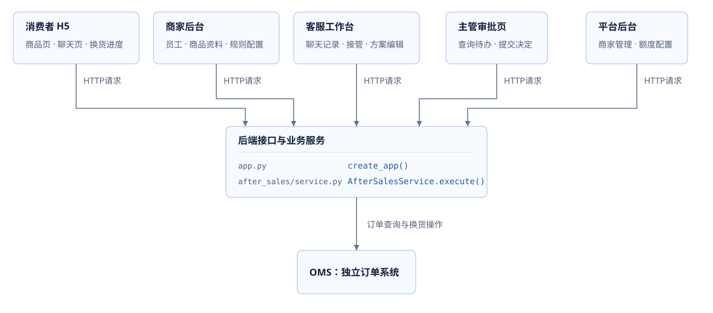</figure>

商家管理员、客服和主管共用商家后台，服务端按账户授权判断具体动作；平台后台有独立的登录入口。**前端菜单和按钮控制可见性，服务端逐次检查操作权限**。例如用户修改URL中的订单编号，不能取得其他客户的订单；客服接管聊天后，也仍需等待客户本人确认方案。

| 使用者 | 需要得到的业务结果 | 阶段00已有入口 |
| --- | --- | --- |
| 消费者 | 查到本人订单、得到有来源的答复、确认方案、请求人工协助 | `storefront`、`conversations`、`after_sales` |
| 商家员工 | 管理资料和规则、接管会话、审核方案、查看通知及消耗 | [商家管理](../source.html?stage=00-handover&path=src/zhifu/modules/merchant/api.py)、`notifications`、`billing` |
| 平台人员 | 登记或停用商家、调整并发及token额度、核查投递异常 | [平台管理](../source.html?stage=00-handover&path=src/zhifu/modules/platform/api.py)、[独立认证](../source.html?stage=00-handover&path=src/zhifu/modules/platform/auth.py) |

一次换货会保存方案、客户确认、审批和外部操作记录。方案记录商品、数量、理由和规则版本，客户与主管分别处理同一个版本；提交者不能审批自己的方案。批准后，后台继续检查权限、规则及可用数量，再向OMS发送换货请求。**OMS请求超时时，保留原操作编号并查询结果，防止重复创建换货单**。完整检查位于[售后服务](../source.html?stage=00-handover&path=src/zhifu/modules/after_sales/service.py&symbol=AfterSalesService.execute)与[履约准备](../source.html?stage=00-handover&path=src/zhifu/modules/integrations/fulfillment.py&symbol=prepare)。

<figure class="static-diagram">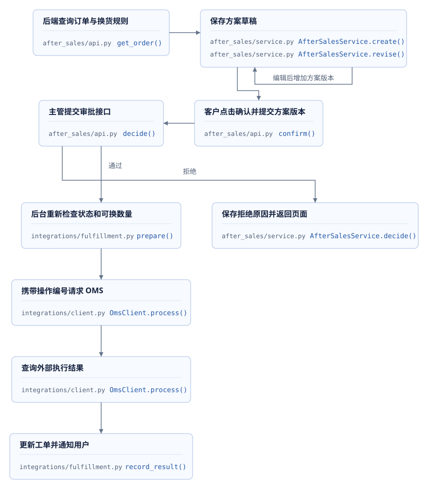</figure>

`00-handover`已经包含上述业务、权限检查、重复请求处理、后台任务领取和调用预算。后续版本增加审批超时提醒，以及两个分别负责订单和资料查询的Agent，并完善查询性能、模型输入长度、流式输出与故障恢复。两个Agent的协作需要启用对应运行配置，调用入口可见最终版本的[`run_specialists`](../source.html?stage=09-course-delivery&path=src/zhifu/modules/agent_runtime/collaboration.py&symbol=run_specialists)。

最终版本通过后端接口、事件、记录和终端检查业务结果：同一方案可以查到确认、审批、到期提醒及履约操作；重复扫描保持通知唯一；取消、权限撤销和进程恢复有对应验证结果；协作运行能找到分支结果与用量。交付同时包含固定源码、迁移、OpenAPI、运行命令和实验报告，使其他人能够复查。

### 完整项目演示

以下操作使用同一位客户和同一张订单，可以结合页面请求、后台记录和数据库状态检查结果。**接口返回值与数据库查询结果，共同证明一个操作是否完成。**

| 演示动作 | 接口与后台结果 | 对应工程能力 |
| --- | --- | --- |
| 客户查询订单和商品资料 | 本人订单、当前有效的资料引用、任务状态 | 权限过滤、资料检索、工具函数执行 |
| 启用协作版本并触发专业查询 | OrderAgent与KnowledgeAgent的操作标识、来源版本、完成结果及模型尝试 | 并行协调、角色工具范围、持久结果与计量 |
| 客户明确办理并确认方案 | 草稿方案、当前版本确认、待审批记录与提醒时间 | 业务状态、事务、配置快照 |
| 到期扫描与主管审批 | 指定接收人的唯一提醒、审批决定、停止条件 | 权限复核、并发顺序、重复执行 |
| 审批通过后的履约 | 原外部操作编号、OMS执行状态与工单进度 | 可靠事件、外部结果查询、业务幂等 |
| 网络断线、取消或进程退出 | 事件序号、会话控制版本、任务领取编号、已完成子任务 | 事件去重、迟到结果检查与任务恢复 |

专业查询的实际路径取决于发布配置和模型返回的工具调用，模型生成需要有效服务配置。固定源码和验证材料记录了对应实现、运行条件及检查结果。

消费者H5和两个后台提供产品使用背景。商品目录与订单服务的实际范围见[消费者接口说明](../source.html?stage=00-handover&path=docs/storefront-api.md)；购物车和支付不列入这条后端换货链路的验收。界面完成情况、模型样本和生产部署分别需要自己的验证记录。本课程的组件与业务实验只证明报告注明的环境、数据和操作范围。

## 2. 分层架构与数据存储

后端采用**按业务模块组织的FastAPI应用，并通过独立worker执行后台任务**。[`create_app`](../source.html?stage=00-handover&path=src/zhifu/app.py&symbol=create_app)注册认证、会话、售后、知识、商家和平台路由。worker可以理解为持续运行的任务处理进程。OMS是独立的订单管理服务，位于`src/zhifu/oms`，使用自己的数据库。

下图展示当前项目的五层架构：产品与接入、业务服务、Agent与知识、异步执行、数据与运行。右侧列出外部模型、OMS和渠道服务，箭头表示调用或任务传递方式。**这里的分层表示代码职责；业务模块中的函数仍可在同一个进程内调用。** 教学版本新增的审批提醒与专业Agent协作，按后续章节注明的代码阶段继续阅读。

<figure class="static-diagram">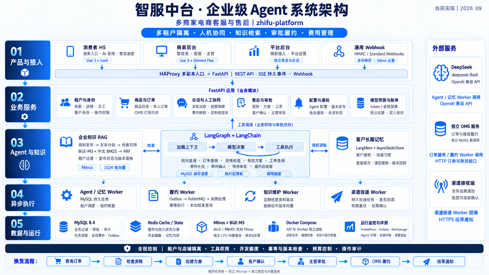</figure>

[独立查看项目架构图](../diagrams/zhifu-platform-current-shuhe.png)

**聊天请求是异步任务：API把消息和运行记录一起提交到MySQL，worker随后领取，前端通过SSE接收进度**。SSE是一条持续返回服务器事件的HTTP连接，页面据此更新处理状态和回答文字。普通配置或审批接口可以直接调用业务服务。工具函数也调用这些服务，因此从聊天入口发起的操作仍经过相同的权限和业务状态检查。

图中的基础设施各有用途：Agent任务通过MySQL领取；RabbitMQ负责已提交业务事件的投递；Redis提供跨进程额度和心跳；BGE-M3把文本转换成用于相似度计算的向量，Milvus据此查询相关资料。生成模型和OMS都是通过HTTP访问的服务，分别处理文本生成与订单业务。

阅读代码时，把模块目录和它操作的表放在一起看。`tenant_id`区分商家，`store_id`关联店铺权限，`subject_id`确定客户；登录身份与`store_grants`共同限制操作范围。`order_projections`保存OMS同步来的订单数据，工单表保存本系统的处理状态。**聊天文字作为用户输入处理，订单状态以经过授权查询的数据为准。**

| 模块 | 关键表或存储 | 调试时查看的内容 |
| --- | --- | --- |
| `identity` | `tenants`、`stores`、`principals`、`store_grants` | 谁在请求，能访问哪个商家、店铺和动作？ |
| `after_sales` | `order_projections`、`tickets`、`proposal_versions`、`confirmations`、`approvals` | 当前订单事实是什么，谁确认了哪个方案版本？ |
| `conversations`、`agent_runtime` | `conversations`、`conversation_events`、`agent_runs`、`model_attempts`、`token_entries` | 当前由谁接待，任务执行到哪里，发生了哪些调用与消耗？ |
| `after_sales`、`integrations` | `business_events`、`consumer_receipts`、`external_operations`、`reservations` | 事件是否已处理，原外部操作及数量预占是什么状态？ |
| `knowledge`、`memory` | MySQL知识版本与授权记录，Milvus索引，Redis记忆内容 | 资料是否仍已发布，客户是否授权使用当前记忆？ |
| 后续版本新增 | `approval_reminders`、`agent_branches` | 哪个方案到期，哪个子任务结果已经完成？ |

这些结构可以分别从[售后模型](../source.html?stage=00-handover&path=src/zhifu/modules/after_sales/models.py)、[运行与计量模型](../source.html?stage=00-handover&path=src/zhifu/modules/agent_runtime/models.py)和[阶段09分支模型](../source.html?stage=09-course-delivery&path=src/zhifu/modules/agent_runtime/branch_store.py&symbol=AgentBranch)继续阅读。

检索可以理解为带权限过滤的站内搜索。[`RetrievalClient.search`](../source.html?stage=00-handover&path=src/zhifu/modules/knowledge/vector.py&symbol=RetrievalClient.search)先请求BGE-M3计算问题的向量，再在Milvus中结合向量相似度和BM25关键词匹配查找资料；[`verified_results`](../source.html?stage=00-handover&path=src/zhifu/modules/knowledge/api.py&symbol=verified_results)回到MySQL检查资料仍已发布且版本有效。**搜索结果需要经过当前权限和版本检查，才能加入模型输入。**

两套Redis分别处理不同数据：cache用于请求限流；state保存跨进程并发额度、SSE连接额度、worker心跳和授权后的客户记忆内容。“记忆”在这里指后续对话可以使用的客户信息，例如沟通习惯；MySQL的`memory_profiles`保存用户是否同意、当前版本和内容引用。读取Redis内容前要检查这些字段，见[`memory.read`](../source.html?stage=00-handover&path=src/zhifu/modules/memory/service.py&symbol=read)。

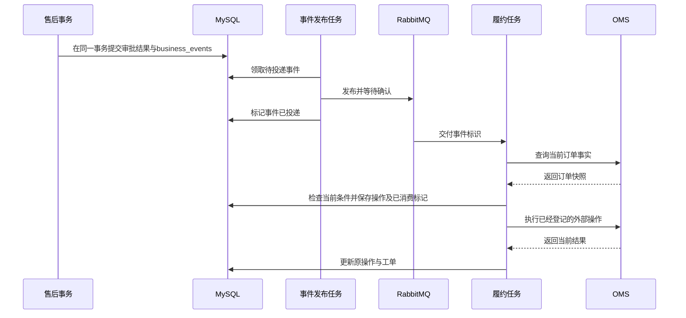

这张时序图对应常见的“数据库事务＋消息队列＋外部HTTP调用”。[`publish_one`](../source.html?stage=00-handover&path=src/zhifu/modules/integrations/worker.py&symbol=publish_one)等待RabbitMQ确认发布，[`consume_one`](../source.html?stage=00-handover&path=src/zhifu/modules/integrations/worker.py&symbol=consume_one)在业务事务完成后确认消费。Agent运行和记忆任务直接从MySQL领取。**排查任务重启或重复消费时，先找到数据库中的任务状态和操作编号，再追踪后续调用**。第5节会继续说明Agent worker内部的函数调用顺序。


## 3. 开发阶段与交付内容

登录、订单查询、换货确认和消息列表使用HTTP接口、服务端权限检查和数据库事务。起点`00-handover`已经能处理这些业务，也具备模型调用、费用预算和任务恢复。**每个代码阶段都保留可以运行的代码、相邻版本的修改和对应测试结果。**

阶段01增加审批超时提醒；阶段02至04加入两个职责不同的Agent，并完善并发处理和任务恢复。

图中按00—09顺序展示开发阶段，每个阶段下方按行列出对应文件与函数。在教学工程选择对应阶段后，按文件名查找文件，再搜索函数名；同名文件保留所属模块名，例如`reminders/api.py`。网页源码阅读器也可以按阶段和文件名查找，再选择对应函数。

<figure class="static-diagram" data-diagram-kind="static" tabindex="0" aria-label="开发阶段流程图，可横向滚动">
  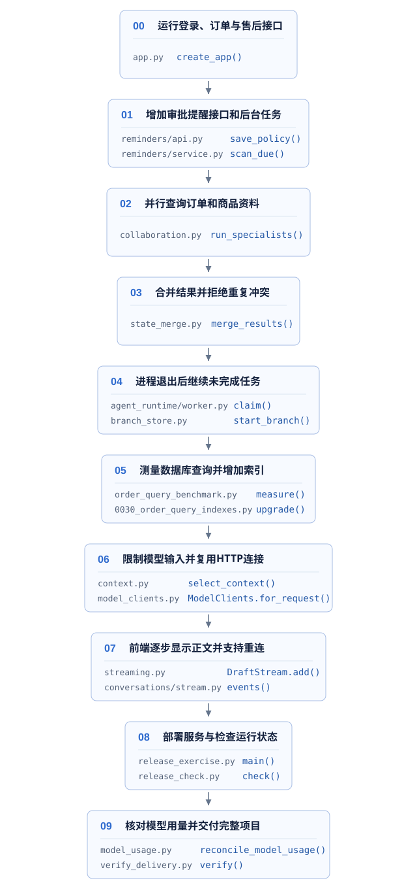
</figure>

| 代码阶段 | 需要解决的具体问题 | 开发内容 | 交付材料 |
| --- | --- | --- | --- |
| 00 → 01 | 新需求涉及已有权限、确认、通知与后台进程 | 从HTTP接口定位函数，确定事务范围，增加配置、数据迁移和有数量限制的后台任务 | 请求路径图、相邻代码差异、提醒验收记录 |
| 02 → 04 | 两个Agent并行，线程返回结果，进程中断后继续执行 | 确定由谁修改共享结果，编写结果合并函数，拒绝冲突与迟到结果，复用已完成分支 | LangGraph与线程实验、MySQL竞争与子进程恢复记录 |
| 05 | 请求等待和检索耗时来源不清楚 | 按入口、排队、数据库、工具、检索的顺序测量，解释查询计划及索引代价 | 固定条件下的耗时分布、SQL执行计划、带范围的负载报告 |
| 06 → 07 | 模型请求内容过长，连接重复建立，前端等待正文，断线后内容重复 | 保留匹配的工具请求和结果，复用模型HTTP连接，处理草稿、正式消息与事件续传 | token用量与费用记录、首段正文耗时、SSE断线重连结果 |
| 08 → 09 | 服务发布、停止、恢复与费用核对 | 检查迁移与接口，处理停止信号、备份恢复，核对实际模型用量 | 发布清单、恢复报告、费用状态记录和项目说明 |

`OrderAgent`与`KnowledgeAgent`分别发起模型请求，各自能调用的Python函数由程序限制。`asyncio`调度两个任务的等待，结果合并函数决定重复返回或内容冲突时的处理。线程实验检查多个线程交回结果时的数据访问；多个后台worker进程则通过数据库状态和有期限的执行权记录协调工作。并行成功以后，提交结果还需要复核权限、数据版本和会话控制权。

性能分析沿请求路径展开：前端连接与后端限流 → 任务排队 → 数据库查询与商品资料搜索 → 组装模型请求 → 模型生成 → 保存事件与前端显示。模型输入和输出按token计量，token是模型处理文本的计量单位；SSE是服务端在HTTP连接中持续发送事件的方式。**每次优化都记录正确性测试、耗时、质量和费用，明确改善了哪一部分**。提醒功能的数据库锁、扫描索引和轮询间隔，也会直接影响处理速度。

源码与实验入口：[专业Agent协作](../source.html?stage=02-parallel-agents&path=docs/course/parallel-agents.md)、[状态合并](../source.html?stage=03-state-consistency&path=docs/course/state-experiments.md)、[进程恢复](../source.html?stage=04-durable-execution&path=docs/course/durable-branches.md)、[上下文](../source.html?stage=06-context-model-performance&path=docs/course/context-model-performance.md)、[增量响应](../source.html?stage=07-streaming-response&path=docs/course/streaming.md)、[部署演练](../source.html?stage=08-deployment-operations&path=docs/course/release-operations.md)、[最终用量核对](../source.html?stage=09-course-delivery&path=docs/course/model-usage-reconciliation.md)。

### 最终项目与验证记录

最终项目包含十个代码阶段、运行说明、接口与数据迁移、真实服务实验、故障处理记录和项目说明。提交时，标出修改的函数和版本，解释请求经过的前端、API、数据库与后台任务，并给出验证命令。介绍项目经验时，可以结合一次具体故障说明：哪项检查发现问题，代码在哪个位置处理，以及测试得到什么结果。

各份报告保存对应验证范围。CPU商品资料搜索、数据库、进程恢复和少量真实模型调用已有记录；当前没有GPU服务器，vLLM模型推理服务提供部署材料和容量计算，GPU实测尚未执行。生产持续容量需要在目标环境中验证。阅读性能报告时，同时查看代码版本、数据规模、并发、时长和实际生成调用数量，本机短时结果的适用范围也写入交付说明。

**练习**：用熟悉的Web业务描述一次修改。例如：“审批通知需要等待多久”“重复点击提交按钮返回什么”“后台进程退出后任务是否继续”。选择其中一项，写出业务问题、修改函数、测试步骤和结果范围。

## 4. HTTP请求与源码阅读顺序

从前端的“确认方案”按钮开始，可以在接口文档中找到请求路径、正文和响应。前端提交当前方案版本，后端验证身份与业务状态，再保存数据库记录。此次新增需求是“客户确认后，审批超时提醒主管”，涉及确认接口、审批决定、通知服务和后台进程；接下来的阅读顺序围绕这几个已有入口展开。

| 阅读顺序 | 具体入口 | 需要取得的结论 |
| --- | --- | --- |
| 项目启动 | `src/zhifu/app.py`、`core/database.py` | 路由注册位置、数据库Session的创建方式、迁移执行命令 |
| 业务入口 | `modules/after_sales/api.py` | 方法、路径、请求字段、认证与事务由谁负责 |
| 状态改变 | `AfterSalesService.execute`、`confirm`、`decide` | 哪个身份能够改变哪个版本，何时保存确认和审批 |
| 数据约束 | `after_sales/models.py`、`notifications/models.py` | 唯一性依赖哪些字段，业务关联是否包含租户范围 |
| 后台执行 | `operations/worker.py`、`compose.runtime.yaml` | 任务进程、停止信号、运行状态检查与重新启动方式 |
| 现有测试 | `tests/test_after_sales.py`、`tests/test_notifications.py` | 测试账户和订单的准备方法、响应与数据库记录的对应关系 |

<figure class="static-diagram">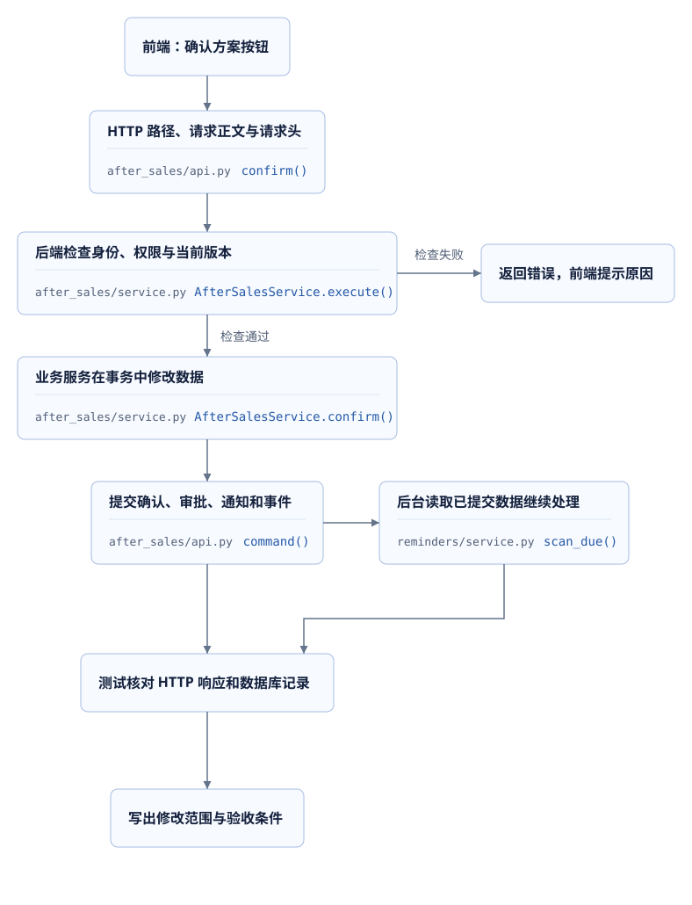</figure>

在教学代码目录执行以下搜索，并打开命中位置的完整函数。`rg`用于查找代码；随后继续阅读调用者、传入的Session以及事务结束的位置。**后端返回成功、事务提交和后台任务完成，是三个需要分别检查的结果。**

```powershell
rg -n 'include_router|sessionmaker' src/zhifu/app.py src/zhifu/core/database.py
rg -n 'async def confirm|async def command|async def decide' src/zhifu/modules/after_sales
rg -n 'class Confirmation|class Approval|UniqueConstraint' src/zhifu/modules/after_sales/models.py
rg -n 'def notify|uq_notification_event' src/zhifu/modules/notifications
```

### 确认请求的调用记录

以`POST /openapi/v1/after-sales/proposals/{proposal_id}/confirm`为例：路由接收请求，`command`创建事务并取得`AuthContext`，其中保存服务端验证过的身份信息；`AfterSalesService.execute`检查授权、重复请求和业务版本；`confirm`确认当前`DRAFT`方案，保存`Confirmation`和`Approval`，工单进入`WAITING_REVIEW`。事件、通知和请求收据与业务结果共同提交。**提醒记录加入这份确认事务，使用同一个确认时间。**

据此可以确定修改位置：新增提醒配置与处理记录，在确认和业务结束时调用提醒服务，由独立worker查询到期记录。前端继续通过接口保存配置和查询通知，业务权限由后端检查。字段不合法、访问权限不足或版本已变化时，接口返回相应错误，前端根据错误提示补充信息或重新读取当前状态。

源码：[应用入口](../source.html?stage=00-handover&path=src/zhifu/app.py&symbol=create_app)、[数据库连接](../source.html?stage=00-handover&path=src/zhifu/core/database.py&symbol=create_engine)、[确认路由](../source.html?stage=00-handover&path=src/zhifu/modules/after_sales/api.py&symbol=confirm)、[业务执行入口](../source.html?stage=00-handover&path=src/zhifu/modules/after_sales/service.py&symbol=AfterSalesService.execute)。

**源码练习**：沿确认请求查找`AuthContext`、`proposal_version`、`expected_ticket_version`、`Idempotency-Key`和`session.begin()`，标出前端提供的字段、后端取得的身份，以及共同提交的数据库记录。

<details>
<summary>展开参考答案</summary>

前端提供确认请求的`proposal_version`、`expected_ticket_version`和`Idempotency-Key`，分别指定方案版本、工单版本和本次操作标识。`AuthContext`由服务端验证访问会话后生成；数据库Session管理本次数据访问，`session.begin()`定义关联记录共同提交的范围。后台worker为每次处理创建自己的Session，从数据库读取已经提交的记录，并重新检查当前业务条件。提醒配置接口的版本字段为`expected_version`，具体名称以各接口的请求定义为准。

</details>


## 5. Agent请求的执行流程

客户在聊天框提供本人键盘订单的UUID，询问：“这张订单的键盘按键失灵，请核对能否换货，并查一下资料里的清洁说明。”前端发送文本和会话信息，后端需要读取订单、换货规则及商品资料。这条消息表达的是查询意图。创建待确认方案还需要客户明确提出办理请求，并通过后端权限检查；确认、审批和履约继续经过各自的业务接口。

**Agent是应用层维护的执行循环：调用模型，读取它请求执行的函数，检查并执行函数，再把结果交给模型继续处理**。一次工具请求称为`tool_call`，包含工具名称、JSON参数和用于匹配结果的调用标识。例如，名称是`get_order`，参数中包含`order_id`。后端按允许的名称调用对应Python函数，检查参数和业务权限。

### HTTP请求与后台任务

前端通过`POST /openapi/v1/conversations/{conversation_id}/messages`提交消息，携带访问令牌、`Idempotency-Key`与`expected_control_version`。接口检查身份、会话归属和控制版本；在`AGENT`模式且没有活动任务时，同一事务保存用户消息事件`message.user`与任务记录`AgentRun`，返回201及`run_id`。**前端收到任务编号后显示处理中，最终正文通过后续事件取得。**`queue_run`还保存模型配置和发布版本，任务初始状态为`QUEUED`。

后台worker通过`claim`选择可以处理的任务，检查租户与Redis并发额度，更新状态为`RUNNING`，保存125秒租约和`lease_token`。租约表示有期限的执行权，token用于识别本次领取。`execute_one`随后执行LangGraph流程。各节点提交前调用`locked_run`，重新检查权限、会话控制权与执行权；客服接管或旧worker失去租约以后，它返回的结果无法覆盖当前状态。

<figure class="static-diagram">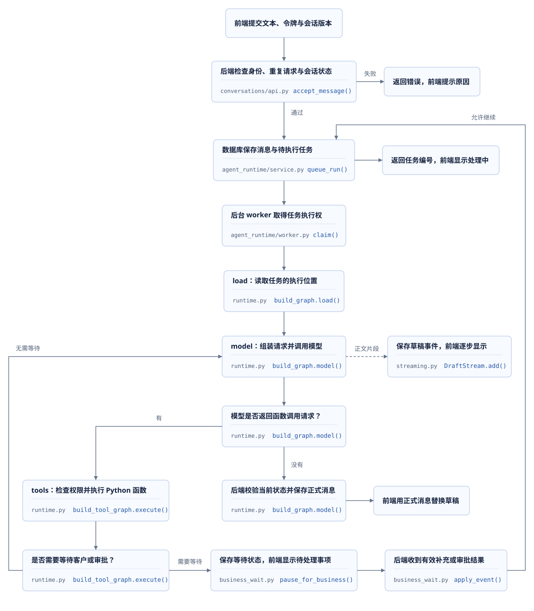</figure>

### 模型消息与LangGraph流程

模型本次请求收到的系统规则、工具定义和消息内容，合称上下文。工具定义提供可用函数的名称、用途和参数结构；消息记录用户问题、模型返回内容与函数执行结果。`ToolMessage`是保存工具结果的消息类型，通过`tool_call_id`对应原来的调用请求。查询订单以后，把查到的数据作为`ToolMessage`加入消息列表，下一轮模型请求才能使用这些结果。

**阶段00已经使用LangGraph组织模型调用和工具执行**。可以把LangGraph的节点理解为Python处理函数，状态理解为在函数之间传递的数据，条件边理解为根据返回值选择下一个函数。下面的实际代码注册`load`、`model`、`tools`，通过`next_node`选择后续步骤。

```python
graph = StateGraph(RunState)
graph.add_node("load", load)
graph.add_node("model", model)
graph.add_node("tools", tool_graph)
graph.add_edge(START, "load")
routes = {"model": "model", "tools": "tools", "done": END, "wait": END}
graph.add_conditional_edges("load", lambda state: state["next_node"], routes)
graph.add_conditional_edges("model", lambda state: state["next_node"], routes)
graph.add_conditional_edges("tools", lambda state: state["next_node"], routes)
return graph.compile()
```

`RunState`包含任务编号`run_id`、执行权标识`token`和下一步名称`next_node`，消息内容保存在MySQL的`AgentRun.messages`中。`load`读取实际执行位置；模型返回`tool_calls`时进入`tools`，函数结果保存后回到`model`；`done`和`wait`结束当前流程调用，等待中的任务保留在数据库里。

模型HTTP请求和外部商品资料搜索在业务事务之外执行，返回后再次检查当前状态。工具函数验证参数、订单归属与店铺权限；创建方案复用`AfterSalesService`的事务和重复请求处理规则。**模型返回函数名称不会直接取得业务权限**。超时、权限失效或资料版本变化会使本次运行失败，前端通过失败事件清理草稿并显示错误。

### 两个专业Agent的并行查询

专业Agent使用不同的模型指令和函数权限。`OrderAgent`负责订单查询，`KnowledgeAgent`负责从当前店铺已发布的商品资料中查找相关内容。当发布版本启用协作、订单已经明确，且主模型选择`consult_specialists`时，后端进入这两个角色的执行流程。订单归属检查通过后，`OrderAgent`使用主任务已经取得的全局交互任务并发名额；`KnowledgeAgent`额外申请一个同类名额，申请失败时本次协作终止。模型也可以选择普通查询工具，具体路径以实际返回的调用请求为准。

**并发名额限制同一时间允许执行的任务数量**。这次额外申请由Redis检查`global_concurrency`，同时保留交互任务、后台任务和指定租户的预留名额，对应`interactive_reserved`、`background_reserved`和`TenantQuota.interactive_reserved`。租户运行数量在主任务领取时通过`TenantQuota.interactive_limit`检查，未配置时使用`tenant_concurrency`；专业分支共用这个主任务，额外申请只增加全局交互任务占用。店铺在这条流程中用于业务权限检查。具体检查见[并发名额申请](../source.html?stage=09-course-delivery&path=src/zhifu/modules/agent_runtime/capacity.py&symbol=acquire)与下方的`claim`入口。

<figure class="static-diagram">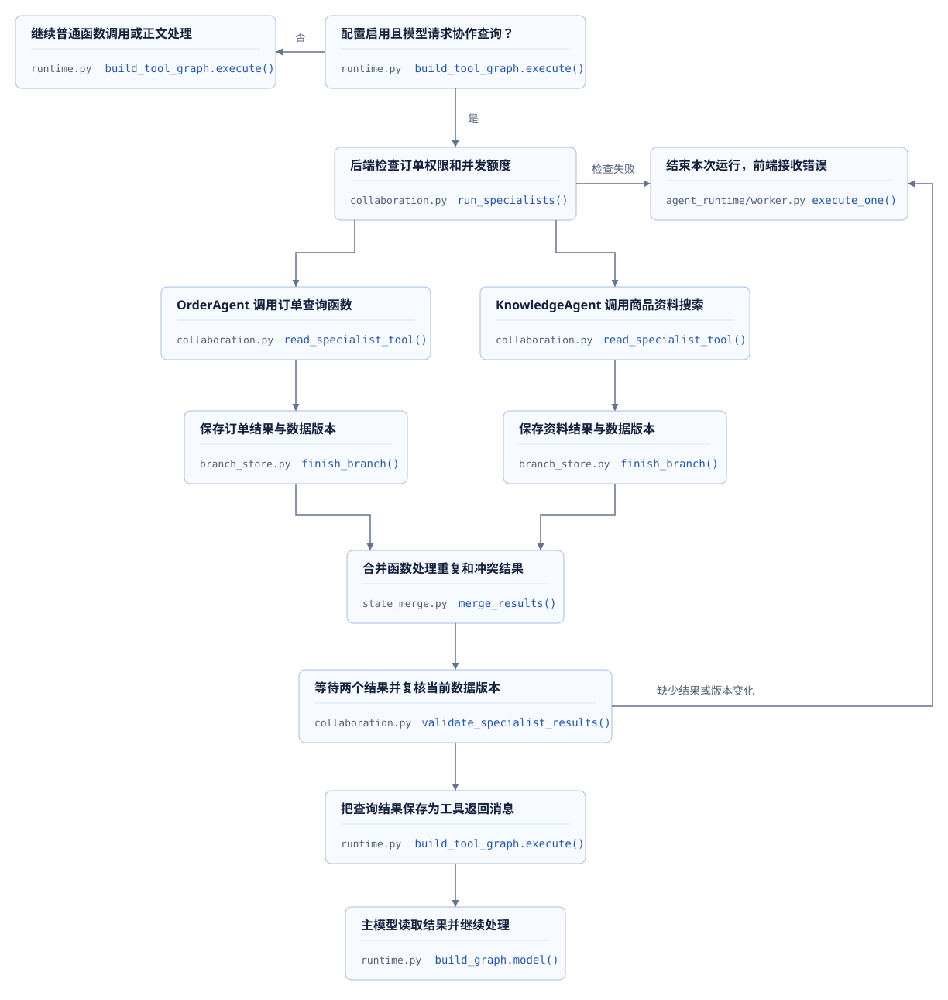</figure>

并行等待这一部分，可以联系`Promise.all([...])`或`asyncio.gather(...)`：发起两个互不依赖的异步任务，结果齐全后继续处理。下面是最终版本`run_specialists`中的实际代码，两个角色分别从`START`进入，`coordinate`等待两者完成。本项目还会检查结果属于哪个运行、采用哪个数据版本，并保存已经完成的分支。

```python
graph = StateGraph(CollaborationState)
graph.add_node("OrderAgent", order_agent)
graph.add_node("KnowledgeAgent", knowledge_agent)
graph.add_node("coordinate", coordinate)
graph.add_edge(START, "OrderAgent")
graph.add_edge(START, "KnowledgeAgent")
graph.add_edge(["OrderAgent", "KnowledgeAgent"], "coordinate")
graph.add_edge("coordinate", END)
```

图的初始输入为`{"results": []}`，两个节点各返回一个`BranchResult`，其中保存角色答复、实际查询结果和数据版本。结果合并函数称为reducer：它复制交回的数据，按操作标识处理重复项，并拒绝相同标识对应不同内容。`coordinate`要求两个角色结果齐全，再复核订单、规则和资料版本。任何角色失败或数据已经变化，本次协作都不能提交成功结果。

阶段02增加专业角色和协作工具；阶段03增加结果交接、合并规则与线程实验；阶段04增加数据库表`AgentBranch`，进程重新执行任务时，可以复用已经完成且数据仍有效的分支。原有任务状态与租约检查继续保护最终提交。

| 概念 | 在本项目中的作用 |
| --- | --- |
| Agent | 使用特定模型指令和函数权限处理一项任务的应用代码 |
| task | 事件循环中的异步任务，用于等待模型请求或执行其他异步步骤 |
| thread | 共享进程内存的线程，用于同步SDK调用或线程交接实验 |
| process | 独立worker进程，具有自己的内存，通过数据库与Redis协调工作 |

这里的专业流程使用异步节点并行，每个角色不要求独占一个线程。各进程分别管理自己的内存，跨进程共享的任务状态保存在MySQL和Redis中。

### 前端草稿与正式消息

SSE通过持续的HTTP响应把服务器事件送到前端。最终版本把模型正文片段交给`DraftStream`，按250毫秒或1000字符聚合为`agent.output.delta`，保存到会话事件后发送。事件包含草稿标记`provisional=true`、模型调用编号`attempt_id`、片段编号`chunk_index`和正文。前端按编号聚合并显示文本，工具参数片段不会作为正文发送。

**草稿可能在工具执行或最终检查时失效**。本轮转向工具调用时，前端根据`agent.output.discarded`清除草稿；任务取消、失败或客服接管时也清理对应内容。最终检查通过后，后端保存`message.assistant`，前端用正式正文替换草稿。连接中断后，前端携带`Last-Event-ID`继续读取，并按事件序号去重；游标过期时重新读取会话和历史。浏览器连接中断与后端任务取消分别处理，重连需要继续查询当前任务状态。

| 阅读位置 | 要找到的实际责任 |
| --- | --- |
| [09 · `accept_message`](../source.html?stage=09-course-delivery&path=src/zhifu/modules/conversations/api.py&symbol=accept_message) | 会话消息与运行在同一事务保存 |
| [09 · `queue_run`](../source.html?stage=09-course-delivery&path=src/zhifu/modules/agent_runtime/service.py&symbol=queue_run)、[`claim`](../source.html?stage=09-course-delivery&path=src/zhifu/modules/agent_runtime/worker.py&symbol=claim) | 保存运行配置、排队、分配额度与执行权 |
| [00 · `build_graph`](../source.html?stage=00-handover&path=src/zhifu/modules/agent_runtime/runtime.py&symbol=build_graph)、[09 · `locked_run`](../source.html?stage=09-course-delivery&path=src/zhifu/modules/agent_runtime/runtime.py&symbol=locked_run) | 主图循环与提交前检查 |
| [09 · `invoke_tool`](../source.html?stage=09-course-delivery&path=src/zhifu/modules/agent_runtime/tools.py&symbol=invoke_tool)、[`run_specialists`](../source.html?stage=09-course-delivery&path=src/zhifu/modules/agent_runtime/collaboration.py&symbol=run_specialists) | 业务工具入口与有条件的专业协作 |
| [09 · `merge_results`](../source.html?stage=09-course-delivery&path=src/zhifu/modules/agent_runtime/state_merge.py&symbol=merge_results)、[`start_branch`](../source.html?stage=09-course-delivery&path=src/zhifu/modules/agent_runtime/branch_store.py&symbol=start_branch) | 结果合并与持久恢复 |
| [09 · `DraftStream`](../source.html?stage=09-course-delivery&path=src/zhifu/modules/agent_runtime/streaming.py&symbol=DraftStream)、[`events`](../source.html?stage=09-course-delivery&path=src/zhifu/modules/conversations/stream.py&symbol=events) | 草稿事件、正式消息与断线续传 |

**源码练习**：把两个专业角色看作“订单查询”和“资料搜索”两个异步任务。订单结果已经保存，资料搜索结束前worker进程退出。服务重新启动后，找出`execute_specialist`和`start_branch`中复用订单结果的条件，并说明订单数据已经变化时前端会收到什么结果。

<details>
<summary>展开参考答案</summary>

恢复使用同一个逻辑操作标识`operation_id`。`start_branch`核对所属运行的权限、步骤、执行权与请求摘要；找到`COMPLETED`分支时，返回独立的结果副本。`execute_specialist`再次检查数据版本，条件仍有效即可复用。订单或规则已经变化时，本次运行失败，前端处理`run.failed`并清理草稿；未完成的分支重新执行可能产生新的模型调用，需要继续累计实际用量。

源码：[09 · `execute_specialist`](../source.html?stage=09-course-delivery&path=src/zhifu/modules/agent_runtime/collaboration.py&symbol=execute_specialist)。

</details>


## 6. 审批超时提醒的业务规则

需求原文是：“客户已经确认换货方案，主管迟迟没有审批，希望系统能够提醒。”对应的开发内容包括管理页面读取和保存提醒配置、客户确认时保存到期时间、后台定时任务查询到期记录，以及主管进入通知页查看待审批方案。接口、数据表和定时任务需要使用同一套时间、版本和接收人规则。

### 到期时间与配置快照

假设客户10:00确认方案第3版，店铺配置为30分钟。10:29:59时不能发送；10:30:00开始允许检查。管理员10:10通过配置表单把时限修改为60分钟，原方案仍按10:30到期。假设10:20修订并重新确认第4版，则第3版停止产生新提醒，第4版按当时60分钟配置在11:20到期。**配置修改只影响后续确认，已有提醒保留确认时的配置**。这里的时间用于解释规则，数据库和接口统一使用UTC。

<figure class="static-diagram">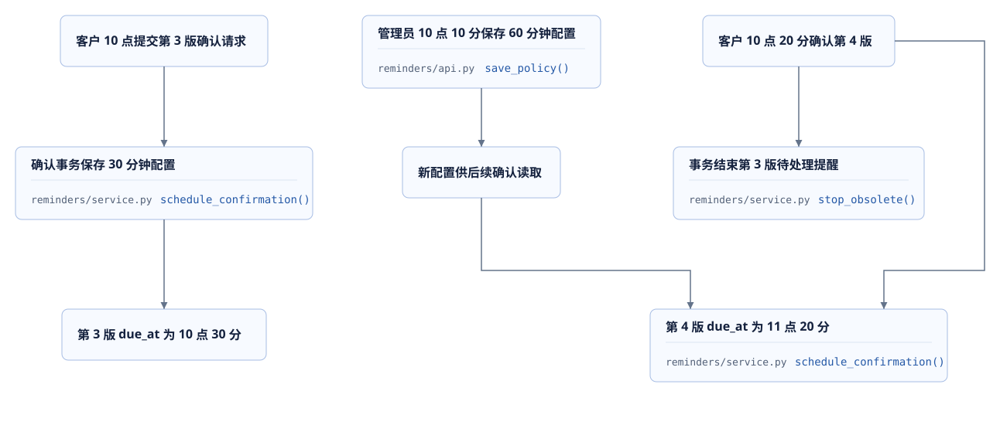</figure>

| 业务规则 | 数据条件 | 相关记录 |
| --- | --- | --- |
| 到期时间 | 当前版本的`confirmed_at + delay_seconds` | 确认记录、时限、配置版本、`due_at` |
| 发送条件 | 当前工单`WAITING_REVIEW`、审批`PENDING`、版本一致、租户与店铺启用 | 提交前重新读取的业务状态 |
| 接收人范围 | 同租户有效`STAFF`，当前店铺`approvals:decide`，排除方案提交者 | 当前Principal与StoreGrant，审批提交人 |
| 无接收人重试 | 继续`PENDING`，60秒以后再次检查 | `check_count`、`last_checked_at`、`next_check_at` |
| 通知唯一性 | 同租户、同接收人、同方案版本只保存一份提醒事件 | 稳定`event_key`和通知唯一约束 |
| 停止条件 | 已审批、修订、取消或范围停用 | `CANCELLED`、`stop_reason`、`completed_at` |

首次成功发送以后，提醒进入`SENT`，后来增加主管不会为该方案版本补发。通知的已读状态只影响展示；业务操作仍根据当前权限、方案和审批状态判断。确认时间和到期时间保存在数据库中，用户关闭通知页、客户端断线和API进程重新启动，都不改变这两个时间。

**练习：审批请求与定时任务同时执行**。主管点击“批准”时，后台恰好开始处理这条到期提醒。分别考虑提醒事务先提交、审批事务先提交两种顺序，记录最终的通知数量和提醒状态。

<details>
<summary>参考结果</summary>

提醒成功发送并提交时，每位当时有效的接收人已经有一条通知，提醒为`SENT`；随后审批通过，已有通知继续保留。审批先提交时，待处理提醒随业务状态变更成为`CANCELLED`，扫描不再新增通知。两种结果都需要通过事务提交顺序和最终记录解释；浏览器收到响应的顺序不能单独说明数据库的提交顺序。

</details>

源码：[阶段01规则及接口说明](../source.html?stage=01-business-change&path=docs/approval-reminders.md)、[旧提醒结束条件](../source.html?stage=01-business-change&path=src/zhifu/modules/reminders/service.py&symbol=stop_obsolete)。

## 7. 提醒配置的数据与接口

### 当前配置与确认记录

管理页面读取的启用开关、提醒时限和配置版本来自`ReminderPolicy`。客户确认以后，`ApprovalReminder`保存本次确认采用的时限、版本、到期时间及处理结果。配置用`tenant_id + store_id`作为主键，提醒用`tenant_id + proposal_id + proposal_version`作为主键。提醒还通过包含租户与版本的外键关联`Confirmation`，使每条提醒对应一次明确的客户确认。

<figure class="static-diagram">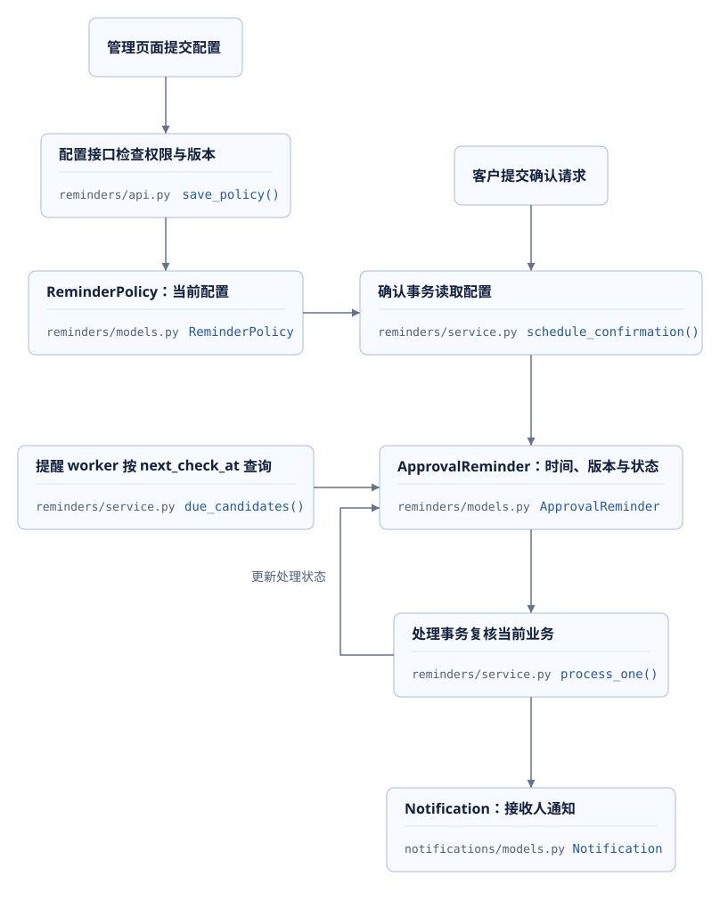</figure>

`due_at`是业务规定的到期时间，`next_check_at`是后台任务下次可以检查的时间。无接收人时只推进后者，因此原到期时间仍可用于计算逾期时长。`recipient_count`记录成功通知的人数，`stop_reason`记录终止原因，排查未发送的提醒时可以直接查询这些字段。

下面是阶段01模型中的约束。到期查询使用`status = 'PENDING'`和`next_check_at <= 当前时间`，索引按这个顺序组织字段；后面的租户与方案字段用于候选排序。增加索引会增加写入成本，是否有必要可以通过实际查询计划和执行时间判断。

```python
CheckConstraint("status IN ('PENDING','SENT','CANCELLED')", name="status"),
CheckConstraint("delay_seconds BETWEEN 1 AND 604800", name="delay_seconds"),
CheckConstraint("due_at >= confirmed_at", name="due_at"),
Index("ix_approval_reminders_due", "status", "next_check_at", "tenant_id", "proposal_id"),
```

源码：[模型与约束](../source.html?stage=01-business-change&path=src/zhifu/modules/reminders/models.py&symbol=ApprovalReminder)、[真实候选查询](../source.html?stage=01-business-change&path=src/zhifu/modules/reminders/service.py&symbol=due_candidates)、[迁移0028](../source.html?stage=01-business-change&path=migrations/versions/0028_approval_reminders.py)。

### 并发保存与网络重试

两个管理员同时打开配置页面，读取到的`version`都是5。两人分别修改时限并点击保存，两次请求都带上`expected_version=5`，各自使用一个`Idempotency-Key`。首先提交的请求把版本更新为6，另一个请求收到`409 VERSION_CONFLICT`。页面可以保留尚未保存的输入，重新读取配置后交由管理员决定本次修改；版本检查保证后提交的旧表单不会直接覆盖已经保存的内容。

另一种常见情况是服务器已经提交配置，浏览器等待响应时发生网络超时。**同一次保存的重试保留原`Idempotency-Key`和正文**。服务器找到该请求已经保存的响应后直接返回；相同请求键对应不同正文时，返回`409 IDEMPOTENCY_CONFLICT`。新的业务修改使用新的请求键，并带上本次读取到的配置版本。

| 标识 | 对应内容 | 服务端检查 |
| --- | --- | --- |
| `Idempotency-Key` | 一次请求及其重试 | 当前授权、相同请求内容、请求收据 |
| `expected_version` | 本次修改依据的配置版本 | 数据库中的当前版本是否一致 |
| `proposal_version` | 客户确认的业务方案 | 工单、确认、审批是否仍指向这个版本 |
| `event_key` | 某个方案版本的提醒事件 | 接收人权限、租户范围和唯一约束 |

三个管理接口均要求Bearer身份、`STAFF`及目标店铺`stores:manage`；提醒接收人的资格使用`approvals:decide`。页面是否显示配置菜单、按钮是否禁用属于前端交互，服务端收到请求后仍要检查当前账户的店铺授权。“主管”这样的显示名称不能代替权限检查。

| 方法与路径 | 主要输入与结果 |
| --- | --- |
| `GET /admin/v1/stores/{store_id}/approval-reminder-policy` | 返回当前配置；未配置时为版本0、停用、建议时限3600秒 |
| `PUT /admin/v1/stores/{store_id}/approval-reminder-policy` | 请求键、预期版本、启停、1至604800秒时限；返回保存后的版本 |
| `GET /admin/v1/stores/{store_id}/approval-reminders/{proposal_id}/{proposal_version}` | 返回本版本提醒的状态与时间；查询本身不触发扫描 |

配置页面先通过GET读取当前版本，保存时提交的正文例如`{"expected_version":5,"enabled":true,"delay_seconds":1800}`，请求头同时携带`Idempotency-Key`。身份失效返回401；身份类型不符合要求返回403；目标范围或记录不可访问返回404；版本与幂等冲突返回409；字段及请求标识不符合约束返回422。完整响应字段、错误码与示例见[接口说明](../source.html?stage=01-business-change&path=docs/approval-reminders.md)和[路由](../source.html?stage=01-business-change&path=src/zhifu/modules/reminders/api.py&symbol=save_policy)。

### 请求收据与版本检查顺序

请求收据保存已处理请求的摘要和响应。保存配置时，代码先查询收据，再检查配置版本。例如请求第一次成功后版本已经从5变为6，浏览器使用原正文重试仍然带着`expected_version=5`；收据让服务器能够返回第一次的成功响应。没有收据的新请求才继续比较当前版本。

```python
prior, digest = await receipt(session, auth, route, key, body)
if prior:
    return prior.response
row = await session.get(ReminderPolicy, (auth.tenant_id, store_id.bytes))
current_version = row.version if row else 0
require(current_version == body.expected_version, "VERSION_CONFLICT", "提醒配置版本已变化")
```

源码：[save_policy](../source.html?stage=01-business-change&path=src/zhifu/modules/reminders/api.py&symbol=save_policy)、[receipt与complete](../source.html?stage=01-business-change&path=src/zhifu/modules/merchant/service.py)。完整函数在查询收据前执行认证与店铺检查，配置、收据和审计事件在同一事务提交。因此，相同请求重试仍然受到当前权限限制。

## 8. 确认事务与业务接入

阶段00到01涉及24个文件，包含业务、迁移、进程、接口文档和测试。售后服务增加两个调用位置：确认成功时建立提醒，业务变化后结束旧提醒。应用入口注册管理接口，独立worker执行到期扫描，测试覆盖这些操作对现有业务的影响。

| 修改位置 | 修改内容 | 验证内容 |
| --- | --- | --- |
| `reminders/models.py`与迁移0028 | 保存配置、确认快照和处理状态 | 检查迁移版本、外键与扫描索引 |
| `reminders/schemas.py`、`api.py` | 定义权限、字段、版本与错误响应 | 检查请求边界、冲突结果及OpenAPI |
| `after_sales/service.py` | 与确认、修订、取消、审批共同改变提醒 | 查询业务状态与提醒状态是否一致 |
| `app.py` | 注册新增路由 | 在当前运行服务中查到三个接口 |
| `reminders/worker.py`、`operations/worker.py`、Compose | 提供周期执行、停止与心跳 | 单次扫描、进程停止和监控检查 |
| 通知、业务与监控测试及文档 | 证明现有能力与新需求共同工作 | 检查相关回归、接口导出和业务记录 |

### 一次请求中的Session与事务

客户在页面点击“确认方案”后，HTTP入口创建一个SQLAlchemy Session，并通过`begin()`管理本次事务。Session负责执行查询、跟踪本次读取和修改的对象；售后服务与提醒服务接收同一个Session，使关联写入能够一起提交。**每个并发请求或后台处理任务使用自己的Session**。数据库操作结束后，该Session随上下文关闭；后台任务重新创建Session读取已提交的记录。

```python
async def command(request, action, object_id, body, key):
    """在同一事务内完成身份校验、业务变更、幂等收据和 outbox 事件写入。"""
    async with request.app.state.sessions.begin() as session:
        auth = await authenticate(request, session)
        return await AfterSalesService(session, auth).execute(action, object_id, body, key)
```

源码：[command](../source.html?stage=00-handover&path=src/zhifu/modules/after_sales/api.py&symbol=command)。正常退出`begin()`管理范围时提交；异常沿调用继续传播，本次关联写入不提交。本次提醒接入只增加数据库读写。如果在持锁期间等待远程HTTP响应或模型生成，其他需要相同记录的事务也会继续等待，事务范围因此会直接影响请求延迟。

`AfterSalesService.confirm`把一次`now()`保存为`confirmed_at`，同时传给`Confirmation`和`schedule_confirmation`，随后由原事务统一提交。以下片段来自`schedule_confirmation`：

```python
policy = await session.get(ReminderPolicy, (ticket.tenant_id, ticket.store_id))
if policy is None or not policy.enabled:
    return
due_at = confirmed_at + timedelta(seconds=policy.delay_seconds)
session.add(ApprovalReminder(
    tenant_id=ticket.tenant_id, store_id=ticket.store_id,
    proposal_id=ticket.id, proposal_version=ticket.proposal_version,
    policy_version=policy.version, delay_seconds=policy.delay_seconds,
    confirmed_at=confirmed_at, due_at=due_at, next_check_at=due_at,
))
```

`schedule_confirmation`只登记待写入的对象，由调用方统一提交。配置启用时，**客户确认、待审批记录、提醒记录和请求收据一起成功或一起失败**。数据库唯一键与外键继续限制重复或不匹配的记录。确认事务和配置修改使用相容的租户与店铺锁；两个请求同时执行时，取得锁的顺序决定确认采用哪份配置。

源码：[阶段01确认服务](../source.html?stage=01-business-change&path=src/zhifu/modules/after_sales/service.py&symbol=AfterSalesService.confirm)、[schedule_confirmation](../source.html?stage=01-business-change&path=src/zhifu/modules/reminders/service.py&symbol=schedule_confirmation)。

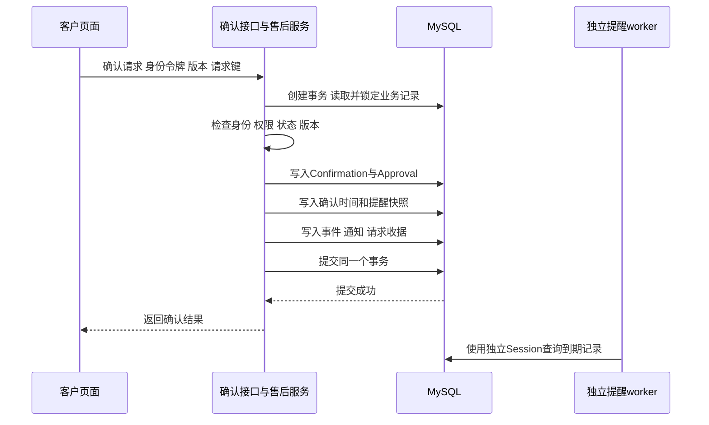

### Agent调用与既有业务服务

Agent调用工具时，模型返回工具名称和参数，后台程序负责校验参数并调用相应的Python函数。例如`create_exchange_proposal`最终进入`AfterSalesService.execute("create", ...)`，继续使用当前请求身份、店铺范围和业务幂等检查。工具调用不会授予新的业务权限，客户确认和主管审批仍通过各自的业务接口完成。

这使提醒功能可以接在统一的确认服务中：方案可以来自页面操作，也可以由Agent协助创建，客户确认后都由同一段代码保存提醒。

源码：[invoke_tool](../source.html?stage=00-handover&path=src/zhifu/modules/agent_runtime/tools.py&symbol=invoke_tool)。

### 业务变更后的提醒状态

`AfterSalesService.execute`在处理`create`、`confirm`、`revise`、`cancel`、`decide`后，调用`stop_obsolete`与`notify_ticket`。`stop_obsolete`只修改`PENDING`提醒：当前工单继续等待审批时，终止其他方案版本；当前状态已经离开`WAITING_REVIEW`时，终止其待处理提醒。已发送通知仍保存，通知查询继续使用现有权限检查。

**练习：确认接口的修改记录**。通过相邻tag的`git diff`定位`confirmed_at = now()`、`schedule_confirmation`和`stop_obsolete`，分别说明它们读取或写入的记录，以及其中一次写入失败时客户页面得到的结果。

## 9. 定时任务的并发与运行

提醒worker是持续运行的后台进程，定期查询数据库中的到期记录。`due_candidates`先返回待检查的标识，`process_one`再为每条记录创建独立事务，取得业务记录锁，重新读取状态、时间、版本和权限。部署两个worker时，它们可能查询到同一条记录。**查询到候选只表示需要检查，发送条件仍在处理事务中确认。**

下面的`process_one`片段依次取得Tenant排他锁、Store共享锁、Ticket排他锁，再通过`refresh`锁定并重新读取提醒。某个worker等待期间，另一个worker可能已经发送通知；重新读取后发现状态已经变化，本次处理返回`skipped`。

```python
tenant = await session.get(Tenant, snapshot.tenant_id, with_for_update=True)
store = await session.get(Store, snapshot.store_id, with_for_update={"read": True})
ticket = await session.get(Ticket, snapshot.proposal_id, with_for_update=True)
await session.refresh(snapshot, with_for_update=True)
if snapshot.status != "PENDING":
    return "skipped"
```

接收人查询前，程序按UUID顺序取得有效员工的Principal共享锁，随后读取`StoreGrant`。管理CLI修改授权也会取得相应账户锁。假设撤权事务先取得账户锁，提醒事务会等待；撤权提交后，提醒继续读取当前授权。本项目使用`READ COMMITTED`，这次授权查询能够看到刚提交的修改。请求、管理命令与worker需要采用相容的锁顺序，才能共同保护这个过程。

源码：[数据库隔离级别](../source.html?stage=01-business-change&path=src/zhifu/core/database.py&symbol=create_engine)。

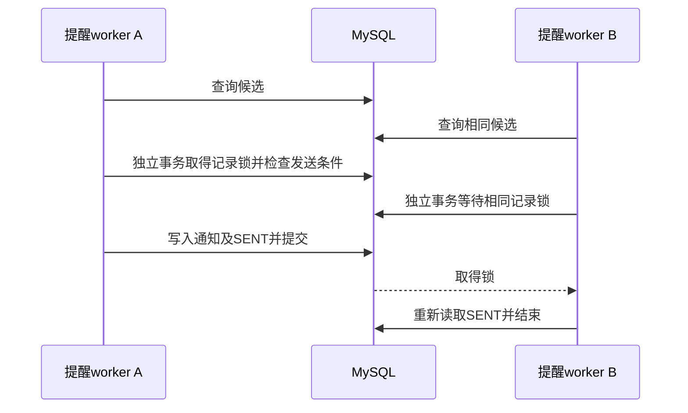

### 重复执行与通知唯一性

通知以租户、接收人和事件建立唯一约束。事件键包含方案标识及方案版本，重复写入沿用通知服务的`on_duplicate_key_update(id=Notification.id)`，保留已有记录与`read_at`。**通知写入和提醒更新为`SENT`共用一个事务**。重复执行不会把已经阅读过的通知重新变为未读。

| 中断位置 | 已提交的数据 | 再次运行的处理 |
| --- | --- | --- |
| 候选查询以后、处理以前 | 提醒仍为`PENDING` | 再次复核业务并处理 |
| 已执行通知写入、事务尚未提交 | 当前事务的关联写入尚未提交 | 原事务结束后重新处理待办 |
| 通知与`SENT`共同提交以后 | 接收通知及完成状态同时存在 | 读取`SENT`后结束，不增加通知 |
| 到期但无有效接收人 | `PENDING`及推进后的`next_check_at` | 60秒以后重新读取当前权限 |

本次通知是数据库中的站内通知，用户打开通知页时通过接口读取。调用外部服务的场景还需要处理请求结果未知、接收方去重和状态查询，项目的OMS履约模块提供了相应实现。

源码：[process_one](../source.html?stage=01-business-change&path=src/zhifu/modules/reminders/service.py&symbol=process_one)、[通知唯一约束](../source.html?stage=00-handover&path=src/zhifu/modules/notifications/models.py&symbol=Notification)、[notify](../source.html?stage=00-handover&path=src/zhifu/modules/notifications/service.py&symbol=notify)。

### 扫描批次与处理延迟

`scan_due`默认每批100条，允许1至500，整批最长30秒。每个候选分别建立事务；常驻worker完成一批以后等待5秒。无接收人的重查间隔为60秒。某个提醒的实际等待由扫描间隔、前面的候选、锁等待和本次事务耗时共同组成，`due_at`表示开始允许检查的时间。

**计算练习**：假设每条处理平均20毫秒且没有锁等待，100条约需要2秒，加上5秒批间等待，连续满批时约每秒处理14.3条。这是根据给定条件计算的结果；实际吞吐需要测量候选数量、每批耗时、到期延迟与锁等待。把`batch_size`从100增加到200，也会增加一批的处理时间，不能直接得出吞吐增加一倍的结论。

同租户处理受Tenant排他锁限制，增加worker数量不能直接提高同租户同时处理的数量。改变锁范围时，还必须继续证明审批、配置修改、权限撤销与通知提交的顺序正确。

<figure class="static-diagram">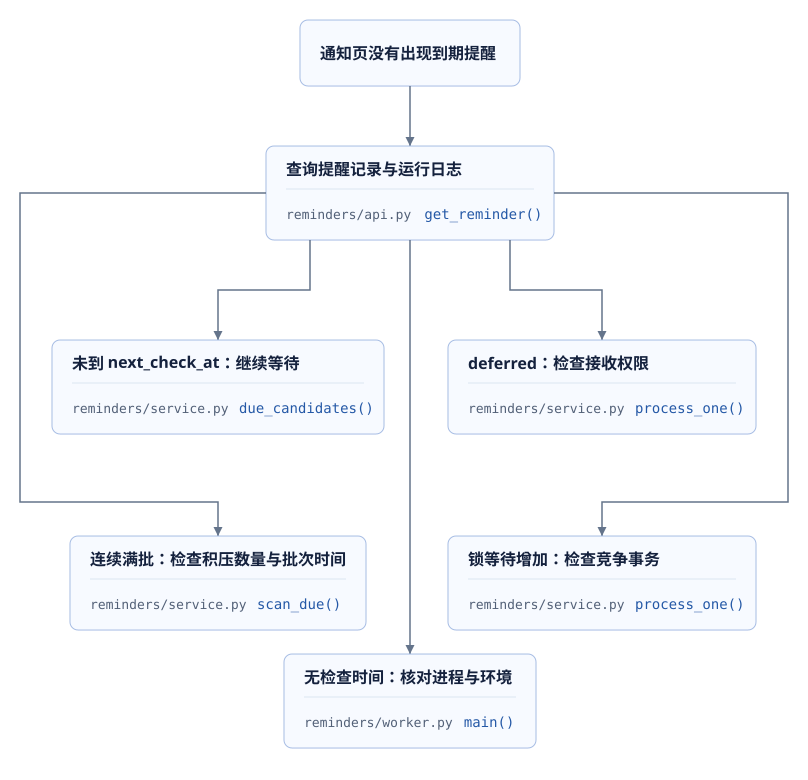</figure>

每批输出`selected`、`sent`、`deferred`、`cancelled`和`skipped`，提醒记录提供检查时间与停止原因，状态Redis保存`reminders`进程心跳。心跳表示进程仍在运行，提醒记录表示具体任务是否已经处理。进程正常但通知未出现时，可以继续检查`next_check_at`、接收人权限、候选积压和数据库等待。

源码：[scan_due](../source.html?stage=01-business-change&path=src/zhifu/modules/reminders/service.py&symbol=scan_due)、[worker.main](../source.html?stage=01-business-change&path=src/zhifu/modules/reminders/worker.py&symbol=main)、[进程管理](../source.html?stage=01-business-change&path=src/zhifu/operations/worker.py&symbol=run)。


## 10. 开发环境与功能验证

实验沿用接口开发的顺序：**准备身份与数据，发送请求，执行后台任务，检查响应和数据库记录**。执行前需要准备镜像、依赖和模型文件。命令均在课件项目的`project/`教学代码目录执行；数据库使用实验专用环境，常驻业务worker保持停止。

### 10.1 环境与相邻版本变更

按照[分支操作材料](../materials/branch-guide.html)完成阶段00的`00-classroom`启动与检查。停止阶段00服务时保留数据，阶段01使用独立的`01-classroom`。已有环境一旦应用后续迁移，回看初始代码时需要使用新的环境名称。

```powershell
git status --short
git diff --name-status course-00-handover course-01-business-change
git diff course-00-handover course-01-business-change -- src/zhifu/modules/after_sales/service.py
. ./scripts/course/environment.ps1 -Action Stop -Stage 00-classroom
git switch course/01-business-change
. ./scripts/course/environment.ps1 -Action Start -Stage 01-classroom `
  -PythonExecutable .venv/Scripts/python.exe -ModelCache .work/models
. ./scripts/course/environment.ps1 -Action Check -Stage 01-classroom
& $runtime.python -m alembic current
```

切换前将自己的修改保存在个人练习分支；`git status --short`为空时，工作目录没有待提交的修改。环境检查结果对应`zhifu-course-01-classroom`，迁移为`0028_approval_reminders`，`PYTHONPATH`指向实验目录的`src`。**代码版本、数据库迁移和实际导入目录需要一起确认**。Start自动升级当前分支的数据库并检查依赖。环境脚本清除实验使用的生成访问密钥变量，并让模型配置引用该变量；Start不启动Agent生成worker。本节选定测试不创建生成任务，生成模型请求次数为0。

相邻版本的diff包含三组变更：新增`reminders`模块与0028迁移；`after_sales/service.py`中的确认与业务状态衔接；`app.py`、接口文档、worker及测试的配套修改。阅读记录可以采用“需求条件—修改位置—测试入口”的格式，并与[阶段01测试文件](../source.html?stage=01-business-change&path=tests/test_approval_reminders.py)对应。

### 10.2 业务数据与身份准备

pytest使用fixture组织测试准备与清理。本节的fixture在每项测试前创建应用、账户和业务数据，测试结束后执行其中的清理代码，删除本次随机租户的相关记录。

[`scenario`](../source.html?stage=01-business-change&path=tests/test_after_sales.py&symbol=scenario)创建两个随机租户、店铺和六个账户，在真实数据库保存密码哈希与店铺授权；随后通过`POST /openapi/v1/auth/sessions`取得实际访问会话。`call`为请求加入对应账户的Bearer头部及幂等键。订单由SERVICE账户调用`PUT /internal/v1/orders/{order_id}`同步，换货规则由员工调用店铺规则接口创建。测试结束会清理这些随机租户的记录，因此需要在断言处观察数据。

`configured`为员工账户`agent`增加当前店铺的`stores:manage`权限，`save_policy`再通过实际配置接口启用1秒时限。下面是固定阶段01的[`pending`](../source.html?stage=01-business-change&path=tests/test_approval_reminders.py&symbol=pending)：

```python
async def pending(data, *, actor="customer"):
    assert (await save_policy(data)).status_code == 200
    control = await takeover_customer_conversation(data) if actor == "agent" else None
    proposal = await confirm_proposal(data, await make_proposal(data, actor, control))
    return proposal, await reminder(data, proposal)
```

这个函数默认使用客户身份创建并确认方案，再读取对应的`ApprovalReminder`。**提醒记录需要启用配置，并由当前方案的客户确认建立时间依据**。订单创建成功时，后续确认与提醒处理仍有各自的状态条件。

**这里的`agent`专指fixture中的员工登录账户，身份为`STAFF`**。`reviewer`也是员工账户，两者均有审批权限。方案由客户提交，所以两位员工都可以成为接收人。账户授权保存在fixture的`permissions`中；确认请求的`proposal_version`和`expected_ticket_version`分别取自方案响应的`proposal_version`和`version`。这与前端提交表单时携带服务端返回版本的处理相同。

ASGI客户端在进程内调用完整应用路由，认证和数据库访问正常执行；这组测试覆盖后端业务与接口行为。浏览器操作、反向代理和真实网络连接需要各自的检查。**接口返回成功与关联数据正确保存，是需要分别检查的结果**。下面的Session查询用于验证后者。

### 10.3 并发请求与数据库断言

**第一项：四个扫描任务竞争同一提醒。** [`test_parallel_scans_send_once_for_each_recipient`](../source.html?stage=01-business-change&path=tests/test_approval_reminders.py&symbol=test_parallel_scans_send_once_for_each_recipient)等待真实到期时间，再执行以下原始代码：

```python
    results = await asyncio.gather(*[scan_due(data["app"].state.sessions) for _ in range(4)])
    assert sum(item["sent"] for item in results) == 1
    rows = await notifications(data)
    assert {item.recipient_id for item in rows} == {
        data["accounts"][name].bytes for name in ("agent", "reviewer")
    }
    assert len(rows) == 2
    current = await reminder(data, proposal)
    assert (current.status, current.recipient_count, current.check_count) == ("SENT", 2, 1)
```

`sent=1`统计成功处理的提醒记录；两份通知对应两位接收人。`notifications`按租户和`approval-reminder:%`事件键查询数据库，查询范围限定为到期提醒通知。后续扫描`selected=0`，通知数量继续为2。**一次提醒处理可以生成多位接收人的通知；重复扫描保持这些通知唯一**。扫描统计、接收人集合和持久状态共同验证这个结果。

**第二项：已读记录与当前权限分别维护。** [`test_tenant_isolation_current_permission_and_read_state`](../source.html?stage=01-business-change&path=tests/test_approval_reminders.py&symbol=test_tenant_isolation_current_permission_and_read_state)先发送提醒，再通过主管身份读取通知详情，检查200及`read=True`。另一个事务新增主管并撤销原主管审批权限，随后重新扫描。原始断言如下：

```python
    assert (await scan_due(data["app"].state.sessions))["selected"] == 0
    rows = await notifications(data)
    assert len(rows) == 2
    assert next(item for item in rows if item.id == notice.id).read_at is not None
    assert (await data["call"](
        "GET", f"/admin/v1/notifications/{notice.id}", "reviewer",
    )).status_code == 404
```

通知没有补发，原已读时间仍存在，权限撤销后的详情请求被拒绝。**历史通知保留已读状态，新的详情请求继续检查当前权限**。这里验证发送、已读、撤权、再次扫描的明确顺序；四个扫描任务的竞争由第一项单独验证。

**第三项：权限撤销与提醒发送的提交顺序。** [`test_permission_revocation_commits_before_blocked_worker_reads_grants`](../source.html?stage=01-business-change&path=tests/test_approval_reminders.py&symbol=test_permission_revocation_commits_before_blocked_worker_reads_grants)让撤权事务持有`Principal`排他锁，同时启动另一个连接的`process_one`。账户锁使提醒事务等待正在提交的授权修改。测试检查任务尚未结束，删除目标授权并提交，随后等待提醒完成。最后查询只包含员工`agent`，`recipient_count=1`。

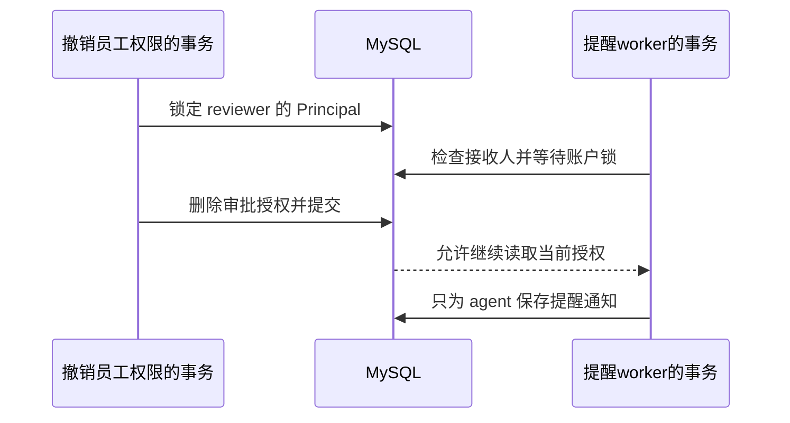

### 10.4 限定测试与结果记录

三项测试共用180秒进程期限；并发扫描为4个task，生成模型调用为0。运行记录同时保留预期结果与实际断言值，便于检查某个失败发生在身份准备、请求处理还是后台扫描。

```powershell
. ./scripts/course/environment.ps1 -Action Use -Stage 01-classroom
New-Item -ItemType Directory -Path .work/course/l01 -Force | Out-Null
$courseTests = @(
  '-m', 'pytest', '-q', '--tb=short', '--maxfail=1',
  'tests/test_approval_reminders.py::test_parallel_scans_send_once_for_each_recipient',
  'tests/test_approval_reminders.py::test_tenant_isolation_current_permission_and_read_state',
  'tests/test_approval_reminders.py::test_permission_revocation_commits_before_blocked_worker_reads_grants',
  '--junitxml=.work/course/l01/selected.xml'
)
$courseProcess = Start-Process -FilePath $runtime.python -ArgumentList $courseTests `
  -WindowStyle Hidden -PassThru -RedirectStandardOutput .work/course/l01/stdout.log `
  -RedirectStandardError .work/course/l01/stderr.log
if (-not $courseProcess.WaitForExit(180000)) {
  $courseProcess.Kill($true)
  $courseProcess.WaitForExit()
  throw '测试超过180秒期限'
}
if ($courseProcess.ExitCode -ne 0) { throw '请依据日志定位失败的业务步骤' }
Get-Content -LiteralPath .work/course/l01/stdout.log
& $runtime.python scripts/export_openapi.py --check
```

OpenAPI检查核对四类接口导出文件与当前代码；实际响应结构另由提醒测试中的`validate_response`验证。记录内容包括tag及commit、环境名及迁移、测试名、租户与方案版本、触发顺序、预期结果、实际HTTP状态与数据库字段、日志文件、未验证范围。输出中不保存访问令牌。

第一项记录可以写成：触发为“同一到期方案，四个扫描任务”；预期为“一次发送事务、两位指定接收人”；查询字段为`sent`总数、`recipient_id`集合、`status`及两个计数。实际结果一栏填写本人运行观察。某项失败时，按照日志中的第一处失败断言追踪其前置请求与数据，保留运行记录后处理对应条件。

### 10.5 到期未通知的诊断

现有[`test_no_recipient_waits_60_seconds_and_recovers`](../source.html?stage=01-business-change&path=tests/test_approval_reminders.py&symbol=test_no_recipient_waits_60_seconds_and_recovers)提供这个场景：审批权限全部撤销，到期扫描返回`deferred=1`；记录仍为`PENDING`，`check_count=1`，通知数量为0。立即再次扫描没有选中记录。哪些字段能够解释当前状态，恢复授权后什么时候能够发送？

<details>
<summary>展开诊断答案</summary>

先检查同租户、同店铺的有效员工及`approvals:decide`授权。当前没有接收人，因此扫描保存检查次数，并令`next_check_at = last_checked_at + 60秒`。**到期以后，下一次允许检查的时间仍由`next_check_at`决定**。恢复reviewer授权后，立即扫描仍为`selected=0`；等待`next_check_at`后发送成功，记录变为`SENT`、`check_count=2`、`recipient_count=1`。该测试使用真实时间等待60秒。诊断记录包含授权、两项时间和扫描统计。

</details>

历史[阶段01验证记录](../source.html?stage=01-business-change&path=docs/course/verification/approval-reminders.md)记载：16项提醒检查106.01秒，权限撤销顺序另1项11.74秒，回归24项50.93秒，生成调用0次。其范围为真实数据库、ASGI接口、真实时间及两个worker进程；持续容量不在该结论内。复现时按该记录执行完整专项和回归，并保存逐项业务解释及本人新产生的结果。


## 11. 发布检查与面试准备

提醒worker是独立运行的Python进程，负责扫描到期记录并保存通知。新增这个进程涉及代码、数据和运行配置的共同变化。发布前需要知道数据库版本、应用注册的路由、后台进程使用的数据库与状态Redis，以及停止时当前事务的处理方式。**接口测试、后台任务测试和部署检查共同说明这项功能能否交付**。

### 11.1 发布前检查

<figure class="static-diagram">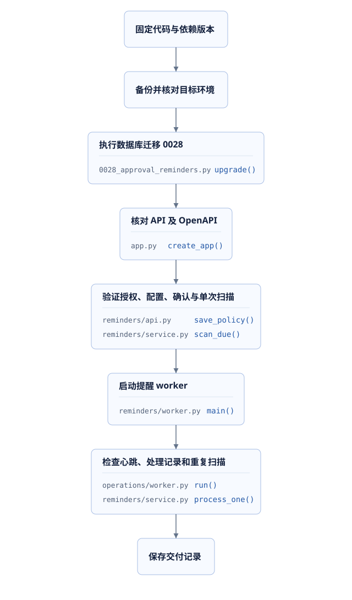</figure>

| 发布检查 | 检查结果 | 可以证明的内容 |
| --- | --- | --- |
| 版本与迁移 | 当前tag、实际导入目录、平台迁移0028 | 运行代码与表结构具有明确对应关系 |
| HTTP与字段 | 三个管理接口、OpenAPI核对、权限测试 | 接口说明与运行行为一致 |
| 业务正确性 | 时间、版本、取消、审批、通知唯一性 | 已验证场景符合业务条件 |
| 进程活动 | `reminders`心跳与单批JSON结果 | 执行者存在且完成过相应扫描 |
| 停止和恢复 | 事务提交记录、重新处理结果 | 中断边界下的状态可解释 |

**API健康检查通过后，还需要查询业务记录确认提醒正在处理**。检查字段包括`last_checked_at`、`next_check_at`、`status`和`stop_reason`。例如一个记录长时间`PENDING`，可能是尚未到期、无有效审批人、候选积压或worker没有运行。字段能够帮助确定当前条件，再据此检查进程、权限或数据库等待。

部署需要的命令与进程参数见[提醒运行说明](../source.html?stage=01-business-change&path=docs/approval-reminders.md)；完整停止与恢复演练见[阶段08发布实验](../source.html?stage=08-deployment-operations&path=docs/course/release-operations.md)。实验环境与生产环境分别保存检查结果，生产资源、实际负载和生成服务容量需要在目标条件下确认。

### 11.2 面试说明

面试介绍项目时，可以沿着需求、接口、事务、后台处理和测试结果说明：业务需要提醒的原因，确认请求对应的代码，配置版本与请求幂等各自处理的问题，审批和提醒同时执行时的结果，以及实际完成的测试。**一个具体请求、一处关键事务和一组实际结果，可以让开发过程得到核验**。

| 面试追问 | 回答必须包含的具体依据 |
| --- | --- |
| “增加一个定时任务为什么需要这些表？” | 当前配置与确认快照分别保存，版本、到期时间、再次检查与停止原因需要持久记录 |
| “多个进程同时扫描为什么不会重复通知？” | 候选只是标识；短事务内重新检查；通知唯一约束；通知与`SENT`共同提交 |
| “增加worker能提升多少性能？” | 先明确数据与租户分布、锁竞争、事务时间和积压；同租户排他锁限制并行处理 |
| “接口返回失败，可以使用新请求键重试吗？” | 响应丢失时保留原键和正文查询原结果；新的业务修改使用新键和最新版本 |
| “你如何证明权限撤销已经生效？” | 当前接收人查询、账户锁与授权修改顺序、真实并发测试的通知和权限记录 |

**口头练习**：结合一张请求图、三处关键代码和一项真实测试结果说明这次需求。遇到继续追问时，使用具体源码与原始记录解释。

## 12. 课后作业与评分

作业包含接口调用与状态变化、后台任务、Agent工具代码，以及提醒需求的后端开发。提交内容包含说明文档、个人练习分支和运行记录。课程固定tag保持不变，自己的修改、运行结果与参考实现分别标明来源。

### 12.1 请求时序与响应处理

绘制一张Mermaid时序图，参与者包含调用方、后端API、MySQL和提醒worker。图中依次表示读取配置、保存配置、客户确认、到期扫描、主管读取通知；分别标明HTTP请求和进程内部调用。请求准备沿用第10节的真实fixture，并记录以下结果：

| 操作或场景 | 请求与响应记录 | 对应的数据或调用方处理 |
| --- | --- | --- |
| 初次读取提醒配置 | GET返回200、`version=0`、`enabled=false` | 页面可以显示尚未启用的配置 |
| 启用提醒 | PUT携带`expected_version=0`和幂等键，返回200 | 保存返回的新版本，供下一次修改使用 |
| 客户确认方案 | POST携带`proposal_version`和`expected_ticket_version`，返回200 | 查询确认、审批及提醒记录的关联 |
| 旧版本修改配置 | 返回409及`VERSION_CONFLICT` | 重新读取配置，展示当前值后再提交新修改 |
| 相同键改变请求正文 | 返回409及`IDEMPOTENCY_CONFLICT` | 核对该操作的原请求；新的修改使用新键 |
| 提醒时限为0 | 返回422 | 检查字段约束，提示时限范围 |
| 主管读取通知后权限被撤销 | 首次详情200及`read=True`，再次请求404 | 历史已读时间保留，当前请求不能继续读取详情 |

为图中的请求附上路由、认证、业务服务、数据模型和后台函数共五处源码位置。每处说明输入、检查条件和返回值或保存结果。**请求返回200，只能说明对应操作成功；到期提醒还需要后台任务执行**。

<details>
<summary>展开请求时序参考答案</summary>

配置读取和保存调用`approval-reminder-policy`接口，保存请求携带当前配置版本和本次幂等键。客户确认调用`POST /openapi/v1/after-sales/proposals/{proposal_id}/confirm`，事务内保存确认、审批和启用后的提醒快照。到达允许检查时间以后，提醒worker调用`scan_due`，`process_one`重新检查业务状态和接收权限，提交通知与`SENT`状态。主管随后通过通知详情接口读取结果。

配置版本来自配置GET响应；确认请求使用方案返回的版本字段；业务身份来自访问会话。网络响应丢失时，同一次操作保持原幂等键和正文重试。收到版本冲突时，需要读取当前业务状态，确认新的修改内容。对应接口及错误码见[提醒API说明](../source.html?stage=01-business-change&path=docs/approval-reminders.md)。

</details>

### 12.2 Agent工具调用与权限检查

沿阶段00的[`build_graph.model`](../source.html?stage=00-handover&path=src/zhifu/modules/agent_runtime/runtime.py&symbol=build_graph.model)、[`build_tool_graph.execute`](../source.html?stage=00-handover&path=src/zhifu/modules/agent_runtime/runtime.py&symbol=build_tool_graph.execute)和[`invoke_tool`](../source.html?stage=00-handover&path=src/zhifu/modules/agent_runtime/tools.py&symbol=invoke_tool)阅读一次订单查询。假设模型响应中的`tool_calls`指定`get_order`及一个`order_id`，回答下面四个问题，并标注对应代码：

1. 哪个函数保存模型响应，什么条件使下一节点变为`tools`？
2. 谁调用订单查询函数，工具名称和参数分别在哪里检查？
3. 查询结果通过什么消息交回模型，这条消息如何对应原调用？
4. 客户提供了有效格式的订单号，服务端为什么仍然需要检查访问会话、店铺权限和订单归属？

这个练习使用源码阅读完成，不发送生成请求。结合已有代码解释一次调用即可，业务图和工具清单都使用项目现有定义。

<details>
<summary>展开Agent执行参考答案</summary>

模型响应提供`tool_calls`中的工具名称、参数和调用标识。`build_graph.model`保存响应，根据`result.tool_calls`设置`next_node="tools"`。图执行进入`build_tool_graph.execute`，Python代码读取工具请求并调用`invoke_tool`；后者检查工具名称是否在`DEFINITIONS`中，并使用Pydantic校验参数。

`locked_run`重新读取当前访问会话和运行状态；`get_order`继续通过业务服务检查租户、店铺权限和订单归属。**模型给出的工具名称与订单号仍然需要服务端校验**。订单号格式正确只说明参数能够解析，资源是否属于当前客户由数据库记录和授权决定。

查询成功后，工具节点把结果保存为`ToolMessage`，其中`tool_call_id`等于原调用标识，并将下一节点设置为`model`，让模型读取查询结果后继续处理。创建方案的工具还可能使运行等待业务确认；当前工具清单包含创建草稿、查询订单等操作，客户确认与主管审批由各自的授权接口执行。**工具执行权由后端代码和当前身份控制**。

</details>

### 12.3 提醒需求实现与测试结果

在从阶段00建立的个人练习分支中完成提醒需求，阶段01作为参考实现。开发顺序与前面的请求时序对应：

1. 实现配置GET、PUT和记录查询，检查员工身份、店铺权限、字段范围、配置版本与幂等键；同步完善OpenAPI。
2. 增加配置及提醒模型与迁移，在确认事务保存时限快照；审批、修订和取消时更新相应提醒状态。
3. 实现每次有数量上限和时间上限的扫描，事务内重新检查业务状态与接收人，通知和处理状态共同提交。
4. 执行真实接口及数据库测试，保留请求响应、提交顺序、查询断言、日志和运行环境；明确生成模型调用次数。
5. 编写发布次序和到期未通知的诊断记录，说明本次已经验证与尚未执行的范围。

**功能完成的判断包括接口结果、业务记录和异常情况下的处理**。第10节的三项测试用于连接这些检查，完整验证还包括时间边界、配置竞争、审批变化和恢复等专项。

<details>
<summary>展开提醒功能测试结果参考</summary>

| 场景 | 预期结果 |
| --- | --- |
| 尚未到期与等于到期时间 | 前者无提醒，后者开始允许检查 |
| 重复配置请求 | 相同键与正文返回原结果，内容变化产生冲突 |
| 两次新配置使用同一版本 | 一项提交，另一项版本冲突 |
| 原版本修订并重新确认 | 原提醒结束，新版本使用新确认时的配置 |
| 已审批或取消后扫描 | 不再产生该版本的新提醒 |
| 重复扫描及多进程竞争 | 每位接收人的有效提醒保持唯一 |
| 已读后再次扫描并撤销权限 | 已读时间保留，新的详情请求按当前权限处理 |
| 撤销权限与提醒竞争 | 通知结果符合锁保护下的实际提交顺序 |
| 提交人自己具有审批权限 | 提交人排除，其他有效审批人按规则接收 |
| 无有效接收人 | 继续等待，推进60秒检查时间，记录次数增加 |
| 数据库锁等待期间取消执行 | 当前事务不提交，后续扫描能够继续处理 |

参考实现入口：[提醒服务](../source.html?stage=01-business-change&path=src/zhifu/modules/reminders/service.py)、[管理接口](../source.html?stage=01-business-change&path=src/zhifu/modules/reminders/api.py)、[提醒专项](../source.html?stage=01-business-change&path=tests/test_approval_reminders.py)。参考实现与课程测量记录提供核对依据，作业需要附本人实际运行结果。

</details>

### 12.4 列表查询扩展练习

在个人分支增加管理查询接口：按当前授权店铺查询提醒，支持`status`筛选与有上限的分页，输出方案版本、`due_at`、`next_check_at`及检查次数。调用方能够根据状态筛选等待处理的记录，并继续读取下一页。**查询只读取状态，发送动作由提醒worker执行**。课程阶段01提供单个方案版本的查询，列表接口属于本题新增内容。

<details>
<summary>展开列表查询设计参考</summary>

读取身份后确定租户和目标店铺，查询条件同时包含该范围；当前店铺权限由服务端检查。分页需要稳定的排序，例如到期时间、方案标识和版本组合，游标保存对应值，条数参数设置明确上限。不同分页请求之间可能发生状态变化，需要在接口文档中说明此时的读取结果。

验证跨租户访问、权限撤销、空结果、条数上限及固定数据下的重复或遗漏。选择索引前检查实际过滤与排序条件，再通过真实数据和执行计划记录查询结果及扫描数量。提交请求示例、响应结构、接口文档、后端修改和本人运行结果。

</details>

### 12.5 评分规则

| 评分项目 | 分值 | 达到要求的说明与结果 |
| --- | ---: | --- |
| 请求追踪与Agent基础 | 20 | 请求时序、响应处理、工具执行者与权限检查位置准确 |
| 业务条件与数据设计 | 20 | 时间、配置、版本、接收人、停止条件和约束完整 |
| 接口、事务与幂等 | 25 | 权限有效，版本与重试含义准确，关联变更共同提交 |
| 并发与运行验证 | 25 | 真实组件、竞争顺序、查询结果与未执行范围记录完整 |
| 发布和项目表达 | 10 | 步骤可执行，出现异常时能按记录解释和定位 |

请求追踪、Agent基础阅读、提醒实现与验证为必做任务。列表查询扩展单独反馈设计质量。提交时一并附完整源文件、依赖版本、运行命令和结果记录。
