# 多Agent并发、状态同步与任务恢复

客户发来一条消息：“请查询这张键盘订单，并查一下资料中的清洁说明。”订单查询与资料搜索由两个任务分别处理。接下来会遇到普通Web系统中同样存在的问题：两个任务同时返回时由谁保存结果，查询期间订单变化后能否继续使用旧数据，以及进程退出后已经完成的查询是否需要再次执行。

**并行执行解决等待时间，状态同步决定结果能否正确使用**。本项目通过LangGraph组织查询，通过独立消息与结果副本管理内存数据，通过数据库事务、版本和执行编号控制提交。代码阶段为`02-parallel-agents`、`03-state-consistency`与`04-durable-execution`。


## 1. 并行查询与开发阶段

一次客户请求需要订单状态和商品资料两组信息。主Agent选择`consult_specialists`工具后，后端检查当前客户与订单归属，再启动`OrderAgent`和`KnowledgeAgent`。前者可以查询订单，后者可以搜索当前店铺的资料。每个角色各自调用模型、执行允许的Python函数，并将查询结果交给协调节点。

例如，一个详情页同时请求订单和商品说明：两个请求有独立的结果，页面等待所需数据后才能完整展示。这里每个角色还会通过模型选择工具与整理答复，因而需要管理各自的消息、调用次数和工具权限。

**并行的前提是执行所需的输入已经确定**。本项目在进入两个分支前验证指定订单的归属；资料搜索使用传入的问题和当前店铺范围。如果新增查询必须读取另一个查询的返回值，就需要增加明确的前后依赖。协调节点还要在结果齐全后重新检查订单、规则与资料版本。

源码：[阶段02协作入口](../source.html?stage=02-parallel-agents&path=src/zhifu/modules/agent_runtime/collaboration.py&symbol=run_specialists)、[阶段04来源检查](../source.html?stage=04-durable-execution&path=src/zhifu/modules/agent_runtime/collaboration.py&symbol=validate_specialist_results)。

### 协作功能的分层结构

下图按照职责排列请求入口、执行流程、结果管理与依赖服务。层间注明任务传递和调用内容；模型HTTP服务由主流程和专业角色调用，检索服务由资料查询函数调用。

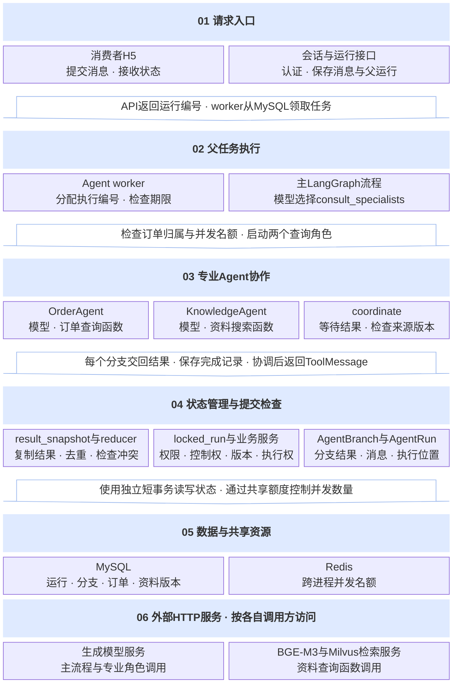

图中的`result_snapshot`与reducer在阶段03加入，`AgentBranch`在阶段04加入。`AgentRun`及其执行权检查在起始项目中已经存在。专业角色只查询数据；创建换货方案、客户确认、主管审批和OMS操作继续经过对应业务服务和权限检查。

### 三个阶段的代码变化

| 代码阶段 | 解决的问题 | 主要修改位置 | 运行结果 |
| --- | --- | --- | --- |
| `02-parallel-agents` | 一个请求需要两类专业查询 | `collaboration.py`、工具定义、发布配置 | 两个角色使用独立消息和工具，协调节点检查必需结果 |
| `03-state-consistency` | 并发结果的对象共享、重复交接和内容冲突 | `state_merge.py`、`thread_bridge.py`、`CollaborationState` | 接收独立副本，相同操作去重，冲突明确失败 |
| `04-durable-execution` | 进程退出后复用已完成分支 | `branch_store.py`、迁移0029、`execute_specialist` | 保存分支结果，重新领取父运行后检查并复用有效结果 |

源码与说明：[阶段02协作规则](../source.html?stage=02-parallel-agents&path=docs/course/parallel-agents.md)、[阶段03结果合并](../source.html?stage=03-state-consistency&path=src/zhifu/modules/agent_runtime/state_merge.py&symbol=merge_results)、[阶段04分支保存](../source.html?stage=04-durable-execution&path=src/zhifu/modules/agent_runtime/branch_store.py&symbol=start_branch)。

### 等待时间与资源消耗

串行调用的等待时间约为两个查询耗时之和；可以并行的部分约为较慢查询的耗时，再加上分发、保存和结果检查的时间。例如假设两个独立查询分别需要2秒和3秒，串行部分为5秒，并行部分接近3秒。这里是说明执行顺序的计算示例，实际结果需要记录各次请求耗时。

**两个Agent同时工作会占用两个并发名额，也会分别产生模型调用**。本实现中，每个专业角色通常先请求模型选择工具，执行查询后再请求模型整理回答。增加角色需要同时检查等待时间、调用次数、token消耗和查询质量，不能仅凭“并行完成”判断性能改善。

三个阶段可以沿同一个问题检查：两份结果分别由谁创建、谁持有副本、保存在哪张表、当前是否仍然有效。接下来的代码把这几个问题分别对应到模型工具、事件循环和数据库事务。


## 2. 专业Agent的调用流程

客户提供了一张本人订单，提出两个问题：“这件键盘是否符合换货条件？说明书里要求如何清洁？”订单状态与换货规则来自业务数据库，清洁说明来自当前店铺发布的商品资料。服务端已经取得订单编号和资料问题后，两项查询可以同时进行；订单编号尚未确定时，需要通过订单查询或补充信息取得输入。

主Agent仍执行“请求模型、执行工具、把结果交回模型”的循环。阶段02的`after-sales-v10`提供`consult_specialists`工具，参数是`order_id`和`question`。主模型选择这个工具后，`build_tool_graph.execute`要求本轮只有这一项工具调用，再进入`run_specialists`。服务端检查客户身份、发布版本和运行状态，并通过`get_order`核实指定订单归属。**是否进入专业协作取决于发布配置、输入条件和主模型返回的工具请求**。主模型也可以直接选择普通查询工具。

源码：[02 · 主工具执行](../source.html?stage=02-parallel-agents&path=src/zhifu/modules/agent_runtime/runtime.py&symbol=build_tool_graph.execute)、[协作参数](../source.html?stage=02-parallel-agents&path=src/zhifu/modules/agent_runtime/tools.py&symbol=SpecialistQuery)、[发布配置](../source.html?stage=02-parallel-agents&path=src/zhifu/modules/agent_runtime/config.py)。

<figure class="static-diagram">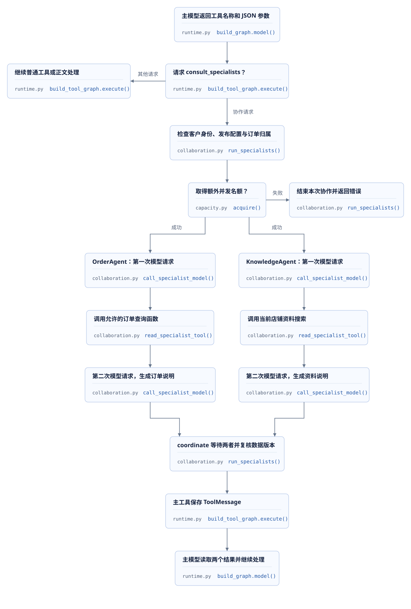</figure>

两个角色各自维护一份`messages`。其中包含角色指令、订单编号和问题，以及本角色产生的模型响应与工具结果。`ToolMessage`保存函数返回的JSON，`tool_call_id`对应模型原来请求的调用标识。角色之间通过最终结果交换信息，各自的消息列表在本次函数调用中创建。

| 角色 | 可以调用的函数 | 返回结果与权限范围 |
| --- | --- | --- |
| `OrderAgent` | `get_order`、`search_orders` | 查询订单及规则；`get_order`限于本次指定订单，所有查询继续检查当前客户和店铺范围 |
| `KnowledgeAgent` | `search_knowledge` | 查询当前店铺已发布资料，返回正文引用与版本；不执行换货操作 |
| `coordinate` | 当前运行与来源版本检查 | 等待两个角色完成，重新核实订单、规则和资料，再返回组合结果 |

下面是阶段02的`execute_specialist`中的实际片段。第一次模型调用要求返回一至两个工具请求，Python按顺序执行这些工具；第二次模型调用只生成说明。**两个角色可以并行，每个角色内部仍按数据依赖顺序执行**。

```python
    response = await call_specialist_model(
        sessions, settings, guard, state, messages, role, final=False, allowance=allowance)
    require(1 <= len(response.tool_calls) <= 2, "TOOL_LIMIT", "协作查询需要一至两个工具调用")
    messages.append(response)
    evidence = []
    for call in response.tool_calls:
        result = await read_specialist_tool(sessions, guard, state, role, call, search_knowledge)
        evidence.append(result)
        messages.append(ToolMessage(content=json.dumps(result, ensure_ascii=False),
                                    tool_call_id=call["id"]))
    answer = await call_specialist_model(
        sessions, settings, guard, state, messages, role, final=True, allowance=allowance)
    require(not answer.tool_calls, "TOOL_LIMIT", "协作角色已经达到调用轮数上限")
```

源码：[02 · execute_specialist](../source.html?stage=02-parallel-agents&path=src/zhifu/modules/agent_runtime/collaboration.py&symbol=execute_specialist)、[角色工具检查](../source.html?stage=02-parallel-agents&path=src/zhifu/modules/agent_runtime/collaboration.py&symbol=read_specialist_tool)。模型HTTP请求和向量搜索在业务事务之外等待；每次读取或提交使用独立的Session，并重新检查当前执行权。角色答复与原始查询结果一起返回，协调节点依据查询结果中的版本进行检查。

### 并行等待与调用数量

这段流程可以联系`Promise.all([...])`或`asyncio.gather(...)`：同时发起两项工作，取得全部结果后继续处理。这里通过LangGraph的边表达依赖；`START`同时连接两个角色，两个角色共同连接`coordinate`。节点是Python函数，图状态保存函数交回的数据。阶段02使用`order_result`和`knowledge_result`两个字段，各角色只写自己的字段。

```python
        graph = StateGraph(CollaborationState)
        graph.add_node("OrderAgent", order_agent)
        graph.add_node("KnowledgeAgent", knowledge_agent)
        graph.add_node("coordinate", coordinate)
        graph.add_edge(START, "OrderAgent")
        graph.add_edge(START, "KnowledgeAgent")
        graph.add_edge(["OrderAgent", "KnowledgeAgent"], "coordinate")
        graph.add_edge("coordinate", END)
        async with asyncio.timeout(60):
            result = await graph.compile().ainvoke({})
```

源码：[02 · run_specialists](../source.html?stage=02-parallel-agents&path=src/zhifu/modules/agent_runtime/collaboration.py&symbol=run_specialists)。任何必需角色失败，或者60秒协作期限结束，本次协作都无法提供成功结果；`finally`释放额外名额。并行减少的是两条独立路径的相互等待，一次完整成功协作仍需要四次专业模型请求，主模型的请求另行累计。所有尝试登记在同一个父运行中；该发布版本最多允许累计十次模型请求，每次专业模型输出最多512个token，实际费用继续按调用记录核算。

`OrderAgent`使用主任务已经取得的全局交互任务并发名额；`KnowledgeAgent`额外申请一个同类名额。Redis检查`global_concurrency`，并保护`interactive_reserved`、`background_reserved`以及`TenantQuota.interactive_reserved`规定的预留名额。租户主任务数量在`claim`中检查`TenantQuota.interactive_limit`，未配置时使用`tenant_concurrency`；两个角色属于同一个`AgentRun`。**并发名额限制同一时间执行的数量，模型调用计数与token预算另外记录**。名额申请失败返回`MODEL_CAPACITY_FULL`，不会进入两个角色节点。

源码：[02 · acquire](../source.html?stage=02-parallel-agents&path=src/zhifu/modules/agent_runtime/capacity.py&symbol=acquire)、[claim](../source.html?stage=02-parallel-agents&path=src/zhifu/modules/agent_runtime/worker.py&symbol=claim)、[专业模型调用与计量](../source.html?stage=02-parallel-agents&path=src/zhifu/modules/agent_runtime/collaboration.py&symbol=call_specialist_model)。

## 3. 任务、线程与进程

两个模型HTTP请求都在等待远端响应时，一个事件循环可以继续调度其他工作。`asyncio`的task表示这个事件循环正在管理的一项异步执行；遇到需要等待的`await`时，可以让其他任务继续运行。前端使用Promise等待网络响应时也有相似的调度思路。阻塞函数如果直接占用事件循环所在的线程，其他任务仍会一起等待。

| 名称 | 对应的对象 | 状态与同步范围 |
| --- | --- | --- |
| `asyncio.Task` | 事件循环管理的异步执行 | 同一事件循环中的任务可以访问同一对象；跨`await`的读取、检查和修改需要明确协调 |
| Python `Thread` | 同一进程中的操作系统线程 | 共享进程内存；多个线程访问共同数据时使用线程同步或结果交接 |
| worker进程 | 独立运行的Python程序 | 各有自己的内存；共同任务通过MySQL、Redis和稳定操作标识协调 |
| LangGraph `thread_id` | 持久化图状态的逻辑标识 | checkpointer据此查找一组状态快照；它不决定Python线程数量 |

<figure class="static-diagram">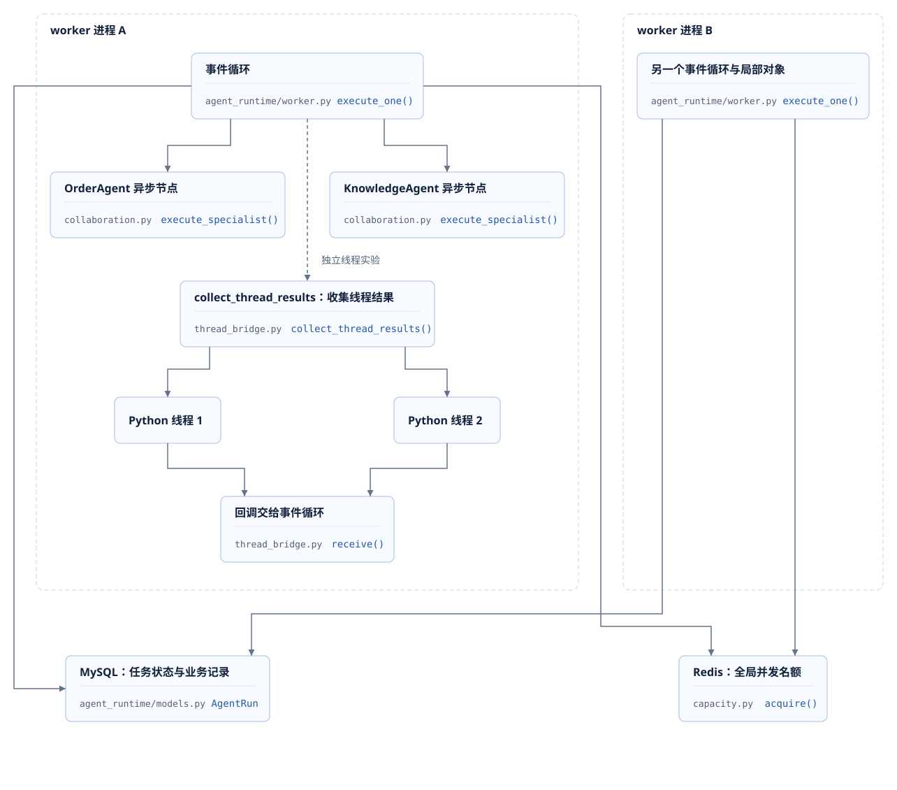</figure>

阶段02、03的专业协作直接使用异步节点；阶段03的`collect_thread_results`提供同步函数结果交接实验，主协作流程没有调用它。需要接入同步SDK时，可以由线程执行有期限的同步工作，再把结果交给事件循环。`asyncio.Lock`用于协调同一事件循环中的任务；`threading.Lock`用于协调同一进程中的线程。多个worker进程各有自己的锁对象，共享业务仍通过数据库事务和Redis检查控制。

checkpointer是LangGraph保存图状态快照的组件，`thread_id`是访问这些快照的逻辑标识。**本项目阶段02、03没有配置checkpointer，也没有传入`thread_id`**。主图通过MySQL中的`AgentRun.messages`、`next_node`和`step`读取执行进度，`lease_token`用于检查当前执行权。源码中的`graph.compile()`可以直接核对这一点，恢复行为需要继续查看业务状态的保存和读取代码。

源码：[02 · 主图构建与读取](../source.html?stage=02-parallel-agents&path=src/zhifu/modules/agent_runtime/runtime.py&symbol=build_graph)、[AgentRun](../source.html?stage=02-parallel-agents&path=src/zhifu/modules/agent_runtime/models.py&symbol=AgentRun)。框架概念见[LangGraph持久化说明](https://docs.langchain.com/oss/python/langgraph/persistence)，事件循环和跨线程回调见[Python asyncio开发说明](https://docs.python.org/3/library/asyncio-dev.html)。

## 4. 共享状态与线程结果交接

考虑一个共享计数的示例：两个查询线程完成后，都需要把`completed_count`增加1。初始值为0，两条线程各自读取0，在自己的局部变量中计算出1，再分别写回。最终计数为1，预期计数为2。下图用于说明读取、计算与写入交错的含义，未作为项目实测结果。

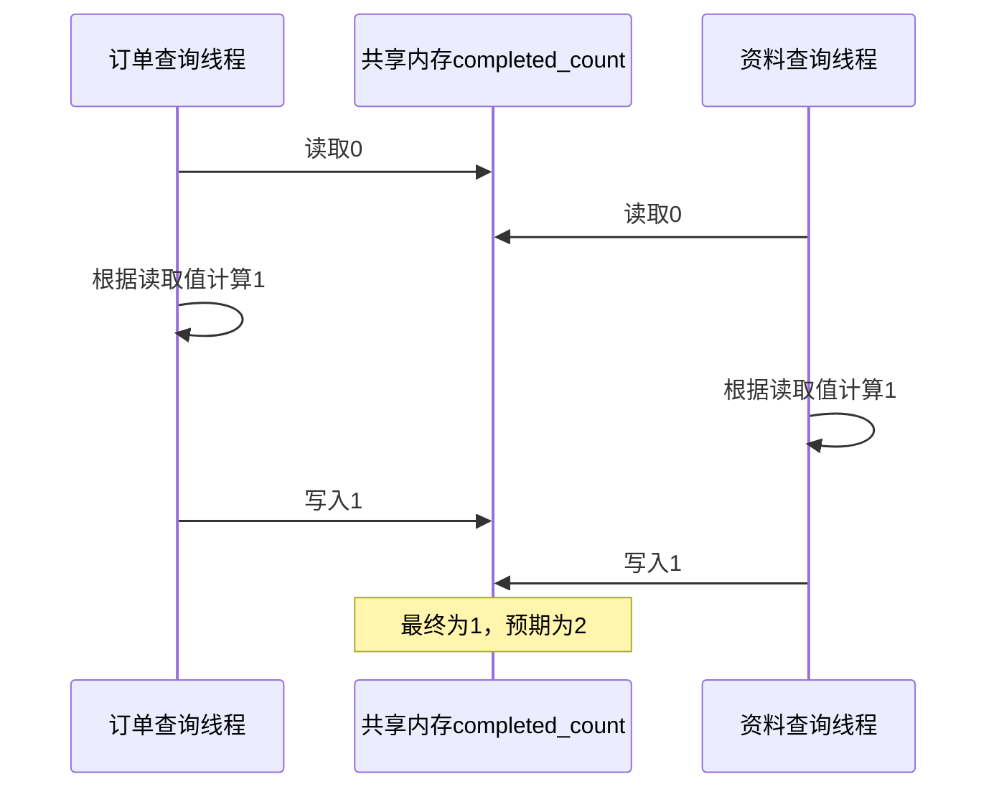

**共同数据的读取、判断与修改需要作为完整步骤协调**。在这个示例中，两个线程各自得到的读取值相同，后一次写入覆盖了前一次增加。实际`thread_bridge`把完成数量和结果集合交给同一个事件循环管理，线程只发布结果；`publication`锁负责协调发布动作与接收入口关闭。

假设一个同步查询函数返回订单数量，另一个同步查询函数返回商品资料。两条线程如果直接修改同一个`results`列表，调用方还需要处理完成次数、错误、取消和重复结果；其中任意一项检查与修改交错，都会影响最终状态。阶段03把责任集中在事件循环：线程完成自己的函数，生成结果副本，提交回调；事件循环统一修改`accepted`、`remaining`和等待结果的`Future`。这里的`Future`表示一个尚未完成的结果，调用方通过`await`等待它。

下面是`collect_thread_results.execute`中的实际片段。`Barrier`让本次实验的线程到齐后再开始；`stopped`是各线程可以读取的取消标记。工作函数接收这个标记，自行限制阻塞调用期限。发生异常时，异常对象也通过同一个交接入口传回。

```python
        try:
            start.wait()
            if stopped.is_set():
                return
            result = result_snapshot(operation(stopped))
        except BaseException as failure:
            # 工作线程异常需要传播给等待协程，不能使请求永久等待。
            error = failure
        with publication:
            if not stopped.is_set():
                loop.call_soon_threadsafe(receive, result, error)
```

源码：[03 · collect_thread_results.execute](../source.html?stage=03-state-consistency&path=src/zhifu/modules/agent_runtime/thread_bridge.py&symbol=collect_thread_results.execute)。`call_soon_threadsafe`把`receive`排入事件循环，回调随后在事件循环线程运行。**工作线程负责提交结果，事件循环负责接受结果和修改共享集合**。这个调用不会等待结果合并完成，也不会把数据库事务变成线程安全操作。

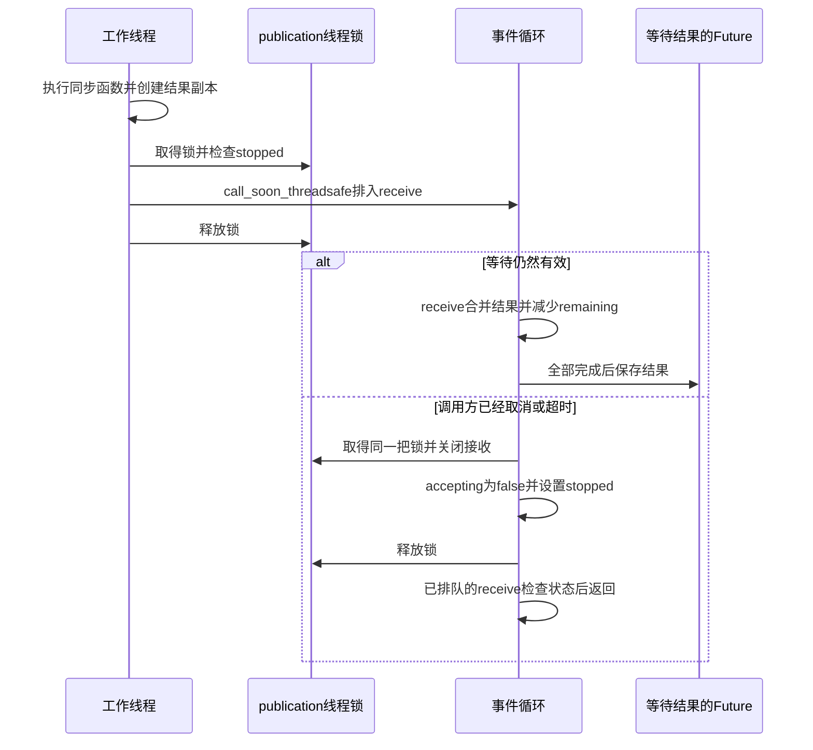

`publication`只保护“检查是否允许发布并提交回调”以及“关闭发布入口”这两组动作，锁内不执行模型请求、同步查询或结果合并。`receive`检查`accepting`与`completed.done()`，关闭后即使已有回调进入队列，也不会写入结果。它运行期间没有`await`，当前事件循环中的其他任务不会在这段回调中间插入执行。具体行为可阅读[结果接收](../source.html?stage=03-state-consistency&path=src/zhifu/modules/agent_runtime/thread_bridge.py&symbol=collect_thread_results.receive)与[结束等待时的清理](../source.html?stage=03-state-consistency&path=src/zhifu/modules/agent_runtime/thread_bridge.py&symbol=collect_thread_results)。

取消等待时，`finally`关闭接收、设置`stopped`并终止Barrier等待。已经进入同步函数的线程仍可能继续运行，因此同步操作需要自己的超时和取消检查。该函数默认等待5秒，一次最多启动32条线程。**取消协程后，迟到的线程结果不能重新成为本次请求的有效结果**。线程操作也不能把其他task正在使用的`AsyncSession`作为共享对象继续修改。

### 嵌套对象的独立副本

复制最外层字典后，里面的列表和字典仍可能由双方共同引用。阶段03的`BranchResult`使用`frozen=True`限制字段重新赋值，但`payload`内部的列表仍然可以修改。例如`payload["items"][0]["quantity"]`与`source_versions`都是需要考虑的嵌套数据。交接时，`result_snapshot`重新验证并经过JSON序列化与反序列化，建立独立的结果对象。

```python
    data = value.model_dump(mode="python") if isinstance(value, BranchResult) else dict(value)
    validated = BranchResult.model_validate(data)
    encoded = json.dumps(validated.model_dump(mode="python"), allow_nan=False)
    return BranchResult.model_validate_json(encoded)
```

源码：[03 · result_snapshot](../source.html?stage=03-state-consistency&path=src/zhifu/modules/agent_runtime/state_merge.py&symbol=result_snapshot)。输入限于声明的字段和有效JSON，版本必须是非负整数；集合、NaN、Infinity等内容会被拒绝。工作函数在返回前完成自己结果的修改，接收方使用独立副本。测试会修改原结果的数量和版本，再检查合并结果保持原值，还会修改新返回的副本，确认上一次合并结果不受影响，见[副本与稳定重放测试](../source.html?stage=03-state-consistency&path=tests/test_course_state.py&symbol=test_result_merge_has_owned_snapshots_and_stable_replay)。

**练习：取消与迟到回调**。同步函数已经开始等待外部结果，调用方取消`collect_thread_results`。随后同步函数返回，并且另一个回调在取消前已经排入事件循环。分别指出这两种结果在哪里被拒绝，以及哪一段代码负责终止外部等待。

<details>
<summary>展开参考答案</summary>

函数退出时，`finally`在`publication`锁内设置`accepting=False`与`stopped`。尚未发布的线程取得锁后发现`stopped`，跳过回调提交；已经排队的回调进入`receive`时，发现接收已关闭或Future已完成，直接返回。同步函数中的外部等待由该函数自己的超时或对`stopped`的检查结束，交接函数只结束本次等待并关闭结果入口。

对应测试使用真实线程及`Event`控制时序：取消收集task，再允许同步函数返回，最后检查`committed`仍为空。源码：[03 · 取消后拒绝迟到结果](../source.html?stage=03-state-consistency&path=tests/test_course_state.py&symbol=test_cancelled_thread_collection_rejects_late_result)。

</details>

## 5. 结果合并与冲突处理

阶段02的两个角色分别写`order_result`和`knowledge_result`。阶段03把结果放入统一的`results`列表，使用`Annotated[list[BranchResult], merge_results]`告诉LangGraph，每次更新都由`merge_results`处理。这个合并函数称为reducer：它接收已有结果和新增结果，返回下一份结果列表。两个节点直接写同一个普通字段时，需要定义合并规则；本项目的真实LangGraph测试检查这种情况下产生的`InvalidUpdateError`。

源码：[03 · CollaborationState](../source.html?stage=03-state-consistency&path=src/zhifu/modules/agent_runtime/collaboration.py&symbol=CollaborationState)、[普通字段并发更新测试](../source.html?stage=03-state-consistency&path=tests/test_course_state.py&symbol=test_real_langgraph_rejects_parallel_ordinary_field)。

每个`BranchResult`保存`agent_id`、`operation_id`、`source_versions`和`payload`。`operation_id`标识一次逻辑查询：主工具使用父运行编号、步骤和工具调用标识组成基础编号，角色再附加自己的名称。重放同一项查询时，依据这个编号识别重复。`source_versions`说明结果使用哪一版订单或资料；`payload`同时保存角色答复和查询原文。

<figure class="static-diagram">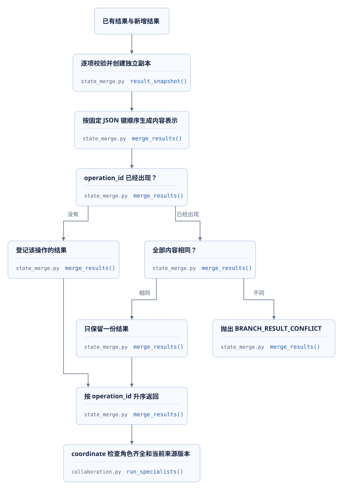</figure>

下面是`merge_results`的实际函数主体。比较内容时使用固定的JSON键顺序，最后按`operation_id`排序。**完成先后顺序可以变化，相同输入集合得到的合并结果保持一致**。列表中的业务顺序仍然保留，例如`payload`内部数组顺序变化也属于内容变化。

```python
    accepted = {}
    fingerprints = {}
    for item in [*(current or ()), *(incoming or ())]:
        result = result_snapshot(item)
        fingerprint = json.dumps(
            result.model_dump(mode="python"), sort_keys=True, ensure_ascii=False, allow_nan=False
        )
        previous = fingerprints.get(result.operation_id)
        if previous is not None and previous != fingerprint:
            raise BusinessError("BRANCH_RESULT_CONFLICT", "相同操作标识对应不同分支结果", 409)
        accepted[result.operation_id] = result
        fingerprints[result.operation_id] = fingerprint
    return [accepted[operation_id] for operation_id in sorted(accepted)]
```

源码：[03 · merge_results](../source.html?stage=03-state-consistency&path=src/zhifu/modules/agent_runtime/state_merge.py&symbol=merge_results)。函数逐项创建副本，使用本次调用的字典积累结果，不修改传入的集合。相同操作编号下，角色、来源版本或正文任一内容改变，都会抛出`BRANCH_RESULT_CONFLICT`，错误状态为409；本次调用不返回部分成功结果。

| 输入情况 | 合并结果 | 对业务的含义 |
| --- | --- | --- |
| 订单和资料按不同先后顺序完成 | 按操作编号固定排序 | 展示和后续处理不依赖完成顺序 |
| 同一操作、同一份内容再次交回 | 保留一份 | 重复结果不会增加有效项 |
| 同一操作编号、不同数量或版本 | 拒绝本次合并 | 调用方需要调查同一逻辑操作为何产生不同结果 |
| 两个不同编号都声称来自订单角色 | reducer可以收集，`coordinate`继续检查角色集合 | 去重规则与必需角色检查分别负责不同条件 |
| 两个角色齐全，但订单已被更新 | 当前来源版本检查失败 | 内存合并成功后仍需重新核实数据库事实 |

`coordinate`要求恰好包含`OrderAgent`和`KnowledgeAgent`各一份结果，然后在业务事务中复核运行步骤、订单归属、规则与资料版本。通过后，主工具再次检查当前状态并保存`ToolMessage`，主模型才能继续使用这些结果。**reducer解决结果收集、复制和重复冲突，业务有效性由提交时的权限与版本检查保证**。源码：[03 · 协调与来源检查](../source.html?stage=03-state-consistency&path=src/zhifu/modules/agent_runtime/collaboration.py&symbol=run_specialists)、[主工具结果提交](../source.html?stage=03-state-consistency&path=src/zhifu/modules/agent_runtime/runtime.py&symbol=build_tool_graph.execute)。

**练习：重复结果与业务版本变化**。已有操作`orders-read`，来源版本为3、数量为1。资料操作`knowledge-read`完成后，订单结果又以相同编号交回一次。分别考虑内容完全相同、数量改成2、内容不变但数据库订单已更新为版本4三种情况，说明在哪个函数继续或失败。

<details>
<summary>展开参考答案</summary>

内容完全相同，`merge_results`保留一份`orders-read`，与`knowledge-read`按编号排序后返回；修改数量后，同一编号的内容表示不同，合并抛出`BRANCH_RESULT_CONFLICT`。数据库订单更新为版本4时，内存中的版本3结果仍可通过重复检查，但`validate_specialist_results`读取当前订单后发现版本不一致，返回`ORDER_VERSION_CONFLICT`。

这三项检查分别回答“是否重复”“相同操作的结果是否冲突”“查询依据是否仍然有效”。对应源码与测试：[03 · 内容冲突检查](../source.html?stage=03-state-consistency&path=tests/test_course_state.py&symbol=test_same_operation_rejects_changed_content)、[真实LangGraph合并](../source.html?stage=03-state-consistency&path=tests/test_course_state.py&symbol=test_real_langgraph_reducer_merges_parallel_results)、[来源版本检查](../source.html?stage=03-state-consistency&path=src/zhifu/modules/agent_runtime/collaboration.py&symbol=validate_specialist_results)。

</details>


## 6. 数据库事务与并发版本

订单查询和资料查询可以同时等待外部服务，写入数据库时仍要检查当前业务状态。一个常见场景是：客户发起查询，后台正在等待资料检索，管理员随后撤回了资料；外部请求返回的候选仍可能包含旧版本。查询开始时有效的权限和数据，在返回时已经发生变化，因此提交阶段需要重新检查。

### 每个并发任务使用独立Session

项目把`sessions`这个`async_sessionmaker`传给各个处理函数。它负责创建Session；每次进入`async with sessions.begin() as session`，都会创建本次操作使用的`AsyncSession`和事务。订单分支、资料分支以及HTTP请求分别创建自己的Session，使用完毕后由上下文提交或终止事务并关闭Session。

Session会跟踪读取的对象、待写入的修改和当前事务。两个并发task共享同一个Session时，其中一个任务的查询、刷新或提交会影响另一个任务正在处理的对象。**Session由当前任务管理，跨任务传递的是标识、参数和独立结果**。模型客户端和检索客户端可以按各自的并发规则共享，业务Session仍按每次数据库操作创建。

在阶段03的`read_specialist_tool`中，资料分支先在事务内读取当前运行身份和店铺范围，结束该事务后调用检索服务。以下是函数的后半部分：

```python
query = SearchInput.model_validate(call["args"])
# 向量调用在事务之外；读取正文时重新检查客户、店铺与资料版本。
candidates = await search_knowledge(tenant_id, store_id, query.query)
async with sessions.begin() as session:
    run, auth = await guard(session, state["run_id"], state["token"])
    require(run.step == state["step"], "RUN_STATE_CHANGED", "协作节点已变化")
    return await verified_results(session, auth, run.store_id, candidates, limit=3)
```

检索返回后，函数重新创建事务，调用`guard`检查当前运行，再由`verified_results`查询当前可访问的资料。外部请求只返回候选，服务端根据数据库中的店铺、发布状态和版本决定哪些内容可以继续使用。

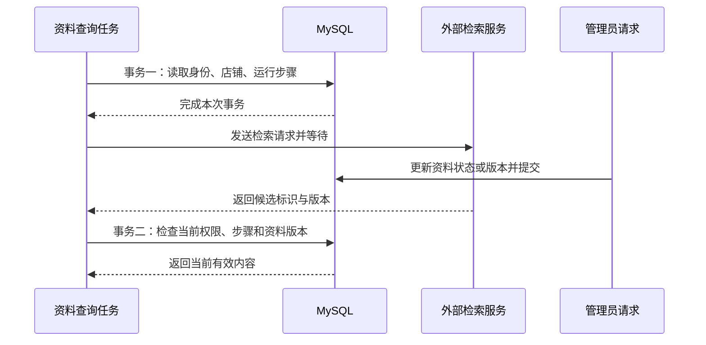

主模型节点采用相同的处理方式：事务内登记调用和读取输入，事务外等待HTTP响应，返回后保存用量，再创建事务检查当前运行与引用资料。**等待网络响应期间不持有这段业务事务，可以缩短连接和记录锁的占用时间**。返回后的检查仍有必要，单纯把HTTP调用移到事务之外并不能保证旧结果有效。

源码：[03 · read_specialist_tool](../source.html?stage=03-state-consistency&path=src/zhifu/modules/agent_runtime/collaboration.py&symbol=read_specialist_tool)、[03 · verified_results](../source.html?stage=03-state-consistency&path=src/zhifu/modules/knowledge/api.py&symbol=verified_results)、[03 · 主模型节点](../source.html?stage=03-state-consistency&path=src/zhifu/modules/agent_runtime/runtime.py&symbol=build_graph.model)。

### 行锁与页面版本

主管在两个浏览器窗口打开同一份待审批方案，一个窗口提交批准，另一个窗口提交拒绝。两个表单都带着读取时的工单版本。服务端取得工单行锁后比较版本，首先提交的请求推进版本，后续请求就能识别自己的输入已经过期。

阶段03的`AfterSalesService.decide`同时检查方案版本和工单版本：

```python
require(
    ticket.proposal_version == body.proposal_version == approval.proposal_version,
    "PROPOSAL_VERSION_CONFLICT",
    "方案版本已变化",
)
require(ticket.version == body.expected_version, "VERSION_CONFLICT", "工单版本已变化")
```

外层`execute`已经完成身份与店铺授权检查，并在调用`decide`前锁定工单。`decide`还会核对提交者、待审批状态、客户确认和当前业务规则。版本检查回答表单依据是否仍然有效，行锁保证检查到提交之间不会被另一个相同工单的写入请求穿过。

| 字段 | 对应记录 | 检查目的 |
| --- | --- | --- |
| `expected_version` | 审批请求所依据的`Ticket.version` | 识别另一个请求已经修改工单 |
| `proposal_version` | 工单、确认和审批中的方案版本 | 保证审批的内容仍是客户确认的方案 |
| `expected_control_version` | 会话的`control_version` | 识别客服接管或交还后的控制权变化 |
| `step` | `AgentRun`已经提交的执行步骤 | 识别外部请求返回期间运行已经进入其他步骤 |

阶段03的并发审批测试通过真实ASGI接口向同一审批发送两次请求，使用同一个主管账户、不同请求键和相同版本。测试要求HTTP状态为一个200、一个409，错误码为`VERSION_CONFLICT`；最终工单版本只增加一次，审批结果与成功响应一致，批准或拒绝事件合计一条。这组断言同时检查接口和数据库状态。

源码：[03 · AfterSalesService.execute](../source.html?stage=03-state-consistency&path=src/zhifu/modules/after_sales/service.py&symbol=AfterSalesService.execute)、[03 · AfterSalesService.decide](../source.html?stage=03-state-consistency&path=src/zhifu/modules/after_sales/service.py&symbol=AfterSalesService.decide)、[03 · 并发审批测试](../source.html?stage=03-state-consistency&path=tests/test_course_state.py&symbol=test_real_mysql_version_race_has_one_committed_decision)。

**练习：审批成功后浏览器网络超时**。原请求带着版本7，数据库已经提交为版本8。浏览器使用原请求键与原正文重试，同时另一个窗口使用新请求键提交版本7的表单。两次请求分别会得到什么结果？

<details>
<summary>参考结果</summary>

原请求重试在当前授权检查通过后读取同内容的`CommandReceipt`，返回第一次保存的响应。新请求没有对应收据，需要继续检查当前版本，版本7与数据库中的8不一致，返回版本冲突。幂等键识别同一次操作，版本字段检查一次新操作所依据的数据；这两个检查分别保留。

</details>

## 7. 执行租约与迟到结果

HTTP请求提交运行后，数据库中的`AgentRun`进入`QUEUED`。独立worker负责领取并执行。租约由`lease_until`和`lease_token`共同记录：前者表示本次执行权有效到什么时间，后者表示这是第几次领取。worker中断后，其他进程可以在符合条件时重新领取；原进程即使稍后恢复，也必须通过提交检查。

### 领取条件与执行期限

阶段04的`claim`在数据库事务内按租户调度顺序和并发额度选择候选，锁定相关记录并重新检查状态。常驻worker还会申请Redis共享额度；额度不足时保留排队状态。正常领取将状态设为`RUNNING`，令`lease_token`增加1，并设置125秒后的`lease_until`。

| 时间或状态 | 阶段04的处理 |
| --- | --- |
| `QUEUED` | 存在可用额度且未超过运行总期限时可以领取 |
| `RUNNING`且租约有效 | 当前领取继续有效，其他worker不重新领取 |
| `RUNNING`且租约到期 | 未超过运行总期限时可以重新领取，取得更大的token |
| 单次图调用 | `execute_one`用120秒限制一次`graph.ainvoke` |
| 一次专业协作图 | `run_specialists`用60秒限制这次协作调用 |
| `deadline_at` | 创建运行时设为10分钟以后，重新领取不延长它 |
| 等待客户或审批且超过总期限 | 进入期限清理，标记`FAILED`，不恢复业务执行 |

这几个时间分别控制一次图调用、一次领取和整个业务运行。125秒租约到期只允许重新竞争领取；它不会重置累计模型调用次数、业务版本或运行总期限。`FAILED`、`CANCELLED`和`COMPLETED`均不属于自动重新执行的候选。

源码：[04 · claim](../source.html?stage=04-durable-execution&path=src/zhifu/modules/agent_runtime/worker.py&symbol=claim)、[04 · execute_one](../source.html?stage=04-durable-execution&path=src/zhifu/modules/agent_runtime/worker.py&symbol=execute_one)、[04 · queue_run](../source.html?stage=04-durable-execution&path=src/zhifu/modules/agent_runtime/service.py&symbol=queue_run)、[04 · run_specialists](../source.html?stage=04-durable-execution&path=src/zhifu/modules/agent_runtime/collaboration.py&symbol=run_specialists)。

### 提交时检查当前执行权

假设worker A领取时取得token 11，随后长时间没有完成。原租约到期后，worker B取得token 12。A返回的结果仍携带11，`locked_run`读取当前数据库记录时会拒绝它。

```python
await session.refresh(snapshot, with_for_update=True)
require(
    snapshot.status == "RUNNING"
    and snapshot.lease_token == token
    and snapshot.lease_until is not None
    and snapshot.lease_until > now(),
    "RUN_LEASE_LOST",
    "当前执行权已失效",
)
require(snapshot.deadline_at > now(), "RUN_DEADLINE", "任务已超过执行期限")
```

**有效结果必须同时满足当前状态、当前token、有效租约和运行总期限**。即使尚无worker重新领取，A在自己的租约到期后提交也会失败。完整`locked_run`还会验证访问会话、租户与账户身份、店铺权限，以及会话控制者、控制版本和`active_run_id`。

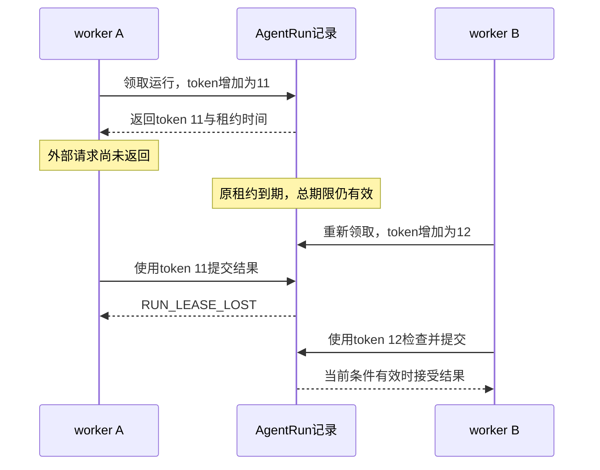

这项检查控制节点与分支结果能否进入数据库。已经发送给模型或OMS的HTTP请求仍可能在远端继续执行，所以外部操作还需要稳定操作编号、幂等处理和结果查询。某个旧worker失去提交资格，也不能据此推断远端没有处理过它的请求。

源码：[04 · locked_run](../source.html?stage=04-durable-execution&path=src/zhifu/modules/agent_runtime/runtime.py&symbol=locked_run)。

## 8. 分支记录与进程恢复

主运行把消息、`next_node`和`step`保存在`AgentRun`。重新领取后，主图的`load`节点读取这些字段，继续执行数据库中保存的下一步。阶段04增加`AgentBranch`，让每个专业角色已经完成的结果也能独立保存。LangGraph可以通过checkpointer保存图执行状态；这里的主图和专业协作图调用`compile()`时均未传入这个组件，恢复依赖项目自己的MySQL记录。

### 操作编号、请求摘要与父运行

`operation_id`由父运行、步骤、工具调用编号和角色稳定生成。例如同一次`consult_specialists`中的订单角色，进程重启后继续使用原编号。`request_hash`是请求摘要，包含角色、操作编号、父步骤及JSON参数；字段排列顺序不影响摘要，请求内容变化会产生冲突。

| AgentBranch字段 | 保存内容与约束 |
| --- | --- |
| `tenant_id + parent_run_id + operation_id` | 复合主键，限定某个租户、父运行中的一次角色操作 |
| `agent_id`、`parent_step`、`request_hash` | 核对角色、步骤和参数，阻止同编号被用于其他请求 |
| `lease_token` | 最近一次有效父运行领取所使用的token |
| `status` | 仅有`RUNNING`和`COMPLETED`；前者还没有已提交结果 |
| `result` | 已完成的JSON结果，包含来源版本；`COMPLETED`必须具有结果 |

父外键同时包含租户和运行标识。`start_branch`与`finish_branch`都先调用`locked_run`检查并锁定父运行，再锁定子记录；即使读取已经完成的分支，也需要通过当前授权和执行权检查。

`start_branch`找到已有记录后的处理如下：

```python
matching_request(branch, body, digest)
require(branch.lease_token <= state["token"], "BRANCH_LEASE_LOST", "分支执行权已变化")
# 新父租约重新认领原操作。已完成结果也需要当前父授权，来源版本由汇总方复核。
branch.lease_token = state["token"]
branch.updated_at = timestamp
return result_snapshot(branch.result) if branch.status == "COMPLETED" else None
```

`result_snapshot`返回独立结果，调用方修改嵌套字段不会修改已保存的数据。返回`None`表示当前没有完成结果。同一有效租约下重复调用`start_branch`可以同时得到`None`，因此它不单独保证查询只执行一次；当前协作图为每个角色安排一个节点入口，调用方仍需维持这个执行安排。`finish_branch`对相同结果的重复提交返回原结果，对相同操作的不同结果返回冲突。

源码：[04 · AgentBranch](../source.html?stage=04-durable-execution&path=src/zhifu/modules/agent_runtime/branch_store.py&symbol=AgentBranch)、[04 · BranchRequest.fingerprint](../source.html?stage=04-durable-execution&path=src/zhifu/modules/agent_runtime/branch_store.py&symbol=BranchRequest.fingerprint)、[04 · start_branch](../source.html?stage=04-durable-execution&path=src/zhifu/modules/agent_runtime/branch_store.py&symbol=start_branch)、[04 · finish_branch](../source.html?stage=04-durable-execution&path=src/zhifu/modules/agent_runtime/branch_store.py&symbol=finish_branch)。

### 完成结果的复用条件

存储函数核对请求和父运行，订单、规则与资料版本由业务调用方继续核对。阶段04的`execute_specialist`取得已完成结果后，会执行以下检查：

```python
completed = await start_branch(sessions, guard, state, role, operation_id, request)
if completed is not None:
    async with sessions.begin() as session:
        run, _ = await guard(session, state["run_id"], state["token"])
        require(run.step == state["step"], "RUN_STATE_CHANGED", "协作节点已变化")
        await validate_specialist_results(session, run, [completed.model_dump(mode="json")])
    return completed
```

`validate_specialist_results`重新读取订单、当前换货规则和知识文档，检查租户、店铺、客户归属及来源版本。协调节点和主图提交工具结果时继续检查。**已经保存的结果只有在当前授权与来源仍有效时才能复用**。订单版本改变或资料撤回后，该结果不能继续成为本次成功协作的内容。

<figure class="static-diagram">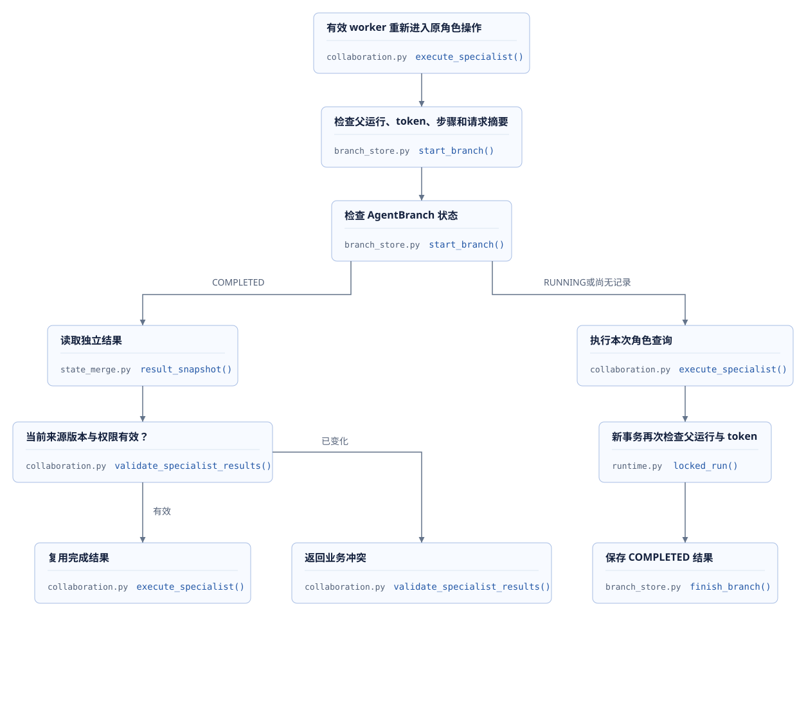</figure>

| 中断位置 | 已保存的状态 | 恢复行为 |
| --- | --- | --- |
| 分支尚未登记 | 没有子记录 | 通过父运行检查后登记并执行 |
| 分支已登记，结果尚未提交 | `AgentBranch.RUNNING` | 新租约认领原操作后重新执行角色查询 |
| 分支结果已经提交，父图尚未汇总 | `AgentBranch.COMPLETED` | 核对请求与来源后复用 |
| 模型请求已登记，响应尚未保存 | `ModelAttempt.STARTED` | 重新领取时改为`UNKNOWN`，继续保留计量核对需求 |
| 父运行已经标记失败或取消 | `AgentRun.FAILED/CANCELLED` | 不自动重新领取，分支也不能单独继续提交 |

`STARTED`属于模型尝试记录；分支执行中的状态是`RUNNING`。未完成角色重新执行时可能产生新的模型尝试，父运行的`model_calls`和已有预算记录继续累计。远端已经处理请求、本地尚未保存结果时发生中断，结果保存机制无法保证远端调用只发生一次。

源码：[04 · execute_specialist](../source.html?stage=04-durable-execution&path=src/zhifu/modules/agent_runtime/collaboration.py&symbol=execute_specialist)、[04 · validate_specialist_results](../source.html?stage=04-durable-execution&path=src/zhifu/modules/agent_runtime/collaboration.py&symbol=validate_specialist_results)、[04 · 主图load节点](../source.html?stage=04-durable-execution&path=src/zhifu/modules/agent_runtime/runtime.py&symbol=build_graph.load)。

### 实际进程恢复测试

`test_process_exit_recovers_completed_and_running_branches`创建独立Python子进程，执行真实订单查询并保存`OrderReader`结果，同时登记尚未完成的`RuleReader`。父测试进程核对PID、命令和进程关系后终止这个子进程，等待原125秒租约自然到期，再次领取运行。测试检查旧token被拒绝、完成的订单结果被读取、未完成的规则查询继续执行，最终两条子记录均为`COMPLETED`。

**这项测试执行真实MySQL查询和进程中断，生成模型调用次数为0**。它验证结果保存、授权、租约与恢复过程；角色使用订单和规则查询函数。测试最长180秒，输出记录包括旧新token、子进程退出码、完成结果复用数量和模型尝试数量。

固定阶段04的说明记录了2026-09-25的运行结果：7项恢复测试通过，总用时151.28秒；实际子进程退出码15，token从1增加为2，复用一条完成记录并继续完成另一条。时间包含环境、身份和业务数据准备。该历史结果供核对测试范围，重新执行需要保留本次结果。

源码与记录：[04 · 进程恢复测试](../source.html?stage=04-durable-execution&path=tests/test_course_recovery.py&symbol=test_process_exit_recovers_completed_and_running_branches)、[04 · 阶段验证记录](../source.html?stage=04-durable-execution&path=docs/course/durable-branches.md)。

**练习：订单分支已经完成，资料分支尚未返回时进程终止**。恢复后，管理员刚好修改了订单版本。沿`start_branch`与`execute_specialist`判断订单结果是否可以继续使用，并说明父运行已经`FAILED`时的区别。

<details>
<summary>参考结果</summary>

父运行仍为`RUNNING`、原租约已经到期且总期限有效时，worker可以重新领取。`start_branch`取得原完成结果后，`execute_specialist`会检查当前订单来源版本；版本改变产生`ORDER_VERSION_CONFLICT`，原结果无法继续用于成功协作。父运行已经`FAILED`时，`claim`不会重新领取；存在完成子记录也不会让父运行自动恢复。

</details>

## 9. 取消、失败与人工接管

浏览器关闭页面、用户取消运行、客服接管会话以及模型请求失败，会改变不同的状态。页面断开连接只说明这个连接结束。项目提供独立取消接口来改变数据库中的运行状态，客服接管接口则同时改变会话控制权和活动运行。

### 取消请求与会话控制权

`POST /openapi/v1/agent/runs/{run_id}/cancel`验证当前账户、租户和店铺权限，按会话在前、运行在后的顺序取得记录锁。允许取消排队、运行、等待客户和等待审批的任务；重复取消返回当前取消状态，不需要`Idempotency-Key`。事务把运行改为`CANCELLED`，清除等待内容和租约。关联会话的活动运行被释放，并生成`run.cancelled`事件。

客服接管通过`POST /openapi/v1/conversations/{conversation_id}/takeover`提交`expected_control_version`和请求键，要求`STAFF`身份与`conversations:manage`。接管成功后取消旧活动运行，清空`active_run_id`，增加`control_version`，把控制者改为`HUMAN`并记录接管客服。交还操作只允许当前接管客服执行；交还后，客户再次发送消息才会创建新运行。

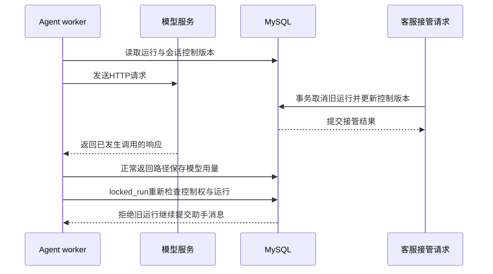

**取消接口改变可提交的业务状态，不保证远端模型请求立即停止**。阶段04的接口没有向执行中的worker直接发送`task.cancel()`；worker在下一次`locked_run`检查时发现运行或控制权已经变化。已经提交的换货方案仍然存在，取消Agent运行不会自动取消该业务方案。

源码：[04 · cancel](../source.html?stage=04-durable-execution&path=src/zhifu/modules/agent_runtime/api.py&symbol=cancel)、[04 · owned_run](../source.html?stage=04-durable-execution&path=src/zhifu/modules/agent_runtime/api.py&symbol=owned_run)、[04 · control](../source.html?stage=04-durable-execution&path=src/zhifu/modules/conversations/api.py&symbol=control)。

### 分支失败与父运行结束

专业协作需要两个角色的结果都完成，协调节点才会继续检查并返回。某个必需分支失败或协作超过60秒时，本次图调用不能返回成功协作结果，异常继续传给外层worker；协作函数的`finally`释放额外并发额度。已提交的分支记录继续保留。

阶段04的`execute_one`处理图执行异常时，只有父运行仍为`RUNNING`且token仍属于本次领取，才将其改为`FAILED`并保存错误码。取消或新租约已经改变状态时，旧执行者不能把该运行重新写成自己的失败结果。外层`finally`释放本次领取的Redis额度。非预算准入类异常继续抛出，当前常驻入口也会结束；已记录为`FAILED`的运行不会因为进程重新启动而自动执行。

| 发生的变化 | 后续业务结果 | 已有记录 |
| --- | --- | --- |
| 用户取消运行 | 当前运行不能继续提交节点与分支结果 | 已提交方案和调用记录继续存在 |
| 客服接管会话 | 旧控制版本不能提交新助手消息 | 接管事件保存新的控制者和版本 |
| 一个必需分支失败 | 本次协作不能作为成功工具结果返回 | 已完成分支保留，父运行按当前token处理失败 |
| 进程直接终止，未提交失败状态 | 租约到期后可能重新领取 | 数据库中的父状态与已提交分支决定恢复位置 |
| 父运行超过总期限 | 标记失败并终止业务执行 | 完成分支不能绕过期限检查 |

源码：[04 · 专业协作入口](../source.html?stage=04-durable-execution&path=src/zhifu/modules/agent_runtime/collaboration.py&symbol=run_specialists)、[04 · worker异常处理](../source.html?stage=04-durable-execution&path=src/zhifu/modules/agent_runtime/worker.py&symbol=execute_one)、[04 · 取消后拒绝迟到分支测试](../source.html?stage=04-durable-execution&path=tests/test_course_recovery.py&symbol=test_cancelled_parent_rejects_late_branch_completion)、[04 · FAILED父运行测试](../source.html?stage=04-durable-execution&path=tests/test_course_recovery.py&symbol=test_failed_parent_is_not_automatically_reclaimed)。

### 业务结果与模型用量

阶段04在模型请求前登记`ModelAttempt.STARTED`，预算回调在发送前预占额度，正常收到响应后按`usage_metadata`结算。主模型和专业角色的正常返回路径还会在独立事务保存`RECEIVED`与usage，之后继续检查业务结果能否使用。请求异常或取消时，尚无确定用量的预算记录通过`mark_pending_unknown`保留为待核对状态。

**拒绝迟到业务结果，不会消除已经发生的模型消耗**。排查取消和失败时，需要分别查询父运行、分支结果、模型尝试与预算账目。没有收到usage时不能把消耗填写为零；父运行状态也不能单独证明费用已经完成结算。

阶段07增加`record_model_usage`和独立的已知用量核对，把已保存usage继续用于未结算账目，包括父运行已经`FAILED`或`CANCELLED`的情况。阶段09优化待结算账目的查询与调度：持续worker完成一次核对后至少间隔30秒再执行，每轮有10秒期限。本节阶段04的进程恢复测试只证明其记录范围内的行为。

源码：[04 · BudgetCallback](../source.html?stage=04-durable-execution&path=src/zhifu/modules/agent_runtime/budget_callback.py&symbol=BudgetCallback)、[04 · mark_pending_unknown](../source.html?stage=04-durable-execution&path=src/zhifu/modules/agent_runtime/budget.py&symbol=mark_pending_unknown)、[04 · 主模型正常返回](../source.html?stage=04-durable-execution&path=src/zhifu/modules/agent_runtime/runtime.py&symbol=build_graph.model)、[07 · 已知用量保存](../source.html?stage=07-streaming-response&path=src/zhifu/modules/agent_runtime/model_usage.py&symbol=record_model_usage)、[09 · 已知用量核对](../source.html?stage=09-course-delivery&path=src/zhifu/modules/agent_runtime/model_usage.py&symbol=reconcile_model_usage)。


## 10. 并发与恢复实验

两个请求同时提交、两个查询同时返回、工作进程中途终止，会影响不同位置的状态。本节分别观察Python线程、LangGraph结果集合和MySQL记录，记录每个执行者的输入、提交条件与最终结果。**并发正确性需要同时检查成功结果、被拒绝的操作和数据库状态**。

### 10.1 代码阶段与独立环境

命令在课件项目的`project/`目录的PowerShell 7中执行。Python依赖、Docker镜像及`.work/models`中的本地检索模型沿用[环境准备说明](../materials/branch-guide.html)。当前目录需要没有待提交的修改；自己的开发内容保存在个人练习分支，课程固定tag保持不变。

| 固定代码阶段 | 本节新增能力 | 实验环境名称 | 平台迁移 |
| --- | --- | --- | --- |
| `course/02-parallel-agents` | 两个查询角色、工具权限及汇总 | `02-classroom` | `0028_approval_reminders` |
| `course/03-state-consistency` | 结果reducer、线程交接与并发实验 | `03-classroom` | `0028_approval_reminders` |
| `course/04-durable-execution` | MySQL保存子任务及恢复 | `04-classroom` | `0029_agent_branches` |

`Stage`决定Compose project、数据卷、配置目录与向量集合名称。端口保持固定，所以同时运行一个实验环境。**切换代码前停止当前环境，目标阶段使用自己的数据库**。已经执行后续迁移的环境需要保留原记录，阅读初始代码时使用新的环境名称。以下命令承接第一课的`01-classroom`；如果当前运行环境不同，Stop参数使用实际环境名称。

```powershell
git status --short
git diff --name-status course-01-business-change course-02-parallel-agents
. ./scripts/course/environment.ps1 -Action Stop -Stage 01-classroom
git switch course/02-parallel-agents
. ./scripts/course/environment.ps1 -Action Start -Stage 02-classroom `
  -PythonExecutable .venv/Scripts/python.exe -ModelCache .work/models
. ./scripts/course/environment.ps1 -Action Check -Stage 02-classroom
& $runtime.python -m alembic current
```

Start升级当前数据库并启动依赖、API和OMS；它不会启动Agent生成worker。环境脚本将生成凭据指向已清除的`COURSE_GENERATION_DISABLED`变量，`PYTHONPATH`指向当前实验目录的`src`。本节测试按输入准备运行或工具请求，直接执行需要验证的函数；生成模型请求次数为0。具体行为见[阶段04环境脚本](../source.html?stage=04-durable-execution&path=scripts/course/environment.ps1)。

下面的函数为每组pytest设置独立期限，保存stdout、stderr和JUnit。超时会终止本次pytest进程及其子进程；失败日志和报告保留。期限包含该组测试的数据准备和清理，环境启动另有自身的就绪检查。

```powershell
function Invoke-LessonCheck {
    param([string] $Name, [string[]] $Tests, [int] $Seconds)
    $directory = ".work/course/l02/$Name"
    New-Item -ItemType Directory -Path $directory -Force | Out-Null
    $arguments = @('-m', 'pytest', '-q', '--tb=short', '--maxfail=1') +
        $Tests + @("--junitxml=$directory/results.xml")
    $process = Start-Process -FilePath $runtime.python -ArgumentList $arguments `
        -WindowStyle Hidden -PassThru `
        -RedirectStandardOutput "$directory/stdout.log" `
        -RedirectStandardError "$directory/stderr.log"
    if (-not $process.WaitForExit($Seconds * 1000)) {
        $process.Kill($true)
        $process.WaitForExit()
        throw "测试超过 $Seconds 秒期限：$directory"
    }
    $process.WaitForExit()
    Get-Content -LiteralPath "$directory/stdout.log"
    if ($process.ExitCode -ne 0) {
        Get-Content -LiteralPath "$directory/stderr.log"
        throw "测试失败，请查看记录：$directory"
    }
}

Invoke-LessonCheck -Name role-access -Seconds 120 `
  -Tests @('tests/test_course_collaboration.py')
```

阶段02的[角色专项](../source.html?stage=02-parallel-agents&path=tests/test_course_collaboration.py&symbol=test_role_tool_authorization_and_order_scope)通过真实订单验证三种情况：KnowledgeAgent请求创建换货方案时返回`TOOL_FORBIDDEN`；OrderAgent查询本次指定范围之外的订单时返回同一错误；查询当前订单时返回实际订单编号。另外三项检查订单来源变化、运行取消及发布版本中的工具注册。**角色名字和提示内容需要代码中的工具范围共同约束**。

### 10.2 线程交接与结果合并

切换阶段03，查看相邻tag中协作状态的变化，然后运行状态专项。该文件包含线程、LangGraph、JSON约束和真实MySQL竞争测试。

```powershell
. ./scripts/course/environment.ps1 -Action Stop -Stage 02-classroom
git switch course/03-state-consistency
git diff course-02-parallel-agents course-03-state-consistency -- src/zhifu/modules/agent_runtime/collaboration.py
. ./scripts/course/environment.ps1 -Action Start -Stage 03-classroom `
  -PythonExecutable .venv/Scripts/python.exe -ModelCache .work/models
. ./scripts/course/environment.ps1 -Action Check -Stage 03-classroom
Invoke-LessonCheck -Name state-and-mysql -Seconds 120 `
  -Tests @('tests/test_course_state.py')
```

[`collect_thread_results`](../source.html?stage=03-state-consistency&path=src/zhifu/modules/agent_runtime/thread_bridge.py&symbol=collect_thread_results)创建真实Thread，使用Barrier协调开始计算，结果通过`loop.call_soon_threadsafe`交回事件循环。线程不直接修改图状态。两个线程计算`sum(range(100))`，返回计算值和线程标识；[原始断言](../source.html?stage=03-state-consistency&path=tests/test_course_state.py&symbol=test_real_threads_return_snapshots_to_event_loop)如下：

```python
    results = await collect_thread_results([calculate("b"), calculate("a")])
    assert [item.operation_id for item in results] == ["a", "b"]
    assert all(item.payload["sum"] == 4950 for item in results)
    assert len({item.payload["thread"] for item in results}) == 2
    assert all(item.payload["thread"] != event_loop_thread for item in results)
```

计算值说明函数确实执行，两个不同线程标识说明任务在不同线程运行，最后一行确认它们均与事件循环线程不同。这个实验验证交接方式；CPU并行加速需要另外测量。取消专项用Event让计算暂时等待，取消接收任务后再允许线程返回，最终检查`committed == []`。**取消等待以后，仍在运行的线程需要自行响应取消信号；迟到结果必须被接收端拒绝**。

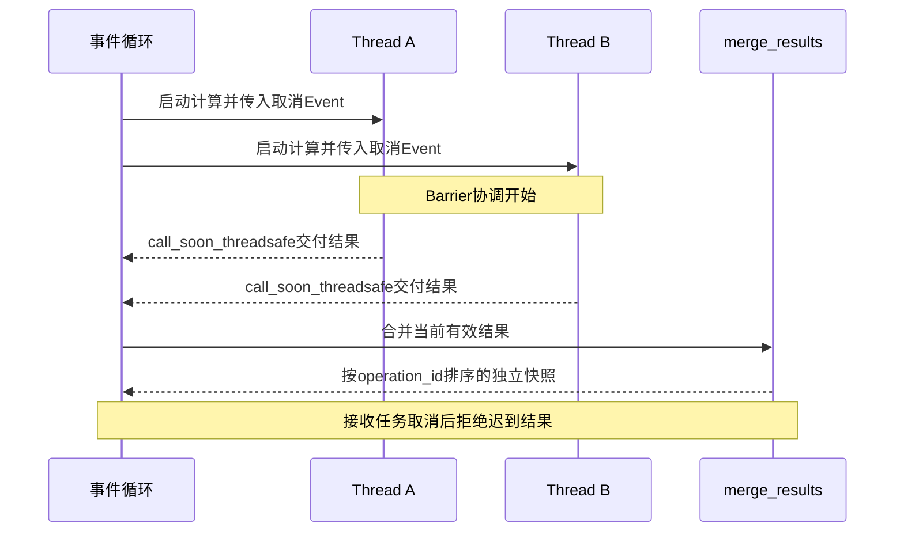

LangGraph专项也使用真实框架。两个节点同时更新普通`value`字段时，测试期望`InvalidUpdateError`；将字段声明为`Annotated[list[BranchResult], merge_results]`后，框架调用reducer合并分支输出。图调用的期限为5秒。这里的reducer就是“已有结果与新结果合并时调用的函数”。

在[快照与重复结果测试](../source.html?stage=03-state-consistency&path=tests/test_course_state.py&symbol=test_result_merge_has_owned_snapshots_and_stable_replay)中，输入包含两次操作`b`，合并后只保留一份；修改原始字典后，已交接结果保持原值：

```python
    left, right = branch("b"), branch("a", agent_id="knowledge")
    combined = merge_results([left], [right, left.model_dump()])
    assert [item.operation_id for item in combined] == ["a", "b"]
    assert combined == merge_results([right], [left])
    assert merge_results(combined, combined) == combined
    left.payload["items"][0]["quantity"] = 99
    left.source_versions["order"] = 4
    assert combined[1].payload["items"][0]["quantity"] == 1
    assert combined[1].source_versions == {"order": 3}
```

[`merge_results`](../source.html?stage=03-state-consistency&path=src/zhifu/modules/agent_runtime/state_merge.py&symbol=merge_results)按`operation_id`识别重复项，同一编号内容变化会返回`BRANCH_RESULT_CONFLICT`。Pydantic的`frozen`限制字段重新赋值，嵌套字典和列表仍可修改；交接时的重新校验与深复制使各方拥有独立对象。**结果去重、快照独立和业务版本检查分别解决不同问题**。

### 10.3 同一业务版本的两个提交

数据库专项复用[`scenario`](../source.html?stage=03-state-consistency&path=tests/test_after_sales.py&symbol=scenario)。pytest在每项测试前建立随机租户、真实账户、访问会话、订单和规则，结束时清理相关记录。fixture中的`reviewer`是具有审批权限的员工账户，`agent`也是员工账户；这些账户名称与模型角色分别管理。

测试通过实际售后接口创建并确认方案，再用`asyncio.Barrier(2)`协调两次审批请求。两次请求访问同一`POST /openapi/v1/approvals/{approval_id}/decisions`，使用相同的`expected_version`与`proposal_version`，分别提交`APPROVED`和`REJECTED`。它们代表两个不同审批操作，各有自己的幂等键。

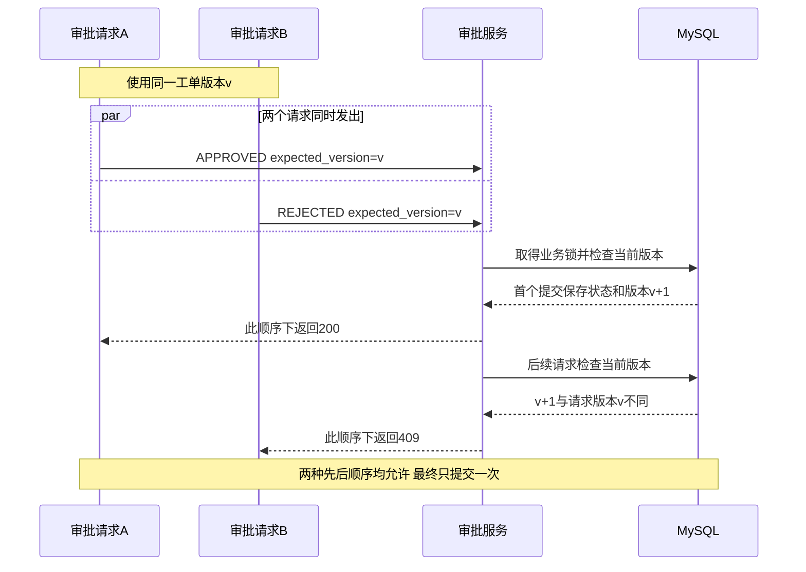

[数据库竞争测试](../source.html?stage=03-state-consistency&path=tests/test_course_state.py&symbol=test_real_mysql_version_race_has_one_committed_decision)的关键代码同时检查响应、工单、审批和业务事件：

```python
    async with asyncio.timeout(20):
        responses = await asyncio.gather(decide("APPROVED"), decide("REJECTED"))
    assert sorted(item.status_code for item in responses) == [200, 409]
    winner = next(item.json() for item in responses if item.status_code == 200)
    conflict = next(item.json() for item in responses if item.status_code == 409)
    assert conflict["code"] == "VERSION_CONFLICT"
    sessions = scenario["app"].state.sessions
    async with sessions() as session:
        current = await session.get(Ticket, UUID(ticket["ticket_id"]).bytes)
        approval = await session.get(Approval, UUID(ticket["approval_id"]).bytes)
        events = await session.scalar(
            select(func.count())
            .select_from(BusinessEvent)
            .where(
                BusinessEvent.tenant_id == scenario["tenant"].bytes,
                BusinessEvent.aggregate_id == current.id,
                BusinessEvent.event_type.in_(["after_sale.approved", "after_sale.rejected"]),
            )
        )
        assert current.version == ticket["version"] + 1
        assert current.status == approval.status == winner["status"]
        assert events == 1
```

事件查询同时限定租户、工单编号和事件类型，所以`events == 1`对应本次工单的一次审批变更。**两个请求中任意一个可以成功，另一个需要明确收到版本冲突**。调用方收到409后读取最新业务状态，再决定是否存在新的操作；原请求响应丢失时，保持原幂等键与原正文重试。

ASGI客户端在同一进程调用完整应用，身份和数据库事务正常执行；本项没有覆盖浏览器、代理或公网传输。测试中的20秒限制针对两次请求主体，外层pytest期限同时包含数据准备与清理。

### 10.4 子进程中断与分支恢复

阶段04将角色结果保存到`AgentBranch`。开始分支和完成分支都通过父运行检查，读取已完成结果也需要有效身份与执行权。环境切换会应用0029迁移：

```powershell
. ./scripts/course/environment.ps1 -Action Stop -Stage 03-classroom
git switch course/04-durable-execution
git diff --name-status course-03-state-consistency course-04-durable-execution
. ./scripts/course/environment.ps1 -Action Start -Stage 04-classroom `
  -PythonExecutable .venv/Scripts/python.exe -ModelCache .work/models
. ./scripts/course/environment.ps1 -Action Check -Stage 04-classroom
& $runtime.python -m alembic current
& $runtime.python -m alembic check

$branchTests = @(
  'tests/test_course_recovery.py::test_same_request_reuses_committed_database_result',
  'tests/test_course_recovery.py::test_request_result_and_step_conflicts_are_rejected',
  'tests/test_course_recovery.py::test_completed_result_still_requires_active_parent_identity',
  'tests/test_course_recovery.py::test_cancelled_parent_rejects_late_branch_completion',
  'tests/test_course_recovery.py::test_failed_parent_is_not_automatically_reclaimed',
  'tests/test_course_recovery.py::test_parent_call_limit_survives_branch_reuse_before_http'
)
Invoke-LessonCheck -Name branch-transactions -Seconds 120 -Tests $branchTests
Invoke-LessonCheck -Name process-recovery -Seconds 240 `
  -Tests @('tests/test_course_recovery.py::test_process_exit_recovers_completed_and_running_branches')
Get-Content -LiteralPath .work/course/recovery/branch-process.json
```

前六项验证并发登记唯一、相同结果重复提交、内容冲突、身份撤销、取消、父步骤变化和FAILED筛选。其中的调用上限测试明确准备`model_calls`已达到上限的数据库状态，随后确认`STEP_LIMIT`在建立模型HTTP客户端之前出现，`ModelAttempt`数量为0。准备的计数属于测试输入，该测试没有执行这些生成请求。

单独的[进程恢复专项](../source.html?stage=04-durable-execution&path=tests/test_course_recovery.py&symbol=test_process_exit_recovers_completed_and_running_branches)调用[`branch_probe`](../source.html?stage=04-durable-execution&path=tests/test_course_recovery.py&symbol=branch_probe)启动Python子进程。子进程领取父运行，保存OrderReader的真实订单查询结果，登记尚未完成的RuleReader，然后等待。父测试核对PID、脚本路径和进程关系，终止这个子进程。

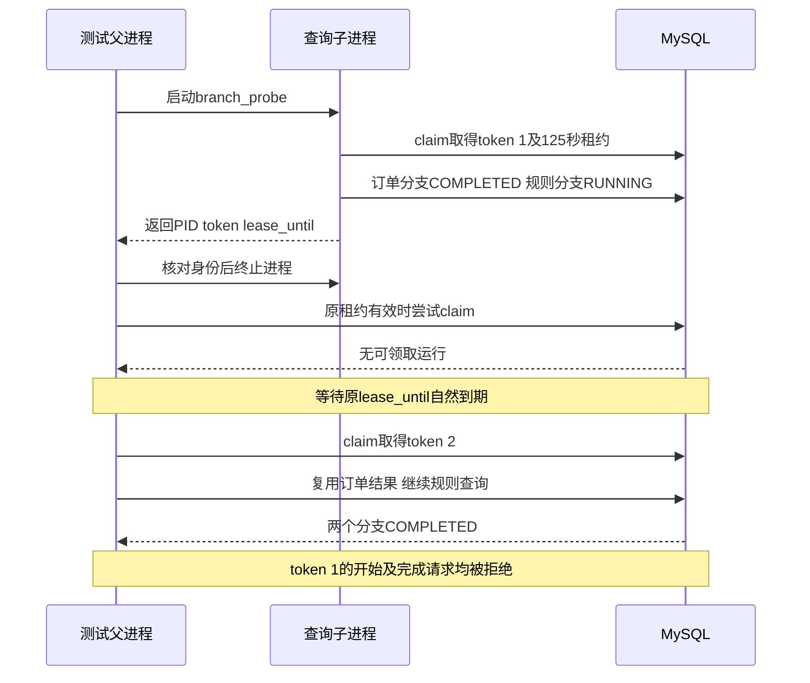

恢复测试主体使用`asyncio.timeout(180)`，其中读取子进程标记的期限为35秒。**125秒来自实际租约，测试等待原`lease_until`自然到期**。它没有通过提前修改租约时间完成恢复。外层240秒给单项pytest的数据准备、恢复主体和清理留下各自的执行空间；其他六项使用单独的120秒期限。

以下[原始断言](../source.html?stage=04-durable-execution&path=tests/test_course_recovery.py&symbol=test_process_exit_recovers_completed_and_running_branches)检查新token、旧执行权拒绝和已完成结果复用：

```python
            recovered = await claim(sessions, 2, run_ids=[run_id])
            assert recovered is not None and recovered[0] == run_id
            assert recovered[1] > marker["token"]
            old = {"run_id": run_id, "token": marker["token"], "step": 0}
            current = {**old, "token": recovered[1]}
            request = {"order_id": str(scenario["order_id"])}
            with pytest.raises(BusinessError) as stale_start:
                await start_branch(sessions, locked_run, old, "OrderReader", "order", request)
            assert stale_start.value.code == "RUN_LEASE_LOST"
            cached = await start_branch(
                sessions, locked_run, current, "OrderReader", "order", request
            )
            assert cached.payload["order_id"] == str(scenario["order_id"])
            assert cached.source_versions == {"order:" + str(scenario["order_id"]): 1}
```

后续断言检查旧token完成规则查询同样被拒绝，最终两条分支均为`COMPLETED`，保存的token均为新token，父`model_calls`和`ModelAttempt`数量均为0。OrderReader调用实际`get_order`，RuleReader执行真实规则SQL查询；这两个名称属于实验查询函数，模型协作中的角色名是OrderAgent和KnowledgeAgent。

**可恢复的条件是父运行仍为RUNNING、租约到期且身份和任务期限继续有效**。已经FAILED的父运行不会自动重新领取。取消后的迟到完成也会被拒绝。`source_versions`只记录读取时版本，业务汇总仍需复核当前来源；存储模块不会替调用方更新订单事实。远端查询已经完成、本地结果尚未提交时发生中断，恢复可能再次执行查询。

### 10.5 测试记录与历史范围

每组运行保存下列信息，报告中的历史数值与本人的结果分别标注：

| 记录项目 | 需要填写的内容 |
| --- | --- |
| 版本与环境 | tag或commit、环境名称、平台迁移、Python版本、实际导入目录 |
| 输入与执行者 | 租户范围、`run_id`、`operation_id`、线程或进程标识、请求版本 |
| 提交与拒绝 | 请求状态码、业务错误码、旧新token、数据库最终状态和数量 |
| 时间与范围 | 测试期限、实际耗时、是否自然租约到期、生成模型实际调用次数 |
| 原始记录 | stdout、stderr、JUnit及恢复JSON所在路径 |

固定阶段文档保存了2026-09-25的历史结果：

| 历史验证 | 结果与耗时 | 已验证的范围 |
| --- | --- | --- |
| [阶段02角色专项](../source.html?stage=02-parallel-agents&path=docs/course/parallel-agents.md) | 4项通过，12.09秒 | 工具权限、订单范围、来源变化、取消及注册 |
| [阶段03状态专项](../source.html?stage=03-state-consistency&path=docs/course/state-experiments.md) | 17项通过，10.39秒；接入协作后合计21项通过，12.93秒 | 真实线程、LangGraph与MySQL竞争，加角色专项 |
| [阶段04恢复专项](../source.html?stage=04-durable-execution&path=docs/course/durable-branches.md) | 7项通过，151.28秒 | 子进程退出码15，token从1增至2，复用1条并完成另1条分支 |

表中三组协调实验的生成调用均为0，耗时包含相应测试的准备与清理。**这些结果说明对应同步与恢复条件成立，不能据此推算生成模型吞吐、并发加速比例或答复准确率**。模型协作样本保存在各自的独立记录中，本节命令不执行该类采样。

## 11. 运行排查与面试准备

### 11.1 运行状态与检查位置

请求一直等待时，先使用`run_id`确认父运行状态，再检查对应分支。`AgentRun`保存执行状态、`step`、`lease_token`、`lease_until`、`deadline_at`和累计模型次数；`AgentBranch`保存操作编号、请求摘要及完成结果；工单和审批的业务状态分别由`Ticket`与`Approval`保存。**图中的结果存在，并不意味着业务审批已经完成**。

| 观察到的情况 | 直接检查的位置 | 判定依据 |
| --- | --- | --- |
| 进程已终止，claim返回None | [`claim`](../source.html?stage=04-durable-execution&path=src/zhifu/modules/agent_runtime/worker.py&symbol=claim) | 原租约可能仍有效；继续核对状态、期限与租户额度 |
| 子分支COMPLETED，读取时仍失败 | [`start_branch`](../source.html?stage=04-durable-execution&path=src/zhifu/modules/agent_runtime/branch_store.py&symbol=start_branch) | 当前身份、父步骤或执行权可能变化；按返回错误定位 |
| 原工作进程返回RUN_LEASE_LOST | [`locked_run`](../source.html?stage=04-durable-execution&path=src/zhifu/modules/agent_runtime/runtime.py&symbol=locked_run) | 当前token、RUNNING状态、租约期限需要共同有效 |
| 同一操作编号出现请求冲突 | `start_branch`中的请求摘要检查 | 比较角色、父步骤、操作编号和请求内容 |
| 订单查询成功，汇总报告版本冲突 | [`validate_specialist_results`](../source.html?stage=04-durable-execution&path=src/zhifu/modules/agent_runtime/collaboration.py&symbol=validate_specialist_results) | 查询后来源已经变化，旧结果失效 |
| 取消以后仍观察到线程运行 | `collect_thread_results`与同步函数的取消Event | 检查工作函数是否响应取消，以及接收端是否拒绝迟到结果 |

### 11.2 故障诊断练习

一项运行完成订单查询后进程终止。数据库显示父运行`RUNNING`、token为1，订单分支`COMPLETED`、规则分支`RUNNING`。原租约尚未到期时，领取函数返回None。到期后领取成功，token变为2；订单结果可以读取。随后旧token提交规则结果，收到`RUN_LEASE_LOST`。

请标记每一步的正常或异常含义，并补充三种检查：父状态已经FAILED、访问会话被撤销、订单在中断期间升级到新来源版本。说明每一种情况下哪些结果仍可保存为历史记录，哪些结果不能作为当前业务提交依据。

<details>
<summary>展开运行诊断参考答案</summary>

租约有效期间返回None符合领取条件。到期后token增加，说明新执行者取得执行权；旧token被拒绝符合提交检查。已有订单结果可以复用，但调用方仍需重新检查当前身份与来源。规则查询使用原稳定操作编号继续处理，成功以后保存新token。

父状态FAILED时，当前claim不会自动重新执行；访问会话撤销时，读取完成结果仍会在父身份检查处失败；订单来源变化时，业务汇总返回`ORDER_VERSION_CONFLICT`。历史结果记录可以保留，当前提交需要有效授权和当前来源。诊断中保留实际错误码，不通过修改token或数据库状态绕过检查。

如果租约到期仍无法领取，继续检查任务总期限、租户当前额度、目标`run_id`和运行状态。`claim`对已超过期限的任务会保存FAILED及`RUN_DEADLINE`；需要把该结果与没有取得执行权区分记录。

</details>

### 11.3 面试问题与回答依据

| 面试问题 | 回答中需要出现的具体内容 |
| --- | --- |
| 两个Agent同时查询就能提升性能吗？ | 输入是否独立；模型调用和额度成本；汇总等待；相同条件下的实际测量 |
| reducer能阻止两次审批同时成功吗？ | reducer处理图状态，审批由MySQL事务锁与版本检查控制；引用200和409的测试结果 |
| 一个角色完成以后进程终止，会再次查询吗？ | 已提交结果按原编号复用；未提交结果可能重做；复用前验证身份与来源 |
| 取消任务能终止所有线程和远端请求吗？ | 协作取消、I/O期限、迟到结果拒绝；已发生请求的计量继续保留 |
| 两个进程都认为自己有执行权时，谁能提交？ | 当前数据库token与有效租约决定提交资格，旧token失败 |
| 增加一个角色需要修改哪些位置？ | 输入、工具范围、结果结构、来源验证、图依赖、必需角色数量、并发额度和累计预算 |

准备一段项目说明，包含具体请求、共享状态、竞争顺序、关键检查和实际结果。**可以核验的描述需要明确实验使用的组件、执行次数与未执行范围**。本节可以说明真实线程、数据库竞争及进程恢复的结果；生成答复质量需要对应的模型测试记录。

## 12. 课后作业与评分

### 12.1 并行请求与双提交

绘制一张Mermaid时序图，把“读取订单与查询资料”表示为两个读取任务，把“批准与拒绝同一申请”表示为两个业务提交。每条箭头标明调用方、输入、响应或保存结果。说明哪些数据已经具备，哪些操作需要等待前序结果，并提交第10节的本人测试记录。

记录至少包括：普通字段并发更新错误、相同结果重复合并、相同编号内容冲突、取消后迟到结果、审批200与409、数据库版本增加一次、业务事件一条。解释收到409的页面处理，以及同一次请求响应丢失时幂等键的使用方式。

<details>
<summary>展开请求与状态参考答案</summary>

订单号、客户、店铺及资料问题已确定时，独立读取任务可以并行；资料参数需要订单查询结果时，图中需要对应依赖。两次审批各有自己的业务决定和幂等键，使用同一旧版本时允许一个成功，另一个收到`VERSION_CONFLICT`。调用方读取最新状态，再判断是否还有新的修改可以提交。

重复网络投递继续使用原键和原正文查询原结果。图结果的重复合并使用`operation_id`，业务重复请求使用幂等记录，数据库竞争使用锁与业务版本，三者的作用位置需要在图中分别标注。

</details>

### 12.2 只读工单角色开发

从阶段04建立个人练习分支，新增`TicketAgent`，用于读取客户指定工单的当前进度。**现有`get_ticket`工具可以复用，TicketAgent及其协作接入属于本题新增内容**。范围限定当前工单快照，返回`ticket_id`、`status`、`version`、`proposal_version`及可用的审批和履约状态；项目现有[`ticket_view`](../source.html?stage=04-durable-execution&path=src/zhifu/modules/after_sales/service.py&symbol=AfterSalesService.ticket_view)提供这些字段。

提交以下内容：

1. 输入与依赖图：增加工单输入，明确已知工单编号时的并行查询，以及编号来自前序操作时的等待关系。
2. 权限与调用过程：说明模型返回`tool_calls`后，Python工具执行代码如何校验名称、参数、当前身份、店铺和客户归属；新角色只允许`get_ticket`。
3. 后端实现：补充角色、提示、参数、节点和汇总要求；结果使用稳定操作编号，登记与完成经过父运行检查，每个并发task使用独立Session。
4. 来源和状态：保存工单版本，扩展来源复核；说明局部消息、图结果、父运行、子任务和业务工单各自的写入位置。
5. 正确性验证：执行真实工具和MySQL测试，包含授权读取、跨租户或跨客户拒绝、版本变化、重复结果、取消、旧token拒绝和恢复复用。

**只读查询仍然需要检查权限；已经完成的查询结果也可能过期**。作业的自动验证使用真实业务函数与协调代码，生成调用为0，不以固定文本代替模型响应进行模型验收。模型决策与自然语言答复质量列为本题未执行范围；角色接入代码与权限、状态、数据库验证分别提交。

<details>
<summary>展开只读角色实现参考答案</summary>

输入增加明确的`ticket_id`，由服务端身份确定租户和客户范围。复用[`invoke_tool`](../source.html?stage=04-durable-execution&path=src/zhifu/modules/agent_runtime/tools.py&symbol=invoke_tool)执行`get_ticket`：Pydantic验证参数，业务服务定位租户内资源，检查店铺及`tickets:read`，客户身份继续检查资源归属。调用方输入的租户字段不能扩大权限。

当前[`execute_specialist`](../source.html?stage=04-durable-execution&path=src/zhifu/modules/agent_runtime/collaboration.py&symbol=execute_specialist)在看到`order_id`时读取`source_version`。工单结果也有`order_id`，但工单版本字段是`version`，因此新增工单处理需要明确识别返回类型，并保存`ticket:<id>`来源；不能直接套用订单字段处理。当前来源验证只接受order和document，需要增加工单的租户、店铺、归属、状态与版本检查。

[`run_specialists`](../source.html?stage=04-durable-execution&path=src/zhifu/modules/agent_runtime/collaboration.py&symbol=run_specialists)目前建立两个角色节点，汇总要求两份结果。新增角色需要共同调整节点、等待关系、必需结果检查与全局额度申请。父运行累计模型次数不会因增加角色或恢复分支而清零；声明新增角色每次决策及最终答复的调用预算，并核对整个运行上限。

业务状态由Ticket、Approval等记录管理，TicketAgent保存读取快照。来源变化后拒绝旧结果，重新查询需明确新的操作语义与编号；同一已完成操作编号携带不同结果会冲突。各角色的消息列表和Session独立，汇总只接收结构化结果。

</details>

### 12.3 进程中断与交付记录

在真实MySQL环境扩展恢复测试：工单读取已经保存，另一项查询尚未完成时终止测试创建的子进程；等待原租约自然到期，再领取并恢复。核对PID及所属关系后才终止进程，保留工作目录之外的服务。沿用第10节的单项期限和进程树清理方式。

提交旧新token、操作编号、已完成和进行中的分支数量、最终状态及模型尝试数量。分别说明“结果已提交”和“远端已完成但本地结果未提交”两个中断位置。附源文件、迁移变更说明、执行命令、JUnit和JSON结果，以及一段面试说明：这次故障影响了什么状态，哪些查询复用，哪些查询重做，哪些提交被拒绝。

<details>
<summary>展开恢复验证参考答案</summary>

已提交结果可以在有效新token下读取，来源版本仍需复核；进行中的分支使用原操作编号继续执行。旧token的开始与完成均失败，最终记录使用新token。父运行FAILED、取消、权限撤销或任务超期分别执行对应失败检查，不能直接修改数据库恢复执行。

远端已经处理、本地没有保存结果时，查询可能再次发生。只读查询可以重新取得当前事实，业务写入则需要外部稳定操作编号与结果查询。记录已发生的全部模型尝试，未知结果保留其状态；本作业协调实验的生成调用保持0。测试通过表示实际执行过的场景满足断言，未执行的模型与网络条件另行注明。

</details>

### 12.4 评分规则

| 评分项目 | 分值 | 达到要求的说明与结果 |
| --- | ---: | --- |
| 请求、依赖与权限 | 20 | 时序准确，工具由代码执行，客户及店铺范围明确 |
| 角色实现与状态归属 | 25 | 输入、工具、节点、来源验证、结果合并和预算共同完成 |
| 并发与恢复 | 25 | 独立Session、业务版本、稳定编号、token、取消与自然租约验证完整 |
| 本人运行记录 | 20 | 真实组件、明确断言、有限执行、原始报告及实际调用次数齐全 |
| 面试说明 | 10 | 使用具体业务时序和代码解释行为、结果与限制 |

**评分依据是提交代码与实际验证范围**。请求图、后端扩展、并发与恢复测试共同构成作业，单次正常查询结果不足以说明竞争和进程中断后的行为。
