# 请求、数据库与检索性能优化

客户提交“查询订单并解释商品说明”，接口很快返回运行编号，页面却仍在等待。增加worker以后，订单列表和资料搜索也开始变慢。定位这类问题，需要把用户等待、任务排队、数据库访问、工具调用和资料检索分别计时，并检查它们是否争用同一组资源。

**性能改动需要同时回答三个问题：哪里消耗了时间，调整后业务结果是否保持正确，收益适用于什么负载**。本课使用阶段05的订单组合索引与真实MySQL实验，继续阅读现有SSE、连接复用和CPU检索批处理，最后结合阶段09交付的综合容量记录判断吞吐与等待之间的关系。模型输入、生成服务和正文增量传输在第四课继续展开。

历史记录保留原日期、代码阶段、数据数量和测试范围；文中的计算示例单独标明假设。实验使用真实数据库、缓存、HTTP与本地检索服务，生成模型调用次数为0。


## 1. 请求耗时与性能指标

点击发送以后，浏览器提交HTTP请求；API完成身份检查、保存消息和运行记录，然后返回`run_id`。worker稍后领取任务，经历模型与工具的多轮调用，提交结果，浏览器再收到事件并更新页面。因此，接口返回时间与用户看到答复的时间分别对应不同工作。一次用户请求还可能产生多次模型尝试、多个工具查询和多次数据库事务。图中展示一次触发工具调用的执行过程，未触发工具的运行会省去对应查询。

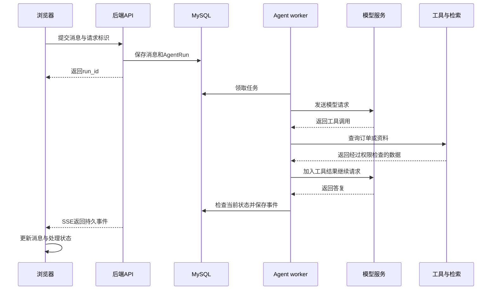

性能记录需要把这些操作关联起来。`request_id`标识一次HTTP处理，`run_id`关联后台运行，`ModelAttempt.id`标识一次模型尝试，工具的操作编号用于识别业务调用。服务端生成`X-Request-ID`；运行内部还需使用自己的编号，才能把多轮操作放回同一条请求路径。源码：[05 · 应用请求标识](../source.html?stage=05-data-retrieval-performance&path=src/zhifu/app.py&symbol=create_app)、[主图与模型尝试](../source.html?stage=05-data-retrieval-performance&path=src/zhifu/modules/agent_runtime/runtime.py&symbol=build_graph)。

| 指标 | 起止位置或计算方法 | 能够回答的问题 |
| --- | --- | --- |
| API受理时间 | 请求发出到收到运行编号 | 接口保存任务需要多久 |
| 排队时间 | 任务保存到有效领取 | 工作机会是否不足，哪个租户等待 |
| 完整任务时间 | 用户提交到最终结果可用 | 用户完成这项请求等待多久 |
| 首次有效反馈时间 | 用户提交到首个业务进度或正文 | 页面多久能够显示有意义的变化 |
| 成功RPS | 成功请求数除以实际测量秒数 | 每秒成功完成多少请求 |
| 状态分布 | 成功、429、其他失败和未完成数量 | 延迟变化是否伴随拒绝或失败 |
| P50、P95、P99 | 按耗时排序后的分位值 | 典型请求及等待较长的请求经历什么 |

P95表示按指定算法统计，约95%的样本耗时不超过该值。计算算法和样本数量需要一并记录：订单实验使用nearest-rank，即在升序样本中取`ceil(n × 0.95)`的位置；综合HTTP实验使用`statistics.quantiles(method="inclusive")`。不同算法的小样本结果可能不同。**成功请求的P95需要与失败、拒绝和未完成数量一起阅读**。只报告成功样本，无法说明被拒绝用户的体验。

阶段05的计时函数明确限定了范围：从创建Session开始，到查询和ORM对象读取结束。ORM是把数据库行转换为Python对象的访问方式。下面的代码没有经过HTTP认证和模型服务。

```python
    async def request():
        started = time.perf_counter()
        async with sessions() as session:
            rows = (await session.scalars(query)).all()
        return (time.perf_counter() - started) * 1000, [row.id.hex() for row in rows]
```

源码：[05 · measure_case.request](../source.html?stage=05-data-retrieval-performance&path=scripts/course/order_query_benchmark.py&symbol=measure_case.request)。同一个请求的顺序步骤可以按实际起止时间计算总耗时；并行部分需要看最长依赖路径。来自不同请求集合的各阶段P95不能直接相加得到总P95。

**计算练习**：假设提交时为0ms，受理完成80ms，worker领取300ms，最终结果提交2380ms，页面显示2420ms。分别计算受理、排队、领取后执行和完整时间。

<details>
<summary>展开参考答案</summary>

受理时间80ms；排队时间220ms；领取到提交为2080ms；完整时间2420ms。这些数字是计算假设。模型首token时间需要模型流式请求的独立时间戳，当前四个时间点不能推导该指标。SSE心跳到达只能说明连接仍有数据传输。

</details>

## 2. 浏览器请求与代理转发

浏览器负责控制重复提交、显示处理中状态和读取事件。一次写入发生网络超时时，使用原请求键与正文重试，能够让服务端识别同一次操作。建立事件连接时携带`Last-Event-ID`，表示上次已经处理完成的事件序号；前端按序号去重，处理成功后再更新游标。订阅断线与取消后台任务是两种操作，重新订阅还需要读取当前任务状态。

阶段05的SSE发送已经保存的完整业务事件。一次连接约50秒结束，每15秒发送心跳，单次发送期限5秒，数据库每轮最多读取50条事件，两轮之间等待0.5秒。模型正文片段属于阶段07新增能力，这里关注连接、事件读取和转发等待。

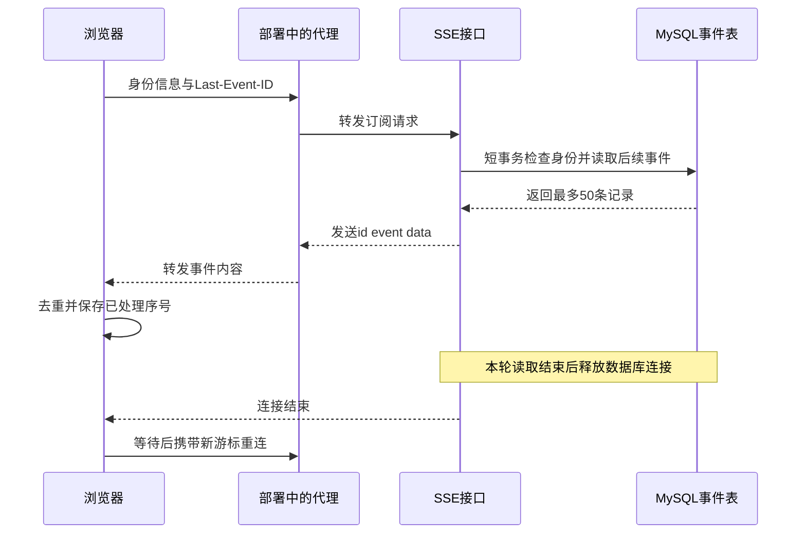

SSE响应的实际配置如下。`X-Accel-Buffering`表达关闭响应缓冲的要求；实际代理是否采用该设置，需要检查部署配置和逐条事件到达时间。后端写出了事件、代理开始转发和页面完成显示，分别可能存在等待。

```python
    return LeasedEventSourceResponse(
        generate(), release=release, ping=15, send_timeout=5,
        headers={"X-Accel-Buffering": "no"}
    )
```

源码：[05 · events](../source.html?stage=05-data-retrieval-performance&path=src/zhifu/modules/conversations/stream.py&symbol=events)。**长连接数量与数据库连接数量分别计算**。本实现按轮次建立短事务，单个API进程再用`asyncio.Semaphore(pool_size)`限制同时读取事件的数量；等待这个许可期间不取得数据库连接。默认全局最多200条SSE连接，单账户3条，Redis同时检查两个范围。连接结束后统一释放名额，见[事件读取](../source.html?stage=05-data-retrieval-performance&path=src/zhifu/modules/conversations/stream.py&symbol=read_events)和[响应生命周期](../source.html?stage=05-data-retrieval-performance&path=src/zhifu/modules/conversations/stream.py&symbol=LeasedEventSourceResponse)。

| 观察到的现象 | 需要同时检查的记录 | 调整范围 |
| --- | --- | --- |
| 事件集中成批到达页面 | 服务端事件时间、代理转发、客户端接收时间 | 检查实际缓冲配置与页面渲染批次 |
| 长连接反复重建 | 关闭原因、心跳、代理空闲期限、重连间隔 | 让部署期限覆盖有效心跳，并限制重连频率 |
| SSE数量增加后普通API变慢 | 事件查询并发、数据库池等待、每次返回条数 | 检查读取许可和事件轮询成本 |
| 客户端处理速度不足 | 单次发送耗时、连接结束记录、最后处理序号 | 保留发送期限，按游标恢复 |

游标早于已压缩事件范围时返回410，客户端重新取得会话和历史；权限失效时停止订阅。优化轮询间隔、每批数量或连接上限时，这些行为都要继续验证。当前代码提供了上述控制；代理参数调整和浏览器处理策略需要在实际部署中测量，不能由本地数据库实验推导收益。

入口限流也需要区分对象。现有登录接口按账户限制每60秒10次，按客户端地址限制每60秒60次，失败尝试同样计数；SSE限制连接数量，Agent入口限制待处理任务。它们并未构成覆盖全部业务接口的统一请求速率限制。若在代理新增速率控制，需要单独定义账户与地址范围、返回429及重试间隔，并把拒绝比例纳入结果。前端的按钮禁用、重复请求合并和合适的渲染批次，也分别通过网络记录和页面处理时间验证。源码：[05 · 登录入口限制](../source.html?stage=05-data-retrieval-performance&path=src/zhifu/modules/identity/auth.py&symbol=login)。

## 3. API事件循环与连接管理

`async def`声明函数可以异步等待，它内部执行的每一段工作仍有自己的运行方式。数据库和异步HTTP在等待时可以让出事件循环；同步密码计算和Milvus SDK调用需要其他执行位置。把同步调用移到线程，可以减少它对事件循环的直接占用；该调用的CPU、连接和等待成本仍然存在。

<figure class="static-diagram" data-diagram-kind="static" tabindex="0" aria-label="API事件循环流程图，可滚动查看">
  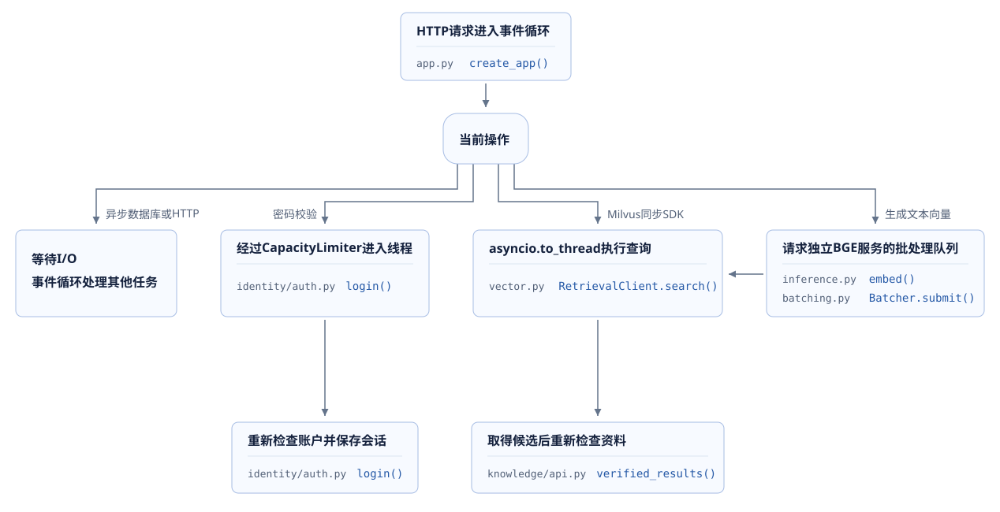
</figure>

登录接口使用AnyIO的线程调用，并以`CapacityLimiter(4)`限制同一进程中的密码工作。这个限制只控制当前进程，部署多个进程以后要计算合计需求。

```python
        verified = await to_thread.run_sync(
            password_hasher.verify,
            body.password.get_secret_value(),
            encoded,
            limiter=request.app.state.password_limiter,
        )
```

源码：[05 · login](../source.html?stage=05-data-retrieval-performance&path=src/zhifu/modules/identity/auth.py&symbol=login)、[密码并发设置](../source.html?stage=05-data-retrieval-performance&path=src/zhifu/modules/identity/auth.py&symbol=setup_password_runtime)。阅读完整函数还能看到，密码计算发生在读取账户后的Session范围内。若登录成为测量中的连接占用来源，可以评估将必要身份快照取出后结束读取事务，再计算并重新验证当前账户；这项改动需要重新证明密码变化、停用账户和登录权限的行为，本课程固定阶段未实施该调整。

数据库连接池保存可复用连接。`pool_size`是基础池容量，`max_overflow`允许临时增加连接，`pool_timeout`限制等待可用连接的时间。下列实际函数还设置了连接检查、回收时间、UTC与隔离级别。

```python
def create_engine(settings: Settings) -> AsyncEngine:
    return create_async_engine(
        settings.database_url.get_secret_value(),
        pool_size=settings.pool_size,
        max_overflow=settings.max_overflow,
        pool_timeout=settings.dependency_timeout_seconds,
        pool_pre_ping=True,
        pool_recycle=1800,
        connect_args={
            "connect_timeout": settings.dependency_timeout_seconds,
            "init_command": "SET time_zone = '+00:00'",
        },
        hide_parameters=True,
        isolation_level="READ COMMITTED",
    )
```

源码：[05 · create_engine](../source.html?stage=05-data-retrieval-performance&path=src/zhifu/core/database.py&symbol=create_engine)。**连接预算计算全部API、worker和后台进程创建的engine**。假设6个API进程、4个worker进程，每个engine配置5＋5，再为其他进程预留20个连接，潜在需求为`(6 + 4) × (5 + 5) + 20 = 120`。这是容量算式，实际同时活跃数量需要监控；增加池大小也可能增加数据库竞争。

检索客户端已按应用或worker生命周期复用，HTTP上限64、keep-alive上限32，退出时关闭Milvus客户端。连接复用减少重复建立连接的工作；请求仍可能等待连接池或下游服务。当前Milvus调用通过`asyncio.to_thread`执行，代码中没有为每次查询新增独立的业务并发许可。需要把事件循环延迟、线程等待、连接池等待和下游耗时分别记录，才能决定调整哪一处。源码：[05 · retrieval_client](../source.html?stage=05-data-retrieval-performance&path=src/zhifu/modules/knowledge/vector.py&symbol=retrieval_client)。

**练习：连接数量增加后的等待**。假设SQL执行时间保持2ms，但API的P95从30ms增加到200ms，同时连接池等待上升。仅增加索引能否证明问题已经解决？

<details>
<summary>展开参考答案</summary>

当前观察指向取得连接前的等待，还需要检查同时处理的请求数、每次持有连接的时间以及其他进程的连接需求。可以在固定负载下分别测量池等待、SQL执行和事务持续时间，并查看哪些请求在等待外部服务时仍保留事务。索引实验继续用于验证具体查询的扫描和执行成本；本题尚无索引收益的测量依据。

</details>


## 4. 任务排队与租户调度

API返回运行编号，只说明任务已经保存。worker还要取得租户执行机会和全局并发名额，才能开始工作。如果提交速度持续超过处理速度，队列等待会增长，已经排队的任务还会继续占用业务期限。定位排队问题时，分别记录队列长度、最早等待时间、每个租户的领取数量和到期任务数。

阶段05的`queue_run`按当前账户统计尚未超过总期限的任务，范围包括排队、运行、等待客户和等待审批。数量达到3时，新任务返回`AGENT_QUEUE_FULL`。它限制的是单个账户的待处理数量；全局执行并发和租户运行数量由后续领取流程检查。

```python
    pending = await session.scalar(
        select(func.count())
        .select_from(AgentRun)
        .where(
            AgentRun.tenant_id == auth.tenant_id,
            AgentRun.actor_id == auth.actor_id,
            AgentRun.status.in_(["QUEUED", "RUNNING", "WAITING_USER", "WAITING_APPROVAL"]),
            AgentRun.deadline_at > now(),
        )
    )
    require(pending < 3, "AGENT_QUEUE_FULL", "当前账户待处理任务已达到上限", 429)
```

源码：[05 · queue_run](../source.html?stage=05-data-retrieval-performance&path=src/zhifu/modules/agent_runtime/service.py&symbol=queue_run)。新运行的`deadline_at`设为创建时刻以后10分钟，这个期限包含排队和后续执行。单次图执行最长120秒，领取租约为125秒；重新领取不会延长原运行总期限。**排队已经消耗的时间，不能再次分配给下游调用**。模型节点会使用剩余总期限与单次模型超时中的较小值。

<figure class="static-diagram" data-diagram-kind="static" tabindex="0" aria-label="任务排队与租户调度流程图，可滚动查看">
  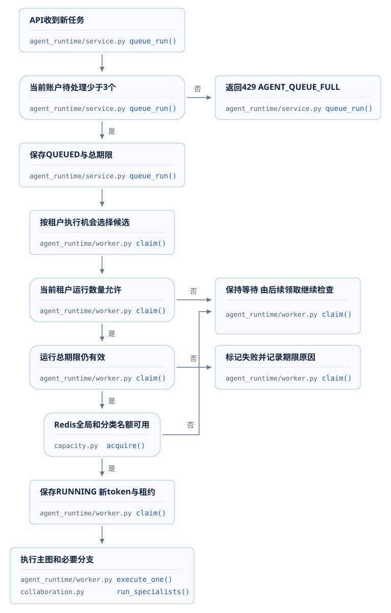
</figure>

`claim`先选择有待处理任务、且没有达到租户上限的租户，优先考虑尚未取得预留名额的租户，再按最近调度时间排序。取得租户锁后重新统计有效运行数量，然后申请Redis全局交互名额。数据库检查保护租户运行数量；Redis原子操作保护多个进程共享的总名额与预留数量。源码：[05 · claim](../source.html?stage=05-data-retrieval-performance&path=src/zhifu/modules/agent_runtime/worker.py&symbol=claim)、[共享名额](../source.html?stage=05-data-retrieval-performance&path=src/zhifu/modules/agent_runtime/capacity.py&symbol=acquire)。

| 限制位置 | 计数对象 | 增加worker后是否共同受限 |
| --- | --- | --- |
| `queue_run` | 同账户有效待处理运行 | 数据库记录继续计数 |
| `claim` | 同租户有效`RUNNING`运行 | 同租户锁与配额继续检查 |
| `capacity.acquire` | 全局、交互、后台及租户预留名额 | Redis共同计算 |
| 专业协作入口 | 主运行之外的资料角色名额 | 额外占用全局交互名额 |
| 检索服务 | 等待文本数与单批文本数 | 由接收请求的检索服务实例管理 |

多个限制各自对应一种资源，增加API或worker数量不会自动增加数据库、BGE计算或模型服务的能力。例如全局4个名额、后台预留1个，当前交互最多使用3个；两个租户各有运行上限2时，三个交互任务可以分为1个和2个。阶段09综合实验实际检查了这组分配，第10节给出结果。

如果业务要求“提交后30秒内结束”，可以先用时间预算计算能否继续：假设已经排队25秒，工具与提交预计需要2秒，模型只剩约3秒。这是预算分析示例；课程当前任务总期限为10分钟，并未采用这组30秒参数。修改业务期限时要同时验证排队拒绝、调用超时、迟到提交和费用记录。

## 5. 订单查询与执行计划

客户打开订单列表，服务端需要查询当前租户、当前店铺、当前客户的订单；员工查询则使用租户与已授权店铺。分页每页最多20条，后续页携带上页最后一个`order_id`。**权限过滤条件属于查询结果的定义，性能调整需要保留这些条件**。

阶段05把订单搜索表达式集中在`order_search_query`。这个函数接收已经验证的身份、店铺和分页参数，返回SQLAlchemy查询；调用方仍需在执行前完成`orders:read`检查。

```python
def order_search_query(auth, store_id, body):
    """构造已授权店铺的订单页；调用者须先完成身份与 orders:read 权限检查。"""
    query = select(OrderProjection).where(
        OrderProjection.tenant_id == auth.tenant_id, OrderProjection.store_id == store_id
    )
    if auth.kind == "CUSTOMER":
        query = query.where(OrderProjection.subject_id == auth.actor_id)
    # 客户条件由服务端身份确定；游标仅限定顺序，不能扩大租户、店铺或客户范围。
    if body.cursor:
        query = query.where(OrderProjection.id > body.cursor.bytes)
    return query.order_by(OrderProjection.id).limit(body.limit)
```

源码：[05 · order_search_query](../source.html?stage=05-data-retrieval-performance&path=src/zhifu/modules/agent_runtime/tools.py&symbol=order_search_query)、[调用前授权](../source.html?stage=05-data-retrieval-performance&path=src/zhifu/modules/agent_runtime/tools.py&symbol=invoke_tool)。这种分页根据游标限制后续编号范围。这里按UUID的二进制编号升序，表达的是固定读取顺序，不能将它解释为订单发生时间排序。游标只增加范围条件，租户、店铺和客户条件始终保留。

<figure class="static-diagram" data-diagram-kind="static" tabindex="0" aria-label="订单查询与分页流程图，可滚动查看">
  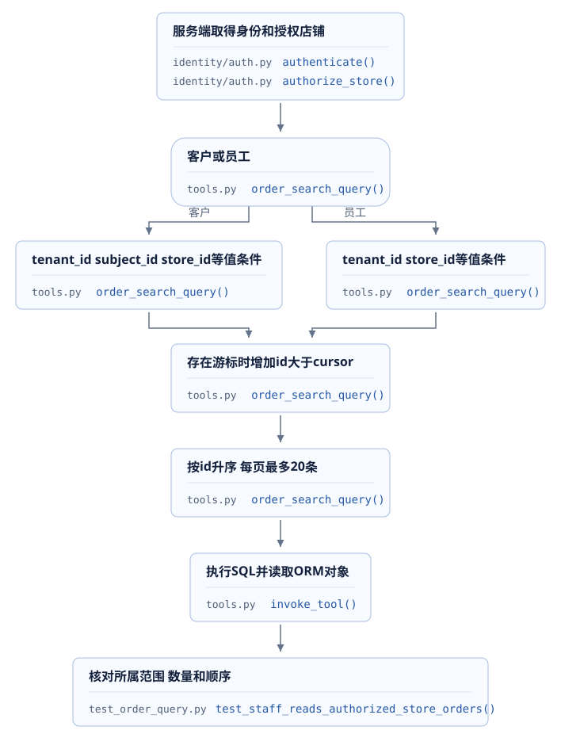
</figure>

索引帮助数据库按可用的字段顺序找到候选记录。组合索引按多个字段共同组织，本例把等值过滤字段放在前面，再用`id`处理范围与顺序。是否真正使用索引、读取多少行，需要读取数据库执行计划。`EXPLAIN FORMAT=JSON`给出所选访问路径和估算；`EXPLAIN ANALYZE`会实际执行查询，并记录观察到的执行过程。因此实验只对专用教学数据执行SELECT。

| 需要区分的数量 | 本例含义 | 不能代替的指标 |
| --- | --- | --- |
| 估算行数 | 优化器根据统计信息预测的读取量 | 不能代替实际执行记录 |
| 实际读取行数 | 执行计划记录访问路径读取的行数 | 不能直接等于接口返回数量 |
| 返回条数 | 条件过滤和分页后得到的订单数 | 相同返回数量可能对应不同扫描成本 |
| 查询耗时 | 本次查询的计时范围内用时 | 还需判断是否包含池等待和ORM读取 |

计时脚本和执行计划使用同一个`order_search_query`及二进制UUID参数，避免展示的SQL与业务查询不同。`query_plan`同时保存参数、估算和实际执行内容，见[05 · query_plan](../source.html?stage=05-data-retrieval-performance&path=scripts/course/order_query_benchmark.py&symbol=query_plan)。真实HTTP列表、Agent工具查询与专用计时函数有不同入口，记录报告时标明使用哪一条路径。

## 6. 索引改进与真实测量

迁移`0030_order_query_indexes`增加两条明确的访问路径。客户索引同时包含本人条件；员工索引按租户、店铺与编号读取。模型中的实际声明如下：

```python
        # 客户订单页同时限定店铺与本人；等值条件后使用 id 完成顺序分页。
        Index("ix_orders_tenant_subject_store_id", "tenant_id", "subject_id", "store_id", "id"),
        Index("ix_orders_tenant_store_id", "tenant_id", "store_id", "id"),
```

源码：[05 · OrderProjection](../source.html?stage=05-data-retrieval-performance&path=src/zhifu/modules/after_sales/models.py&symbol=OrderProjection)、[迁移0030](../source.html?stage=05-data-retrieval-performance&path=migrations/versions/0030_order_query_indexes.py)。MySQL可能调整被新索引覆盖的自动外键支持索引，因此实验同时核对完整索引清单和员工访问路径。索引占用存储，订单同步时也要维护索引；本次结果没有包含写入吞吐测量。

2026-09-25的实验使用独立教学MySQL 8.4.11，随机租户包含64个店铺、32位客户，每位客户在每个店铺有32条订单，共65,536条。数据由程序生成并真实写入数据库。基准和调整后使用同一批数据、游标和查询构造函数，每个案例64次计时、并发4、预热4次，每组四个案例，最长90秒。生成模型调用为0。

<figure class="static-diagram" data-diagram-kind="static" tabindex="0" aria-label="订单索引测量流程图，可滚动查看">
  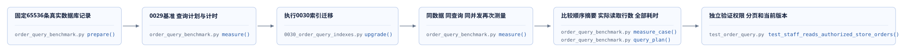
</figure>

| 查询 | 返回条数 | 实际读取行数：基准→调整后 | P50 ms：基准→调整后 | P95 ms：基准→调整后 |
| --- | ---: | --- | --- | --- |
| 客户首页 | 20 | 699→20 | 4.727→2.650 | 8.083→5.156 |
| 客户游标页 | 15 | 458→15 | 3.896→2.600 | 8.059→3.338 |
| 员工首页 | 20 | 20→20 | 2.755→2.947 | 4.014→3.503 |
| 员工游标页 | 20 | 20→20 | 2.648→2.948 | 3.269→4.568 |

客户查询的访问路径减少了实际读取数量。员工游标页的P95在本次记录中增加，员工查询没有统一的延迟收益。**优化报告保留全部案例，包括没有改善或等待增加的结果**。每个案例仅64条计时样本，持续不足一秒；它可以帮助解释本地查询行为，尚不足以证明生产持续吞吐或P99。

脚本每次检查有序返回值是否与预热结果一致，最终保存订单编号序列的SHA-256摘要。四种查询的前后摘要全部相同。另有九项真实权限及分页验证，覆盖本人范围、员工店铺、游标重放、其他客户游标、权限撤销、跨租户和字段约束。历史结果为`9 passed in 14.84s`，范围与原始计划见[05 · 索引实验记录](../source.html?stage=05-data-retrieval-performance&path=docs/verification/course-order-query.md)及[订单查询测试](../source.html?stage=05-data-retrieval-performance&path=tests/test_order_query.py)。

计时样本完成后，脚本按升序数组计算分位数，连续片段如下：

```python
    ordered = sorted(timings)
    return {
        "requests": len(timings), "concurrency": concurrency, "warmup_requests": 4,
        "duration_seconds": duration, "requests_per_second": len(timings) / duration,
        "p50_ms": ordered[math.ceil(len(ordered) * 0.50) - 1],
        "p95_ms": ordered[math.ceil(len(ordered) * 0.95) - 1], "max_ms": max(timings),
        "returned_rows": len(reference),
        "result_sha256": hashlib.sha256(json.dumps(reference).encode()).hexdigest(),
    }
```

源码：[05 · measure_case](../source.html?stage=05-data-retrieval-performance&path=scripts/course/order_query_benchmark.py&symbol=measure_case)。相同摘要证明这两组查询返回了同一有序编号序列；权限正确性还需要独立接口测试。测量覆盖连接池、MySQL与ORM，HTTP认证、模型和页面显示均在计时范围之外。

**练习：扫描减少与整体等待**。客户查询从扫描699行减少到20行，页面仍需要等待5秒。结合第1节指标，写出继续调查的位置，并说明本次索引实验已经证明的内容。

<details>
<summary>展开参考答案</summary>

索引实验记录了指定数据和查询条件下的读取数量、查询耗时与结果一致性。页面5秒还包括请求受理、任务排队、模型轮次、其他工具、提交和事件读取。需要按同一`run_id`取得这些时间区间，判断剩余等待集中在哪里。重复运行SQL无法补齐缺失的模型或事件传输时间。

</details>


## 7. 工具调用与查询范围

模型请求调用`search_orders`时，后端接收工具名称和JSON参数，通过Pydantic验证分页字段，再执行权限检查与查询。工具结果会进入后续模型请求，所以一次过量查询会同时增加数据库读取、JSON序列化和模型输入长度。调整工具性能时，需要共同检查返回数量、必要字段、重复调用和业务依赖。

订单搜索的实际入口如下。`limit`已在参数模型中限制为1至20；客户身份来自服务端访问会话，查询构造函数自动加入本人条件。

```python
    if name == "search_orders":
        await authorize_store(session, auth, store_id, "orders:read")
        orders = (await session.scalars(order_search_query(auth, store_id, body))).all()
        return {"items": [order_view(order) for order in orders]}
```

源码：[05 · invoke_tool](../source.html?stage=05-data-retrieval-performance&path=src/zhifu/modules/agent_runtime/tools.py&symbol=invoke_tool)、[分页输入](../source.html?stage=05-data-retrieval-performance&path=src/zhifu/modules/agent_runtime/tools.py&symbol=OrderSearch)、[输出字段](../source.html?stage=05-data-retrieval-performance&path=src/zhifu/modules/agent_runtime/tools.py&symbol=order_view)。**工具返回值需要保留完成当前业务所需的字段、来源标识和版本**。减少重复正文或无关字段可以作为优化实验，删除权限条件、资格依据或引用版本会改变功能。

主图处理普通工具时按请求列表顺序执行；`consult_specialists`走专用协作流程，且本轮必须单独调用。两个专业角色查询之前，入口已经检查订单归属并取得并发名额。协作完成后，还要核对角色结果、运行步骤和来源版本。不能把所有工具请求都同时发送：创建方案、等待确认和依赖前一次结果的查询都有明确先后关系。

<figure class="static-diagram" data-diagram-kind="static" tabindex="0" aria-label="工具调用与依赖检查流程图，可滚动查看">
  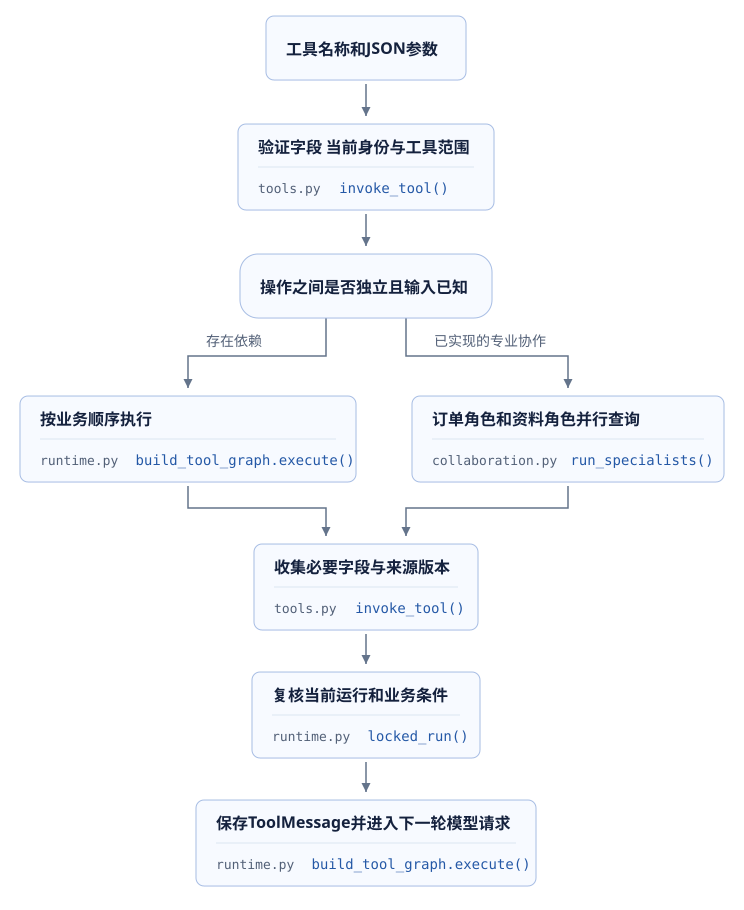
</figure>

源码：[05 · 主工具节点](../source.html?stage=05-data-retrieval-performance&path=src/zhifu/modules/agent_runtime/runtime.py&symbol=build_tool_graph.execute)、[专业协作](../source.html?stage=05-data-retrieval-performance&path=src/zhifu/modules/agent_runtime/collaboration.py&symbol=run_specialists)。假设订单查询120ms、依赖订单的资格计算40ms、独立资料查询180ms、协调20ms，顺序执行为360ms；满足并行条件时，理想时间为`max(120 + 40, 180) + 20 = 200ms`。这组数值仅解释依赖路径，实际协作还包含模型请求、额度等待和持久状态读写。

| 检查位置 | 可以记录的指标 | 修改前必须保留的条件 |
| --- | --- | --- |
| 工具轮次 | 每个run的工具调用数、重复参数与模型尝试数 | 客户补充信息和版本变化后的必要重查 |
| 返回内容 | 行数、正文字符数、JSON字节数 | 业务字段、引用及来源版本 |
| 查询依赖 | 每个步骤输入、开始和结束时间 | 写入顺序、当前授权、结果齐全 |
| 状态保存 | 事务次数、持续时间、序列化大小 | 恢复所需的步骤、消息和操作编号 |

这些指标用于找到具体重复。查询参数相同但订单版本已经变化时，重查有业务意义；同一有效操作重新执行时，已保存结果和幂等收据决定是否复用。先明确结果的有效范围，再评估减少哪一次调用，才能把耗时变化与功能变化分开记录。

## 8. 向量生成与资料检索

资料搜索把文本问题转换为向量，再查询相关资料。向量是表示文本特征的一组数字，本项目使用BGE-M3生成1024维归一化向量。Milvus同时执行dense向量相似度查询和BM25关键词查询，再由RRF按各路排序合并候选。RRF使用排名组合结果，最终正文还需要回到MySQL检查发布状态、店铺和版本。

<figure class="static-diagram" data-diagram-kind="static" tabindex="0" aria-label="向量生成与资料检索流程图，可滚动查看">
  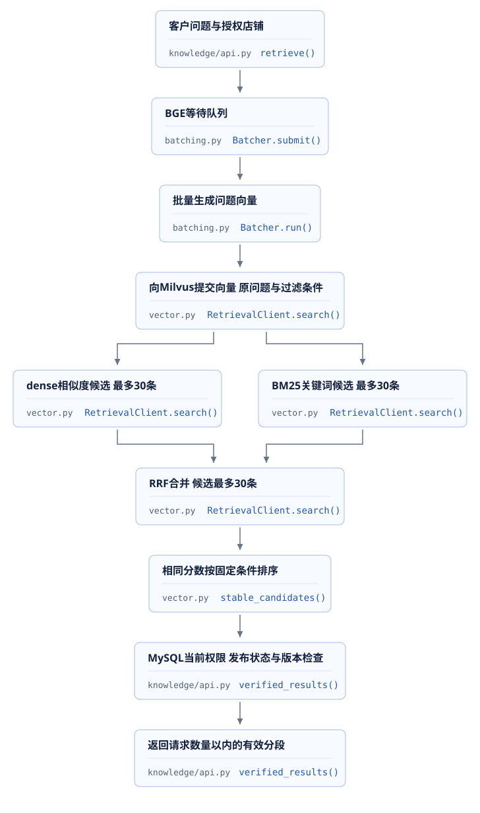
</figure>

`RetrievalClient.search`实际先等待问题向量，然后在一次`hybrid_search`中发起两路搜索。图中的两种候选表示检索方法，代码中的调用次序仍需按下面的函数阅读。租户和店铺过滤同时传入两路搜索。

```python
    async def search(self, tenant_id, store_id, query):
        vector = (await self.embeddings([query]))[0]
        expression = f'tenant == "{tenant_id.hex()}" and store == "{store_id.hex()}"'
        requests = [
            AnnSearchRequest([vector], "dense", {"metric_type": "COSINE"}, 30, expr=expression),
            AnnSearchRequest([query], "sparse", {"metric_type": "BM25"}, 30, expr=expression),
        ]
        result = await asyncio.to_thread(
            self.milvus.hybrid_search,
            self.settings.collection,
            requests,
            RRFRanker(),
            limit=30,
            output_fields=["document", "version", "position", "text"],
            timeout=self.settings.timeout,
        )
        return stable_candidates(result[0])
```

源码：[05 · RetrievalClient.search](../source.html?stage=05-data-retrieval-performance&path=src/zhifu/modules/knowledge/vector.py&symbol=RetrievalClient.search)、[相同分数的候选顺序](../source.html?stage=05-data-retrieval-performance&path=src/zhifu/modules/knowledge/vector.py&symbol=stable_candidates)。接口最终返回数量默认5、范围1至10；专业角色读取资料时使用3条上限。候选数量与最终返回数量是两个参数，不能把30条候选直接当成30条模型输入。

### CPU批处理的等待与结果顺序

BGE服务每个请求允许1至32条文本，每条最多1000字符；模型最大输入长度为512token。当前使用CPU、4个计算线程，批次上限32条文本、聚合窗口5ms、等待队列256条文本、排队期限2秒。这些数字来自固定配置，队列按文本数量计数，包含多条文本的单个请求也会占用相应数量。

`Batcher.submit`检查容量后把请求及Future保存到队列。Future保存将来的结果；请求协程等待它，批处理任务完成计算后按请求顺序分配结果。队列满时返回429，服务关闭时返回503。

```python
    async def submit(self, texts):
        if not self.accepting:
            raise HTTPException(503, "向量服务正在关闭")
        if self.waiting + len(texts) > self.settings.queue_texts:
            self.rejected.labels("full").inc()
            raise HTTPException(429, "向量请求队列已满", headers={"Retry-After": "1"})
        future = asyncio.get_running_loop().create_future()
        item = Pending(texts, future, monotonic())
        self.pending.append(item)
        self.waiting += len(texts)
        self.depth.set(self.waiting)
        self.available.set()
```

源码：[05 · Batcher.submit](../source.html?stage=05-data-retrieval-performance&path=src/zhifu/modules/knowledge/batching.py&symbol=Batcher.submit)、[配置](../source.html?stage=05-data-retrieval-performance&path=src/zhifu/modules/knowledge/config.py&symbol=KnowledgeSettings)、[向量接口](../source.html?stage=05-data-retrieval-performance&path=src/zhifu/modules/knowledge/inference.py&symbol=embed)。等待期限使用独立计时器，计算繁忙时仍能结束尚未开始的过期请求。请求已经进入CPU计算以后，取消等待不会让同批其他请求失去自己的结果。

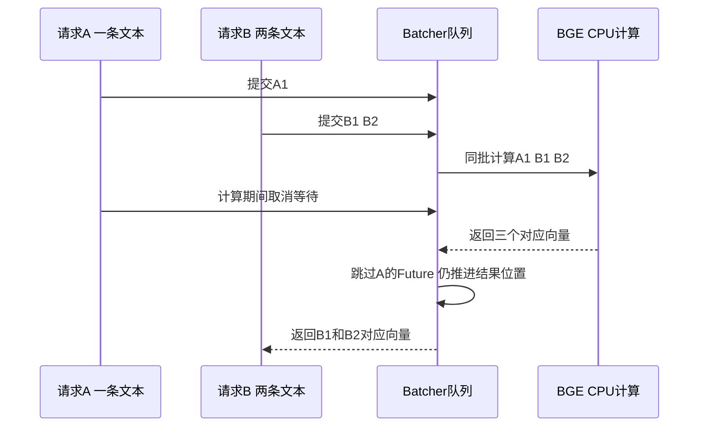

结果分配保留已经取消请求占据的位置，下面的连续片段说明了原因：

```python
                position = 0
                for item in batch:
                    # 已取消请求仍占据该批结果的位置，其他请求的结果切片必须保持原位置。
                    end = position + len(item.texts)
                    if not item.future.done():
                        item.future.set_result(result[position:end].tolist())
                    position = end
```

源码：[05 · Batcher.run](../source.html?stage=05-data-retrieval-performance&path=src/zhifu/modules/knowledge/batching.py&symbol=Batcher.run)。**批处理性能调整必须保留请求与文本顺序、取消行为和容量拒绝**。只测平均批量，无法证明返回给客户的向量属于其输入。

| 可评估的位置 | 固定实现或实验变量 | 同时核对的结果 |
| --- | --- | --- |
| 资料分段 | 已发布正文的分段边界与长度 | 相关内容是否被分散，引用位置是否有效 |
| Embedding | 模型版本、输入长度、CPU线程、批次和等待窗口 | 向量顺序、队列等待、吞吐、相关性 |
| 候选top-k | 当前两路各30条，合并最多30条 | 命中率、Milvus耗时、回查数量 |
| 最终返回数量 | API默认5条，专业资料角色最多3条 | 有效引用数量、模型输入长度与回答所需信息 |
| reranker | 当前未配置，可评估额外排序模型 | 排序改善是否足以覆盖新增计算和等待 |
| 结果缓存 | 当前未新增，下一节给出评估条件 | 命中比例、重建等待和失效正确性 |

top-k表示选取排名靠前的k项。减小候选或正文数量可能减少后续工作，也可能遗漏相关资料；增大数量可能提高覆盖，同时增加查询、回查和模型输入。每次只改变已定义的因素，使用固定问题集同时测量质量与耗时。

### 历史性能与质量范围

2026-09-20的历史记录使用Windows 10 19045、Python 3.12.13、单API进程、MySQL池5＋5、BGE-M3 CPU四线程、Milvus 3.0.1；每组12份资料、同一个问题，持续发送5秒并等待已开始的请求结束。该次同时加入批处理和客户端复用，结果属于组合改动，未增加查询结果缓存。

| 并发 | 成功RPS：调整前→调整后 | 成功请求P95 ms：调整前→调整后 | 调整后200／429 |
| --- | --- | --- | --- |
| 1 | 9.27→8.95 | 134.61→140.07 | 45／0 |
| 4 | 11.00→21.40 | 203.39→239.79 | 109／0 |
| 16 | 10.35→35.42 | 806.34→572.24 | 188／0 |

16并发下成功吞吐约为原来的3.42倍；4并发下吞吐增加，同时P95也增加；1并发下吞吐略有下降。原报告还记录两组并发负载调整前429比例为75%。成功耗时必须结合拒绝情况阅读，单独比较P95不足以判断整体服务效果。另一次320个真实HTTP向量请求在2.29秒内结束，128个200、192个429，队列随后归零，新请求恢复200；这是容量拒绝与恢复检查。

检索质量也需要单独测量。Recall@k记录预期相关资料是否进入前k名；本项目单个预期答案的问题集可按命中问题数占比统计。MRR@k对每个问题的首个相关位置取倒数，未命中记0，再求平均。历史24题对照中，相同资料状态下复用客户端与独立客户端返回顺序一致，Recall@1为95.83%、Recall@3与5为100%、MRR@5为0.9792。重新生成资料的另一轮曾得到Recall@1为87.5%、MRR@5为0.9375，首位排序波动的原因尚未确定。

这些数字仅覆盖12份资料和24个问题；相同资料下的连接对照不能推导重新生成资料后的排序完全稳定。原始范围、全部结果和CPU正确性检查见[05 · 历史检索报告](../source.html?stage=05-data-retrieval-performance&path=docs/verification/retrieval-performance.md)。增加reranker，即用另一个模型重新排序候选，属于可评估方案，当前检索实现没有此步骤。

## 9. 缓存命中与资料有效性

连接复用保存可再次使用的HTTP或Milvus连接，结果缓存保存一次查询得到的数据。当前检索已实现连接复用，每次查询仍然生成问题向量、查询Milvus并检查MySQL。**固定阶段没有新增检索结果缓存**。本节的缓存流程用于评估后续改动，现有的授权与版本检查继续作为必需步骤。

假设同一店铺反复收到相同资料问题，可以评估缓存检索候选。缓存键至少区分租户、店铺、查询条件、检索配置和资料发布状态；如果新增店铺资料版本号，发布、修订和撤回时需要同步推进它。命中候选后仍读取当前身份和资料记录，才能处理权限撤销以及旧版本。缓存期限TTL只说明数据保存多久，不能单独决定内容是否允许返回。

<figure class="static-diagram" data-diagram-kind="static" tabindex="0" aria-label="候选缓存评估流程图，可滚动查看">
  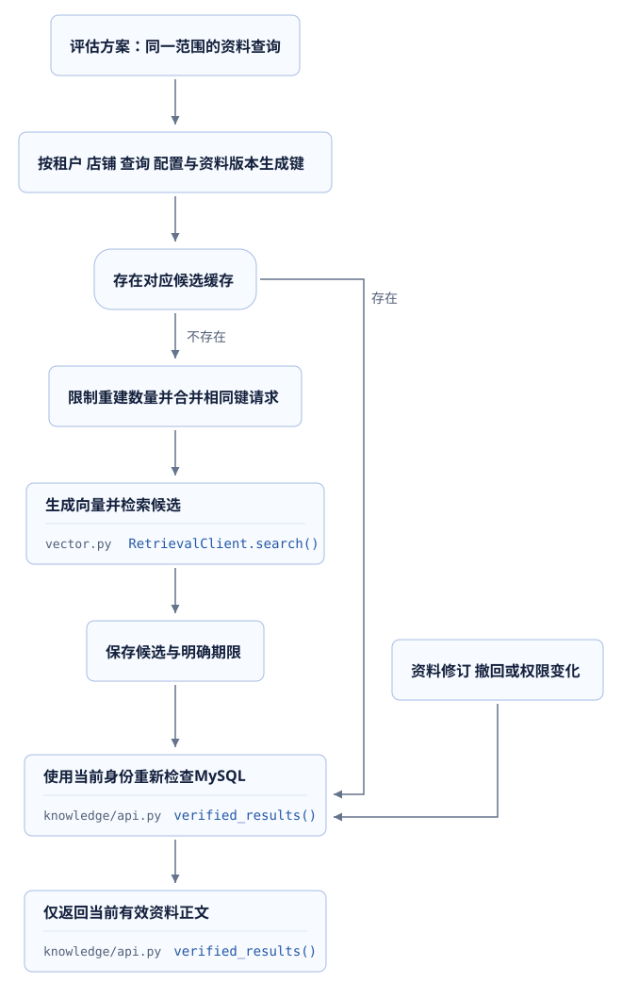
</figure>

批量回查已经存在于`verified_results`。函数收集候选文档编号，一次查询当前租户、店铺中已发布的文档，随后按候选顺序检查版本。这个做法减少了逐候选单独查询数据库的次数，也保留了业务过滤。

```python
    identifiers = sorted({bytes.fromhex(item["entity"]["document"]) for item in candidates})
    if not identifiers:
        return {"items": []}
    documents = (
        await session.scalars(
            select(KnowledgeDocument)
            .where(
                KnowledgeDocument.tenant_id == auth.tenant_id,
                KnowledgeDocument.store_id == store_id,
                KnowledgeDocument.id.in_(identifiers),
                KnowledgeDocument.status == "PUBLISHED",
            )
            .order_by(KnowledgeDocument.id)
            .with_for_update(read=True)
        )
    ).all()
```

源码：[05 · verified_results](../source.html?stage=05-data-retrieval-performance&path=src/zhifu/modules/knowledge/api.py&symbol=verified_results)。候选文本没有直接作为最终正文返回，正文来自MySQL中的`document.chunks[position]`；文档不存在、已撤回或版本不同的候选会被跳过。返回数量不足时，只返回目前有效内容。

| 缓存方案需要确定的内容 | 对应检查 |
| --- | --- |
| 哪些请求可以共享 | 租户、店铺、权限范围和查询条件 |
| 数据何时失效 | 资料修订、发布、撤回和检索配置变化 |
| 同时未命中时如何计算 | 单键进行中的计算数量、总重建并发和等待期限 |
| 命中以后如何验证 | 当前授权、资料状态、版本与正文位置 |
| 收益与代价 | 命中比例、端到端P95、重建量、存储、过期引用检查 |

请求合并表示相同键的多个等待者共享一次进行中的计算；需要明确取消某个等待者是否影响其他请求。进程内记录只覆盖当前进程，多副本共享行为需要另外设计和验证。这些控制尚未进入固定教学代码，评估报告需要明确标注实现范围。

**练习：缓存剩余10分钟，资料已经撤回**。候选仍指向旧文档与版本，客户重新查询。沿当前`verified_results`判断正文能否返回，再说明如果缓存的是最终正文，需要补充什么检查。

<details>
<summary>展开参考答案</summary>

当前查询只读取`PUBLISHED`文档，已撤回的记录不会进入查找表，旧候选被跳过。缓存最终正文时仍要根据当前授权、发布状态和版本检查可用性，或者采用能够及时反映这些变化的失效规则。仅检查TTL会遗漏撤回条件。验证时保留“缓存生成、资料撤回、再次请求”的实际顺序，检查响应中没有旧正文。

</details>


## 10. 真实组件负载与容量判断

SQL实验解释一个查询表达式，真实HTTP实验还包含网络、认证、接口调度和其他组件。阶段09交付的综合容量脚本同时使用真实API、MySQL、两套Redis、BGE-M3 CPU和Milvus。它创建随机租户与资料，通过HTTP查询订单和知识，再验证任务入队、领取与取消。**本实验没有执行生成模型循环，模型尝试数通过数据库核对为0**。

<figure class="static-diagram" data-diagram-kind="static" tabindex="0" aria-label="真实组件容量实验流程图，可滚动查看">
  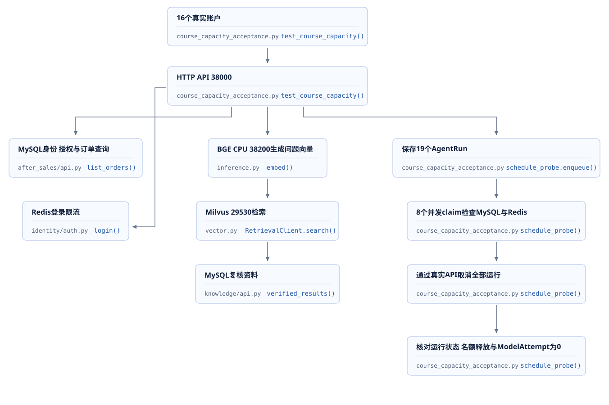
</figure>

已有测量执行于2026-09-25，业务代码为阶段08，脚本与报告随阶段09交付。环境为Windows 10、Python 3.12.13、20个逻辑CPU，单API进程、MySQL连接池5＋5，BGE CPU四线程、批次上限32、等待窗口5ms。12份资料来自`ecommerce-2026-09-v1`，数据摘要保存到原始记录。并发1使用一个账户，并发16使用16个账户。

| 请求 | 并发 | 成功请求 | 成功RPS | P50 ms | P95 ms | P99 ms |
| --- | ---: | ---: | ---: | ---: | ---: | ---: |
| 订单API | 1 | 315 | 62.86 | 15.49 | 19.71 | 24.17 |
| 订单API | 16 | 543 | 106.97 | 143.68 | 186.83 | 216.35 |
| 检索API | 1 | 42 | 8.32 | 115.43 | 141.20 | 176.50 |
| 检索API | 16 | 146 | 27.20 | 563.28 | 819.56 | 863.67 |

四组负载共1046次，全部返回200，429、传输错误与未完成负载均为0。包含准备、探测和清理的HTTP请求共1146次；基础身份和数据准备另有8次真实ASGI请求。逻辑工作25.55秒，包含清理26.15秒，完整pytest为39.63秒。每组持续发送5秒，统计时间包含已经发出的请求等待完成。

并发提高以后，每秒完成的请求增加，P95也增加。这是同一环境不同并发条件下的测量，不能解释为单因素代码优化收益，也不能直接作为阶段05索引的API收益。若业务把检索P95目标设为500ms，这个假设目标下，16并发的819.56ms就未达到目标，即使成功RPS更高。

### 检索计算与调度结果

负载窗口中BGE增加66批、188条文本，累计排队15.939秒，结束时等待队列为0。累计排队是多个请求等待的总和，不能当作某个请求的等待时间或P95。按这组计数计算，平均每批约2.85条文本；判断批处理效率还需要批量分布和CPU利用情况。

负载前后使用一个固定问题检查前5名，预期资料均位于第1名，五份返回资料顺序相同。这个探测只覆盖一个问题，完整24题评测与生成回答质量不在本次范围。历史检索质量报告与本次容量探测分别保留，不能把两组数据合成一次验收。

调度部分通过真实API保存19个运行，然后只调用`claim`。实际代码使用8个并发领取尝试，每个尝试具有自己的额度标识。

```python
    capacity_ids.extend(uuid4().hex for _ in range(8))
    started = perf_counter()
    selected = await asyncio.gather(*(
        claim(sessions, agent.tenant_concurrency, state=state, settings=agent,
              capacity_id=identifier, run_ids=list(runs))
        for identifier in capacity_ids
    ))
    claim_seconds = perf_counter() - started
    claimed = [result[0] for result in selected if result is not None]
```

源码：[09 · schedule_probe](../source.html?stage=09-course-delivery&path=tests/course_capacity_acceptance.py&symbol=schedule_probe)。19个运行入队用时0.297秒，8个领取尝试用时0.178秒，取得3个不同运行，两个租户分别为1个和2个。Redis全局与交互活跃数均为3，符合全局4、后台预留1和租户上限2的设置。随后19个运行全部通过HTTP取消，实验自己的Redis额度归零，`ModelAttempt`为0。

报告与完整范围：[09 · 综合容量记录](../source.html?stage=09-course-delivery&path=docs/course/capacity-experiment.md)、[真实HTTP实验](../source.html?stage=09-course-delivery&path=tests/course_capacity_acceptance.py&symbol=test_course_capacity)。这组数据证明注明环境中接口、检索和调度的行为；完整生成任务吞吐、长期稳定性、多个生产副本与GPU推理均未在本次实验验证。

## 11. 有限范围实验与故障诊断

实验在独立教学目录执行，沿用[代码分支与环境说明](../materials/branch-guide.html)。每次保存自己的原始输出，记录固定tag、数据状态和参数。课程源码目录、环境名称和数据库迁移分别管理；切换代码前停止当前环境，固定端口同时只运行一个环境。以下命令需要PowerShell 7、已安装的依赖与已缓存的本地模型。

### 11.1 统一的进程期限与输出

下面的辅助函数为Python命令设置外层期限，保存stdout和stderr。超时终止本次进程及子进程，结果不登记为通过。索引脚本本身也有内部期限，两层期限共同限定实验执行。输出使用本次独立目录，原始测量文件保持不变。

```powershell
$ErrorActionPreference = 'Stop'
$coursePython = (Resolve-Path '.venv/Scripts/python.exe').Path
$courseModels = (Resolve-Path '.work/models').Path
$courseRecord = '.work/course/l03-' + (Get-Date -Format 'yyyyMMdd-HHmmss')
New-Item -ItemType Directory -Path $courseRecord -Force | Out-Null
function Invoke-PerformancePython {
    param([string] $Name, [string[]] $Arguments, [int] $Seconds)
    $process = Start-Process -FilePath $coursePython -ArgumentList $Arguments `
        -WindowStyle Hidden -PassThru `
        -RedirectStandardOutput "$courseRecord/$Name.stdout.log" `
        -RedirectStandardError "$courseRecord/$Name.stderr.log"
    if (-not $process.WaitForExit($Seconds * 1000)) {
        $process.Kill($true)
        $process.WaitForExit()
        throw "实验超过 $Seconds 秒期限，请检查日志与清理状态：$Name"
    }
    $process.WaitForExit()
    Get-Content -LiteralPath "$courseRecord/$Name.stdout.log"
    if ($process.ExitCode -ne 0) {
        Get-Content -LiteralPath "$courseRecord/$Name.stderr.log"
        throw "实验失败，请核对原始输出：$Name"
    }
}
```

这是实验辅助命令，业务关键Python片段均链接固定源码。命令已按现有脚本参数核对；本文引用的历史值仍以原日期与环境为准，命令在自己的环境执行后产生新的记录。

### 11.2 同一数据下的索引前后测量

`Start`会把数据库升级到当前代码的head。为了保留无新索引的基准，在阶段04创建专用环境`05-index-lab`，初始化到0029，然后停止服务、切换阶段05，用`Use`加载同一环境，仅启动依赖容器。完成基准以后再明确执行0030迁移。下面承接第二课的`04-classroom`，Stop参数使用实际正在运行的环境名称。

```powershell
git status --short
. ./scripts/course/environment.ps1 -Action Stop -Stage 04-classroom
git switch course/04-durable-execution
if ($LASTEXITCODE -ne 0) { throw '阶段04代码切换失败' }
. ./scripts/course/environment.ps1 -Action Start -Stage 05-index-lab `
    -PythonExecutable $coursePython -ModelCache $courseModels
. ./scripts/course/environment.ps1 -Action Stop -Stage 05-index-lab
git switch course/05-data-retrieval-performance
if ($LASTEXITCODE -ne 0) { throw '阶段05代码切换失败' }
. ./scripts/course/environment.ps1 -Action Use -Stage 05-index-lab
docker compose --project-name $env:COMPOSE_PROJECT_NAME --file $env:COMPOSE_FILE `
    up -d --wait --wait-timeout 300
if ($LASTEXITCODE -ne 0) { throw '实验依赖未就绪' }
$courseState = "$courseRecord/order-data.json"
Invoke-PerformancePython -Name prepare -Seconds 120 -Arguments @(
    'scripts/course/order_query_benchmark.py', 'prepare', '--state', $courseState,
    '--stores', '64', '--customers', '32', '--orders', '32', '--timeout', '90'
)
Invoke-PerformancePython -Name before -Seconds 120 -Arguments @(
    'scripts/course/order_query_benchmark.py', 'measure', '--state', $courseState,
    '--phase', 'before', '--requests', '64', '--concurrency', '4', '--timeout', '90',
    '--output', "$courseRecord/order-before.json"
)
Invoke-PerformancePython -Name migrate -Seconds 120 -Arguments @(
    '-m', 'alembic', 'upgrade', '0030_order_query_indexes'
)
Invoke-PerformancePython -Name after -Seconds 120 -Arguments @(
    'scripts/course/order_query_benchmark.py', 'measure', '--state', $courseState,
    '--phase', 'after', '--requests', '64', '--concurrency', '4', '--timeout', '90',
    '--output', "$courseRecord/order-after.json"
)
Invoke-PerformancePython -Name order-checks -Seconds 180 -Arguments @(
    '-m', 'pytest', '-q', '--tb=short', '--maxfail=1', 'tests/test_order_query.py',
    "--junitxml=$courseRecord/order-checks.xml"
)
Invoke-PerformancePython -Name cleanup -Seconds 120 -Arguments @(
    'scripts/course/order_query_benchmark.py', 'cleanup', '--state', $courseState,
    '--timeout', '90'
)
. ./scripts/course/environment.ps1 -Action Stop -Stage 05-index-lab
```

范围固定为一个随机租户、65,536条订单；每组四个案例，各64次计时、4次预热，另有各4次`EXPLAIN FORMAT=JSON`与`EXPLAIN ANALYZE`。并发为4，脚本内部90秒、外层120秒，权限专项外层180秒。生成模型调用为0。脚本要求地址为`127.0.0.1:23306/zhifu`；`before`检查新索引不存在，`after`检查两条新索引均存在。

成功后比较四种查询的有序摘要、实际读取行数和全部延迟。`cleanup`只处理状态文件记载的随机租户。达到期限或命令失败时，保留状态文件与日志，确认该租户的准备或清理状态后再继续。数据库已经升级0030时，再做基准要使用新的实验环境名称；`Stop`保留数据卷，不能通过重新启动原环境取得0029基准。

源码：[05 · 参数与范围](../source.html?stage=05-data-retrieval-performance&path=scripts/course/order_query_benchmark.py&symbol=parse_arguments)、[内部执行期限](../source.html?stage=05-data-retrieval-performance&path=scripts/course/order_query_benchmark.py&symbol=run)、[结果与索引检查](../source.html?stage=05-data-retrieval-performance&path=scripts/course/order_query_benchmark.py&symbol=measure)、[按实验租户清理](../source.html?stage=05-data-retrieval-performance&path=scripts/course/order_query_benchmark.py&symbol=cleanup)。

### 11.3 CPU批处理正确性

索引环境已停止后，使用阶段05的独立环境运行本地CPU测试。第一项同时提交三组请求，共4条文本，与直接模型计算比较；第二项在同批计算期间取消一个请求，检查另一个请求的结果。两项测试只使用本地BGE，不调用生成模型。

```powershell
. ./scripts/course/environment.ps1 -Action Start -Stage 05-classroom `
    -PythonExecutable $coursePython -ModelCache $courseModels
. ./scripts/course/environment.ps1 -Action Check -Stage 05-classroom
Invoke-PerformancePython -Name embedding-order -Seconds 180 -Arguments @(
    '-m', 'pytest', '-q', '--tb=short', '--maxfail=1',
    'tests/test_embedding_batching.py::test_batch_preserves_request_and_text_order',
    "--junitxml=$courseRecord/embedding-order.xml"
)
Invoke-PerformancePython -Name embedding-cancel -Seconds 180 -Arguments @(
    '-m', 'pytest', '-q', '--tb=short', '--maxfail=1',
    'tests/test_embedding_batching.py::test_cancelled_active_request_does_not_cancel_batch',
    "--junitxml=$courseRecord/embedding-cancel.xml"
)
```

第一项测试真实断言如下，说明检查内容同时包括数值、返回位置和批次计数：

```python
        np.testing.assert_allclose(np.concatenate(results), expected, atol=1e-5)
        assert [len(result) for result in results] == [1, 2, 1]
        assert registry.get_sample_value("zhifu_embedding_batch_texts_count") == 1
        assert registry.get_sample_value("zhifu_embedding_batch_texts_sum") == 4
```

源码：[05 · 文本顺序测试](../source.html?stage=05-data-retrieval-performance&path=tests/test_embedding_batching.py&symbol=test_batch_preserves_request_and_text_order)、[计算期间取消测试](../source.html?stage=05-data-retrieval-performance&path=tests/test_embedding_batching.py&symbol=test_cancelled_active_request_does_not_cancel_batch)。模型文件需提前缓存，加载时间包含在外层期限内。第二项是2个并发提交、2条文本；测试等待计算开始最多10秒，整个进程最多180秒。正确性通过后，吞吐与排队收益仍需另行负载测量。

### 11.4 综合容量复现与诊断

综合脚本在阶段09提供，使用最终代码复现会产生阶段09的新结果。历史报告的执行代码仍标为阶段08，两者分别保存。先停止阶段05，再启动独立`09-perf-lab`，保持生成worker、memory worker和统一后台worker停止；环境脚本只启动API、OMS与依赖，并将生成凭据指向未提供的变量。

```powershell
. ./scripts/course/environment.ps1 -Action Stop -Stage 05-classroom
git switch course/09-course-delivery
if ($LASTEXITCODE -ne 0) { throw '阶段09代码切换失败' }
. ./scripts/course/environment.ps1 -Action Start -Stage 09-perf-lab `
    -PythonExecutable $coursePython -ModelCache $courseModels
. ./scripts/course/environment.ps1 -Action Use -Stage 09-perf-lab
$env:COURSE_CAPACITY_OUTPUT = Join-Path (Get-Location) "$courseRecord/capacity.json"
Invoke-PerformancePython -Name capacity -Seconds 180 -Arguments @(
    '-m', 'pytest', '-q', '--tb=short', '--maxfail=1',
    'tests/course_capacity_acceptance.py', "--junitxml=$courseRecord/capacity.xml"
)
. ./scripts/course/environment.ps1 -Action Stop -Stage 09-perf-lab
```

| 综合实验约束 | 限定范围 |
| --- | --- |
| 请求总量 | 4组负载，每组最多800；负载共最多3200，全部HTTP最多3320 |
| 并发与时长 | 每组并发1或16，发送5秒；单次HTTP最多15秒，无自动重试 |
| 工作与清理 | 准备及负载120秒、清理30秒、外层进程180秒 |
| 调度 | 19个运行、8个并发领取，只领取后取消 |
| 基础准备 | 另有8次真实ASGI请求，随机租户与12份资料 |
| 生成限制 | 不执行主图，检查`ModelAttempt`为0 |

脚本检查专用端口、生成凭据、进程参数、Redis心跳和已有活跃名额；条件不满足立即终止。实验需要独占这些依赖。中断后检查报告是否为`INCOMPLETE`、登记的运行是否取消、自己的Redis名额是否释放，再处理对应清理状态。记录范围见[09 · require_course_environment](../source.html?stage=09-course-delivery&path=tests/course_capacity_acceptance.py&symbol=require_course_environment)与[负载和清理](../source.html?stage=09-course-delivery&path=tests/course_capacity_acceptance.py&symbol=test_course_capacity)。

<figure class="static-diagram" data-diagram-kind="static" tabindex="0" aria-label="性能等待诊断流程图，可滚动查看">
  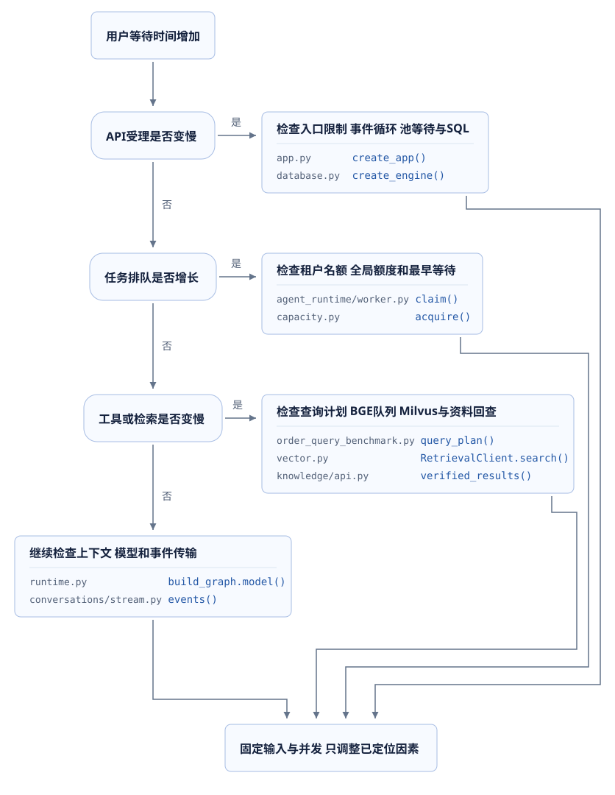
</figure>

**诊断练习**：API受理P95保持稳定，排队时间增加；全局交互额度持续用满，BGE队列为空。数据库查询没有变慢。此时直接增加BGE批次上限是否具有测量依据？

<details>
<summary>展开参考答案</summary>

现有记录说明等待集中在取得任务执行机会。继续检查各租户的活跃任务、主图持续时间、专业分支额外名额、模型调用等待和后台预留配置。BGE队列为空，当前还没有增加其批次的测量依据。任何额度调整都需要核对下游服务能力和交互P95，不能只观察排队数量下降。

</details>

## 12. 课后作业与评分

提交一份从浏览器到检索的性能检查记录，以及一个单因素实验。记录使用本人运行产生的数据，历史记录单列用于解释方法。选择已能定位的具体因素，例如订单查询索引、BGE等待窗口，或检索候选数量；修改保存在个人练习分支，固定教学tag保持不变。

### 12.1 请求时间与优化位置

绘制Mermaid请求时序图，包含浏览器、代理或实际直连入口、API、任务队列、数据库、工具、BGE与Milvus。标出受理、排队、执行、提交和页面显示的起止时间。主模型调用只标识其位置及当前未采样状态，本次不发送生成请求。

按路径列出可检查的位置：前端重复请求和渲染、入口拒绝、事件循环、HTTP与数据库连接、租户排队、SQL查询和锁等待、工具结果数量、Embedding批次、检索top-k、资料回查、缓存失效。每项标记“已有实现”“本次修改”或“检查方法”，附实际源码位置。**指标没有采集时写明缺少的记录，不能用其他阶段耗时代替**。

### 12.2 单因素实验与正确性

例如选择BGE聚合窗口从5ms调整为0ms。修改前说明预期：低并发的聚合等待可能减少，并发请求形成的批量也可能变化。固定模型版本、CPU线程、数据、问题、请求数、并发与最长时间，再记录两组结果。实验继续遵守最多3200次负载、并发不超过16、外层180秒的范围；需要不同范围时，在提交材料中先明确数量和期限。

| 必须提交的记录 | 具体字段 |
| --- | --- |
| 版本与环境 | 日期、tag或commit、依赖、进程数、CPU线程、池与队列配置 |
| 数据与输入 | 租户范围、资料及问题集摘要、订单数量、预热方法 |
| 负载范围 | 请求总数、并发、发送时间、最长执行时间、生成尝试数 |
| 全部结果 | 200、429、其他错误、未完成、成功RPS、P50/P95/P99及算法 |
| 资源与阶段时间 | 连接等待、事务时间、队列深度、BGE批量与排队、检索耗时 |
| 正确性 | 返回顺序、权限撤销、跨租户、资料版本、取消及清理结果 |
| 采用条件 | 哪组条件改善、增加了什么成本、哪些范围仍未验证 |

<details>
<summary>展开实验设计参考</summary>

窗口实验只修改`batch_wait_seconds`，保持`batch_size`、`queue_texts`、模型revision和文本集合相同。低并发与16并发分别记录成功耗时、全部状态、平均批量和队列等待；使用CPU顺序与取消测试检查返回正确性。检索质量沿固定资料与问题集比较，同一问题的返回变化需要保存原始结果。结果没有改善仍然可以形成有效结论，前提是方法、范围和数据可核对。

候选top-k实验同时检查Recall与MRR，并保存最终有效引用数量；索引实验同时检查四类查询与有序摘要。缓存属于新增实现时，额外验证资料撤回、权限撤销、同时未命中及等待者取消，不能只报告命中请求耗时。

</details>

### 12.3 面试说明与评分

用一次实际请求说明问题：用户等待表现、哪一段记录显示主要耗时、修改了哪个函数、相同条件下结果如何变化，以及权限和业务结果如何验证。例如客户分页查询减少扫描，同时员工游标页P95增加，就分别说明两条访问路径与测量范围，保留全部数据。

| 评分项目 | 分值 | 达到要求的内容 |
| --- | ---: | --- |
| 请求路径与指标定义 | 20 | 起止位置清楚，受理、排队、业务完成和失败分别统计 |
| 单因素与可复现条件 | 25 | 固定版本、数据、请求数量、并发、期限和进程配置 |
| 原始结果与资源记录 | 20 | 全部状态、分位算法、样本量和相关资源指标完整 |
| 业务、权限与检索质量 | 25 | 使用真实组件，范围及版本检查保持正确，结果能够复查 |
| 结论与项目说明 | 10 | 解释收益、代价、采用条件和未验证范围 |

提交完整源文件、个人分支差异、命令、原始JSON和测试输出。实验方法正确但未取得收益，可以获得相应方法与验证分；历史数值只作为参考，自己的结论需要本人实际执行记录。第四课继续沿这条请求路径分析上下文、模型HTTP连接、生成服务与流式正文。
