# 上下文、模型推理与流式响应

订单服务已经返回订单状态，资料搜索也找到了清洁说明。接下来，后端需要把这些结果交给模型，生成客户能够阅读的答复。输入里同时存在系统指令、历史消息、工具定义和工具结果；输出还需要经过权限、版本、费用与会话状态检查。一次模型 HTTP 请求周围的这些工作，决定了长对话能否继续、页面多久出现文字，以及连接中断后能否恢复。

代码阶段`06-context-model-performance`增加上下文筛选和模型连接复用，`07-streaming-response`增加正文流式事件及用量恢复。`09-course-delivery`继续优化用量核对查询与调度。GPU部署与资源计算单独标明条件；现有测量来自本地服务及历史模型样本。

## 1. 模型请求与响应过程

### 从工具返回的JSON到模型输入

模型只会读取本次请求携带的内容。数据库保存了十次对话，并不表示供应商自动知道这十次对话；订单工具刚刚返回一个JSON，也需要加入消息列表，才能参与下一次生成。这里的**上下文，是本次请求提交给模型的全部输入**，包括系统指令、选中的消息以及工具说明。

例如，客户要求“查询键盘订单，并说明清洁方式”。订单工具返回订单编号、商品和当前状态，资料工具返回文档内容及版本。主模型根据这些结果组织答复；如果还需要查询信息，返回的内容也可能包含工具名称和JSON参数。后端据此调用普通业务函数，保存结果，继续发起模型请求。一次客户请求因而可能产生多次模型尝试，每次分别记录`ModelAttempt`和token账目。

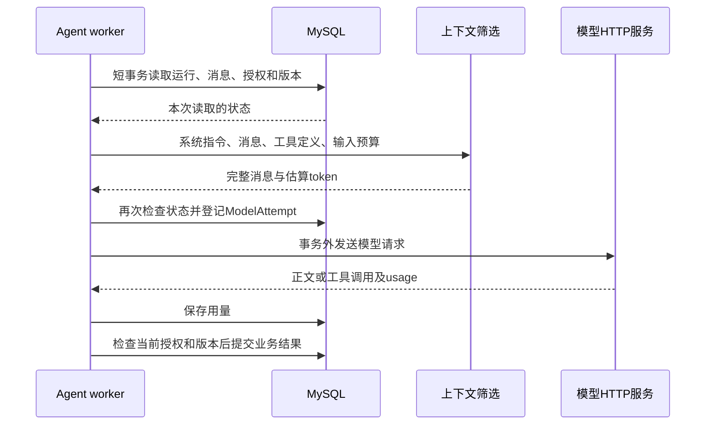

06阶段中，主模型调用前使用下面的代码准备消息。`context_start`标记当前用户请求的起点，`max_context_tokens`限制估算输入规模，`model_tools`提供当前图版本允许使用的工具。

```python
selected = select_context(
    messages, instructions=SystemMessage(content=instructions),
    tools=model_tools(graph_version), required_from=configuration.get("context_start", 0),
    maximum_tokens=configuration.get("max_context_tokens", settings.max_context_tokens),
)
```

源码：[06 · runtime.py · build_graph.model](../source.html?stage=06-context-model-performance&path=src/zhifu/modules/agent_runtime/runtime.py&symbol=build_graph.model)。

### 请求时间与结果状态

普通接口经常只记录请求总耗时。模型流式接口还需要区分首次文字出现和完整答复完成：客户看到第一段文字之后，模型可能仍在生成；后端接收全部内容之后，也可能因资料版本变化而拒绝提交。

| 观察对象 | 起点和终点 | 可以回答的问题 |
| --- | --- | --- |
| 模型尝试 | 发起本次模型调用到返回或终止 | 单次调用占用多少时间和token |
| 服务端首次文字 | `DraftStream`创建到收到第一份非空正文 | worker何时收到正文；包含请求准备与网络等影响 |
| 客户端首次草稿 | 客户端开始观察到收到首条正文事件 | 页面等待受到模型、事件聚合、数据库和传输的共同影响 |
| 业务运行 | `AgentRun`创建到完成、失败、取消或等待 | 一次用户请求经过多少工具与模型调用 |

**草稿可以提前展示，正式消息需要完成业务检查**。07阶段把草稿保存为`agent.output.delta`事件，完整答复通过检查后形成`message.assistant`。模型尝试的用量独立保存，客户取消请求也不会撤销已经发生的模型消耗。

源码：[07 · streaming.py · DraftStream](../source.html?stage=07-streaming-response&path=src/zhifu/modules/agent_runtime/streaming.py&symbol=DraftStream)、[07 · runtime.py · build_graph.model](../source.html?stage=07-streaming-response&path=src/zhifu/modules/agent_runtime/runtime.py&symbol=build_graph.model)。


## 2. 上下文筛选与工具消息完整性

### 工具请求和结果成组保留

工具调用可以理解为模型发来一份函数调用请求：`AIMessage.tool_calls`包含调用编号、函数名称和参数，后端返回的`ToolMessage.tool_call_id`指向对应编号。模型依赖这组关系判断哪份JSON回答了哪次查询。

直接保留“最近20条消息”可能恰好从工具结果开始，前面的调用请求已经被省略。另一个风险是只保留两个并行查询中的一个结果。06阶段通过`validate_pairs`检查编号，并以`HumanMessage`为完整轮次起点选择历史。

<figure class="static-diagram" data-diagram-kind="static" tabindex="0" aria-label="上下文筛选与工具消息完整性，可滚动查看">
  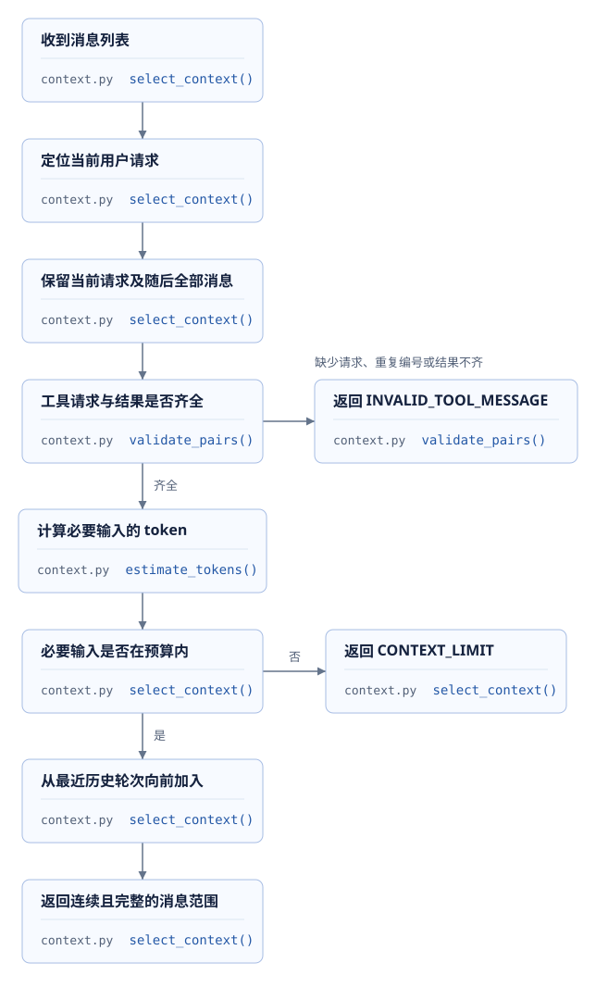
</figure>

以下连续源码展示结果编号的检查。遇到新消息时，上一组工具请求必须已经收到全部结果；函数结束时也会检查未完成编号。

```python
pending = set()
for message in messages:
    if isinstance(message, ToolMessage):
        require(message.tool_call_id in pending, "INVALID_TOOL_MESSAGE", "工具结果缺少对应请求")
        pending.remove(message.tool_call_id)
    else:
        require(not pending, "INVALID_TOOL_MESSAGE", "工具请求仍有未返回的结果")
        if isinstance(message, AIMessage):
            identifiers = [item["id"] for item in message.tool_calls]
            require(len(identifiers) == len(set(identifiers)),
                    "INVALID_TOOL_MESSAGE", "工具请求编号重复")
            pending.update(identifiers)
require(not pending, "INVALID_TOOL_MESSAGE", "工具结果尚未齐全")
```

源码：[06 · context.py · validate_pairs](../source.html?stage=06-context-model-performance&path=src/zhifu/modules/agent_runtime/context.py&symbol=validate_pairs)。

### 历史消息与本次请求的边界

用户当前要求修改换货方案，随后补充“只更换键盘，不更换鼠标”。两条消息以及期间的工具结果都属于当前运行的重要输入。筛选函数从`required_from`开始完整保留这部分内容，再尝试加入更早的对话。当前内容超过预算时，调用在登记模型尝试前终止。

```python
for start in reversed(starts):
    candidate = messages[start:]
    validate_pairs(candidate)
    count = estimate_tokens([instructions, *candidate], tools)
    if count > maximum_tokens:
        break
    selected, estimated, boundary = candidate, count, start
return ContextSelection(selected, estimated, boundary)
```

源码：[06 · context.py · select_context](../source.html?stage=06-context-model-performance&path=src/zhifu/modules/agent_runtime/context.py&symbol=select_context)。

`starts`来自当前请求之前的用户消息位置，因此选择结果是最近的一段连续完整对话。某轮加入后超额，循环随即结束。它没有根据语义重要性跳过中间轮次，也没有更改数据库中的历史消息。`omitted_history_messages`记录本次输入省略的消息数量，便于解释不同请求的token变化。

**省略历史只改变模型输入，不改变订单事实、用户授权或数据库历史**。运行创建时保存`context_start`与输入上限；每次调用前仍重新验证资料、业务数据和用户记忆版本。07阶段还把相同预算检查用于专业角色：委托输入使用`required_from=0`，整份委托都需要保留，超额时不会扣除本次模型调用额度。

源码：[06 · service.py · queue_run](../source.html?stage=06-context-model-performance&path=src/zhifu/modules/agent_runtime/service.py&symbol=queue_run)、[07 · collaboration.py](../source.html?stage=07-streaming-response&path=src/zhifu/modules/agent_runtime/collaboration.py)。

## 3. 输入预算与历史压缩

### 输入上限、输出上限与账户预算

这三个上限控制不同对象。输入上限限制系统指令、消息和工具定义的估算规模；输出上限控制单次生成的最大token数量；账户预算限制一段时间内允许消耗的额度。模型服务自身还具有上下文长度限制，输入和可能生成的输出需要共同满足该服务的要求。

| 约束 | 项目中读取的位置 | 超过限制时的行为 |
| --- | --- | --- |
| 输入预算 | `release_snapshot.max_context_tokens` | 必要内容超额时返回`CONTEXT_LIMIT` |
| 输出预算 | `release_snapshot.max_output_tokens` | 编码到模型参数，并用于预算预留 |
| 账户与租户额度 | `TokenEntry`及预算管理 | 调用前检查和预留，收到usage后结算 |
| 调用次数 | 图版本的`max_model_calls`与运行计数 | 达到次数后停止继续调用 |
| 服务端模型长度 | 供应商或vLLM模型配置 | 由模型服务检查；平台估算不能代替服务端判断 |

06阶段的估算把消息和工具定义序列化后，用固定`cl100k_base` tokenizer计数，并增加256个token余量：

```python
payload = {"messages": [message_to_dict(item) for item in messages], "tools": tools}
serialized = json.dumps(payload, ensure_ascii=False)
return len(ENCODING.encode(serialized, disallowed_special=())) + 256
```

源码：[06 · context.py · estimate_tokens](../source.html?stage=06-context-model-performance&path=src/zhifu/modules/agent_runtime/context.py&symbol=estimate_tokens)、[06 · budget_callback.py · BudgetCallback](../source.html?stage=06-context-model-performance&path=src/zhifu/modules/agent_runtime/budget_callback.py&symbol=BudgetCallback)。

不同模型的tokenizer和消息编码存在差异，256是项目采用的预留量。**估算用于请求筛选，供应商返回的usage用于费用与额度结算**。例如，估算输入为8,000、输出上限为1,000时，可以判断是否满足项目的12,000输入预算；能否进入某个最大长度为8,192的模型，还需要按该模型实际tokenizer和输入、输出长度规则验证。

### 三种减少输入的操作

第三课的检索负责从资料集合找出相关内容。本课的历史筛选负责选择完整对话。业务JSON字段选择可以减少无关数据，例如订单查询只传模型允许读取的商品、数量、状态和版本。三者发生在不同位置，验收也分别检查资料相关性、消息配对和业务字段完整性。

<figure class="static-diagram" data-diagram-kind="static" tabindex="0" aria-label="必要输入与历史预算，可滚动查看">
  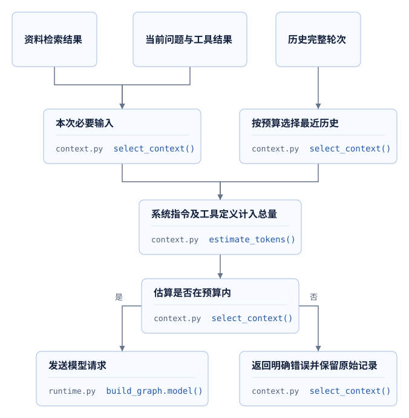
</figure>

历史摘要则需要生成一份新的内容：从多次对话提取仍然有效的事实。06、07阶段**没有实现自动历史摘要**。如果扩展这项能力，摘要需要保留订单编号、方案版本、用户确认范围、否定和取消要求；来源消息与生成版本也需要可查询。摘要本身会增加模型调用和用量，源消息变动后需要重新判断摘要是否有效。

例如，历史中先出现“可以换货”，后来出现“暂时取消，等待我确认”。只保存前一句的摘要会改变用户意图。可以把这两条消息作为摘要质量检查的最小样例：输出必须表达当前等待确认状态，并引用对应消息范围。压缩率之外，还需要验证业务事实和工具配对。

<details>
<summary>练习：输入超额时可省略哪些内容</summary>

当前运行包含用户换货要求、一次订单查询、用户补充的商品数量和一次方案查询。历史中还有上周的物流咨询。当前运行本身已经超过输入预算。

参考答案：当前实现返回`CONTEXT_LIMIT`，不会从当前运行中删除工具结果或用户补充。上周咨询属于可省略历史，但省略之后仍然超额。进一步处理需要调整产生过大输入的工具响应、经过验证的业务字段选择，或者发布适合该输入规模的配置；调整期间保留当前业务版本和授权检查。

</details>

## 4. 模型HTTP连接、超时与并发

### 连接对象的生命周期

每次HTTP调用都重新创建客户端，会使连接建立和关闭反复发生。06阶段在持续运行的worker中保存`ModelClients`，同一模型地址和凭据复用客户端。SDK仍按当前调用设置认证信息，传输层没有固定的默认身份头。

```python
identity = hashlib.sha256((base_url + "\0" + credential).encode()).digest()
async with self.lock:
    if identity not in self.entries:
        if len(self.entries) >= 8:
            idle = next((key for key, item in self.entries.items()
                         if item.active == 0), None)
            if idle is None:
                raise RuntimeError("当前进程的模型连接身份数量已达到上限")
            await self.entries.pop(idle).transport.aclose()
        self.entries[identity] = ClientEntry(TransportClients(maximum_connections=4))
    entry = self.entries[identity]
    self.entries.move_to_end(identity)
    entry.active += 1
```

源码：[06 · model_clients.py · ModelClients.for_request](../source.html?stage=06-context-model-performance&path=src/zhifu/modules/agent_runtime/model_clients.py&symbol=ModelClients.for_request)。

这个缓存最多保存8种地址与凭据组合。需要新组合时，只能清理没有活动请求的旧客户端；全部繁忙则明确报错。每种组合中的同步与异步客户端各自限制4条连接。凭据变化会得到新的组合，已有活动请求继续使用原客户端，结束后才允许清理。

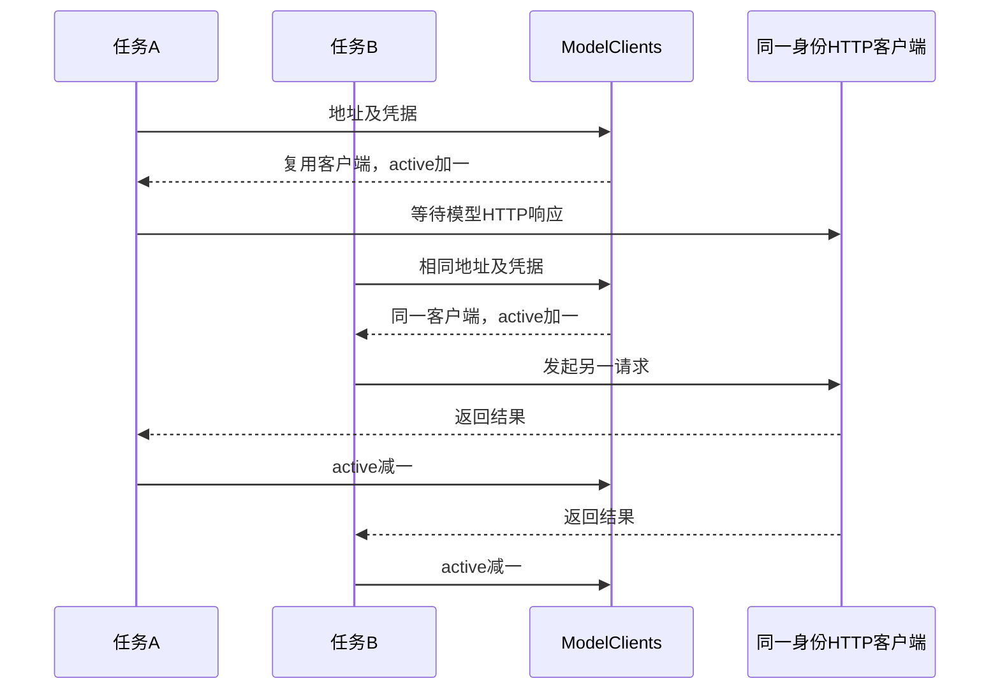

`asyncio.Lock`保护本进程缓存条目，等待HTTP期间不持续持有这个锁。其他进程拥有各自的客户端与连接池。**一个进程的连接上限不能代替整个部署的模型并发限制**。账户额度、租户并发、全局并发以及供应商RPM、TPM，需要分别统计。

### 超时对应的等待范围

主模型调用在数据库事务之外执行，外部请求无需占用业务行锁。`asyncio.timeout`覆盖本轮异步调用，采用发布配置的模型超时与读取到的运行剩余时间中的较小值；SDK也设置超时，并关闭自动重试。

```python
async with model_clients(clients) as pool, pool.for_request(
    model_url, credential,
) as transport, asyncio.timeout(min(configuration["model_timeout"], remaining)):
    client = ChatOpenAI(
        model=model_name, base_url=model_url, api_key=credential, temperature=0,
        timeout=configuration["model_timeout"], max_retries=0,
        cache=False, use_responses_api=False,
        **chat_parameters(model_url, configuration["max_output_tokens"],
                          configuration["model_extra_body"]),
        http_client=transport.sync, http_async_client=transport.async_client,
    )
```

源码：[06 · runtime.py · build_graph.model](../source.html?stage=06-context-model-performance&path=src/zhifu/modules/agent_runtime/runtime.py&symbol=build_graph.model)、[06 · worker.py · execute_one](../source.html?stage=06-context-model-performance&path=src/zhifu/modules/agent_runtime/worker.py&symbol=execute_one)。

模型超时之外还有worker整次执行期限、运行总期限和执行租约。取消HTTP等待之后，远端是否已经计算或返回usage需要单独处理。调用发生了网络错误，也不能据此认定消耗为零。

2026-09-25的本地连接实验共执行6次健康检查请求，每组3次、并发1、最长30秒：逐次创建客户端使用3条TCP连接，复用客户端使用1条。实验关闭环境代理，生成模型调用为0。这个结果证明该场景的TCP复用；供应商TLS、跨网络延迟以及模型推理速度需要另外测量。

记录：[06 · context-model-performance.md](../source.html?stage=06-context-model-performance&path=docs/course/context-model-performance.md)。

## 5. 模型配置与输出预算

### 配置进入运行快照

管理员发布模型名称、服务地址、凭据环境变量名称、系统指令和预算之后，运行保存所用配置。排队期间管理员发布了新版本，已经创建的运行仍能解释自己采用了哪份设置。凭据本身从环境读取，接口和事件中不需要展示密钥。

<figure class="static-diagram" data-diagram-kind="static" tabindex="0" aria-label="模型配置与请求，可滚动查看">
  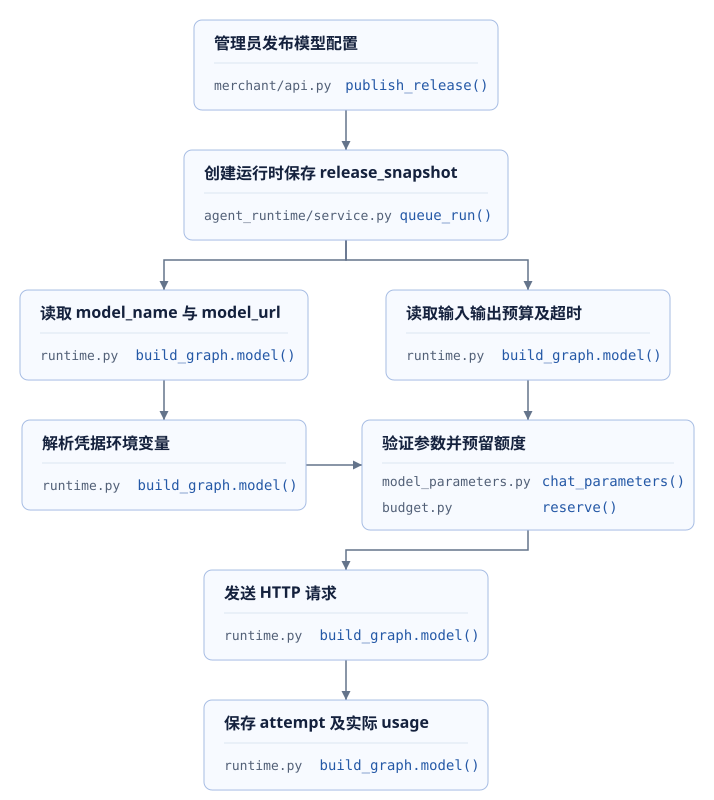
</figure>

源码：[06 · service.py · queue_run](../source.html?stage=06-context-model-performance&path=src/zhifu/modules/agent_runtime/service.py&symbol=queue_run)。

用户配置的`extra_body`也可能含有输出长度字段。如果顶层限制为512，但扩展JSON再次填入8,192，最终HTTP请求就存在冲突。`chat_parameters`检查这些字段，要求与受控上限完全相等，再按服务地址编码请求。

```python
body = dict(extra_body)
# SDK 会把 extra_body 合并到最终 JSON，扩展设置不能覆盖平台保存的输出额度。
for name in ("max_tokens", "max_completion_tokens", "max_output_tokens"):
    if name in body:
        value = body.pop(name)
        if type(value) is not int or value != max_output_tokens:
            raise ValueError(f"{name} 与模型输出上限冲突")
```

源码：[06 · model_parameters.py · chat_parameters](../source.html?stage=06-context-model-performance&path=src/zhifu/core/model_parameters.py&symbol=chat_parameters)。

### 模型选择的业务检查

更换服务时，接口兼容只覆盖请求格式的一部分。课程中的工具调用还依赖模型生成正确工具名称、完整JSON、调用编号，以及能够处理后续工具结果。输出上限过小，可能使工具参数或答复提前终止；上限增加又会影响预留额度、等待时间和资源计算。

| 检查项 | 沿用的业务样例 | 记录内容 |
| --- | --- | --- |
| 信息选择 | 同时查询订单与清洁资料 | 选择的工具、参数、资料引用是否正确 |
| 权限与意图 | 客户取消或主管接管 | 服务端拒绝旧结果，正式消息没有使用过期状态 |
| 输出完整性 | 包含多字段的换货请求 | JSON可解析，必填字段齐全，结束原因可解释 |
| 等待体验 | 相同长度的输入与输出上限 | 首次文字、完整耗时、失败率 |
| 用量 | 包含全部工具循环和重试 | 每次尝试的输入、缓存输入、输出和账目状态 |

**质量检查通过后，性能与费用才具有可比较的业务含义**。固定输入、工具定义、输出预算、模型版本和并发条件，才能讨论同一业务的成本差异。`temperature=0`也不能把跨版本、跨服务的结果当成完全一致。


## 6. 项目生成服务部署

### 业务服务与模型服务之间的接口

客户请求“查询订单并咨询商品资料与换货条件”后，Agent worker 查询订单和换货规则、检索商品资料，并请求生成模型整理结果。这里为项目配置独立生成服务：vLLM加载模型、安排计算、管理KV cache，通过Chat Completions返回工具调用、正文和usage。订单权限、换货审批、业务版本和token账目继续由项目后端管理。

**主Agent与两个专业Agent共用运行快照中的模型地址、模型名称和凭据变量名称。** 生成服务通过`AGENT_MODEL_URL`接入；第三课的BGE-M3继续通过`KNOWLEDGE_INFERENCE_URL`提供文本向量，Milvus完成dense、BM25与RRF融合查询。项目已有Compose中的`inference`运行BGE服务，生成模型另行部署。

<figure class="static-diagram" data-diagram-kind="static" tabindex="0" aria-label="业务进程与独立生成服务，可滚动查看">
  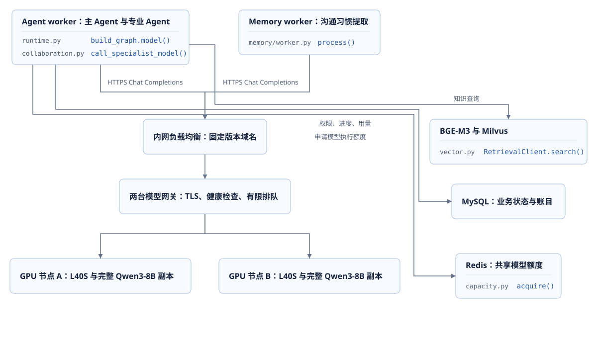
</figure>

部署使用两台Linux amd64服务器，每台一张NVIDIA L40S 48GB、一份完整的`Qwen/Qwen3-8B`模型。两个副本分别处理请求，每个副本的`tensor-parallel-size=1`。网关按连接数量分配请求，并检查副本健康状态；一个副本维护时，剩余副本承担当前流量，入口额度按剩余能力控制。

模型与服务固定为同一个发布组合：Qwen revision为`b968826d9c46dd6066d109eabc6255188de91218`，vLLM版本为`v0.11.0`，Linux amd64镜像使用固定digest。驱动、容器设备访问与模型加载检查在目标服务器执行。完整镜像标识、模型下载和服务器要求见[项目推理服务部署](../materials/gpu-deployment-lab.html)。

### 从启动参数到验收条件

模型文件以只读目录挂载，权重使用BF16，凭据从部署系统分发的secret文件读取。GPU节点仅开放受控私网端口，业务进程通过网关HTTPS地址访问。两台网关使用相同的TLS与路由配置，生成POST关闭自动重试，持续转发SSE内容。

| 设置 | 项目部署值 | 需要检查的对象 |
| --- | --- | --- |
| 模型服务名称 | `zhifu-qwen3-8b-r1` | 请求中的`model`与服务名称一致 |
| `max-model-len` | 16384 | 每个序列的输入与输出总长度 |
| `max-num-seqs` | 每副本8 | 每次调度允许处理的序列数量 |
| `max-num-batched-tokens` | 4096 | 一次调度中的token处理预算 |
| `dtype` / `kv-cache-dtype` | `bfloat16` / `auto` | 权重精度与KV元素的存储格式 |
| `gpu-memory-utilization` | 0.85 | 引擎的设备显存预算比例 |
| prefix caching / chunked prefill | 开启 | 前缀复用与长输入调度 |
| 自动工具选择 / parser | 开启 / `hermes` | 自动选择工具时解析Qwen3输出 |
| `generation-config` | `vllm` | 由服务及请求参数控制生成配置 |

`gpu-memory-utilization=0.85`描述显存预算比例，GPU计算利用率从运行指标读取。`max-num-batched-tokens=4096`配合chunked prefill，让长输入分多轮参与调度。**每副本8个序列是配置上限，规定延迟下能够承接的请求数量需要通过负载检查确定。** 模型权重、KV、临时张量和实际输入长度都参与容量判断。

<figure class="static-diagram" data-diagram-kind="static" tabindex="0" aria-label="生成服务部署与验收顺序，可滚动查看">
  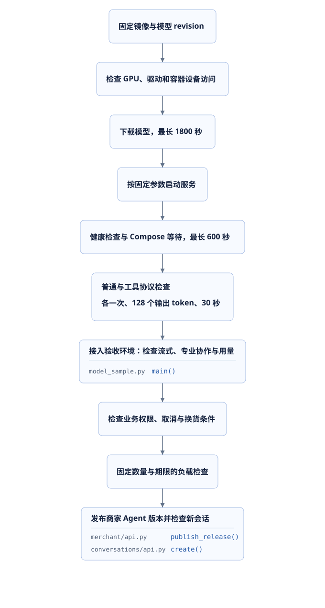
</figure>

下载与操作命令保存在[项目推理服务部署](../materials/gpu-deployment-lab.html)，包含GPU节点Compose、启动脚本、模型网关、环境参数和检查请求。模型下载最长1800秒，Compose就绪等待最长600秒；普通文本和工具流式协议检查各执行一次，每次最多128个输出token、最长30秒、自动重试为0。`/health`通过后，继续检查工具名称、JSON参数、调用编号、最终usage和业务权限。

### 后端配置、发布与业务验收

API、Agent worker、Memory worker和发布检查进程读取同一发布目标的配置。地址示例为`https://model-r1.internal.example/v1`，模型名称为`zhifu-qwen3-8b-r1`，`AGENT_CREDENTIAL_ENV`指向部署系统注入的`ZHIFU_INFERENCE_R1_KEY`。`AGENT_MODEL_EXTRA_BODY`使用`{"chat_template_kwargs":{"enable_thinking":false}}`，单次模型期限30秒，主Agent输出上限1024，专业Agent最多512。

项目`AGENT_MAX_CONTEXT_TOKENS=12000`使用`cl100k_base`估算输入；服务端16384限制包含输入和输出。Qwen3的tokenizer及chat template还会影响最终数量，接近上限的请求需要按目标模型检查。主Agent使用`astream()`接收正文和usage，专业Agent第一轮使用`tool_choice="required"`，第二轮使用`"none"`；这些行为都属于接入验收范围。

源码：[09 · runtime.py · build_graph.model](../source.html?stage=09-course-delivery&path=src/zhifu/modules/agent_runtime/runtime.py&symbol=build_graph.model)、[09 · collaboration.py · call_specialist_model](../source.html?stage=09-course-delivery&path=src/zhifu/modules/agent_runtime/collaboration.py&symbol=call_specialist_model)。

商家读取`GET /admin/v1/stores/{store_id}/agent-releases`，取得候选摘要并检查发布条件；完成接入回归后，携带业务访问令牌、幂等键、`expected_version`、`candidate_hash`、`regression_checked`和发布原因提交POST。**发布记录固定模型地址与名称，新会话引用新版本，已有会话继续使用原版本。** 运行创建时复制发布快照，执行时从环境读取凭据值；Memory worker直接使用自身的`AgentSettings`。

源码：[09 · merchant/api.py · publish_release](../source.html?stage=09-course-delivery&path=src/zhifu/modules/merchant/api.py&symbol=publish_release)、[09 · service.py · queue_run](../source.html?stage=09-course-delivery&path=src/zhifu/modules/agent_runtime/service.py&symbol=queue_run)。

发布接口和发布检查只核查生成配置是否齐全。实际请求另外核对`max_completion_tokens`、自动工具选择、`required`、`none`、流式工具参数及usage。启用金额预算的租户还需审批新地址与模型对应价格，否则调用会因`BILLING_PRICE_MISSING`被拒绝。已有采样脚本按1、2、5次上限分别检查文本流式、订单工具和专业协作，每次最多512个输出token，每项脚本最长180秒；记忆任务与其他业务路径分别登记。

Qwen3-8B在本方案中承担生成服务，业务质量通过订单事实、知识引用、工具调用和权限结果检查。部署记录同时保存revision、服务参数、请求数量、用量、失败结果、TTFT与GPU指标，发布结论使用这些记录限定适用范围。

## 7. 推理性能与资源计算

### 首次输出和持续生成

生成请求通常包含两种计算：prefill处理输入并建立KV cache，decode根据已有内容逐步生成新token。请求还可能先在队列等待。输入变长通常会增加输入处理工作，输出变长则会延长持续生成过程。

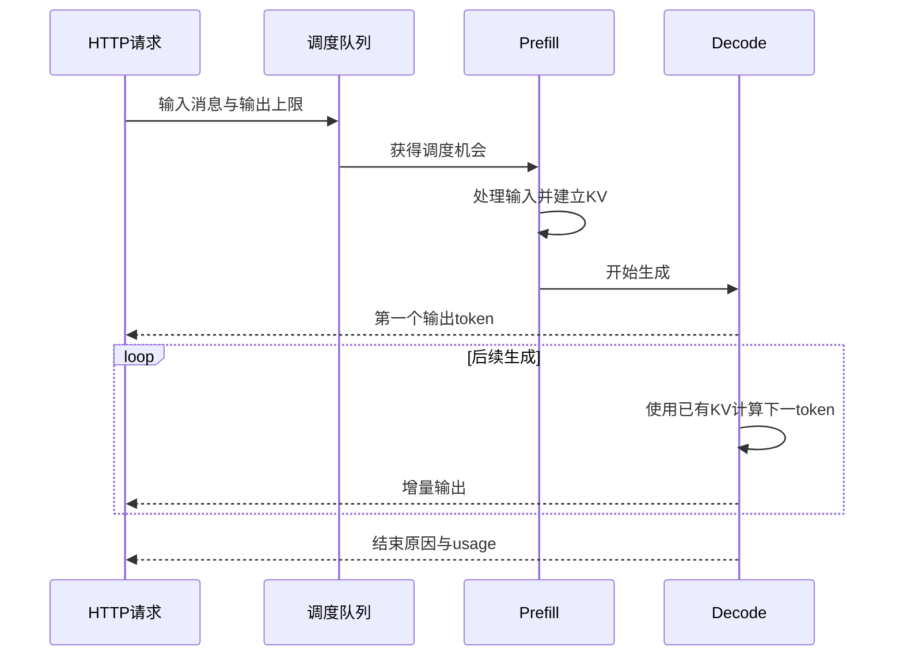

TTFT通常指请求开始到首次输出token的时间，具体起点必须写入测量记录。后续token间隔描述持续输出是否顺畅。吞吐则需要说明统计对象：输出token/s、全部token/s或请求/s。一个请求更快与一组并发请求总吞吐更高，需要分别观察。

项目`DraftStream.ttft_seconds`从对象创建到第一份非空正文计时。它包含SDK调用、网络和远端等待等影响，不能直接作为GPU内核耗时。客户端首次草稿还要经过聚合、数据库事件保存和SSE读取，通常具有不同数值。

源码：[07 · streaming.py · DraftStream.add](../source.html?stage=07-streaming-response&path=src/zhifu/modules/agent_runtime/streaming.py&symbol=DraftStream.add)。

### KV cache与显存容量

KV cache保存注意力计算使用的Key和Value，使后续生成能够使用之前token的计算结果。对于各层结构相同、保存完整K和V的模型，可以进行以下容量练习：

```text
每个token的KV字节数 = 2 × 层数 × KV head数量 × head维度 × 每元素字节数
每个请求的KV字节数 = 每个token的KV字节数 × 当前缓存token数
可用KV容量 = 引擎显存预算 − 权重 − 运行开销 − 预算内保留容量
容量上限 = floor(可用KV容量 / 每个请求的KV字节数)
```

第一组假设采用32层、8个KV head、head维度128、每元素2字节，得到128 KiB/token。4,096 token请求需要512 MiB KV，16个相同长度的请求需要8 GiB KV。

再设设备24 GiB、引擎比例0.85、80亿参数、权重每参数2字节、运行开销2 GiB、预算内保留1 GiB。权重约14.901161 GiB，可用KV约2.498839 GiB。仅按这组显存假设，4,096 token请求可容纳4个，8,192 token请求可容纳2个。

| CPU计算输入 | 每个token的KV | 每个请求的KV | 结果范围 |
| --- | ---: | ---: | --- |
| 32层，4096 token | 128 KiB | 512 MiB | 上述24 GiB假设下容量为4 |
| 32层，8192 token | 128 KiB | 1024 MiB | 相同假设下容量为2 |
| 28层，4096 token | 112 KiB | 448 MiB | 8个请求合计3.5 GiB KV |

第三行使用Qwen3-0.6B作为独立结构计算例：固定配置包含28层、8个KV head和128维度，KV元素按2字节计算，权重规模使用模型名称中的近似值。它与前两组历史假设分别保留，用于检查不同输入条件下的容量公式。第6章Qwen3-8B部署所需的36层结构计算见[项目推理服务部署](../materials/gpu-deployment-lab.html)。[Qwen3-0.6B固定配置](https://huggingface.co/Qwen/Qwen3-0.6B/raw/c1899de289a04d12100db370d81485cdf75e47ca/config.json)

2026-09-26重新执行这三组CPU计算，输出均为`status=ASSUMPTION_CALCULATION`、`gpu_execution=false`。计算命令位于第11章。实际容量还受缓存分页、临时张量、CUDA graph、分配器、并行方式和请求长度分布影响。MLA、滑动窗口和混合层模型需要使用对应结构的公式。

### 批处理、前缀缓存与量化

多个请求同时等待时，推理服务需要安排有限的计算与显存资源。连续批处理在请求结束后继续接入等待请求；chunked prefill把长输入按调度预算分段处理，V1调度优先安排decode。调整每次调度的token预算，会改变输入处理和持续输出之间的时间分配。KV不足引起的preemption可能增加重新计算，检查时需要同时记录等待队列和延迟。[vLLM v0.11.0优化说明](https://raw.githubusercontent.com/vllm-project/vllm/v0.11.0/docs/configuration/optimization.md)

前缀缓存利用相同输入前缀已经计算的KV，例如固定系统指令和工具定义。它主要减少重复输入的prefill计算，后续新token仍需要生成。项目没有实现跨供应商缓存控制器；远端报告的缓存命中token与自己部署vLLM时的前缀缓存，需要按各自服务记录解释。[官方前缀缓存说明](https://raw.githubusercontent.com/vllm-project/vllm/v0.11.0/docs/features/automatic_prefix_caching.md)

量化使用更少位数表示权重或其他数值，可能减少存储与显存需求。权重量化和KV量化改变不同对象；可用格式、GPU支持和计算内核也需要匹配。较小的文件不能直接证明工具调用质量或响应速度，固定业务样例需要重新验证。[vLLM v0.11.0量化与设备支持](https://raw.githubusercontent.com/vllm-project/vllm/v0.11.0/docs/features/quantization/README.md)

| 调整对象 | 预期减少的工作或资源 | 同时记录的变化 |
| --- | --- | --- |
| 上下文长度 | 输入处理与KV数量 | 必要业务信息、答案正确率 |
| 输出上限 | 最长生成过程及额度预留 | JSON与正文完整性 |
| 批处理参数 | 多请求调度开销 | TTFT、后续间隔、队列与吞吐 |
| 前缀缓存 | 相同前缀的重复计算 | 命中范围与冷启动结果 |
| 权重或KV量化 | 对应数值的存储容量 | 质量、支持的设备及计算内核 |
| 多GPU或多副本 | 单设备容量或请求承载量 | 通信开销、总费用与请求分布 |

### 推测解码的计算收益

推测解码由较低成本的过程提出多个候选token，再由目标模型验证。实际接受多少候选，决定一次验证能够前进多少个token。草稿生成和验证都需要时间，也可能占用额外显存。v0.11.0官方文档明确指出收益依赖输入与采样条件，并标明当时与pipeline parallelism不兼容；具体方法还需要核对该版本支持情况。[官方推测解码说明](https://raw.githubusercontent.com/vllm-project/vllm/v0.11.0/docs/features/spec_decode.md)

<figure class="static-diagram" data-diagram-kind="static" tabindex="0" aria-label="推测解码流程，可滚动查看">
  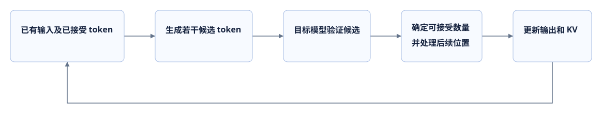
</figure>

采用一组计算假设：草稿生成4毫秒，目标验证16毫秒，平均有效前进3个token，则有效速度为`3 / 0.020 = 150 token/s`。普通生成若为8毫秒/token，则为125 token/s，计算比值为1.2。平均前进数量下降或验证成本增加时，这个比值也会变化。

采样与接受算法需要保持目标模型要求的输出分布；数值精度和批次变化仍可能使具体输出不同。业务验收继续检查工具JSON、事实引用和权限处理。这组150与125的数字是公式输入和结果，当前没有推测解码的GPU测量。

### 多GPU与多个模型副本

tensor parallel把同一层中的张量计算分配到多个GPU，参与该层计算的设备需要交换结果。pipeline parallel按模型层分配设备，请求经过各组层时传递中间结果。它们能够让一个模型副本使用多设备容量，同时增加通信和调度要求。节点间网络、设备连接和模型结构会影响最终收益。[官方并行部署说明](https://raw.githubusercontent.com/vllm-project/vllm/v0.11.0/docs/serving/parallelism_scaling.md)

独立副本则分别加载完整模型，各自处理分配到的请求。单个模型已经能容纳在设备中、主要压力来自请求数量时，可以分析增加副本的吞吐与费用。请求分配还需考虑排队长度和前缀缓存所在位置；不同副本的缓存不会自动成为同一份缓存。

| 方式 | 分配对象 | 资源与通信 | 需要测量的结果 |
| --- | --- | --- | --- |
| tensor parallel | 同一层的张量计算 | 多设备共同持有一个副本，层内需要通信 | 单请求时间、通信占比、可用KV |
| pipeline parallel | 不同模型层 | 按阶段传递中间结果，可能出现设备等待 | 阶段利用率、排队与完整请求时间 |
| 独立副本 | 不同业务请求 | 每份副本占用完整模型及自己的缓存 | 总吞吐、请求分布、缓存命中与总费用 |

项目已有业务worker的并发控制。这里讨论的设备并行与模型副本位于HTTP服务另一端，需要分别配置；增加业务worker不会自动为模型服务增加显存。

vLLM提供`/metrics`，目标设备验收需使用实际返回的指标名称，记录请求耗时、队列、缓存及吞吐，并与客户端时间配合分析。指标会随版本变化，课程固定版本便于复查。[官方metrics说明](https://raw.githubusercontent.com/vllm-project/vllm/v0.11.0/docs/usage/metrics.md)


## 8. 正文流式事件

### 两条不同的流

模型服务向worker发送的是模型响应片段；页面订阅的是项目保存的会话事件。07阶段在两者之间增加`DraftStream`：只收集正文，按数量或时间聚合，重新检查当前运行后保存事件。浏览器连接中断时，worker仍可以继续执行，已经保存的事件可以重新读取。

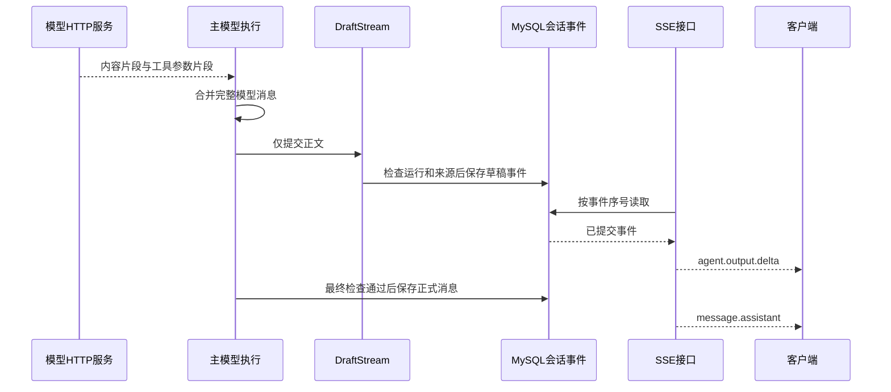

主模型从06的`ainvoke`改为07的`astream`。LangChain负责合并消息片段，代码传给`DraftStream.add`的只有`chunk.text`。工具参数不会作为正文片段发送给客户。专业角色在07阶段仍通过`ainvoke`返回完整结果，主模型随后汇总。

```python
# 使用 LangChain 合并完整消息；工具参数片段不进入正文事件。
combined = chunk if combined is None else combined + chunk
await draft.add(str(chunk.text))
```

源码：[07 · runtime.py · build_graph.model](../source.html?stage=07-streaming-response&path=src/zhifu/modules/agent_runtime/runtime.py&symbol=build_graph.model)、[07 · collaboration.py](../source.html?stage=07-streaming-response&path=src/zhifu/modules/agent_runtime/collaboration.py)。

### 聚合与有界保存

模型可能每次只返回几个字符。每份片段都开事务、保存事件并交给SSE，会增加数据库和网络操作。`DraftStream`采用四个限制：待发送正文达到1,000个字符时发送；不足时由定时任务等待约0.25秒；每次尝试最多64条事件；累计正文最多65,536个UTF-8字节。

字符数和字节数有不同用途。1,000字符控制通常的事件批次，UTF-8字节限制控制总体数据量。第64条事件留给最终`flush`，因此最后一条可以超过1,000字符。数据库等待和调度也会影响发送时间，0.25秒不代表客户端必定在250毫秒内看到文字。

```python
# 预留最后一条事件给最终 flush，慢速输出也保持事件总数有界。
while (
    len(self._pending) >= self.batch_characters
    and self.emitted_events < self.event_limit - 1
):
    await self._send_pending(self.batch_characters)
    if self._standalone:
        return
if self._pending and self.emitted_events < self.event_limit - 1:
    self._wake.set()
```

源码：[07 · streaming.py · DraftStream.add](../source.html?stage=07-streaming-response&path=src/zhifu/modules/agent_runtime/streaming.py&symbol=DraftStream.add)。

定时任务由异步上下文创建并管理，退出时取消和等待它结束。后台保存失败会记录异常，由`add`、`flush`或`close`继续传播；清理期间的错误不会覆盖调用方已经收到的模型或取消异常。没有会话的独立运行只记录文本指标，不创建会话草稿事件。

源码：[07 · streaming.py · DraftStream.__aexit__](../source.html?stage=07-streaming-response&path=src/zhifu/modules/agent_runtime/streaming.py&symbol=DraftStream.__aexit__)、[07 · streaming.py · DraftStream.close](../source.html?stage=07-streaming-response&path=src/zhifu/modules/agent_runtime/streaming.py&symbol=DraftStream.close)。

### 每次保存都检查当前状态

模型生成期间，客户可能撤回授权，客服可能接管会话，资料也可能被更新。`_persist_text`在短事务中验证执行租约、当前权限、步骤、资料引用和记忆版本。已经被浏览器显示的文字无法通过数据库事务收回，因此事件带有`provisional=true`，明确表示仍是草稿。

```python
emit(
    session,
    conversation,
    "agent.output.delta",
    {
        "provisional": True,
        "attempt_id": str(UUID(bytes=self.attempt_id)),
        "run_id": str(UUID(bytes=run.id)),
        "chunk_index": self.emitted_events + 1,
        "text": text,
    },
    run.actor_id,
)
```

源码：[07 · streaming.py · DraftStream._persist_text](../source.html?stage=07-streaming-response&path=src/zhifu/modules/agent_runtime/streaming.py&symbol=DraftStream._persist_text)。

**正式答复只能使用通过最后一次检查的完整消息**。模型最终选择调用工具时，后端发出`agent.output.discarded`清除本次草稿，再处理工具请求。文本和工具参数都收到完毕，只代表模型响应完成，业务提交仍需通过当前状态验证。

## 9. SSE续传、取消与正式消息

### 事件编号与模型尝试编号

SSE接口为`GET /openapi/v1/conversations/{conversation_id}/events`，使用Bearer认证。事件包含`id`、`event`和`data`：`id`采用会话事件的`sequence`，`event`采用类型，`data`是完整事件JSON。正文位于`payload.text`，还有`run_id`、`attempt_id`和`chunk_index`。

| 字段 | 管理范围 | 客户端用途 |
| --- | --- | --- |
| `sequence` / SSE `id` | 整个会话的持久事件 | 保存已处理位置，重连和去重 |
| `run_id` | 一次业务运行 | 过滤当前请求之外的运行 |
| `attempt_id` | 一次模型尝试 | 新尝试开始时建立新的草稿 |
| `chunk_index` | 同一尝试的正文事件 | 检查草稿片段是否连续 |
| `control_version` | 会话控制权版本 | 服务端过滤旧控制权下的模型事件 |

过滤旧控制权事件后，客户端收到的`sequence`可以出现间隔。服务端仍会推进读取游标。正文的`chunk_index`则需要在同一次尝试中连续，否则客户端无法确认当前草稿完整。

```python
cursor = event["sequence"]
if event["type"].startswith("agent.") or event["type"] == "message.assistant":
    if event["control_version"] != version:
        continue
yield {
    "id": str(cursor),
    "event": event["type"],
    "data": json.dumps(event, ensure_ascii=False),
}
```

源码：[07 · stream.py · events.generate](../source.html?stage=07-streaming-response&path=src/zhifu/modules/conversations/stream.py&symbol=events.generate)。

### 连接恢复与访问检查

客户端在成功处理事件之后保存编号，重连时通过`Last-Event-ID`发送。接口只查询大于该编号的事件，每批最多50条；每轮查询重新验证访问权限。游标早于保留窗口返回410 `EVENT_CURSOR_EXPIRED`，需要重新查询会话状态与历史；游标超过当前序号返回422。

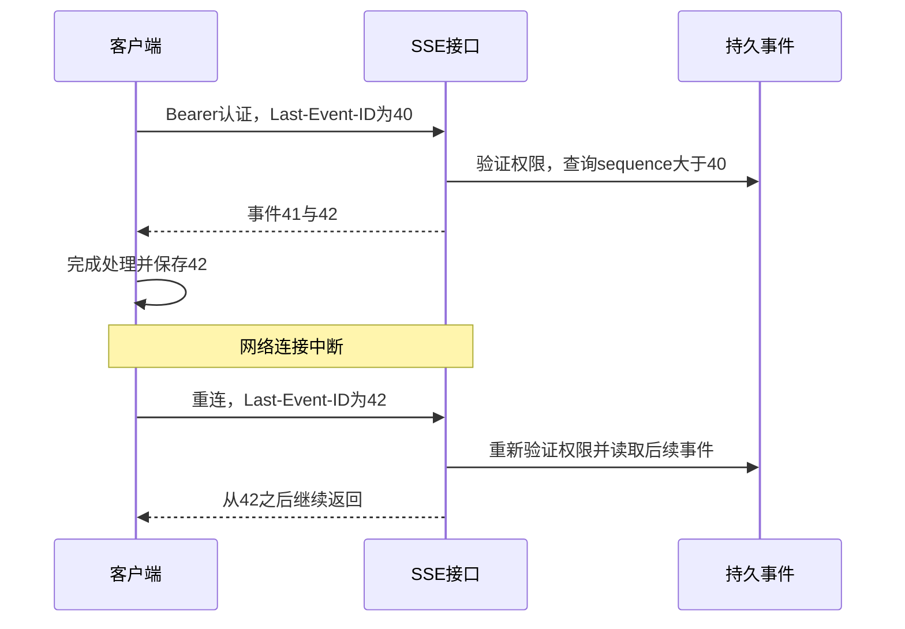

每条连接约50秒后结束，心跳间隔15秒，发送超时5秒。Redis原子检查全局与账户连接数，默认全局200、账户3，超限返回429 `SSE_LIMIT`并提示60秒后重试。API进程用查询信号量限制并行数据库读取；等待下一轮或等待信号量期间无需长期占用数据库连接。

源码：[07 · stream.py · read_events](../source.html?stage=07-streaming-response&path=src/zhifu/modules/conversations/stream.py&symbol=read_events)、[07 · stream.py · events](../source.html?stage=07-streaming-response&path=src/zhifu/modules/conversations/stream.py&symbol=events)。

**恢复事件连接只负责读取结果，不会创建新的模型运行**。页面刷新丢失内存草稿后，需要结合会话状态、正式消息与可用事件恢复显示。课程终端客户端使用`httpx-sse`解析事件，最多3条连接、总期限150秒；它在同一进程重连时保留草稿和游标。

### 页面状态与取消

| 收到的事件或情况 | 显示状态与处理 |
| --- | --- |
| `agent.model_started` | 清除上一尝试未完成草稿，显示正在处理 |
| `agent.output.delta` | 按尝试编号接收并追加正文，保留草稿标记 |
| `agent.output.discarded` | 清除本次草稿，等待工具处理或下一尝试 |
| `message.assistant` | 使用完整正式消息替换草稿 |
| `run.failed`、`run.cancelled`、`control.changed` | 清除未完成草稿，按运行或会话状态更新显示 |
| `access.revoked`、`stream.expired` | 终止当前订阅，重新查询有权访问的会话状态 |

终端客户端采用以下连续代码处理正式答复和草稿清理：

```python
if kind == "message.assistant":
    self.text = payload["text"]
    self.attempt_id = None
    return {"state": "最终答复", "text": self.text}
if kind in {"agent.model_started", "agent.output.discarded", "run.failed",
            "run.cancelled", "control.changed"}:
    self.attempt_id, self.text, self.chunk_index = None, "", 0
    return {"state": "清除未完成草稿", "event": kind}
```

源码：[07 · stream_client.py · DraftView.accept](../source.html?stage=07-streaming-response&path=scripts/course/stream_client.py&symbol=DraftView.accept)。

关闭浏览器的SSE连接只结束这次订阅。取消业务运行需要使用项目取消接口改变运行状态；主管接管也会改变会话控制版本。后续保存和正式提交据此拒绝旧结果。远端模型是否已经计算、是否返回usage仍需独立核对。这里描述的是后端事件协议与终端验证范围，产品页面需要依照这些规则单独完成交互验收。

<details>
<summary>练习：客户已经看到草稿后，主管接管会话</summary>

参考答案：会话控制版本变化后，旧运行不能继续提交新的草稿或正式消息；SSE读取过滤旧控制权的模型事件。客户端收到`control.changed`清除未完成草稿，重新读取会话状态。已有模型消耗仍记录在对应尝试和账目中。断开连接、取消业务运行、终止远端计算是不同操作，验收分别检查它们的结果。

</details>

## 10. 模型用量与样本费用

### 已知用量独立保存

一次模型请求已经返回usage，随后可能因为客户取消或资料版本变化而无法提交业务答复。07阶段新增`record_model_usage`，先保存本次模型尝试的usage，再结算相关账目。重复报告同一尝试时必须具有相同用量；不同内容返回`TOKEN_USAGE_CONFLICT`。

```python
normalized = Usage.model_validate(usage).model_dump() if usage is not None else None
async with sessions.begin() as session:
    attempt = await session.get(ModelAttempt, attempt_id, with_for_update=True)
    require(attempt is not None and attempt.tenant_id == tenant_id,
            "RESOURCE_NOT_FOUND", "模型尝试不存在", 404)
    if attempt.usage is not None:
        require(Usage.model_validate(attempt.usage).model_dump() == normalized,
                "TOKEN_USAGE_CONFLICT", "重复计量的用量不同")
    attempt.status, attempt.usage = "RECEIVED", usage
    identifiers = list(await session.scalars(select(TokenEntry.id).where(
        TokenEntry.tenant_id == tenant_id, TokenEntry.kind == "agent",
        TokenEntry.reference_id == attempt_id,
    )))
```

源码：[07 · model_usage.py · record_model_usage](../source.html?stage=07-streaming-response&path=src/zhifu/modules/agent_runtime/model_usage.py&symbol=record_model_usage)。

尝试记录与预算账目通过不同短事务完成，以遵守各自加锁顺序。进程在两者之间退出时，后续核对查询可以找到已经保存usage、账目仍未结算的尝试。核对不依赖父运行处于成功状态，`FAILED`和`CANCELLED`同样需要处理已知消耗。

<figure class="static-diagram" data-diagram-kind="static" tabindex="0" aria-label="模型用量保存与结算恢复，可滚动查看">
  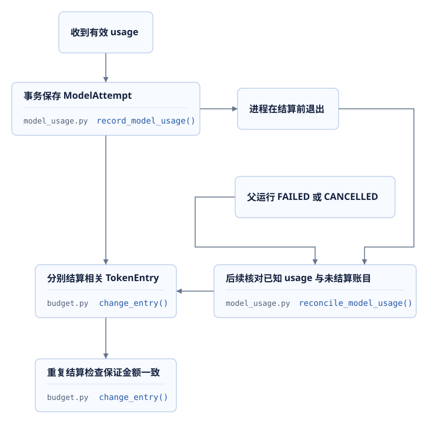
</figure>

| 阶段 | 已有处理 |
| --- | --- |
| 06 | 模型响应用量独立保存，预算回调负责调用前后额度处理 |
| 07 | 增加`record_model_usage`与`reconcile_model_usage`；单次worker执行领取前进行核对 |
| 09 | 从未结算账目关联模型尝试，0031补充索引；持续worker在完成核对后至少间隔30秒，每次核对最长10秒，默认最多100个候选尝试 |

09优化保留07的幂等和取消后结算规则；没有新增无人管理的后台task。单次`execute_one`仍保留默认核对入口，持续worker通过明确参数统一调度。

源码：[07 · model_usage.py · reconcile_model_usage](../source.html?stage=07-streaming-response&path=src/zhifu/modules/agent_runtime/model_usage.py&symbol=reconcile_model_usage)、[09 · model_usage.py · model_usage_candidates](../source.html?stage=09-course-delivery&path=src/zhifu/modules/agent_runtime/model_usage.py&symbol=model_usage_candidates)、[09 · model_usage.py · ModelUsageReconciler](../source.html?stage=09-course-delivery&path=src/zhifu/modules/agent_runtime/model_usage.py&symbol=ModelUsageReconciler)。

### 20次历史模型尝试

以下六份记录位于教学代码仓库`docs/course/verification/`，均使用`deepseek-flash`。费用分析复用已有样本，新增生成模型调用为0。三个协作样本直接提交协作工具请求，覆盖两个专业角色和主模型汇总；没有测量主模型选择协作工具的准确率。

| 记录 | 尝试数 | 输入token | 输出token | 缓存命中输入 | 整体耗时 |
| --- | ---: | ---: | ---: | ---: | ---: |
| `collaboration-model.json` | 5 | 4977 | 651 | 640 | 4.098秒 |
| `collaboration-durable.json` | 5 | 5004 | 636 | 2688 | 4.472秒 |
| `collaboration-context.json` | 5 | 5063 | 729 | 1664 | 4.584秒 |
| `streaming-model.json` | 1 | 2422 | 360 | 2176 | 3.101秒 |
| `streaming-tool-attempt.json` | 2 | 5220 | 235 | 4736 | 3.164秒 |
| `streaming-tool-model.json` | 2 | 5208 | 248 | 4736 | 2.924秒 |
| 合计 | 20 | 27894 | 2859 | 16640 | 不合并为单请求耗时 |

`streaming-tool-attempt.json`的业务验收状态为`FAILED`，其中两次模型尝试均已收到usage，仍计入消耗。**缓存命中输入已经包含在输入token中，计算总量时不能重复相加**。全部样本总token为30,753，缓存未命中输入为11,254。

正文流式记录包含7条文本事件和2次SSE连接，服务端首次正文约0.823秒，客户端首次可见草稿约1.741秒，整个检查约3.101秒。这些计时起点和观察位置不同，不能直接相减得到网络耗时。`text_chunks=360`描述响应片段数量，输出token需读取usage。

三个协作样本与正文流式样本仅保存相对耗时，没有日历起止时间。两个工具流式样本保存了2026-09-25的UTC时间，对应北京时间23:02和23:03。每阶段单个样本、输出长度与缓存条件不同，不能推导P95、长期吞吐、并行加速比或上下文优化收益。

记录及文件指纹：[20次真实模型调用的token与费用分析](../materials/model-sample-analysis.html)。固定阶段说明：[07 · streaming.md](../source.html?stage=07-streaming-response&path=docs/course/streaming.md)。

### 单价、时间和业务量假设

历史分析采用2026-09-25查询的人民币单价；2026-09-26复查官方页面时，`deepseek-flash`这三项单价相同。每百万token的缓存命中输入为空闲0.02元、高峰0.04元；未命中输入为空闲1元、高峰2元；输出为空闲4元、高峰8元。[DeepSeek官方模型与价格](https://api-docs.deepseek.com/zh-cn/quick_start/pricing/)

```text
未命中输入 = input_tokens − cache_read
费用 = (未命中输入 × 未命中单价
      + cache_read × 缓存命中单价
      + output_tokens × 输出单价) / 1000000
```

三个协作样本合计15,044个输入、2,016个输出、4,992个缓存输入，按空闲价格计算为0.01821584元，高峰价格为0.03643168元。两个工具样本时间已知，按空闲价格合计0.00307744元；其余样本保留两个时段的费用范围。全部20次尝试估算为0.02302280—0.04296816元。记录缺少调用时价格快照与账单编号，实际扣费仍需核对账单。

业务量练习只采用三个协作样本平均值。假设每个业务仍使用5次模型尝试，输入、输出和缓存比例保持相同，1,000个业务约需5,000次尝试，费用约6.071947元或12.143893元。每分钟30个同类业务对应150次调用、170,600 token；额外尝试按正常数量的5%估算，对应157.5次调用、179,130 token。规划请求数量时向上取整，并按供应商实际规则分别检查并发和额度。

这些计算保留业务类别、角色数量、摘要调用数量、输入长度和缓存比例等假设。它们不能代替预算扣减、重复结算和权限变更的数据库测试。


## 11. 本地实验与性能检查

### 代码阶段和运行环境

源码链接中的`06-context-model-performance`与`07-streaming-response`表示固定代码阶段。命令中的`06-classroom`与`07-classroom`表示独立教学环境，包括数据库卷、检索集合和运行配置。同一机器的教学端口固定，每次只运行一个环境。启动和切换操作见[代码阶段与环境操作](../materials/branch-guide.html)。

以下命令在课件项目的`project/`教学代码目录执行，使用PowerShell 7和已安装依赖、已缓存的本地模型。第三课最后的`09-perf-lab`已经通过`Stop`停止；如果结束在其他实验步骤，先使用实际运行的环境名称执行`Stop`。切换前检查工作区，个人修改保存在个人练习分支，固定教学版本保持不变。

```powershell
$coursePython = (Resolve-Path '.venv/Scripts/python.exe').Path
$courseModels = (Resolve-Path '.work/models').Path
$courseRecord = '.work/course/l04-' + (Get-Date -Format 'yyyyMMdd-HHmmss')
New-Item -ItemType Directory -Path $courseRecord -Force | Out-Null
git status --short
git switch course/06-context-model-performance
. .\scripts\course\environment.ps1 -Action Start -Stage 06-classroom `
  -PythonExecutable $coursePython -ModelCache $courseModels
. .\scripts\course\environment.ps1 -Action Check -Stage 06-classroom
. .\scripts\course\environment.ps1 -Action Use -Stage 06-classroom
$courseRuntime = Get-Content .work/course/06-classroom/runtime.json -Raw | ConvertFrom-Json
```

`Start`创建或使用指定环境，并应用当前代码迁移；`Use`把连接参数载入当前PowerShell进程。已经用于后续迁移的环境需要保留其数据，较早代码选择新的独立环境名称。Python绝对路径从本次环境的`runtime.json`读取。

### 实验进程期限与输出

下面的辅助函数为每次Python实验设置外层期限，并在本次独立目录保存标准输出和错误输出。超时只终止它刚启动的进程及子进程，抛出异常并保留记录；进程返回非零状态也终止本组命令。达到期限后的数据清理状态需要按对应测试记录核查，不能登记为通过。

```powershell
function Invoke-ModelLessonPython {
    param([string] $Name, [string[]] $Arguments, [int] $Seconds)
    $process = Start-Process -FilePath $courseRuntime.python -ArgumentList $Arguments `
        -WindowStyle Hidden -PassThru `
        -RedirectStandardOutput "$courseRecord/$Name.stdout.log" `
        -RedirectStandardError "$courseRecord/$Name.stderr.log"
    if (-not $process.WaitForExit($Seconds * 1000)) {
        $process.Kill($true)
        $process.WaitForExit()
        throw "实验超过 $Seconds 秒期限，请检查日志与清理状态：$Name"
    }
    $process.WaitForExit()
    Get-Content -LiteralPath "$courseRecord/$Name.stdout.log"
    if ($process.ExitCode -ne 0) {
        Get-Content -LiteralPath "$courseRecord/$Name.stderr.log"
        throw "实验失败，请核对原始输出：$Name"
    }
}
```

这是本节实验辅助函数，业务Python片段继续引用固定源码。上下文检查外层180秒，连接实验内部30秒、外层60秒。输出文件名称在本次目录中分别保存。

```powershell
Invoke-ModelLessonPython -Name context -Seconds 180 -Arguments @(
    '-m', 'pytest', 'tests/test_course_context.py', '-q', '--tb=short', '--maxfail=1',
    "--junitxml=$courseRecord/context.xml"
)
Invoke-ModelLessonPython -Name transport -Seconds 60 -Arguments @(
    'scripts/course/transport_experiment.py',
    '--health-url', 'http://127.0.0.1:38000/health/live',
    '--output', "$courseRecord/transport.json"
)
```

上下文测试验证当前请求、澄清、工具配对、最近完整历史、超额拒绝以及连接对象生命周期。HTTP实验向真实本地健康接口发送两组请求，每组3次、并发1、总期限30秒，自动检查TCP连接数量。两项实验都不发送生成模型请求。

源码：[06 · test_course_context.py](../source.html?stage=06-context-model-performance&path=tests/test_course_context.py)、[06 · transport_experiment.py · main](../source.html?stage=06-context-model-performance&path=scripts/course/transport_experiment.py&symbol=main)。

### 流式事件与权限变化

停止06环境后切换到07代码，启动独立的`07-classroom`。发送器检查外层期限300秒，专业角色输入检查外层120秒；两组输出分别保存。

```powershell
. .\scripts\course\environment.ps1 -Action Stop -Stage 06-classroom
git status --short
git switch course/07-streaming-response
. .\scripts\course\environment.ps1 -Action Start -Stage 07-classroom `
  -PythonExecutable $coursePython -ModelCache $courseModels
. .\scripts\course\environment.ps1 -Action Check -Stage 07-classroom
. .\scripts\course\environment.ps1 -Action Use -Stage 07-classroom
$courseRuntime = Get-Content .work/course/07-classroom/runtime.json -Raw | ConvertFrom-Json
Invoke-ModelLessonPython -Name streaming -Seconds 300 -Arguments @(
    '-m', 'pytest', 'tests/test_course_streaming.py', '-q', '--tb=short', '--maxfail=1',
    "--junitxml=$courseRecord/streaming.xml"
)
Invoke-ModelLessonPython -Name specialist-context -Seconds 120 -Arguments @(
    '-m', 'pytest', 'tests/test_specialist_context.py', '-q', '--tb=short', '--maxfail=1',
    "--junitxml=$courseRecord/specialist-context.xml"
)
```

发送器测试通过真实ASGI接口创建会话与运行，在真实MySQL写入事件，把明确文本提交给`DraftStream`检查聚合和状态变化。专业角色输入测试在超额或配对错误处终止，检查没有新增模型尝试、token账目或调用次数。它们验证代码分支和持久状态，生成模型调用为0。

| 实验变化 | 可检查的数据库或接口结果 |
| --- | --- |
| 慢速提交少量正文 | 定时提交有序的临时事件 |
| 一次加入较多字符 | 按字符阈值聚合，最后一次发送保留剩余正文 |
| 正文超出UTF-8字节上限 | 返回明确错误，不继续保存超额内容 |
| 客户权限或记忆变化 | 后续正文保存被当前状态检查拒绝 |
| 引用资料版本变化 | 后续事件无法沿用旧来源 |
| 取消任务或发生异常 | 定时任务停止，未发送内容清理，原始异常保留 |
| 已知usage尚未结算 | 核对后完成结算，重复执行不重复扣减 |

源码：[07 · test_course_streaming.py](../source.html?stage=07-streaming-response&path=tests/test_course_streaming.py)、[07 · test_specialist_context.py](../source.html?stage=07-streaming-response&path=tests/test_specialist_context.py)。

2026-09-25历史记录中，发送器与恢复相关的15项检查全部通过，用时49.69秒。该时间包含身份、会话与数据库准备，不代表模型响应时间。真实模型正文及HTTP续传使用第10章的已有记录；本节数据库实验没有新增生成请求。

如需观察已有会话的持久事件，终端客户端读取`COURSE_CUSTOMER_TOKEN`环境变量，并接收已有`conversation_id`和`run_id`。它只订阅事件，最多3次连接、总期限150秒。凭据不写入命令参数或实验结果。

```powershell
Invoke-ModelLessonPython -Name stream-client -Seconds 180 -Arguments @(
    'scripts/course/stream_client.py', '--base-url', 'http://127.0.0.1:38000',
    '--conversation-id', $conversationId, '--run-id', $runId
)
```

这里的两个变量来自所观察消息的实际接口响应。已完成历史运行的可用事件范围由服务端保留窗口决定；读取过期游标时按410重新查询会话历史。对已有事件进行订阅不会触发新模型调用。

源码：[07 · stream_client.py · main](../source.html?stage=07-streaming-response&path=scripts/course/stream_client.py&symbol=main)。

### CPU容量复算

以下命令在网页课件仓库`zhifu-platform-courseware`执行，需要可用Python。脚本只计算并输出JSON，不访问GPU和模型服务。

```powershell
python scripts/gpu_capacity.py
python scripts/gpu_capacity.py --context-tokens 8192
python scripts/gpu_capacity.py --layers 28 --parameters 600000000 --active-requests 8
```

核对`assumptions`、`kv_kib_per_token`、`kv_mib_per_request`、`available_kv_gib`与`memory_only_max_active_requests`。默认配置请求16个活跃序列，但按假设计算只能容纳4个，`configured_requests_fit_memory_assumptions`为false。这展示了配置上限和显存容量之间的区别。

### 性能检查的观察顺序

<figure class="static-diagram" data-diagram-kind="static" tabindex="0" aria-label="首段正文等待时间检查，可滚动查看">
  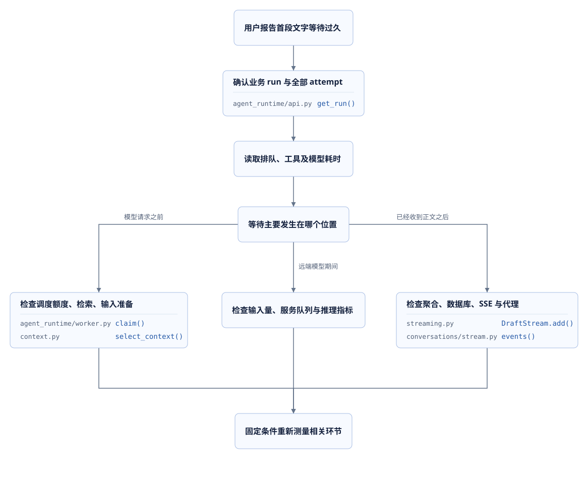
</figure>

项目没有保存供应商全部内部计时，因此无法从本地总耗时直接推导远端排队或GPU计算。自建vLLM可以增加服务端指标，供应商服务则需要结合其可提供的记录。每次记录包含代码版本、输入输出上限、请求数、并发、期限、错误、usage和测量起止位置。

GPU性能验收计划保留在部署材料：每组32次生成、并发分别为1、4、8，输出上限128 token，每组最长180秒，自动重试0，三组合计最多96次。当前均未执行。冷启动、预热、缓存条件和实际设备信息分别记录，质量结果与性能数据一起保存。

## 12. 课后作业与评分

### 作业：等待时间、草稿状态与计算预算

业务情景：客户在长对话中请求查询订单和清洁资料，等待期间客服接管会话。提交一份能同时解释模型输入、响应展示和费用记录的工程分析，包含以下四项产物。

1. 在06代码中定位当前请求边界、工具消息配对、token估算和模型HTTP生命周期。构造包含历史轮次、当前澄清及工具结果的输入，记录筛选前后消息数量与完整性检查结果。
2. 在07代码中沿`attempt_id`追踪草稿事件和正式消息，完成一次真实数据库的权限或版本变更实验，记录变化前后事件数量、错误码、运行状态和账目状态。直接输入发送器的文本需标明测试范围。
3. 使用六份历史模型JSON复算输入、输出、缓存命中与费用，计入失败样本；说明哪些样本只能计算价格范围。复算两种上下文长度的KV容量，保留全部假设。
4. 编写一份目标GPU实验记录表，列出固定模型版本、请求数、并发、输出上限、期限、质量检查、TTFT与吞吐定义。未执行的项目保留“未执行”，并说明需要哪些记录才能判断优化效果。

**提交结果需要把真实接口测试、历史模型样本和容量假设计算分别标明**。已有样本足够完成本次费用作业，新增生成模型调用数量可以保持为0。

| 评分项 | 分值 | 完成条件 |
| --- | ---: | --- |
| 上下文与预算 | 25 | 当前请求完整、工具配对有效，能区分估算、输出上限和实际usage |
| 流式状态正确性 | 30 | 区分运行、尝试、事件序号；包含取消或接管后的数据库结果与草稿处理 |
| 费用与容量计算 | 25 | 缓存输入没有重复计数，失败尝试计入，KV公式与设备假设可复算 |
| 性能实验设计 | 20 | 统计范围明确，具有请求和时间上限，保留质量与错误，准确标注GPU执行状态 |

<details>
<summary>参考答案：长对话、接管与已发生用量</summary>

`queue_run`保存当前用户请求的`context_start`。`select_context`保留从该位置开始的全部必要消息，按最近完整历史轮次逐步增加输入；工具请求与结果必须配对。必要内容超额时在模型尝试登记前拒绝，不能仅删除其中一份订单结果。

HTTP等待发生在业务事务之外，连接对象按进程中的服务地址和凭据复用。模型返回正文进入`DraftStream`，每次保存都检查当前租约、权限、步骤、来源和记忆版本。客服接管改变会话控制版本并取消旧活动运行，后续草稿与正式消息提交受到检查。客户端收到控制变化后清除临时内容。

`record_model_usage`独立保存已知消耗。父运行取消之后，已知usage仍可参与未结算账目核对；重复处理必须保持相同计量。关闭SSE连接不会代替业务取消，也不能据此认定远端没有计算。

全部样本输入27,894、输出2,859、缓存命中16,640、缓存未命中11,254，总token30,753。已知时段的两个工具样本按空闲价格计算，其余样本保留两档费用范围，合计0.02302280—0.04296816元。实际账单扣费缺少完整记录，不能填写为已经验证的金额。

</details>

<details>
<summary>参考答案：性能变化与面试说明</summary>

可以围绕一个具体观察展开说明：“本地6次健康请求的实验中，逐次创建客户端产生3条TCP连接，复用客户端产生1条；实验没有调用生成模型，因此结论限定为这组HTTP连接行为。”解释代码使用的地址与凭据分组、活动请求计数和关闭条件，再说明供应商网络与推理耗时需要独立测量。

GPU容量题中，32层、8个KV head、128维、2字节得到128 KiB/token。4,096 token请求为512 MiB，8,192 token请求为1,024 MiB。指定24 GiB设备等假设后，可用KV约2.498839 GiB，对应容量4与2。该结果无法给出真实TTFT或吞吐。

目标设备实验需要固定模型、输入、采样设置和输出上限，分别观察冷启动与预热后的队列、TTFT、后续间隔、总耗时、错误率、吞吐和显存。增加批处理并发、启用量化或推测解码后，质量样例也需要重新检查。相同统计条件下的完整记录才能支持性能结论。

</details>
