# 部署、运维与项目交付

审批提醒、并行查询、检索优化和流式答复完成以后，项目还需要在确定的环境中持续运行：API能够受理请求，worker能够领取任务，数据库版本与代码相容，异常中断以后能够解释当前状态，费用记录能够继续结算。

**交付包含源码、配置、数据变更、运行方法和实际验证记录**。本课围绕阶段08的发布与恢复工具，以及阶段09的容量实验和后台计量查询，沿着启动、观测、故障处理与验收的顺序检查整个服务。实验使用独立环境、真实组件和明确期限；历史结果保留日期与数据范围。


## 1. 部署单元与交付内容

一个Web接口能够返回200，只说明这次请求完成了对应处理。客服系统还有已经受理的Agent运行、等待发送的业务事件、审批提醒和外部履约操作。它们由不同进程执行，需要分别配置启动入口、依赖、资源上限与停止方式。

例如客户确认换货方案以后，平台保存审批记录；主管批准以后，履约worker继续处理外部操作；提醒worker负责符合条件的未审批记录。API进程重启时，这些记录仍需保留。**应用进程可以重新创建，业务执行位置需要由持久记录说明**。

### 1.1 服务与运行入口

[容器运行配置](../source.html?stage=08-deployment-operations&path=compose.runtime.yaml)定义API、OMS、监控、六类worker、迁移命令及独立BGE服务。API、OMS和worker共用应用镜像，具体职责由入口命令决定。

| 部署单元 | 入口或职责 | 需要检查的结果 |
| --- | --- | --- |
| API | `zhifu.app:create_app` | 认证、业务接口、运行受理、事件读取 |
| OMS | `zhifu.oms.api:create_app` | 订单、换货操作及其查询 |
| Agent worker | `zhifu.operations.worker agent` | 领取AgentRun、执行图、保存进度 |
| memory worker | `zhifu.operations.worker memory` | 后台记忆任务及对应模型额度 |
| fulfillment worker | `zhifu.operations.worker fulfillment` | 审批事件、数量预占与外部操作 |
| knowledge worker | `zhifu.operations.worker knowledge` | 资料处理与索引维护 |
| channel-delivery worker | `zhifu.operations.worker channel-delivery` | 渠道结果投递与接收确认 |
| reminders worker | `zhifu.operations.worker reminders` | 审批到期扫描、授权接收人和通知 |
| operations | `zhifu.monitoring.api:app` | 数据库任务、心跳和额度指标 |
| inference | `zhifu.modules.knowledge.inference:app` | 本地BGE向量计算 |

<figure class="static-diagram" data-diagram-kind="static" tabindex="0" aria-label="服务进程与外部依赖，可滚动查看">
  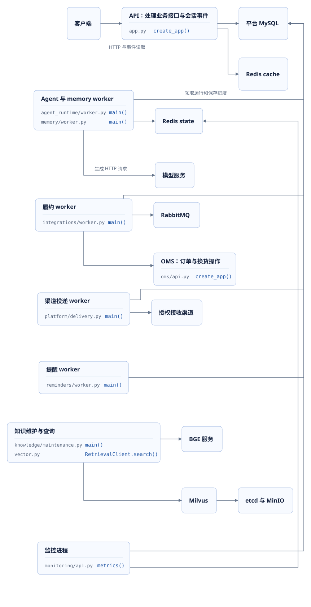
</figure>

图中体现运行关系，部署副本数量由实际负载决定。当前Compose为本机运行配置，多个应用进程共享数据库和额度服务。生成模型服务与本地BGE各自承担不同任务，本课的有界实验只调用本地BGE。

### 1.2 一次发布需要保留的材料

交付记录至少包含代码tag与commit、应用和推理镜像ID、依赖锁文件、环境名称、配置来源、两套数据库revision、模型与资料版本、执行命令及结果路径。运行配置中的密钥值由环境管理，报告记录配置来源及校验结论。

| 内容 | 项目中的对应位置 | 审阅时核对什么 |
| --- | --- | --- |
| 应用与依赖 | Dockerfile、`uv.lock`、固定tag | 构建来源与实际运行代码一致 |
| 服务入口 | `compose.runtime.yaml`、环境脚本 | 每类进程的命令、网络、停止期限 |
| 数据变更 | 平台与OMS两套Alembic目录 | 当前revision、目标head、兼容范围 |
| 环境记录 | `.work/course/<stage>/runtime.json`与报告 | 源码导入目录、服务端口、镜像和数据卷 |
| 功能与运行结果 | JUnit、容量JSON、恢复报告 | 验证日期、真实组件、数据数量和限制 |

阶段08增加发布与恢复演练；阶段09交付综合容量脚本，并增加计量核对索引和周期调度。**一个报告需要同时说明执行时的代码、数据版本和环境**。最终tag可用于阅读当前交付，历史报告中的执行版本也要保留。例如阶段08的历史演练包含尚未提交的当次文件，报告明确记录`source_changes_present=true`。

## 2. 环境配置与启动依赖

### 2.1 配置来源与地址作用范围

实验使用`compose.course.yaml`和`scripts/course/environment.ps1`。每个环境拥有独立Compose project、网络、数据卷、凭据目录和向量集合。主机端口固定，同一时间运行一个实验环境。`08-classroom`属于环境名称，`course/08-deployment-operations`属于代码分支，两者分别记录。

| 组件 | 实验主机地址 | 配置作用 |
| --- | --- | --- |
| 平台MySQL与OMS MySQL | 23306、23307 | 分别连接平台与OMS数据 |
| Redis cache与state | 26379、26380 | 缓存与限流；状态、心跳及模型额度 |
| RabbitMQ | 25672，管理端口25673 | 业务消息发布与消费 |
| API、OMS、监控 | 38000、38100、38300 | 三个本机Python服务 |
| BGE与Milvus | 38200、29530 | 向量计算与检索 |
| Milvus健康检查 | 29091 | 当前服务就绪情况 |
| Toxiproxy | 管理38474、代理38110 | 需要明确配置的网络故障实验 |

容器中的`mysql:3306`和主机上的`127.0.0.1:23306`代表不同访问位置。进入容器后，`127.0.0.1`指向容器自身。**连接地址需要与运行进程的位置共同核对**。发布演练创建提醒容器时，会把宿主机地址转换为当前Compose网络中的服务名称，密钥继续通过环境传入。

代码与服务关系见[环境脚本](../source.html?stage=08-deployment-operations&path=scripts/course/environment.ps1)和[环境说明](../source.html?stage=08-deployment-operations&path=docs/course/environment.md)。生产运行还需要实际的TLS、认证、受控网络与配置管理；项目[部署说明](../source.html?stage=08-deployment-operations&path=docs/deployment.md)列出了生产配置要求。本机实验记录不能代表这些条件已经在生产环境验证。

### 2.2 从依赖就绪到应用检查

<figure class="static-diagram" data-diagram-kind="static" tabindex="0" aria-label="依赖启动与发布检查，可滚动查看">
  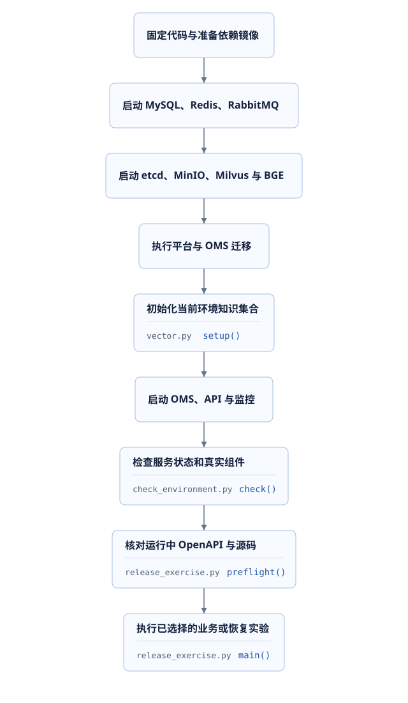
</figure>

PowerShell 7、Python依赖、Docker镜像和`.work/models`缓存需要已经准备。以下命令在课件项目的`project/`目录执行，承接阶段07的独立环境；Stop参数使用当前实际运行的环境名称。切换前将自己的修改保存在个人分支。

```powershell
git status --short
. ./scripts/course/environment.ps1 -Action Stop -Stage 07-classroom
git switch course/08-deployment-operations
$stage = '08-classroom'
. ./scripts/course/environment.ps1 -Action Start -Stage $stage `
  -PythonExecutable .venv/Scripts/python.exe -ModelCache .work/models
. ./scripts/course/environment.ps1 -Action Check -Stage $stage
& $runtime.python scripts/course/release_exercise.py --stage $stage --action check
if ($LASTEXITCODE -ne 0) { throw '发布检查失败，请查看当前环境日志' }
```

Start应用当前分支的迁移，启动API、OMS与监控，并执行检查。它不启动常驻业务worker；生成凭据引用指向未配置的`COURSE_GENERATION_DISABLED`。后续选定实验的生成调用为0。已有数据库升级以后，较早代码使用自己原有的独立环境，不通过改变Git版本撤销数据库迁移。

### 2.3 readiness与发布检查

API的[`ready`](../source.html?stage=08-deployment-operations&path=src/zhifu/app.py&symbol=create_app.ready)并发检查MySQL和两套Redis，依据结果返回200或503：

```python
        results = await asyncio.gather(
            database_probe(),
            request.app.state.cache.ping(),
            request.app.state.state.ping(),
            return_exceptions=True,
        )
        healthy = not any(isinstance(result, BaseException) for result in results)
        return JSONResponse(
            {"status": "ready" if healthy else "unavailable"},
            status_code=200 if healthy else 503,
        )
```

这里没有发送生成模型请求。教学`check_environment.py`继续核对两套迁移、RabbitMQ发布确认与消费、Milvus结构、一次真实BGE请求和服务地址。`release_exercise.preflight`还比较运行中API的OpenAPI与当前源码，并保存版本和镜像记录。

**健康检查的名称不能扩大检查覆盖的范围**。工程`release_check`要求模型名称、地址和凭据齐全，检查过程也不调用生成模型。教学环境未配置生成凭据，使用本节的教学检查命令。真实身份、工具授权、业务提交和模型答复各自需要对应测试。

## 3. 数据库迁移与兼容升级

### 3.1 四种版本共同影响恢复

代码commit说明执行的函数内容；数据库revision说明当前表结构；`graph_version`说明Agent运行使用的流程定义；资料和订单版本说明查询时的事实。还需要记录`AgentRun.release_snapshot`中的模型配置。**恢复旧任务需要它依赖的流程仍然可用，提交旧查询需要来源仍然有效**。

平台和OMS分别执行迁移。API启动不会自动执行DDL，教学Start与部署迁移任务负责升级。平台08对应`0030_order_query_indexes`，09对应`0031_model_usage_indexes`；OMS为`0002_unsigned_orders`。

[`schema`](../source.html?stage=08-deployment-operations&path=src/zhifu/operations/release_check.py&symbol=schema)将实际revision集合与当前源码的Alembic heads比较：

```python
        expected = set(ScriptDirectory.from_config(Config(config)).get_heads())
        async with engine.connect() as connection:
            actual = set(
                (
                    await connection.execute(text("SELECT version_num FROM alembic_version"))
                ).scalars()
            )
        if actual != expected:
            raise RuntimeError(f"{config}: 数据库版本与镜像版本不一致")
        return sorted(actual)
```

检查通过说明迁移标识一致，还需要业务测试验证新索引或字段符合预期。`alembic check`比较模型元数据与数据库结构，也无法代替权限、并发或恢复测试。

### 3.2 阶段09索引的发布次序

0031增加两个非唯一索引，服务于未结算候选查询和按尝试编号读取账目。原数据、唯一性规则及状态字段保持原有含义。下面是固定[迁移函数](../source.html?stage=09-course-delivery&path=migrations/versions/0031_model_usage_indexes.py&symbol=upgrade)中的两项操作：

```python
    op.create_index(
        "ix_token_entries_kind_status_reference", "token_entries",
        ["kind", "status", "tenant_id", "reference_id"],
    )
    op.create_index(
        "ix_token_entries_tenant_reference", "token_entries",
        ["tenant_id", "kind", "reference_id"],
    )
```

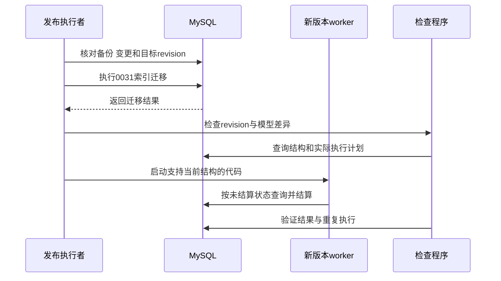

增加索引也会占用空间，账目插入和状态变化需要维护索引。大表上的创建耗时和锁影响需要按目标数据量检查；本项目的小数据测试没有证明生产表可以无中断建立索引。

准备09环境时保留08数据卷，使用独立名称：

```powershell
. ./scripts/course/environment.ps1 -Action Stop -Stage 08-classroom
git switch course/09-course-delivery
$stage = '09-classroom'
. ./scripts/course/environment.ps1 -Action Start -Stage $stage `
  -PythonExecutable .venv/Scripts/python.exe -ModelCache .work/models
& $runtime.python -m alembic current
& $runtime.python -m alembic check
& $runtime.python -m alembic -c oms-alembic.ini current
```

**兼容升级需要同时检查读取、写入与存量任务**。新增索引的兼容性相对直接；删除字段、修改状态语义或撤销旧图版本时，还要确认运行中任务和旧进程的行为。发布记录需要列出支持的代码与数据库组合，以及出现问题时继续使用哪些已验证组合。不能把旧镜像能够启动当作旧业务可以继续运行的证明。

## 4. worker租约与退出

### 4.1 正常停止的生命周期

`zhifu.operations.worker`为六类后台入口提供信号处理与心跳。Linux容器收到SIGTERM或SIGINT以后，停止信号触发Event，当前业务task收到取消，包装器等待清理完成。异常继续传播，正常结束打印`worker=<role> stopped`。

[`run`](../source.html?stage=08-deployment-operations&path=src/zhifu/operations/worker.py&symbol=run)中的关键等待与取消如下：

```python
            done, _ = await asyncio.wait((task, shutdown), return_when=asyncio.FIRST_COMPLETED)
            if task in done:
                await task
            else:
                task.cancel()
                result = (await asyncio.gather(task, return_exceptions=True))[0]
                if isinstance(result, BaseException) and not isinstance(
                    result, asyncio.CancelledError
                ):
                    raise result
```

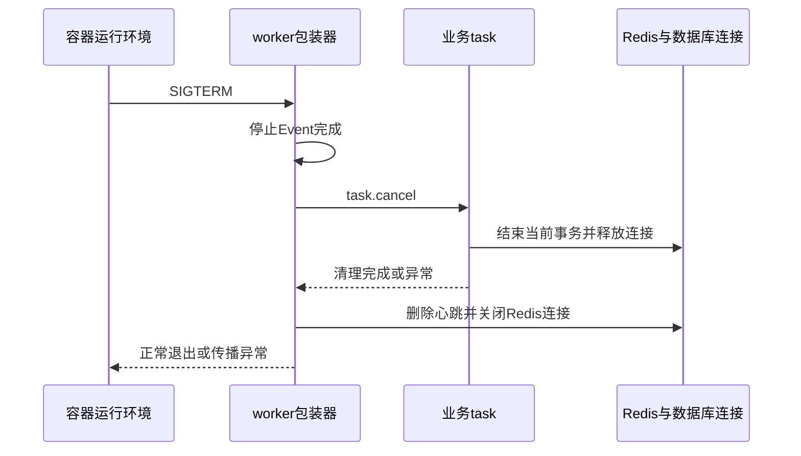

**优雅退出依赖业务函数正确处理取消和资源生命周期**。等待中的事务需要退出，已提交记录需要保留。当前容器配置为75秒停止等待，API的Uvicorn优雅停止参数为60秒；工作进程清理仍需要在目标环境验证。超过容器等待期限的终止可能没有机会完成全部清理。

### 4.2 进程退出与任务恢复

Agent worker从MySQL领取运行时增加`lease_token`并设置125秒租约，业务执行阶段最长120秒。提交前的`locked_run`检查当前身份、控制权、运行状态、token和期限。进程意外终止以后，RUNNING任务可以在原租约到期后重新领取；FAILED不会自动重做。

Redis中的生成并发额度使用另一份150秒租约。MySQL执行权与Redis额度分别保护业务提交及共享资源占用。二者没有跨系统原子事务，中断时可能短暂保留额度，后续申请按期限清理。**停止进程、取消客户任务和供应商停止计算是三个不同事件**。已发送生成请求的消耗继续通过计量记录核对。

固定源码：[任务领取](../source.html?stage=09-course-delivery&path=src/zhifu/modules/agent_runtime/worker.py&symbol=claim)、[提交检查](../source.html?stage=09-course-delivery&path=src/zhifu/modules/agent_runtime/runtime.py&symbol=locked_run)。第二课的真实子进程恢复专项验证原租约自然到期、旧token拒绝和分支复用，本节的提醒worker演练检查信号与心跳生命周期。

### 4.3 提醒worker限定演练

使用已启动的09实验环境也可以运行阶段08提供的演练工具。环境需要独占，提醒表没有PENDING记录，没有常驻业务worker；工具会检查这些条件。应用镜像由`ZHIFU_IMAGE`指定，默认`zhifu-platform:local`，镜像需已在本机准备。

```powershell
. ./scripts/course/environment.ps1 -Action Use -Stage 09-classroom
& $runtime.python scripts/course/release_exercise.py --stage 09-classroom --action worker
if ($LASTEXITCODE -ne 0) { throw 'worker生命周期验证失败' }
Get-Content -LiteralPath .work/course/09-classroom/release-worker.json
```

工具创建带本次run_id的提醒容器，以只读方式加载当前源码。最多25秒等待心跳，容器停止等待15秒，Docker停止命令期限25秒；退出码为0、心跳已删除、日志存在正常结束标记才通过。最终清理范围限定本次标签对应的容器。

2026-09-25的阶段08历史演练中，该动作耗时2.73秒，SIGTERM、正常退出、心跳删除及容器清理通过，生成调用0。演练要求没有待处理提醒，所以该结果覆盖空闲提醒worker生命周期；处理业务事务期间的取消由相应业务测试验证。


## 5. 日志指标与运行观测

### 5.1 单次请求与整体状态

客户端报告“发送消息以后一直等待”，需要沿着该次请求继续查询。运行接口返回的`run_id`对应AgentRun，ModelAttempt记录模型尝试，工具操作和外部履约各有自己的编号。整体指标则用于判断问题是否同时影响多个请求。

**单次排查保留业务标识，聚合指标使用数量受控的标签**。现有指标包含请求路径、方法、状态、任务类型与worker角色等信息，任务指标不把每条客户消息或每个run_id加入标签。当前实现提供这些关联记录与聚合指标，没有把它们自动连接成完整分布式调用追踪。

<figure class="static-diagram" data-diagram-kind="static" tabindex="0" aria-label="运行记录与整体指标，可滚动查看">
  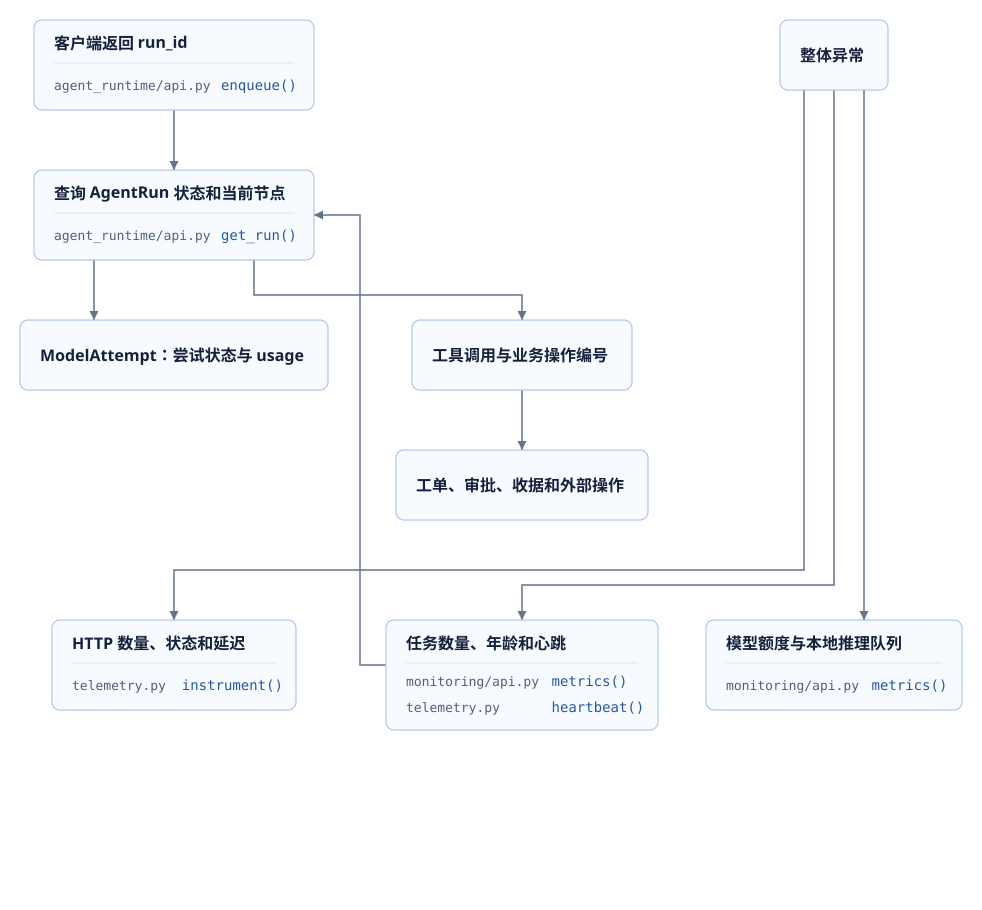
</figure>

Agent worker输出中的`agent_run=<id> next_node=<node>`可以帮助查询某次运行。实验目录同时保存API、OMS和监控的stdout、stderr；部署容器使用日志轮换。发布报告还记录`checked_at`、`run_id`、源码revision及镜像ID。日志中的执行时间和数据中的创建时间需要结合使用，避免把较早报告当作当前运行结果。

### 5.2 指标含义与采集期限

[`instrument`](../source.html?stage=08-deployment-operations&path=src/zhifu/core/telemetry.py&symbol=instrument)在API中提供HTTP请求数量与耗时分布，并排除`/metrics`和健康检查路径。独立监控进程的[`metrics`](../source.html?stage=08-deployment-operations&path=src/zhifu/monitoring/api.py&symbol=metrics)在8秒内读取真实MySQL与Redis。

| 指标 | 当前统计内容 | 阅读时的限制 |
| --- | --- | --- |
| `zhifu_pending_jobs` | Agent和memory的QUEUED、RUNNING数量；outbox的PENDING数量 | 包含正在执行的任务 |
| `zhifu_oldest_pending_seconds` | 上述记录最早创建或发生时间距现在的秒数 | 包含执行中记录的年龄，不能直接当作纯排队时间 |
| `zhifu_jobs_15m` | 最近15分钟创建的任务按当前状态统计 | 使用创建时间筛选 |
| `zhifu_model_tokens_15m` | 最近15分钟创建记录中已保存的usage | 未知用量需要查看账目 |
| `zhifu_workers_alive` | Redis中尚未过期的角色心跳数量 | 不能独立说明业务正在成功处理 |
| `zhifu_model_slots`及`zhifu_model_pool_slots` | 全局与分类尚未过期额度 | 需要与租户上限及任务状态共同解释 |

任务数量和年龄由同一次数据库查询取得，核心代码如下：

```python
                count, first = (
                    await session.execute(
                        select(func.count(), func.min(column)).where(model.status.in_(states))
                    )
                ).one()
                pending.labels(kind).set(count)
                oldest.labels(kind).set(max(0, (now() - first).total_seconds()) if first else 0)
```

例如QUEUED数量为0，但一个RUNNING任务已经运行很久，当前年龄指标仍可能很高。需要继续读取它的`next_node`、`lease_until`、`deadline_at`和最近模型尝试。WAITING_USER与WAITING_APPROVAL代表明确的业务等待，不能直接归为执行进程故障。

### 5.3 心跳与业务进度

[`heartbeat`](../source.html?stage=08-deployment-operations&path=src/zhifu/core/telemetry.py&symbol=heartbeat)每5秒刷新一次Redis键，过期时间20秒；正常退出时主动删除。关键循环为：

```python
    async def loop():
        while not stopped.is_set():
            await state.set(key, "1", ex=20)
            await asyncio.sleep(5)
```

**心跳证明近期有相应进程活动，业务记录证明它处理了哪些任务**。进程存在但数据库锁等待过长时，心跳与积压可能同时增长。进程异常退出后的心跳也会在过期前短暂存在。诊断需要结合采集时间、进程状态、任务数量与最近提交。

读取接口时设置请求期限：

```powershell
Invoke-RestMethod -Uri http://127.0.0.1:38000/health/ready -TimeoutSec 10
(Invoke-WebRequest -Uri http://127.0.0.1:38000/metrics -TimeoutSec 10).Content
(Invoke-WebRequest -Uri http://127.0.0.1:38300/metrics -TimeoutSec 10).Content
Get-Content -LiteralPath .work/course/09-classroom/api.stderr.log -Tail 40
```

最后一条日志路径需要与当前环境一致。指标采集失败需要保留失败状态及时间，不能把缺少数据解释为任务数量为0。告警阈值需要来自业务目标与实际基线，例如持续等待超过目标、错误比例增长、无worker而任务持续增加；本节不为未执行的生产负载指定验收阈值。

## 6. 队列调度与模型额度

### 6.1 从HTTP受理到实际执行

接口保存运行并返回202以后，任务可能继续排队。Agent worker通过MySQL选择有额度的租户，再领取具体运行；Redis原子检查全局、分类和其他租户的保留份额。数据库行锁负责同一租户的领取竞争，Redis额度控制多个进程的模型并发占用。

<figure class="static-diagram" data-diagram-kind="static" tabindex="0" aria-label="任务领取与模型额度，可滚动查看">
  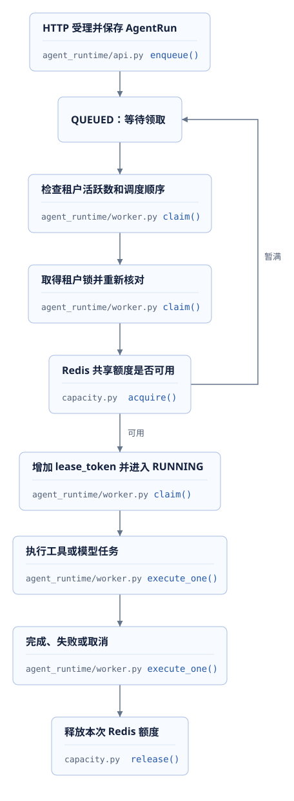
</figure>

当前默认全局额度4，交互预留2，后台预留1，剩余1份共享；因此交互最多3个，后台最多2个，两类合计不超过4个。预留份额保持给对应分类。每个租户还有自己的上限，默认2；提高某个租户上限也不能突破分类和全局限制。

**HTTP连接数、排队任务数、模型并发额度和供应商token限制需要分别计算**。接口受理快并不代表完整Agent任务完成快；增加API副本也不自动增加模型服务容量。当前Redis额度实现针对单实例多键Lua，不能把本机结果直接用于Redis Cluster。

固定实现与规则：[领取函数](../source.html?stage=09-course-delivery&path=src/zhifu/modules/agent_runtime/worker.py&symbol=claim)、[分类额度](../source.html?stage=09-course-delivery&path=src/zhifu/modules/agent_runtime/capacity.py&symbol=acquire)、[模型容量说明](../source.html?stage=09-course-delivery&path=docs/model-capacity.md)。

### 6.2 数据库连接预算

每个进程拥有自己的连接池。新增API副本前需要把它们可能使用的连接加到当前连接和运维预留中。[`inspect_capacity`](../source.html?stage=08-deployment-operations&path=src/zhifu/operations/scale_capacity.py&symbol=inspect_capacity)读取MySQL当前上限与连接数，计算新增副本的峰值：

```python
    planned = request.replicas * (request.pool_size + request.max_overflow)
    remaining = maximum - connected - planned - request.reserved_connections
    return {
        **request.model_dump(), "mysql_max_connections": maximum,
        "currently_connected": connected, "planned_peak_connections": planned,
        "remaining_connections": remaining, "status": "READY" if remaining >= 0 else "BLOCKED",
        "database_configuration_changed": False,
    }
```

假设上限200、当前35个连接，计划新增4个副本，每个池8个加2个临时连接，另留20个运维连接，剩余为`200 - 35 - 4 × (8 + 2) - 20 = 105`。这是明确假设下的计算；实际命令使用数据库当前值，检查过程不会修改MySQL配置。

```powershell
& $runtime.python -m zhifu.operations.scale_capacity `
  --replicas 4 --pool-size 8 --max-overflow 2 --reserved-connections 20
```

**连接预算足够以后，还需要验证连接等待、SQL耗时、锁竞争和目标延迟**。未来新增worker的数据库需求也要计入预算。多个副本共同读取相同表时，单进程测试中的低耗时不能说明共享数据库仍能保持相同表现。

### 6.3 八个领取者的真实检查

阶段09综合实验通过真实HTTP建立两个租户的19个运行，然后启动8个并发`claim`。默认额度下，只允许取得3个不同运行，两租户分别占用1和2个。运行创建、claim尝试和模型尝试是三种独立数量。

[`schedule_probe`](../source.html?stage=09-course-delivery&path=tests/course_capacity_acceptance.py&symbol=schedule_probe)的数据库与Redis断言如下：

```python
    claimed = [result[0] for result in selected if result is not None]
    assert len(claimed) == len(set(claimed)) == 3
    async with sessions() as session:
        active = (await session.scalars(select(AgentRun).where(AgentRun.id.in_(claimed)))).all()
    tenants = {}
    for run in active:
        tenants[run.tenant_id.hex()] = tenants.get(run.tenant_id.hex(), 0) + 1
        assert run.status == "RUNNING" and run.lease_token == 1
    assert sorted(tenants.values()) == [1, 2], tenants
    assert await state.zcard("agent:active:global") == 3
    assert await state.zcard("agent:active:global:interactive") == 3
```

这组断言同时检查重复领取、租户分配和Redis占用。随后通过实际取消接口结束19个运行，并释放本次额度；没有进入生成执行循环。实验说明当前条件下的真实协调结果，完整生成吞吐仍需要对应模型负载。

## 7. 计量状态与后续结算

### 7.1 已发生消耗与业务运行分别处理

模型返回usage以后，客户可能已经取消运行，也可能有一段草稿校验失败。有效答复能否提交由运行权限和状态决定；已经发生的消耗需要继续保存。另一个中断位置是usage已写入ModelAttempt，而关联TokenEntry尚未结算。

**父运行FAILED或CANCELLED以后，已知用量仍然需要结算**。模型账目UNKNOWN表示当前缺少可靠用量，需要保留相应预占并继续核对。它与外部履约操作UNKNOWN属于不同记录，不能相互推断业务或费用结果。

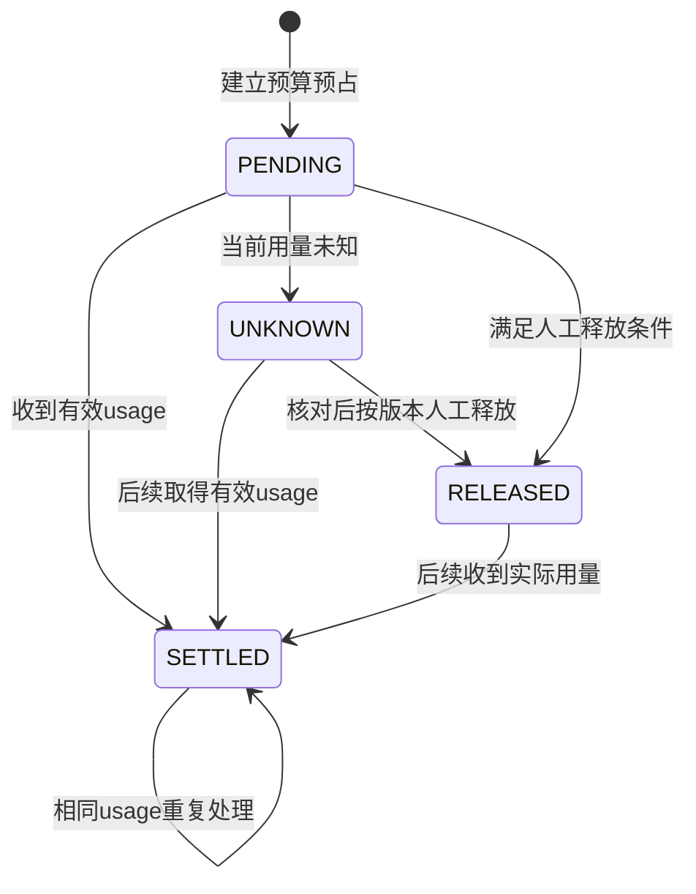

[`change_entry`](../source.html?stage=09-course-delivery&path=src/zhifu/modules/agent_runtime/budget.py&symbol=change_entry)按租户、账目和账户执行结算，重复相同usage保持原结果，不同usage报告冲突。人工释放以后收到迟到usage，也要记录实际消耗。这里只说明计量状态；供应商账单的实际扣费还需要对应的账单记录。

### 7.2 保存与结算之间的中断窗口

[`record_model_usage`](../source.html?stage=09-course-delivery&path=src/zhifu/modules/agent_runtime/model_usage.py&symbol=record_model_usage)先独立保存尝试用量，取得关联账目编号，再逐项调用已有幂等结算：

```python
        if attempt.usage is not None:
            require(Usage.model_validate(attempt.usage).model_dump() == normalized,
                    "TOKEN_USAGE_CONFLICT", "重复计量的用量不同")
        attempt.status, attempt.usage = "RECEIVED", usage
        identifiers = list(await session.scalars(select(TokenEntry.id).where(
            TokenEntry.tenant_id == tenant_id, TokenEntry.kind == "agent",
            TokenEntry.reference_id == attempt_id,
        )))
```

同一模型尝试可以关联多份账目，恢复时需要处理全部关联记录。用量保存和账目结算是分别提交的短事务，所以必须存在后续核对入口。**幂等结算保证重复执行安全，周期核对负责重新发现尚未完成的结算**。

阶段09的候选查询从`kind=agent`、状态为PENDING、UNKNOWN或RELEASED的TokenEntry取得唯一尝试引用，再关联已有有效usage的ModelAttempt。SQL NULL和JSON null都被排除。当前核对只覆盖已经保存用量的Agent尝试；进程在收到或保存usage之前终止，仍需后续取得供应商结果。

### 7.3 索引、数量上限与执行期限

默认每轮最多返回100个模型尝试，可以设置1至1000的整数上限。同一尝试有多份账目时只占一个候选位置。`LIMIT 100`限制返回数量，数据库去重和排序仍需要读取候选，实际扫描数量通过EXPLAIN确认。

[`reconcile_model_usage`](../source.html?stage=09-course-delivery&path=src/zhifu/modules/agent_runtime/model_usage.py&symbol=reconcile_model_usage)为查询和结算共同设置10秒期限：

```python
    statement = model_usage_candidates(limit, tenant_id=tenant_id)
    async with asyncio.timeout(RECONCILIATION_TIMEOUT_SECONDS):
        async with sessions() as session:
            candidates = (await session.execute(statement)).all()
        # 不检查父租约与运行状态：已经收到的用量在 FAILED/CANCELLED 后仍需计费。
        # 事务逐项提交；超时取消当前事务，已完成结算由幂等检查保护。
        for attempt_id, owner_id, usage in candidates:
            await record_model_usage(sessions, owner_id, attempt_id, usage)
    return len(candidates)
```

[`ModelUsageReconciler.run_due`](../source.html?stage=09-course-delivery&path=src/zhifu/modules/agent_runtime/model_usage.py&symbol=ModelUsageReconciler.run_due)每次成功完成后至少间隔30秒。它在worker主循环中顺序调用，正在处理业务任务时下一轮会延后；每个worker各自维护时间。多进程可能同时核对同一尝试，正确性继续由数据库幂等规则保护。

2026-09-25的[专项记录](../source.html?stage=09-course-delivery&path=docs/course/model-usage-reconciliation.md)包含69个ModelAttempt和70份TokenEntry：64个已结算尝试、3个已知待结算尝试、2个未知尝试，以及1份重复引用账目。实际执行计划读取6份未结算账目，去重为5个引用，通过ModelAttempt主键读取5行，返回3个候选。本次小数据查询为0.0493毫秒，不能推算长期积压条件下的查询成本。

真实SQL与周期检查共7项通过，耗时63.16秒，生成调用0。检查包括实际30秒等待、MySQL行锁触发10秒期限、解除等待后的重复结算和父运行结束后的处理。测试回放已有真实usage作为输入，没有发送新的模型请求。

## 8. 数据库备份与独立恢复

### 8.1 备份文件与恢复结果

备份需要记录内容、时间和来源镜像；恢复需要确认这些内容能在目标环境被读取。`mysql_recovery.py`分别导出平台和OMS数据库，每份记录开始结束时间、文件大小、SHA256和源MySQL镜像ID。

<figure class="static-diagram" data-diagram-kind="static" tabindex="0" aria-label="数据库备份与独立恢复，可滚动查看">
  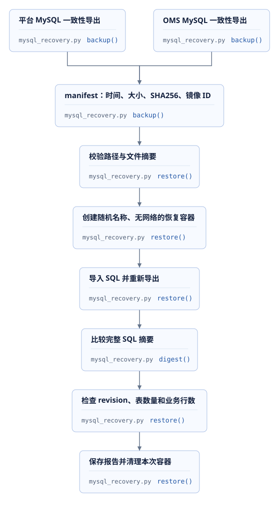
</figure>

导出使用`--single-transaction`，并以hex形式保存二进制标识、按主键排序。它为单个数据库提供一致性读取；平台与OMS分别导出，报告保留各自时间范围。备份期间需要保持表结构稳定。**两份成功备份不自动形成跨系统同一时刻的业务快照**。

### 8.2 恢复目标与内容校验

[`restore`](../source.html?stage=08-deployment-operations&path=scripts/mysql_recovery.py&symbol=restore)只接受`.work/backups`内的备份路径，验证manifest格式、文件名和SHA256。恢复容器使用随机名称与凭据、不加入网络、不公开主机端口，MySQL数据位于本次独立的内存目录。

导入后再次导出，并执行原始校验：

```python
            restored = directory / f"{database}.restored.sql"
            with restored.open("wb") as output:
                docker("exec", name, "sh", "-c", DUMP + database, stdout=output)
            if digest(restored) != entry["sha256"]:
                raise RuntimeError(f"{database}: 恢复后的完整 SQL 内容校验失败")
```

当前每个恢复容器使用1GiB内存数据目录和2GiB内存上限，适用于本次数据规模。恢复工具不接收已有业务数据库地址。原镜像需要在本机保留，备份目录包含实际数据，交付材料展示摘要和范围，原始文件按实际访问权限管理。

独立实验命令：

```powershell
. ./scripts/course/environment.ps1 -Action Use -Stage 09-classroom
& $runtime.python scripts/course/release_exercise.py --stage 09-classroom --action recovery
if ($LASTEXITCODE -ne 0) { throw '独立恢复验证失败' }
Get-Content -LiteralPath .work/course/09-classroom/release-recovery.json
```

包装工具核对当前教学project，新增本次UUID的Tenant与Store，再调用两套MySQL恢复流程。备份恢复子命令期限480秒，整个动作工作阶段期限1200秒；结束后清理本次恢复容器与新增业务记录，备份文件保留。一次动作失败时不能使用先前成功报告代替当前结果，需核对命令退出码、报告`checked_at`与`run_id`。

### 8.3 已验证数据与完整业务恢复

2026-09-25的[阶段08恢复记录](../source.html?stage=08-deployment-operations&path=docs/course/verification/deployment-operations.md)中，两套MySQL恢复耗时16.03秒，完整SQL摘要均一致。平台包含60张表、1个新增Tenant与1个Store，订单和工单均为0；OMS包含4张表，订单为0。

**该记录验证当前表结构和少量数据的恢复，业务可用性还需要对应流程检查**。例如重新启动应用、恢复身份与授权、核对未完成外部操作，以及检查资料内容与向量索引是否相容。Redis state、RabbitMQ及Milvus没有包含在这次双MySQL演练中。

| 恢复对象 | 需要核对的关系 |
| --- | --- |
| 平台与OMS | 外部操作编号、订单数量、工单状态及预占 |
| Redis state与MySQL | 记忆内容引用、授权代次、TTL及旧执行额度 |
| RabbitMQ与outbox | 未发送或未确认事件、消费收据与重复处理 |
| Milvus与资料表 | 当前发布版本、分段数量与真实检索结果 |
| 镜像、模型与配置 | 支持的数据结构、模型revision、访问凭据与服务地址 |

RTO描述业务恢复需要的时间，RPO描述可以接受的数据时间损失；目标值需要业务要求与完整恢复实验共同确定。本次16.03秒包含具体双MySQL动作，无法作为生产RTO。需要恢复到某个时间点时，还要有已验证的日志保留及重放方案。现有相关组件的能力与限制见[备份恢复说明](../source.html?stage=08-deployment-operations&path=docs/backup-recovery.md)。


## 9. 有界容量验证

### 9.1 请求数量、并发与时间范围

容量实验需要明确测量对象。订单列表主要经过HTTP、身份检查和MySQL查询；资料检索还会调用BGE与Milvus；Agent运行受理以后，完整执行需要另外消耗模型额度。三条路径可以共享部分组件，但一次订单列表测量不能直接解释生成任务吞吐。

阶段09的[`test_course_capacity`](../source.html?stage=09-course-delivery&path=tests/course_capacity_acceptance.py&symbol=test_course_capacity)使用真实HTTP服务、MySQL、Redis、本地BGE及Milvus。它创建随机租户和实际账户，发布固定资料，然后执行四组有界负载。

| 限制 | 实际配置 |
| --- | --- |
| 请求类别 | 订单列表GET、知识检索POST |
| 每类并发 | 1和16，共四组 |
| 每组发送窗口 | 5秒，每组最多800个请求 |
| 请求总数 | 负载最多3200；包含准备、探测、入队和清理的HTTP最多3320 |
| 连接与单次期限 | 最多16个HTTP连接，单次15秒，无自动重试 |
| 任务领取 | 两个租户19个运行，8个并发claim |
| 总期限 | 工作主体120秒，清理30秒，外层pytest进程180秒 |
| 数据与质量 | 12份资料，16个客户；前后检查一个固定问题的前5项结果 |
| 生成调用 | 不执行生成循环；查询ModelAttempt并要求0 |

<figure class="static-diagram" data-diagram-kind="static" tabindex="0" aria-label="有界容量实验，可滚动查看">
  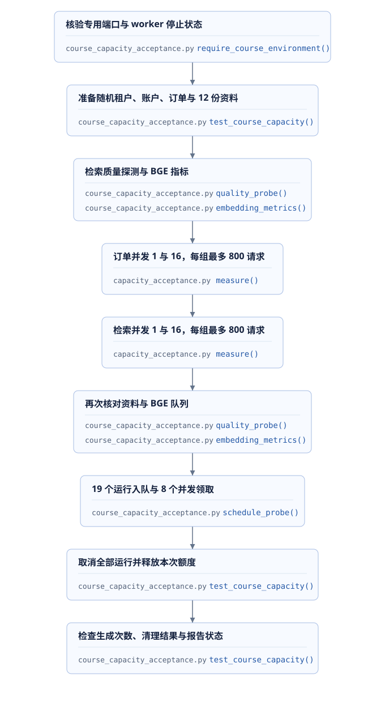
</figure>

工具[`measure`](../source.html?stage=09-course-delivery&path=tests/capacity_acceptance.py&symbol=measure)在5秒内继续发出请求，等待已发请求返回的组内期限为40秒；所有组仍受120秒总工作期限约束。统计包含成功与全部请求的吞吐、延迟和状态分布。

原始负载循环明确限定并发与数量，并要求每组存在成功请求：

```python
                    for concurrency in (1, 16):
                        result = await measure(client, method, target, body, concurrency,
                                               identities, seconds=5, maximum_requests=800)
                        report["stages"].append({"workload": workload, **result})
                        assert set(result["statuses"]) <= {"200", "429"}, result
                        assert result["statuses"].get("200", 0) > 0
                        assert result["requests"] <= 800
```

**有界实验需要同时限制单次调用、请求总数、并发和总时间**。429单独统计；传输错误或其他HTTP状态使本项失败。记录中还要区分HTTP请求、fixture内的ASGI调用、任务领取次数和生成模型次数。

### 9.2 可复现命令与退出处理

阶段09已经包含容量脚本。使用本课前面建立的`09-classroom`，保持其他实验和常驻业务worker停止。脚本会检查专用端口、进程参数、Redis心跳、活跃额度及生成凭据状态。每次使用新的输出目录。

下面的函数也供后续限定pytest使用。外层超时时终止本次进程及其子进程，保留日志；此时仍需核对随机租户、任务和额度的实际清理情况。

```powershell
. ./scripts/course/environment.ps1 -Action Use -Stage 09-classroom
$deliveryDirectory = '.work/course/l05-' + [guid]::NewGuid().ToString('N')
New-Item -ItemType Directory -Path $deliveryDirectory -Force | Out-Null

function Invoke-DeliveryPython {
    param([string] $Name, [string[]] $Arguments, [int] $Seconds)
    $stdout = "$deliveryDirectory/$Name.stdout.log"
    $stderr = "$deliveryDirectory/$Name.stderr.log"
    $process = Start-Process -FilePath $runtime.python -ArgumentList $Arguments `
        -WorkingDirectory (Get-Location).Path -WindowStyle Hidden -PassThru `
        -RedirectStandardOutput $stdout -RedirectStandardError $stderr
    if (-not $process.WaitForExit($Seconds * 1000)) {
        $process.Kill($true)
        $process.WaitForExit()
        throw "执行超过 $Seconds 秒，请检查日志与本次资源：$Name"
    }
    $process.WaitForExit()
    Get-Content -LiteralPath $stdout
    if ($process.ExitCode -ne 0) {
        Get-Content -LiteralPath $stderr
        throw "执行失败：$Name"
    }
}

$env:COURSE_CAPACITY_OUTPUT = "$deliveryDirectory/capacity.json"
Invoke-DeliveryPython -Name capacity -Seconds 180 -Arguments @(
    '-m', 'pytest', 'tests/course_capacity_acceptance.py', '-q', '--tb=short',
    "--junitxml=$deliveryDirectory/capacity.xml"
)
Get-Content -LiteralPath $env:COURSE_CAPACITY_OUTPUT
```

**报告的PASSED需要工作主体与清理均成功**。源码在`finally`中逐个取消本次运行、释放本次额度、检查生成次数和剩余状态，再清理资料向量。工作失败或清理失败会保留相应状态；输出文件存在不等于实验通过。

### 9.3 历史测量与正确解释

2026-09-25的[综合容量记录](../source.html?stage=09-course-delivery&path=docs/course/capacity-experiment.md)在08环境执行，业务代码对应阶段08，脚本随09交付。环境为Windows 10、Python 3.12.13、20个逻辑CPU，一个API工作进程，数据库连接池5加5；BGE-M3在CPU使用4线程，批次上限32，等待窗口5毫秒。

| 请求 | 并发 | 成功请求 | 成功RPS | P50毫秒 | P95毫秒 | P99毫秒 |
| --- | ---: | ---: | ---: | ---: | ---: | ---: |
| 订单 | 1 | 315 | 62.86 | 15.49 | 19.71 | 24.17 |
| 订单 | 16 | 543 | 106.97 | 143.68 | 186.83 | 216.35 |
| 检索 | 1 | 42 | 8.32 | 115.43 | 141.20 | 176.50 |
| 检索 | 16 | 146 | 27.20 | 563.28 | 819.56 | 863.67 |

四组负载共1046次，均为200；全部HTTP共1146次，另有8次ASGI准备请求。完整pytest耗时39.63秒。BGE负载窗口增加66个批次、188条文本，累计排队15.939秒，结束时等待文本数量为0。固定问题的预期资料前后均位于第1名，前5项顺序保持一致。

19个运行入队耗时0.297秒，8个并发claim耗时0.178秒，取得3个不同运行，两租户分别占用1和2个额度。最后19个运行全部取消，本次Redis额度为0，ModelAttempt为0。

**并发增加同时提高吞吐和等待时间，收益需要结合目标P95判断**。这里比较的是同一代码下的不同负载，不能当作代码优化前后的因果结果。分位数采用`statistics.quantiles(method="inclusive")`，表中为成功请求口径。本次所有请求成功，所以全部请求与成功请求的结果相同。

本实验没有验证生产持续容量、GPU推理或完整生成任务吞吐；一个固定问题也无法代表完整检索质量。重新测量时保存CPU、数据集版本、账户分布、服务副本、池大小和状态分布，结果无需与历史数字完全相同。

## 10. 故障处置与发布实验

### 10.1 按当前状态确定下一步

故障处理从一条可识别的运行或业务操作开始，保存时间、标识、当前状态、版本和最近错误。进程重启可能恢复服务连接，业务是否继续执行仍由持久状态决定。**操作前需要明确对象、影响范围和可以检查的完成条件**。

<figure class="static-diagram" data-diagram-kind="static" tabindex="0" aria-label="按持久状态诊断故障，可滚动查看">
  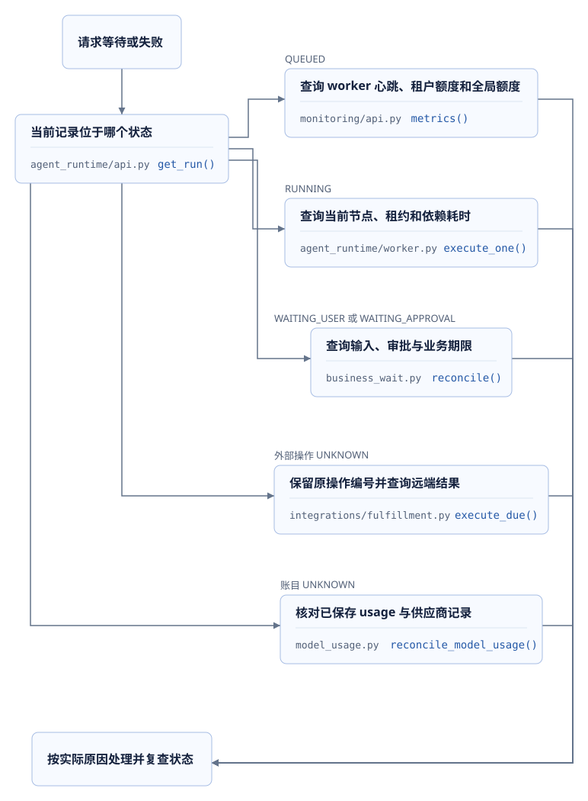
</figure>

| 现象 | 首项核对 | 后续检查 |
| --- | --- | --- |
| API readiness返回503 | MySQL及两套Redis连接结果 | 地址、认证、连接池和依赖日志 |
| readiness正常但检索失败 | BGE与Milvus检查结果 | 集合维度、资料版本、推理队列和请求期限 |
| 任务排队且心跳为0 | worker是否运行、最近退出日志 | 进程配置、依赖及启动失败原因 |
| 已有心跳但没有新领取 | 租户及分类额度、任务状态 | 有效租约、运行总期限和数据库等待 |
| 模型返回后没有正式答复 | 运行状态、控制版本与来源校验 | 是否取消、接管、资料变化或草稿校验失败 |
| 父运行结束但预算仍预占 | ModelAttempt.usage与账目状态 | 已知usage核对、未知结果及人工审计 |

### 10.2 外部响应中断的处理

一个换货操作已经被OMS接受，响应返回途中中断，本地只能确认请求结果未知。此时释放数量预占或换用新操作编号重试，都可能影响业务正确性。项目保存原`ExternalOperation`，按原编号查询远端结果，再推进预占和工单状态。

[`test_lost_response_keeps_reservation_and_recovers`](../source.html?stage=08-deployment-operations&path=tests/test_fulfillment.py&symbol=test_lost_response_keeps_reservation_and_recovers)使用真实OMS与Toxiproxy延迟响应，关键断言检查三个位置：

```python
            assert await execute_due(sessions, 0.3, operation.id)
            async with sessions() as session:
                assert (await session.get(ExternalOperation, operation.id)).status == "UNKNOWN"
                assert (await session.get(Reservation, operation.id)).status == "HELD"
            async with connected["oms_sessions"]() as session:
                assert (await session.get(Exchange, operation.id)).status == "ACCEPTED"
```

解除响应延迟后，后续执行把本地操作推进为ACCEPTED，预占改为CONSUMED。**网络超时不能证明远端没有完成操作**。诊断需要同时读取本地操作、预占及远端同编号结果。

这项固定源码使用Toxiproxy管理端口18474、代理18100及OMS 8100，与本节教学端口不同。这里阅读其实际断言；下列可执行命令只包含已经核对教学环境地址的发布、计量、监控和接口专项。若在个人分支扩展这项实验，需要明确配置全部端点并核验目标服务。

### 10.3 当前环境停止与重新启动

`release_exercise.py --action restart`只操作当前教学stage。它核对Compose标签、源码路径、PID与启动记录，执行Stop以后检查容器和三个本机端口，再Start并检查数据卷身份。

```powershell
. ./scripts/course/environment.ps1 -Action Use -Stage 09-classroom
& $runtime.python scripts/course/release_exercise.py --stage 09-classroom --action restart
if ($LASTEXITCODE -ne 0) { throw '环境恢复验证失败' }
Get-Content -LiteralPath .work/course/09-classroom/release-restart.json
```

Stop子命令期限180秒，Start期限600秒，工作阶段总期限1200秒。该命令会中断当前实验环境的API、OMS、监控及Compose服务，需要独占该环境。命名数据卷保留，脚本不修改Git分支，也不删除其他环境数据。

[`restart_environment`](../source.html?stage=08-deployment-operations&path=scripts/course/release_exercise.py&symbol=restart_environment)在启动后执行以下核对：

```python
    await check(stage)
    _, _, _, current = await scope(stage)
    volumes = {name: item["volumes"] for name, item in services.items()}
    if volumes != {name: item["volumes"] for name, item in current.items()}:
        raise RuntimeError("重新启动后的数据卷与停止前不一致")
```

2026-09-25阶段08执行完整`--action all`，总耗时77.98秒；其中提醒worker为2.73秒，双MySQL恢复16.03秒，Stop/Start与核对45.67秒。38000、38100、38300停止后拒绝连接，恢复后依赖健康，7个命名卷及Redis cache现有匿名卷身份保持一致。生成调用为0。**45.67秒包含检查过程，不能直接解释为生产服务中断时间**。

### 10.4 计量和接口专项

继续使用第9节的`Invoke-DeliveryPython`和本次独立输出目录。计量测试包含真实30秒周期、10秒锁等待，以及小数据SQL准备，外层给整组300秒；监控和接口组单独设置180秒。两组均不会发送生成请求。

```powershell
$env:COURSE_USAGE_QUERY_REPORT = "$deliveryDirectory/model-usage-query.json"
Invoke-DeliveryPython -Name usage -Seconds 300 -Arguments @(
    '-m', 'pytest', 'tests/test_course_usage_query.py',
    'tests/test_course_streaming.py::test_known_stream_usage_settles_after_draft_failure_once',
    'tests/test_course_streaming.py::test_reconcile_usage_after_interrupted_settlement',
    '-q', '--tb=short', "--junitxml=$deliveryDirectory/usage.xml"
)
Invoke-DeliveryPython -Name operations-api -Seconds 180 -Arguments @(
    '-m', 'pytest', 'tests/test_monitoring.py', 'tests/test_api_documentation.py',
    '-q', '--tb=short', "--junitxml=$deliveryDirectory/operations-api.xml"
)
Invoke-DeliveryPython -Name openapi -Seconds 60 -Arguments @(
    'scripts/export_openapi.py', '--check'
)
```

监控测试检查真实Redis心跳与MySQL指标；接口专项检查已发布定义和实际响应结构，其中OMS与本地推理地址取自当前环境配置。对应固定入口：[计量查询测试](../source.html?stage=09-course-delivery&path=tests/test_course_usage_query.py)、[流式用量恢复](../source.html?stage=09-course-delivery&path=tests/test_course_streaming.py&symbol=test_reconcile_usage_after_interrupted_settlement)、[监控测试](../source.html?stage=09-course-delivery&path=tests/test_monitoring.py)、[接口文档测试](../source.html?stage=09-course-delivery&path=tests/test_api_documentation.py)。

## 11. 交付验收与面试准备

### 11.1 从需求条件连接到运行结果

回到第一课审批提醒：确认时保存配置快照，到期扫描重新检查审批和接收权限，通知与处理状态共同提交。最终交付需要同时包含这个业务行为、对应接口文档、迁移、worker入口、监控方式和失败处理。

<figure class="static-diagram" data-diagram-kind="static" tabindex="0" aria-label="业务需求与交付检查，可滚动查看">
  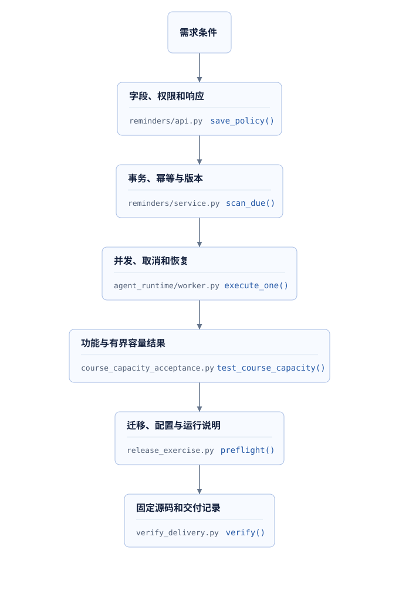
</figure>

**每项完成结论需要能定位到代码与实际结果**。源码可以说明实现机制，测试说明执行过的场景，容量报告说明特定环境下的测量，恢复报告说明对应数据能够恢复到什么范围。这些材料共同支持交付判断。

| 验收项目 | 核验材料 | 关键问题 |
| --- | --- | --- |
| 需求与权限 | 接口、业务服务及真实身份测试 | 哪种身份在什么状态能够执行操作 |
| 数据与竞争 | 迁移、约束、事务与并发结果 | 重复请求、旧版本和旧token如何处理 |
| 发布与配置 | commit、镜像ID、配置来源、preflight | 运行的版本和检查的版本是否相同 |
| 运行观测 | 日志、指标、业务状态查询 | 发生等待或失败时能定位到哪一步 |
| 容量与费用 | 原始请求统计、usage与账目 | 口径、上限、拒绝和未知结果是否完整 |
| 恢复与交付 | 独立恢复报告、停止结果、操作说明 | 哪些组件和数据已经实际验证 |

源文件链接使用固定阶段与函数位置，个人修改另附自己的commit。报告保留命令、开始结束时间、环境、输入规模、实际次数与未执行范围。原始备份和密钥不进入公开交付包，网页可以展示其摘要及检查结果。

### 11.2 发布检查中的接口一致性

阶段08的[`preflight`](../source.html?stage=08-deployment-operations&path=scripts/course/release_exercise.py&symbol=preflight)检查导出文件，并读取运行中API定义与当前源码比较：

```python
    await command([runtime["python"], "scripts/export_openapi.py", "--check"], 60)
    async with httpx.AsyncClient(timeout=5, trust_env=False) as client:
        response = await client.get("http://127.0.0.1:38000/openapi.json")
        response.raise_for_status()
        if response.json() != create_app().openapi():
            raise RuntimeError("运行中的教学 API 与当前源码 OpenAPI 不一致，请重新启动当前阶段")
```

这项检查可以发现“源码已切换、旧API还在运行”。真实响应专项继续检查返回字段及错误结构。**接口定义相同与业务行为正确需要分别验证**。新增接口时，参数范围、权限、状态码、幂等和分页说明要与实现共同更新。

### 11.3 面试表达与追问

项目说明从一条业务请求开始，描述个人修改、状态保存位置、异常顺序和实际验证。性能说明保留环境与负载；运维说明保留部署入口、资源限制和故障后的判断过程。

| 追问 | 需要解释的项目内容 |
| --- | --- |
| API正常，客户仍然没有结果，检查什么？ | 运行状态、worker心跳、额度、当前节点、业务等待和事件回传 |
| 增加4个副本需要准备什么？ | 连接预算、共享数据库负载、模型额度、租户公平性及实际P95 |
| 部署时正在执行的任务会丢失吗？ | 事务提交位置、租约、稳定编号、分支结果和未知外部操作 |
| usage保存后进程终止会漏计费吗？ | 短事务中断窗口、未结算候选、周期核对、重复结算及未知边界 |
| 数据库备份恢复通过代表系统恢复了吗？ | 数据范围、跨系统时间、依赖、权限、未完成操作和业务验证 |
| 你证明了多少生产容量？ | 明确本机环境与短时负载；给出实际数字及尚未验证的生产条件 |

<details>
<summary>展开一段项目表达参考</summary>

我新增了审批提醒，并把配置、确认快照、到期处理和通知权限连接到同一业务流程。并发扫描使用短事务检查当前状态，重复执行保持通知唯一；审批、取消和权限变化有各自测试。

交付阶段提供独立环境、迁移检查、OpenAPI比较、提醒worker停止验证和双MySQL恢复报告。容量实验使用真实HTTP、数据库和本地检索组件，固定请求上限和期限，同时保存状态分布、延迟和清理结果。生成尝试为0，因此该实验只说明这些本地路径与调度行为。

后台计量在已有usage但尚未结算时可以继续核对，父运行失败或取消不影响已发生消耗。当前查询使用未结算状态索引，并设置数量、周期和期限；保存usage之前发生中断的未知用量仍需继续取得供应商结果。

</details>

## 12. 课后作业与评分

### 12.1 一次可核验发布

使用个人独立环境完成一次发布检查，提交代码commit、镜像ID、两套revision、配置来源、端口、启动次序、OpenAPI与真实接口结果。保留命令退出状态、报告时间、run_id和原始路径，并说明当前是否存在业务worker。

绘制一张部署图，包含API、至少两类worker、数据库、Redis、消息服务、本地检索与生成服务。箭头标明实际调用方式；每个需要持久状态的位置注明保存什么数据。解释同一个程序镜像为什么可以用不同入口运行多个角色。

<details>
<summary>展开发布材料参考</summary>

版本记录把代码commit、应用镜像和迁移连接起来；环境记录区分主机地址与容器服务地址。发布次序为准备依赖、检查备份与迁移、执行结构变更、启动应用、检查依赖与接口、执行授权业务检查，再按需求启动worker。

生成配置检查、真实模型调用、真实业务提交各有对应结果。本课本地实验保持生成调用0；生产凭据与网络条件写为待验证条件。每个“通过”均附实际记录，历史样本标明日期和来源。

</details>

### 12.2 故障诊断与独立恢复

执行一次提醒worker生命周期实验和一次双MySQL独立恢复。记录信号、退出码、心跳变化、数据库数量、完整SQL摘要和清理结果。另完成一项源码分析：客户取消运行以后，供应商响应返回usage，程序在哪些位置分别保存计量与拒绝业务提交。

完成三个纸面诊断场景：API健康但Agent任务排队；父运行FAILED且关联账目UNKNOWN；平台操作UNKNOWN而OMS已ACCEPTED。每个场景给出下一项需要查询的记录、判断条件、可以继续的动作和不能从现有信息推断的结果。

<details>
<summary>展开故障与恢复参考</summary>

排队时检查worker、租户和共享额度，继续核对期限及数据库等待。FAILED加UNKNOWN只能说明业务结束且用量当前不确定；若ModelAttempt已保存有效usage，周期核对可以继续结算，未保存时需要后续取得用量。平台UNKNOWN且OMS已ACCEPTED时保留原操作编号与预占，读取并确认远端同编号结果后推进本地状态。

双MySQL摘要一致说明本次数据库内容恢复成功，完整业务恢复还涉及Redis状态、消息、向量、授权和外部操作。报告中只登记实际数据数量和动作耗时；不把数据库恢复时间直接作为生产RTO。

</details>

### 12.3 有界测量与后台处理扩展

执行第9节综合容量实验，保留原始JSON、JUnit和日志。解释并发1与16的吞吐及P95变化，检查429、传输错误、BGE队列、19个运行取消及本次额度释放。为一个明确假设的业务目标计算数据库连接预算，假设值与实测值分别标注。

在个人练习分支增加一个**单次、按指定租户执行的计量核对命令**，复用阶段09的`reconcile_model_usage`。参数包含租户UUID、候选上限及输出路径；输出本次开始结束时间、实际候选数量和执行状态。该命令属于本题新增内容，只复用已有计量规则，不自动释放未知账目。

实现与验证要求如下：

1. 入口使用当前项目Settings和数据库Session，候选上限遵守现有1至1000约束，单次核对继续使用10秒期限。
2. 说明这是具备主机及数据库访问权限的运维入口；租户参数限定数据范围，输入姓名或operator字段不能代替身份认证。
3. 为本次命令创建独立随机租户和真实账目，验证跨租户范围、已知用量、重复结算、SQL NULL及JSON null。
4. 复用已有真实usage记录作为测试输入，生成调用0；保存失败及超时结果，异常继续使进程非零退出。
5. 说明多进程同时执行时由哪些数据库锁与幂等检查保持正确，并记录查询计划及实际候选数量。

<details>
<summary>展开命令扩展参考</summary>

命令把UUID转换为数据库使用的bytes，调用`reconcile_model_usage(sessions, limit, tenant_id=...)`，并在退出时释放engine。候选查询按tenant_id过滤，实际结算仍验证尝试归属及全部关联账目。重复运行时已经完成的账目不再成为候选，重复相同usage保持已结算状态。

命令报告中的候选数量不能直接解释为SQL扫描行数；通过EXPLAIN说明查询路径。超时会取消当前事务，之前已提交的账目继续存在，后续同范围执行可以完成余下工作。UNKNOWN而缺少usage的记录继续等待核对，不能为使报告归零而释放。

扩展命令需要自己的源码、参数说明和测试。已有周期worker仍按原30秒调度规则执行；人工运行时记录目标租户和操作时间，以便关联审计。

</details>

### 12.4 评分规则与交付清单

| 评分项目 | 分值 | 达到要求的内容 |
| --- | ---: | --- |
| 部署与配置 | 20 | 服务图、版本、迁移、地址及检查过程可核验 |
| 运行观测与故障判断 | 20 | 指标含义准确，能根据持久状态确定下一项检查 |
| 独立恢复与资源清理 | 20 | 信号、数据范围、完整内容校验和本次清理记录齐全 |
| 容量与计量扩展 | 25 | 实际负载口径完整，命令限定范围，真实SQL与幂等测试通过 |
| 项目说明与交付材料 | 15 | 代码、命令、结果和限制对应，个人实施范围明确 |

**评分依据是实现、方法和本人结果，性能数字无需与历史样本相同**。交付包包含完整源文件、固定版本、依赖与配置说明、原始测试报告、故障分析和未执行项；原始密钥及业务备份按各自访问权限保存。
