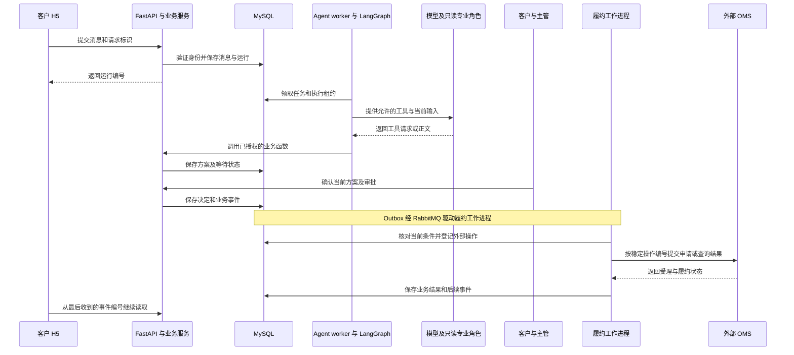
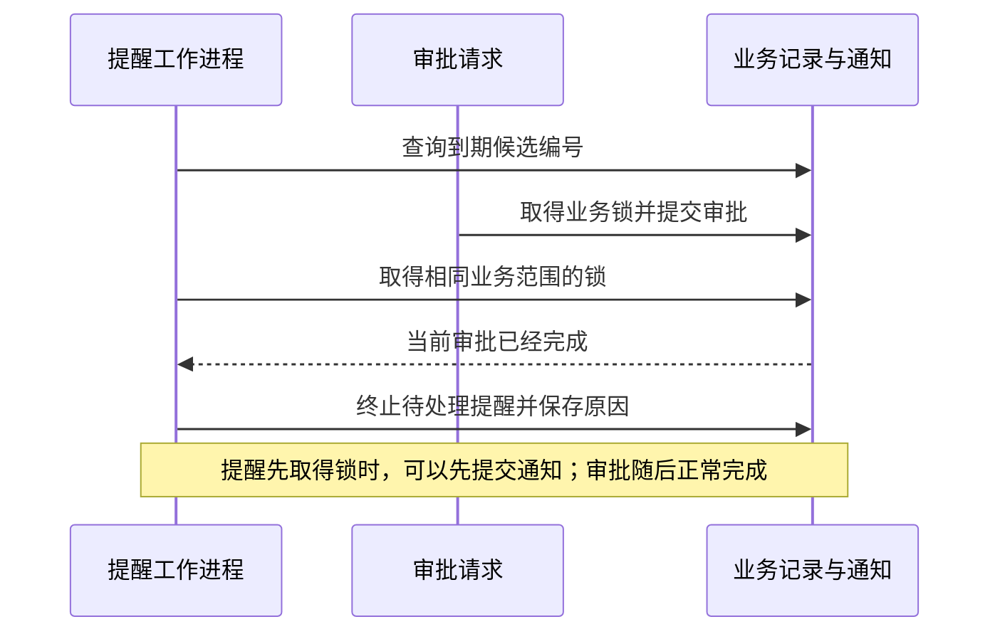
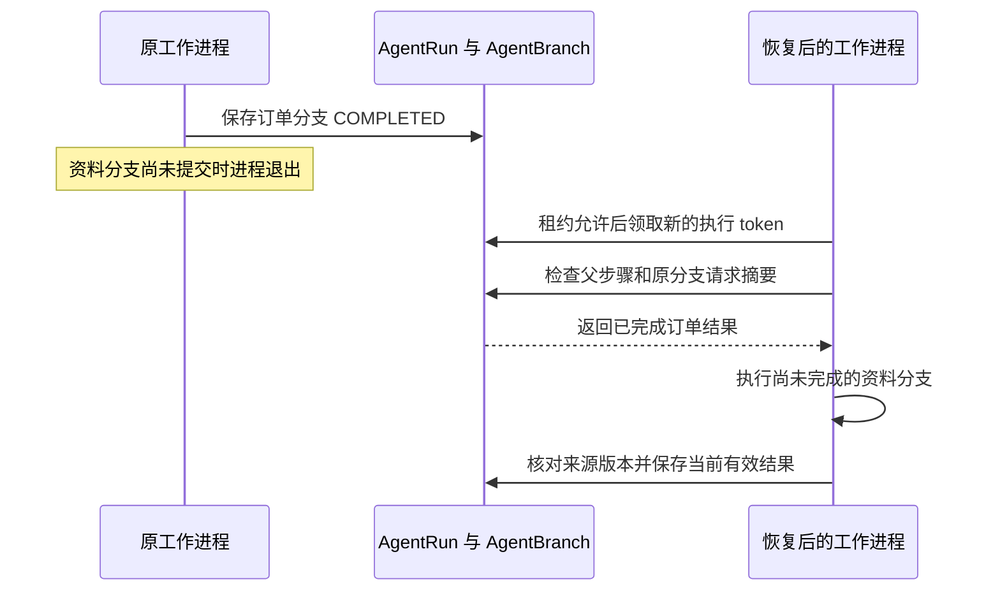

# 项目简历与面试表达

智服中台面向多商家客服与售后，将自然语言咨询、订单与知识查询、客户确认、主管审批和 OMS 履约连接起来。模型负责理解诉求与选择工具，业务服务保证身份权限、方案版本、数量和操作记录有效。

系统同时需要可重复部署、能够观察运行状态、能够限制资源和费用，并在服务中断后恢复业务。Docker 镜像与 Compose 管理部署，HAProxy 提供多副本入口，Prometheus、Alertmanager 和 Grafana 提供指标与告警，数据库、消息、缓存及知识索引各自具有恢复路径。**Agent 开发、后端一致性、部署监控和故障处理共同构成项目的技术价值**。

以下简历与口述示例按照中高级 Agent 开发工程师的职责组织，采用“业务目标、技术机制、实施结果、运行条件”的表达。使用时保留本人承担的工作，量化结果注明测量环境和统计范围。


## 1. 项目背景与业务价值

### 多商家售后的业务要求

智服中台服务于多商家电商客服与商品故障换货。客户希望少重复说明、能够查询进度；客服需要找到本人订单、适用规则和历史处理记录；主管需要知道自己批准的具体商品、数量与方案版本；平台需要管理商家额度、模型费用和系统运行状态。

一次换货需要的信息分布在订单系统、商家规则、商品资料和会话中。自然语言描述还可能缺少订单、商品或申请数量。系统通过 Agent 查询与整理信息，把客户确认、人工接管、主管审批及外部 OMS 连接到同一个有状态的办理流程。

服务投入运行，还需要回答另外一组问题：部署配置是否完整，数据库版本是否正确，增加副本是否会耗尽数据库连接，后台任务是否持续推进，模型失败是否仍产生费用，以及进程中断后如何继续原业务。这些要求直接决定客服和售后能否持续使用系统。

| 业务与运行问题 | 关键技术处理 | 可以说明的项目价值 |
| --- | --- | --- |
| 订单、规则和商品资料分散 | 业务工具、版本化资料、混合检索与引用 | 将客户诉求转换为有来源的方案和待补充事项 |
| 确认或审批期间内容变化 | 方案版本、短事务、唯一约束和提交前复核 | 执行当前有效且获得授权的业务决定 |
| 多商家竞争模型资源 | Redis 共享并发额度、租户 RPM/TPM 和预算 | 限制资源占用，区分交互与后台任务，按商家核对用量 |
| 环境和依赖变化影响发布 | 固定镜像与依赖版本、独立数据库迁移、发布检查 | 使部署步骤可重复，及时发现配置与依赖问题 |
| 增加副本带来连接压力 | HAProxy 动态发现、健康检查和 MySQL 连接预算 | 让扩容受到下游容量约束，确认实际吞吐收益 |
| 页面正常但后台停止推进 | HTTP、任务积压、最长未完成时间、worker 心跳和向量队列指标 | 根据服务与业务状态定位问题，验证告警触发和解除 |
| 数据服务或进程中断 | 数据恢复、消息核对、知识索引重建、任务租约与幂等收据 | 按原业务编号恢复处理，检查数据内容和操作结果 |
| 模型超时且用量信息缺失 | 调用尝试记录、预留额度、实际用量结算与待核对状态 | 保留费用依据，防止重复扣减或无依据释放额度 |

工程指标需要连接到业务意义。例如，订单查询减少扫描行数，改善客服获取信息的等待；任务恢复保留原操作编号，减少重复申请；监控未完成任务的持续时间，能够发现业务没有继续推进。人工节省比例、客户满意度和收入变化需要相应经营记录支持。

### 面试中的业务介绍

> 我负责的智服中台面向多商家客服与售后，核心流程是从客户咨询到换货履约。Agent 查询订单、商家规则和商品资料，整理处理方案；客户确认、主管审批和外部履约由业务服务按照身份、版本和状态推进。我的职责覆盖 Agent 编排、业务一致性和系统运行管理，包括容器部署、资源调度、指标告警、容量验证与故障恢复。项目的价值体现在两个方面：让模型能够参与真实业务流程，同时让这套流程可以部署、可以观察，也可以在中断后继续处理。

业务范围与运行入口见[项目说明](../source.html?stage=09-course-delivery&path=README.md)。项目时间、职责和成果按照本人实际工作填写，每项结果保留对应运行记录。

## 2. 技术架构与请求处理

### 一次换货请求经过的组件



图中的业务函数表示共享服务职责，worker 在进程内调用 Python 服务，外部 OMS 使用 HTTP。模型返回的工具名称和参数需要经过服务端检查。身份权限、方案确认与审批拥有独立的接口和状态条件。

| 使用的技术 | 本项目中的职责 | 中高级岗位需要解释的技术要点 |
| --- | --- | --- |
| Python asyncio、FastAPI、Pydantic | 异步接口、参数约束和任务调度 | 超时与取消、阻塞调用隔离、每项并发任务独立管理 AsyncSession |
| LangGraph、LangChain | 主模型工具循环、专业角色及结果协调 | 显式节点依赖、工具范围、并行分支、结果合并、持久进度及恢复条件 |
| MySQL、SQLAlchemy、Alembic | 订单、方案、审批、运行、账目与迁移 | 组合索引、行锁、版本复核、唯一约束，以及短事务与外部等待的关系 |
| Redis | 多进程共享额度、心跳与客户记忆 | 原子占用与释放、租约有效期、隔离范围、进程中断后的额度回收 |
| RabbitMQ、Outbox/Inbox | 业务事件发布与履约推进 | 业务修改和事件同事务提交，投递确认、消费去重与有条件重放 |
| BGE-M3、Milvus、BM25、RRF | 文本向量与关键词混合检索 | 批量推理、连接复用、资料权限和版本、召回质量与吞吐分别验证 |
| LangMem、AsyncRedisStore | 授权范围内的客户记忆 | 按身份范围读写，删除后复核版本，防止旧任务重新保存已删除内容 |
| SSE、持久事件 | 页面状态与正文增量 | 事件顺序、断线续传、草稿确认与撤销、终止条件和共享连接额度 |
| Docker、Compose、HAProxy | 镜像交付、进程部署和多副本入口 | 固定版本、独立迁移、健康检查、停止等待、动态发现与连接预算 |
| Prometheus、Alertmanager、Grafana | 运行指标、告警和排查面板 | P95、成功吞吐、429、任务持续时间、进程心跳，以及标签数量控制 |

`AgentRun` 保存一次运行及节点位置，`AgentBranch` 保存专业角色的请求与完成结果，业务表保存订单、方案和账目。当前图使用 `compile()`，主运行从 MySQL 的消息与节点字段恢复，专业分支根据自己的记录复用完成结果。面试中介绍持久化时，需要能够说明具体保存了什么，以及哪些条件变化后结果失效。

源码：[build_graph](../source.html?stage=09-course-delivery&path=src/zhifu/modules/agent_runtime/runtime.py&symbol=build_graph)、[任务领取 claim](../source.html?stage=09-course-delivery&path=src/zhifu/modules/agent_runtime/worker.py&symbol=claim)、[AgentRun](../source.html?stage=09-course-delivery&path=src/zhifu/modules/agent_runtime/models.py&symbol=AgentRun)、[AgentBranch](../source.html?stage=09-course-delivery&path=src/zhifu/modules/agent_runtime/branch_store.py&symbol=AgentBranch)、[部署说明](../source.html?stage=09-course-delivery&path=docs/deployment.md)、[监控说明](../source.html?stage=09-course-delivery&path=docs/monitoring.md)。

### “从上次的位置继续查询”是什么意思

游标表示上次读取到的位置。订单列表每次返回一批数据，客户端记住这一批最后一条订单的编号，下次把编号传回来，服务端从它后面继续查询。项目参数名是 `cursor`，查询条件包含 `id > cursor`，并继续检查商家、店铺和当前客户的范围。

面试时可以说：“订单列表使用按编号连续分页，每次记住最后一条订单的编号，下次从这个位置继续查询，并为身份范围和订单编号建立组合索引。”这种方式适合连续翻页；任意跳到某一页需要另行设计，UUID 的编号顺序也需要与业务要求的时间顺序分别考虑。

SSE 也使用“记住上次的位置”的思路，不过记住的是**最后收到的事件编号**。页面断线重连时通过 `Last-Event-ID` 提交这个编号，服务端继续发送后续事件。它与订单分页处理的是不同的数据。

### 九十秒架构回答

> HTTP 入口使用 FastAPI，消息和任务保存到 MySQL 后由独立 worker 领取。LangGraph 组织模型与工具调用，明确权限的业务服务负责订单、方案、审批和费用。Redis 管理多副本共享的资源额度，RabbitMQ 配合 Outbox 和消费收据推动异步履约。知识查询结合 BGE-M3、Milvus、BM25 和 RRF，页面通过持久事件与 SSE 获取进度。
>
> 部署采用固定版本的 Docker 镜像，API、OMS 和后台进程分别运行，数据库迁移作为独立命令执行。HAProxy 发现 API 副本，扩容前计算数据库连接预算。Prometheus 和 Grafana 同时观察请求延迟、后台任务、模型资源和向量队列，Alertmanager 验证告警状态。进程中断后依靠执行租约和持久记录恢复，数据服务则分别执行数据库恢复、消息核对和知识重建。这些部分一起保证业务可以运行，也能解释运行中发生的问题。

## 3. 中高级 Agent 工程师的专业技能

### 简历中的专业技能写法

技能描述需要说明掌握的机制和使用场景。以下条目按实际熟悉程度调整动词，并选择与目标岗位有关的内容。

- **Python 与异步服务**：使用 Python、FastAPI、Pydantic 和 SQLAlchemy 构建异步业务服务，处理任务取消、超时、连接生命周期与并发数据库会话；能够分析阻塞调用对接口和 worker 吞吐的影响。
- **Agent 编排与工具调用**：使用 LangGraph、LangChain 组织模型循环、只读专业角色和并行工具调用，设计工具权限、结构化参数、依赖顺序与结果合并；通过持久运行记录、租约和分支结果支持中断恢复。
- **RAG 与长期记忆**：使用 BGE-M3、Milvus、BM25 和 RRF 实现混合检索，处理商家与店铺隔离、资料版本、引用和索引重建；结合 LangMem、AsyncRedisStore 管理客户记忆及删除后的并发写入检查。
- **事务与查询优化**：使用 MySQL 行锁、唯一约束、版本检查和组合索引维护业务一致性；通过 EXPLAIN ANALYZE、扫描行数、结果一致性与多次计时分析查询性能。
- **异步任务与消息可靠性**：使用 RabbitMQ、Outbox/Inbox、幂等收据和稳定外部操作编号处理重复投递、响应未知与恢复重放；在网络等待前提交短事务，恢复时重新检查有效状态。
- **模型资源与费用管理**：设计租户 RPM/TPM、共享并发额度、交互与后台任务资源分配，以及调用预留、实际用量结算和未知用量核对；将每次模型尝试纳入统计。
- **部署与运行维护**：使用 Docker、Compose、HAProxy 组织服务部署和动态副本发现，管理固定镜像、独立迁移、发布检查、资源限制及连接预算；执行 MySQL、Redis、消息和知识索引恢复验证。
- **监控与问题分析**：使用 Prometheus、Alertmanager 和 Grafana 观察成功吞吐、P95、错误、任务积压、心跳、token 与向量队列；结合请求编号、错误码、业务运行记录和容量报告定位问题。
- **性能与容量评估**：针对数据库、HTTP、检索、SSE 和多副本分别设计有请求数、并发数与时间上限的测试，区分模型生成与本地依赖处理，记录改善结果、拒绝请求和适用条件。

### 技术关键词需要能够继续回答的问题

| 简历技术点 | 面试官可能继续询问 |
| --- | --- |
| 并行 Agent 与持久状态 | 两个任务如何避免覆盖结果？恢复后如何知道哪些工作已经完成？ |
| 业务工具与人工审批 | 模型能否绕过客户确认？等待期间方案变更怎么办？ |
| RAG 与记忆 | 关键词与向量结果如何合并？资料撤回和客户删除记忆如何生效？ |
| Redis 额度与模型预算 | 多进程如何共同限制数量？调用失败但可能产生费用怎么处理？ |
| Outbox 与幂等 | 发送成功但更新数据库失败怎么办？重复消费会不会产生重复换货？ |
| Docker 与 HAProxy | 发布前检查什么？readiness 覆盖哪些依赖？增加副本需要多少连接？ |
| Prometheus 与告警 | 页面能够打开，但后台停止执行时，哪些指标能发现问题？ |
| 恢复与重建 | 如何证明恢复的数据正确？哪些内容需要核对外部系统？ |

### 职责范围的自然表达

> 我承担的是 Agent 服务从业务开发到运行维护的工作。开发侧，我负责工具授权、并行任务、状态恢复和订单与审批的一致性；运行侧，我负责镜像与配置、发布检查、监控告警、容量测试和恢复工具。处理问题时，我会把客户看到的现象关联到对应任务、调用尝试和依赖状态，用运行记录确认原因，再验证处理结果。

职责中的“负责”“设计”“优化”需要能够关联到本人修改和测量记录。团队已有能力可以说明采用方式；个人完成的部分需要讲清具体决定、实现和结果。


## 4. 部署、监控与运维：让业务持续运行

### 部署需要同时管理代码、依赖、配置和数据版本

API、OMS、Agent、记忆、履约、知识、渠道投递、提醒等进程承担不同工作。只确认 HTTP 能够启动，无法说明这些业务能够完成。项目使用固定版本的 Docker 镜像与依赖，API、OMS、六类 worker、监控服务和数据库迁移命令分别执行；BGE-M3 使用独立 CPU 推理镜像，模型文件通过只读目录离线加载。

`Dockerfile` 设置非 root 用户，`compose.runtime.yaml` 配置只读文件系统、临时目录、资源限制、日志轮换和健康检查。容器停止等待时间为 75 秒，worker 收到终止信号后处理任务取消与资源清理。每个 API 容器运行一个 Uvicorn 进程，通过增加容器数量扩容。

数据库使用 Alembic 独立迁移，应用启动不执行建表。`release-check` 设置 60 秒期限，检查平台与 OMS 数据库版本、两套 Redis、RabbitMQ 连接、Milvus 的 1024 维配置、真实 BGE 推理输出，以及 API 和 OMS 健康状态。模型生成配置检查环境参数是否齐全，生成效果仍需对应调用记录。

源码：[Dockerfile](../source.html?stage=09-course-delivery&path=Dockerfile)、[运行配置](../source.html?stage=09-course-delivery&path=compose.runtime.yaml)、[发布检查 check](../source.html?stage=09-course-delivery&path=src/zhifu/operations/release_check.py&symbol=check)。

### 增加副本之前计算数据库连接预算

HAProxy 通过 Docker DNS 发现 API 副本，并每秒检查 readiness。readiness 检查 MySQL 与两套 Redis，完整发布检查另行覆盖消息、向量与推理服务。网关允许连接建立失败时重试；业务层仍通过幂等标识控制有效操作，SSE 中断后由客户端携带最后收到的事件编号重连。

增加 API 副本会同时增加数据库连接池。`inspect_capacity` 根据 `max_connections`、当前连接、待增加副本的连接池峰值及预留额度计算余量。一次验证中的计算为：151 个最大连接，减去 3 个当前连接、80 个新增峰值和 20 个预留，剩余 48 个。这个数字属于当次配置，修改副本或连接池后需要重新计算。

动态副本验证覆盖双副本、一个副本故障和不同 IP 替换三种情况：192 次订单查询全部成功，48 次相同幂等键的方案请求只产生一条工单，网关持续运行。扩容效果则通过同条件的单副本与双副本测试衡量，第七节列出完整测量范围。

源码与记录：[HAProxy 配置](../source.html?stage=09-course-delivery&path=ops/haproxy/runtime.cfg)、[inspect_capacity](../source.html?stage=09-course-delivery&path=src/zhifu/operations/scale_capacity.py&symbol=inspect_capacity)、[动态副本验证](../source.html?stage=09-course-delivery&path=docs/verification/dynamic-scale-20260922.md)。

### 监控要能够发现“请求正常，业务没有继续处理”

Prometheus 每 5 秒采集与评估指标，Grafana 展示请求、任务、模型和向量服务状态，Alertmanager 处理告警状态。判断问题时同时观察成功吞吐、P95、错误与 429：拒绝大量请求也可能缩短延迟，需要结合成功数量理解结果。SSE 长连接从普通 HTTP 延迟面板中排除，单独检查连接额度、事件推进与断线恢复。

| 观察对象 | 指标含义 | 可以继续检查的原因 |
| --- | --- | --- |
| HTTP | 请求数量、状态码、耗时分布 | 业务拒绝、依赖错误、接口处理时间 |
| 后台任务 | 待完成数量及最早创建时间 | worker 未运行、任务执行缓慢、外部服务等待 |
| worker | 六类进程的有效心跳数量 | 进程退出、连接问题或持续无法写入心跳 |
| 模型用量 | 最近 15 分钟创建的调用记录或记忆任务中的已知 token | 重试增加、上下文扩大、用量尚未返回 |
| 共享资源 | 当前模型名额、交互与后台占用 | 租户竞争、额度未释放、任务等待 |
| 向量服务 | 队列、批量大小、排队 P95 和拒绝请求 | 推理能力不足、批量设置不适合当前请求 |

任务的最长未完成时间包含执行过程，不能直接解释为纯排队时间。token 面板按调用记录或记忆任务的创建时间统计已知用量，费用核算继续使用账目。worker 每 5 秒写入一次心跳，有效期 20 秒，正常退出时删除；异常退出依靠有效期失效。告警规则还包含持续时间和分组等待，因此“进程退出到通知”的时间需要结合整个过程测量。

HTTP 指标按路由模板、方法和状态码聚合，避免把会话编号、客户内容或提示词加入标签。排查时结合 `X-Request-ID`、业务运行记录和 `error_code`。本地告警触发与解除已经验证，外部通知渠道需要在目标环境配置与验证。

源码：[instrument](../source.html?stage=09-course-delivery&path=src/zhifu/core/telemetry.py&symbol=instrument)、[heartbeat](../source.html?stage=09-course-delivery&path=src/zhifu/core/telemetry.py&symbol=heartbeat)、[metrics](../source.html?stage=09-course-delivery&path=src/zhifu/monitoring/api.py&symbol=metrics)、[告警规则](../source.html?stage=09-course-delivery&path=ops/prometheus/alerts.yml)、[监控运行说明](../source.html?stage=09-course-delivery&path=docs/monitoring.md)。

### 故障恢复需要检查内容和业务结果

| 恢复对象 | 项目中的实现 | 恢复以后核对什么 |
| --- | --- | --- |
| MySQL | 分别完整导出平台和 OMS，保存 SHA256、镜像与时间，在隔离容器导入并再次导出 | 表、记录与完整内容是否一致 |
| Redis | 保存并恢复 RDB，核对 JSON、搜索与绝对有效期，在恢复容器清理原运行额度、SSE 连接和进程心跳 | 记忆内容、有效期和搜索结果，过期内容没有重新生效 |
| RabbitMQ 相关业务 | 根据业务事件和消费收据核对处理状态，按原事件编号重放 | 并发重放的修改次数、收据、外部操作和 OMS 结果 |
| Milvus 知识索引 | 从 MySQL 当前发布资料重新计算向量，写入独立集合，检查来源摘要与数量 | 资料权限、版本、分段数量及重建期间来源是否变化 |

数据库记录显示已发送但缺少收据时，需要结合队列和消费者判断；OMS 操作状态未知时，按原 `operation_id` 查询远端。知识重建使用 MySQL 锁保护目标集合，限制资料数量与运行时间，并在结束时重新核对来源，目标集合经过验证后才具备后续切换依据。

一组真实记录完成 MySQL、Redis 和知识顺序恢复，用时 31.906 秒，其中知识范围为 12 份资料与 12 个分段。该记录证明组件恢复过程与内容校验，生产恢复时间目标、允许的数据损失范围以及跨系统一致恢复，需要结合目标环境另行验证。它没有执行业务地址切换。

源码：[MySQL restore](../source.html?stage=09-course-delivery&path=scripts/mysql_recovery.py&symbol=restore)、[Redis verify](../source.html?stage=09-course-delivery&path=scripts/redis_recovery.py&symbol=verify)、[消息 reconcile](../source.html?stage=09-course-delivery&path=src/zhifu/operations/message_recovery.py&symbol=reconcile)、[知识 rebuild](../source.html?stage=09-course-delivery&path=src/zhifu/modules/knowledge/recovery.py&symbol=rebuild)、[消息恢复验证](../source.html?stage=09-course-delivery&path=docs/verification/message-recovery.md)。

### 两分钟部署与运维经历表达

> 我负责服务部署和运行维护，把 API、OMS、六类后台进程和 CPU 向量服务组织为独立容器。镜像和依赖固定版本，数据库迁移单独执行，发布检查同时验证数据库版本、消息、缓存、向量配置和真实推理。增加副本之前，我会根据连接池峰值计算 MySQL 连接预算，再通过 HAProxy 发现副本并执行容量验证。
>
> 监控方面，我同时关注接口和业务推进。除了成功吞吐、P95 和错误，还监控任务积压、最长未完成时间、worker 心跳、模型额度与向量队列。出现等待变长时，结合这些指标和运行记录判断是排队、推理、数据库还是后台进程问题。
>
> 恢复方面，我分别实现和验证数据库内容恢复、Redis 记忆与有效期恢复、消息核对重放和知识索引重建。动态副本替换测试中的查询与幂等业务结果保持正确，同机双副本订单吞吐提高约 64.6%。这些数字都有对应配置与时间范围，生产容量和恢复目标需要在部署环境继续验证。

### 审批提醒中的后台任务与并发控制

客户确认换货方案后，主管可能尚未处理审批。商家希望到期后收到提醒，并且修改方案、提前审批、撤销权限或后台重复扫描时，通知内容仍然正确。这个需求适合展示需求理解、数据库事务、权限和后台任务的综合能力。

计时起点采用客户确认时刻。`schedule_confirmation`在确认事务中保存方案版本、配置版本、等待秒数和到期时间。后续配置修改影响新确认的方案；已有提醒继续使用保存的时间依据。方案修订后，新版本经过客户确认重新计时，旧版本待处理提醒按业务变化终止。

到期查询只提供候选编号。`process_one`实际处理时按租户、店铺、工单、提醒的顺序取得锁，重新核对方案版本、待审批状态和时间，再查找当前有效、拥有`approvals:decide`权限的接收人，并排除申请提交人。通知和提醒完成状态在同一个事务中保存。

```python
        if (ticket.tenant_id != snapshot.tenant_id or ticket.store_id != snapshot.store_id
                or ticket.proposal_version != snapshot.proposal_version
                or ticket.status != "WAITING_REVIEW" or approval is None
                or approval.status != "PENDING"):
            cancel(snapshot, "BUSINESS_CHANGED", checked_at)
            return "cancelled"
```

源码：[process_one](../source.html?stage=09-course-delivery&path=src/zhifu/modules/reminders/service.py&symbol=process_one)、[schedule_confirmation](../source.html?stage=09-course-delivery&path=src/zhifu/modules/reminders/service.py&symbol=schedule_confirmation)。这段判断发生在锁定相关记录以后；只在扫描候选时检查状态，无法覆盖随后发生的审批或修订。



两个执行顺序都要解释。审批先提交，提醒复核后停止发送；提醒先提交，通知表示当时仍待审批的事实。员工点击通知时，业务页面继续查询当前状态，通知已读也与审批完成分别记录。

无有效接收人时保留待处理状态，将下一次检查延后60秒。批次默认最多100个候选、上限500个，整个批次最长30秒。工作进程重启后继续根据持久记录扫描，已经完成的记录会被跳过。验证入口：[审批提醒测试](../source.html?stage=09-course-delivery&path=tests/test_approval_reminders.py)、[通知服务](../source.html?stage=09-course-delivery&path=src/zhifu/modules/notifications/service.py&symbol=notify)。

### 两分钟经历表达

> 我在已有售后流程中开发了审批超时提醒。业务要求从客户确认开始计时，并且只提醒当前有权限处理该版本方案的员工。我把配置版本、方案版本和到期时间保存在确认事务中，后台只查询到期候选，真正发送前重新锁定工单并检查审批状态。
>
> 并发上主要处理审批、权限变化和重复扫描。提醒与审批使用一致的锁顺序，通知及完成状态在同一事务提交；通知使用包含方案编号和版本的业务标识，并按接收人保持唯一。没有接收人时保存下次检查时间，服务重启后能够继续处理。
>
> 我验证正常到期、配置变化、方案修订、权限撤销、重复扫描以及审批竞争。这个功能的结果是建立了可恢复、可以说明时间依据的提醒流程。业务上是否缩短审批等待，还需要实际运营中的确认与审批时间记录。

使用这段回答前，把“我验证”的范围改成本人已经执行的场景，并附个人报告位置。若被追问结果，可以说明通知数量、接收范围和最终提醒状态；这些检查比没有统计依据的效率百分比更容易核验。

## 5. 专业协作：并行、版本与恢复

### 输入独立以后启动两个角色

客户同时询问订单是否符合换货条件，以及说明书如何清洁键盘。服务端已经取得并验证目标订单，资料问题也已明确时，`OrderAgent`查询订单，`KnowledgeAgent`查询当前店铺资料。两个角色具有各自的消息、模型决策和允许工具。协调节点等待必需结果，并检查订单、规则及资料版本。

并发的结果可能以不同顺序返回，同一个结果也可能被重复交接。`merge_results`按操作标识处理结果，相同内容复用，冲突内容明确报错，接收方使用独立快照。这个规则维护图内结果集合。提交数据库时还需要检查当前业务和执行状态。

源码：[run_specialists](../source.html?stage=09-course-delivery&path=src/zhifu/modules/agent_runtime/collaboration.py&symbol=run_specialists)、[merge_results](../source.html?stage=09-course-delivery&path=src/zhifu/modules/agent_runtime/state_merge.py&symbol=merge_results)、[来源复核](../source.html?stage=09-course-delivery&path=src/zhifu/modules/agent_runtime/collaboration.py&symbol=validate_specialist_results)。

### 三类版本分别保护什么

| 检查对象 | 保护的内容 | 典型竞争 |
| --- | --- | --- |
| 方案及来源版本 | 本次计算使用的业务事实 | 客服修订方案、订单更新或资料撤回 |
| `control_version`与`active_run_id` | 当前会话由谁处理、哪个运行有效 | 客服接管或后续运行替换当前运行 |
| `lease_token`与`lease_until` | 当前工作进程是否仍有执行权 | 租约到期后另一个进程重新领取 |

在模型调用之前检查一次身份，还要处理等待期间身份和业务变化。`locked_run`在提交前重新认证、检查会话控制权并锁定运行，随后验证当前执行租约与任务期限。

```python
    require(
        snapshot.status == "RUNNING"
        and snapshot.lease_token == token
        and snapshot.lease_until is not None
        and snapshot.lease_until > now(),
        "RUN_LEASE_LOST",
        "当前执行权已失效",
    )
    require(snapshot.deadline_at > now(), "RUN_DEADLINE", "任务已超过执行期限")
```

源码：[locked_run](../source.html?stage=09-course-delivery&path=src/zhifu/modules/agent_runtime/runtime.py&symbol=locked_run)。片段只显示租约与期限，完整函数还检查身份、会话、渠道、店铺和图版本。面试时说明每项检查保护的对象，比背诵字段名称更有说服力。

### 一份结果完成以后进程退出

`AgentBranch`按租户、父运行和`operation_id`保存分支。记录包括角色、父步骤、请求摘要、执行 token、状态及结果。恢复后，`start_branch`检查当前父运行和请求摘要；已经完成的分支返回独立结果快照，未完成分支继续执行。汇总方仍需核对来源版本。



原进程仍在等待外部请求、租约已经到期的另一种情形中，新进程取得执行权后，原进程可能返回迟到结果；提交检查会拒绝旧 token。模型响应已经产生、分支结果尚未保存时发生进程退出，后续可能再次产生模型请求。稳定操作编号、业务收据和外部结果查询共同限制有效业务操作；模型尝试按照实际发生次数计量。回答恢复问题时需要说明这个中断位置。

源码：[start_branch](../source.html?stage=09-course-delivery&path=src/zhifu/modules/agent_runtime/branch_store.py&symbol=start_branch)、[finish_branch](../source.html?stage=09-course-delivery&path=src/zhifu/modules/agent_runtime/branch_store.py&symbol=finish_branch)。

### 两分钟经历表达

> 我在售后 Agent 中增加了订单和资料两个只读专业角色。进入协作前验证订单归属，各角色使用独立上下文和工具范围；结果齐全后再检查来源版本。结果合并按操作标识去重，相同标识不同内容会报冲突。
>
> 我重点处理了进程退出后的恢复。分支结果保存到 MySQL，并包含父步骤、请求摘要和执行 token。恢复后的进程取得新租约，可以复用已经完成且当前有效的结果。提交前同时检查执行权和会话控制权，旧进程的迟到结果不能覆盖当前状态。
>
> 并行会额外占用执行名额，专业角色也各自产生模型调用。我会记录每个分支耗时、全部模型尝试和最终业务结果。已有三个协作样本各有五次模型尝试，这些记录说明对应请求的执行与用量；并行加速比例需要同条件串行对照。

## 6. 流式响应与用量：把业务结果和消耗分别保存

### 页面已经看到文字，随后客户取消

`DraftStream`聚合模型正文并保存`agent.output.delta`事件。事件包含`run_id`、`attempt_id`、`chunk_index`及`provisional`标识，表示当前可展示的草稿。正式提交仍要检查运行、控制权、引用与记忆版本。观察客户端收到`run.failed`、`run.cancelled`或`control.changed`时清除未完成草稿；模型转入工具调用时通过`agent.output.discarded`清除对应内容。

工具参数在完整接收、解析和授权后进入业务执行；增量参数不直接触发业务动作。页面重连后从最后收到的事件编号继续读取已有内容，业务任务按照自己的状态执行。同一文本流既需要短时间显示，也需要限制事件数量和缓存大小，当前实现有0.25秒聚合间隔、1000字符批次、64条事件与65536字节上限。

源码：[DraftStream](../source.html?stage=09-course-delivery&path=src/zhifu/modules/agent_runtime/streaming.py&symbol=DraftStream)、[观察客户端 DraftView.accept](../source.html?stage=09-course-delivery&path=scripts/course/stream_client.py&symbol=DraftView.accept)、[模型节点](../source.html?stage=09-course-delivery&path=src/zhifu/modules/agent_runtime/runtime.py&symbol=build_graph.model)、[流式验收记录](../source.html?stage=09-course-delivery&path=docs/course/streaming.md)。

### 模型已经返回 usage，结算过程被中断

客户取消可以停止后续业务提交，已经发生的生成仍有消耗。`record_model_usage`保存供应商返回的 usage，随后逐份结算关联账目。两段工作分别使用短事务，因此存在“usage 已保存、账目尚未结算”的时间窗口。`model_usage_candidates`查找这类记录，定期继续核对；父运行处于`FAILED`或`CANCELLED`时仍需结算。

```python
    references = select(TokenEntry.tenant_id, TokenEntry.reference_id).where(
        TokenEntry.kind == "agent",
        TokenEntry.status.in_(["PENDING", "UNKNOWN", "RELEASED"]),
    )
    if tenant_id is not None:
        references = references.where(TokenEntry.tenant_id == tenant_id)
```

源码：[model_usage_candidates](../source.html?stage=09-course-delivery&path=src/zhifu/modules/agent_runtime/model_usage.py&symbol=model_usage_candidates)、[record_model_usage](../source.html?stage=09-course-delivery&path=src/zhifu/modules/agent_runtime/model_usage.py&symbol=record_model_usage)。后续查询按尝试引用去重，检查 SQL NULL 和 JSON null，再读取已知用量。相同尝试可以有多份账目，候选上限按尝试计算。

**业务失败、调用失败、用量未知是不同状态**。已有 usage 可以按原计量规则继续结算；供应商实际消耗仍未知时，保留相关记录并继续核对。重复相同 usage 保持原结果，不同 usage 返回冲突。

持续 worker 每次成功核对后至少间隔30秒，单轮查询及结算共同限制10秒，默认最多100个尝试。任务执行会推迟下一轮核对，每个 worker 各自记录时间；多进程重复处理由数据库锁和幂等规则保护。这个设计给出了恢复路径，也明确了结算可能延后的范围。

### 外部换货请求采用相同的结果判断原则

OMS 已受理换货，HTTP 响应途中中断，本地保存`ExternalOperation=UNKNOWN`及`Reservation=HELD`。后续按原操作编号查询远端，取得明确受理结果后推进本地操作与数量状态。外部响应超时本身无法说明远端是否执行成功。

源码和真实故障断言：[test_lost_response_keeps_reservation_and_recovers](../source.html?stage=09-course-delivery&path=tests/test_fulfillment.py&symbol=test_lost_response_keeps_reservation_and_recovers)。这个案例适合回答“跨系统操作如何恢复”，计量案例适合回答“业务取消以后为什么仍然需要结算”。

### 两分钟经历表达

> 我在模型正文流式输出中区分了草稿与正式消息。正文增量保存为带运行和尝试编号的事件，断线后从最后收到的事件编号继续读取；正式提交前重新检查权限、控制权和来源。工具参数完整验证后才执行，取消或接管时使相关草稿失效。
>
> 我还处理了用量已经返回但结算被中断的情况。先持久保存 usage，后台从未结算账目查找已知用量，按原事务和幂等规则继续结算。查询按尝试去重，使用状态与引用索引，并设置数量、周期和时间上限。测试覆盖取消、草稿失败、重复计量、真实锁等待和后续恢复。
>
> 这里的价值是能够解释每次尝试的业务状态和消耗状态。流式可见时间、完整完成时间、未知用量数量和结算等待需要分别测量，当前样本不能直接证明生产环境的长期费用或响应目标。


## 7. 优化数据与测量范围

### 多副本部署：业务吞吐、故障恢复和共享资源一起检查

2026-09-20的本地验收使用 Windows 10、Python 3.12.13、i7-12700KF、真实 MySQL、Redis、Milvus 和 BGE-M3 CPU 推理。每个 API 的 MySQL 连接池为5加5，每个 BGE-M3进程使用4个计算线程；全部进程共享一台计算机，后台业务工作进程在测量期间停止。16个客户账户轮流访问，固定32并发，订单请求持续30秒，检索请求持续60秒，检索范围为12条资料和24条问题。

| 请求 | API / 推理副本 | 成功请求数 | 成功 RPS | 成功请求 P95 毫秒 |
| --- | --- | ---: | ---: | ---: |
| 订单查询 | 1 / 1 | 6774 | 225.15 | 269.58 |
| 订单查询 | 2 / 2 | 11134 | 370.69 | 194.02 |
| 知识检索 | 1 / 1 | 2225 | 36.67 | 1049.78 |
| 知识检索 | 2 / 2 | 2679 | 44.34 | 925.27 |

四组请求全部返回 HTTP 200。订单成功吞吐提高约64.6%，检索成功吞吐提高约20.9%。双副本分别处理5567 / 5567次订单请求、1340 / 1339次检索请求。相同机器上的 CPU、内存和数据库由多个进程共享，扩展收益与资源竞争共同发生。

2026-09-22又验证了 Docker DNS 自动发现：网关持续运行，API 从两个副本变为单个可用副本，再加入不同 IP 的替换副本。三个运行状态共192次订单查询全部返回200，48次使用同一个 `Idempotency-Key` 的方案请求全部返回201，数据库中共1条工单。另一组双副本订单负载使用16个身份、32并发、最多6000次请求、30秒发起窗口，实际6000次全部成功，耗时21.11秒，成功吞吐284.21 RPS，P95为152.62毫秒、P99为231.26毫秒，生成模型调用0次。

来源：[多副本历史测量](../source.html?stage=09-course-delivery&path=docs/verification/replica-capacity.md)、[动态副本与连接预算验收](../source.html?stage=09-course-delivery&path=docs/verification/dynamic-scale-20260922.md)、[动态发现原始JSON](../source.html?stage=09-course-delivery&path=docs/verification/dynamic-discovery-20260922.json)、[扩容前检查 inspect_capacity](../source.html?stage=09-course-delivery&path=src/zhifu/operations/scale_capacity.py&symbol=inspect_capacity)。两次测量的容器资源、连接池和请求期限不同，应分别解释结果。故障检查覆盖健康检查完成后的业务行为，正在执行的请求仍可能受进程终止影响。

面试可以这样回答：

> 我负责把 API 做成可以增加副本的服务，通过 HAProxy 和 Docker DNS 发现可用实例，数据、业务幂等和额度由共享服务管理。扩容前检查数据库当前连接、每个新增副本的连接池以及运维预留。在同机32并发的历史测量中，订单成功吞吐从225.15提高到370.69 RPS，约增加64.6%。我还验证了副本终止和不同地址替换：192次查询、48次同键提交完成，数据库保持一条工单。这些记录说明本地部署配置下的扩容与恢复行为，跨机器扩展和长时间运行仍需要目标环境数据。

### SSE、监控告警与恢复：运行能力的量化记录

| 验收对象 | 已执行结果 | 结果说明 |
| --- | --- | --- |
| SSE共享连接额度 | 1001个真实账户、1001个会话；其中1000个账户各3条连接，3000条同时保持10秒；额外2次订阅返回429；断开后36.55秒额度全部恢复，重新订阅成功 | 全局与账户额度在8个 API 副本间共同生效；本次验证的是空闲事件连接 |
| 数据库连接预算 | MySQL上限151、当前3、运维预留20；8副本各8加2个连接，计划占用80，剩余48 | 扩容前可以检查数据库连接是否足够；预算通过还需持续观察连接等待和 SQL 耗时 |
| 监控链路 | Prometheus采集 platform、inference、operations；历史6个面板的6条 PromQL 均返回时间序列，6条告警规则通过检查 | 当时运行记录验证了指标采集、面板查询和规则配置；当前配置包含9个面板 |
| 告警触发与解除 | agent、memory、fulfillment、knowledge进程停止后出现 `WorkerUnavailable`，恢复后解除；向量服务429触发 `InferenceSaturation` | 告警已进入本地 Alertmanager；外部通知渠道尚需部署环境验收 |
| 容器生命周期 | 历史8个应用容器使用 `10001:10001` 身份和只读根文件系统；4类空闲worker在1.31秒内停止，退出码均为0，心跳从0恢复为1 | 已检查容器约束、正常退出、心跳清理与重新启动 |
| 双 MySQL 独立恢复 | 平台25张表、OMS 4张表，两端各1条订单、平台1条售后方案；导出37383与4297字节；独立恢复合计19.70秒，完整导出 SHA256 均一致 | 2026-09-20小规模数据库内容恢复验收 |
| MySQL、Redis、知识顺序恢复 | 2026-09-22完整编排耗时31.906秒；平台57张表、OMS 4张表；12份知识资料、12个分段恢复；数据库内容校验一致 | 验证数据库完整内容、Redis RDB与Search索引、独立知识集合；各组件拥有各自备份时间 |
| 恢复程序超时清理 | 10秒期限实际触发，3个相关进程全部终止，1个独立MySQL容器被清理，延迟复查没有新增容器 | 超时报告保留 `INCOMPLETE`，恢复动作可以明确终止并检查剩余资源 |

来源：[动态副本、SSE与顺序恢复](../source.html?stage=09-course-delivery&path=docs/verification/dynamic-scale-20260922.md)、[SSE原始JSON](../source.html?stage=09-course-delivery&path=docs/verification/dynamic-sse-final-20260922.json)、[顺序恢复原始JSON](../source.html?stage=09-course-delivery&path=docs/verification/sequential-recovery-20260922.json)、[监控历史验收](../source.html?stage=09-course-delivery&path=docs/verification/monitoring-capacity.md)、[当前监控定义](../source.html?stage=09-course-delivery&path=docs/monitoring.md)、[容器与双数据库恢复](../source.html?stage=09-course-delivery&path=docs/verification/deployment-recovery.md)。

3000条 SSE 验收总耗时151.10秒，生成模型调用0次，请求上限4005、执行期限360秒；它没有测量3000条连接同时推送业务事件的延迟。客户端关闭连接后，后端释放额度需要经过代理通知、响应结束或租约清理；36.55秒属于本次观察结果。单独的提前断开验收观察到50.162秒后额度恢复，不能承诺瞬间释放。恢复编排报告的 `consistent_cross_system_snapshot` 为 `false`，31.906秒表示组件恢复与检查的总耗时，生产 RTO / RPO 和业务切换仍待完整环境验证。

### 订单查询：把数据与查询条件一起讲述

客户订单查询同时限定 `tenant_id`、`subject_id` 和 `store_id`，使用 `id > cursor` 从上次读取的位置继续获取记录并按 `id` 排序，组合索引覆盖过滤字段和排序字段。这种按订单编号连续分页的方式，要求下一次请求携带上一页最后一条记录的编号。UUID 的二进制顺序用于稳定分页，不代表订单创建时间。

```python
        Index("ix_orders_tenant_subject_store_id", "tenant_id", "subject_id", "store_id", "id"),
        Index("ix_orders_tenant_store_id", "tenant_id", "store_id", "id"),
```

源码：[OrderProjection](../source.html?stage=09-course-delivery&path=src/zhifu/modules/after_sales/models.py&symbol=OrderProjection)、[order_search_query](../source.html?stage=09-course-delivery&path=src/zhifu/modules/agent_runtime/tools.py&symbol=order_search_query)。

2026-09-25使用独立 MySQL 8.4.11，写入65,536条测试订单：64个店铺、32位客户、每位客户每店铺32条。调整前后使用同一数据、查询函数和继续读取的订单编号，四种查询分别进行64次计时、并发4、预热4次，每次测量命令总期限90秒并覆盖四种查询，生成模型调用0次。计时包含连接池、MySQL 与 ORM。

| 查询 | 实际读取行数：前→后 | P95 毫秒：前→后 | 根据原始值计算的变化 |
| --- | --- | --- | --- |
| 客户首页 | 699→20 | 8.082500→5.155800 | P95 减少36.21%，读取行数减少97.14% |
| 客户后续页面 | 458→15 | 8.059500→3.338200 | P95 减少58.58%，读取行数减少96.72% |
| 员工首页 | 20→20 | 4.013700→3.503400 | P95 减少12.71% |
| 员工后续页面 | 20→20 | 3.269200→4.568000 | P95 增加39.73% |

降低比例采用 `(原值 - 新值) / 原值 × 100%`；增加比例采用 `(新值 - 原值) / 原值 × 100%`。客户首页的计算为 `(8.0825 - 5.1558) / 8.0825 × 100% ≈ 36.21%`。四种查询前后有序结果的 SHA256 全部一致。

报告及原始数据：[查询测量说明](../source.html?stage=09-course-delivery&path=docs/verification/course-order-query.md)、[调整前 JSON](../source.html?stage=09-course-delivery&path=docs/verification/course-order-query-before.json)、[调整后 JSON](../source.html?stage=09-course-delivery&path=docs/verification/course-order-query-after.json)、[计时函数 measure_case](../source.html?stage=09-course-delivery&path=scripts/course/order_query_benchmark.py&symbol=measure_case)。

**扫描行数、查询延迟、接口延迟和业务完成时间分别描述**。这组结果没有覆盖 HTTP 认证、模型生成与页面显示；每种计时只有64条样本、持续不足一秒。员工后续页面延迟增加需要保留，也不能仅凭这一次计时确定增加原因。新增索引的存储和写入成本需要独立测量。

面试可以这样回答：

> 客户查询同时按租户、本人和店铺过滤，我针对这些等值条件和按订单编号连续分页增加组合索引。本地测量中，客户首页实际读取从699行减少至20行，P95 从8.0825毫秒降至5.1558毫秒，减少约36.21%。数据量是65,536条订单，每种查询64次，并发4。四种查询的有序结果一致。员工后续页面本次 P95 有增加，因此当前结果支持客户查询在这组条件下的改进，写入影响和持续负载仍需要另行测量。

### 连接复用与后台用量查询

| 改动 | 已有记录 | 能够支持的表达 |
| --- | --- | --- |
| `ModelClients`复用 HTTP 客户端 | 每组3次真实本机健康请求；逐次新建客户端产生3次 TCP 建连，复用产生1次；共6次请求、并发1、最长30秒 | 在该本机路径中减少重复建连；供应商 TLS 与生成等待需另测 |
| 未结算账目索引 | 64个已结算尝试、3个已知待结算、2个未知，加1份重复引用账目；读取6份账目、去重5个引用、关联5行、返回3个候选 | 查询从未结算引用进入，重复账目不挤占尝试候选数量 |
| 用量核对周期与期限 | 真正等待30秒，并用 MySQL 行锁验证10秒期限；7项相关检查通过 | 核对具备周期、期限及可继续处理的状态；没有前后负载百分比 |

来源：[连接测量](../source.html?stage=09-course-delivery&path=docs/course/verification/model-transport.json)、[客户端管理](../source.html?stage=09-course-delivery&path=src/zhifu/modules/agent_runtime/model_clients.py&symbol=ModelClients)、[用量查询说明](../source.html?stage=09-course-delivery&path=docs/course/model-usage-reconciliation.md)、[原始执行计划](../source.html?stage=09-course-delivery&path=docs/course/verification/model-usage-query.json)。

用量查询记录的0.0493毫秒来自一次小数据集 `EXPLAIN ANALYZE`。没有同条件调整前计时，因此使用访问路径与正确性说明结果。默认最多100个候选也不等于只扫描100行，数据库仍需过滤、去重和排序。

### 检索历史对照中的成功吞吐

2026-09-20的检索测量，在 Windows 10、Python 3.12.13、单 API、BGE-M3 CPU 四线程、Milvus 3.0.1、12条资料和同一个问题下进行。每组发送5秒；组合改动包含向量批处理和客户端复用。

| 16并发指标 | 调整前 | 调整后 |
| --- | ---: | ---: |
| HTTP 200 数量 | 55 | 188 |
| HTTP 429 数量 | 165 | 0 |
| 成功 RPS | 10.353389 | 35.423732 |
| 成功请求 P95 毫秒 | 806.342500 | 572.237515 |

成功 RPS 达到原来的约3.42倍，增幅约242.15%；成功 P95 减少约29.03%。调整前220个响应中包含165个拒绝，全部响应 RPS 为41.413555，成功 RPS 只有10.353389。需要将拒绝比例与成功延迟一起阅读。

来源：[检索报告](../source.html?stage=09-course-delivery&path=docs/verification/retrieval-performance.md)、[调整前原始数据](../source.html?stage=09-course-delivery&path=docs/verification/capacity-before-batching.json)、[调整后原始数据](../source.html?stage=09-course-delivery&path=docs/verification/capacity-results.json)。1并发成功 RPS 从约9.27变为8.95，4并发 P95 从约203.39毫秒变为239.79毫秒；批处理等待也影响单次请求。这是特定负载下组合措施的结果，单项贡献需要控制其他因素再测量。

### 模型小样本与容量数据的用途

六份历史生成记录共有20次模型尝试，输入27,894 token、输出2,859 token，总量30,753 token；缓存命中输入16,640 token 已包含在总输入内。有一次工具流式执行没有通过验收，其中已返回 usage 的两次尝试仍然计入消耗。

正文流式样本记录2次 SSE 连接和7条文本事件，HTTP 消费者首次可见约1.741秒，发送器首正文约0.823秒。计时起点与观察位置不同，两者的差值不能直接表示网络耗时。三个协作样本各5次模型尝试，输入、输出、缓存条件不同，尚无多 Agent 加速比或上下文节省比例。

完整计量及历史价格估算见[模型样本与费用](../materials/model-sample-analysis.html)。费用按历史价目估算，实际供应商账单扣费未知；本次文档更新复核已有数据，没有新增模型调用。

2026-09-25的综合容量测量包含1,046次负载请求，全部 HTTP 200；加准备、检查和清理为1,146次 HTTP，生成调用0次。测试采用单 API、CPU 检索、12份资料，订单和检索各运行并发1与16、每组发送5秒。它说明本地接口和调度路径的短时表现。来源：[综合容量记录](../source.html?stage=09-course-delivery&path=docs/course/capacity-experiment.md)。

## 8. 当前问题、处理方案与验收条件

### 监控已经具备，生产通知与业务目标仍需补充

**当前情况：** Prometheus 能采集 API、推理服务和 exporter，Grafana 展示请求、任务、worker、模型用量与向量队列。worker停止与推理429已经触发本地 Alertmanager 告警。当前 receiver 仅在本地保存告警，生产通知渠道、负责人员、升级规则以及按业务目标确定的阈值仍待配置；单次运行记录与指标也尚未形成完整分布式调用追踪。

**处理方案：** 按“用户等待超过业务目标”“任务长期没有推进”“模型额度持续占满”“履约结果未知”“费用核对积压”制定处理说明。通知中携带环境、服务、持续时间、指标查询和排查入口；运行、模型尝试、工具操作与外部履约保留可关联的编号。Prometheus 标签继续使用数量受控的维度，具体客户和运行编号放在受控日志或业务查询中。心跳与任务进度同时判断，明确正常业务等待和执行故障的区别。

**验收条件：** 在部署环境分别触发采集失败、worker停止、任务等待和推理过载，检查真实通知到达、恢复通知、去重、分组及升级。记录从故障发生到规则满足、通知送达、开始处理、业务恢复的时间。阈值来自业务目标与实际测量；恢复通知还要核对业务任务继续推进。

### 备份可以恢复，跨系统时间与业务切换仍需验证

**当前情况：** 已完成双 MySQL 内容校验、Redis 记忆和Search索引恢复、独立知识集合重建，并提供顺序恢复及超时清理。平台、OMS、Redis 和知识资料各有自己的读取时间，当前报告明确标记 `consistent_cross_system_snapshot=false`。生产备份调度、独立存储、binlog 保留、指定时间恢复和完整业务切换仍待完成。

**处理方案：** 按业务允许的数据损失确定备份间隔与 binlog 保留，使用加密的独立存储并记录镜像、模型、配置和凭据版本。恢复前停止业务写入与相关worker，确定相容时间范围；核对授权、方案版本、数量预占、Outbox/Inbox收据、外部操作和未知费用。对 OMS 已接受而本地未知的操作使用原编号查询。所有核对完成以后，在独立应用环境执行完整业务流程，再决定是否切换入口。

**验收条件：** 使用目标数据规模恢复全部依赖，记录实际数据损失范围和恢复耗时；检验订单、权限、审批、外部受理、消息重放及账目一致性。故意使用损坏备份和过期期限，确认恢复终止、报告保留失败原因、临时资源清理完成。RTO / RPO 使用这一整套过程的结果。

### 多副本已经验证，持续容量与 GPU 运行仍需目标环境数据

**当前情况：** 本机已验证动态副本、共享额度、6000次订单请求和3000条空闲 SSE 连接保持10秒。跨主机故障域、入口高可用、生产 TLS、长时间维持3000条连接、业务事件推送延迟及完整 Agent 生成吞吐尚未验收。Qwen3-8B、vLLM 与 L40S 已有部署资料，GPU 实际启动、显存、模型质量、吞吐和副本切换仍待执行。

**处理方案：** 将 API、SSE、数据库、检索服务和生成服务分别建立容量记录，再按照业务比例组合请求。扩容前核算所有 API 与worker连接池、文件句柄、Redis额度、供应商 RPM/TPM 和预算。持久 SSE 事件按上次收到的事件编号继续读取；模型执行受全局、分类和租户额度共同控制。持续负载固定机器资源、数据量、模型版本、请求数、并发和最长执行时间。

**验收条件：** 同时报告成功吞吐、429、5xx、P95/P99、事件推送时间、任务持续时间、数据库连接等待和推理资源。注入副本终止、依赖不可用、模型超时、客户端提前断开，检查恢复后的幂等业务数量、事件连续性与额度释放。CPU组件压测保持生成调用0次，生成部分限定采样次数、输出token和总期限；GPU生产SLA根据目标环境结果确定。

### 外部响应尚未保存时，仍存在结果未知的窗口

**当前情况：** 持久分支能够复用已完成结果，响应到达与本地事务提交之间中断时可能重新请求。客户端复用已经验证本机建连次数，供应商 DNS、TLS、排队和生成对完整耗时的影响仍缺少同条件对照。

**处理方案：** 保留模型尝试编号、请求摘要、usage和未知状态。供应商支持结果查询或幂等请求时，按原编号核对；缺少这些能力时，业务明确次数与预算范围内允许的继续执行方式，未知消耗继续保留。只读查询重新执行主要增加等待和费用；换货写入还需要业务幂等、数量预占和 OMS 同编号查询。HTTP客户端仅在地址和凭据相同的条件下共享，检查取消和进程退出时的连接释放。当前最多8个连接身份、每个身份4条连接，容量计算覆盖全部worker。

**验收条件：** 覆盖远端已接受、本地未保存、重复回调、旧租约返回和父运行取消；分别核对模型尝试次数、有效业务数量及未知账目。端到端测量固定模型、prompt、输出上限和业务输入，记录首正文、完成时间、缓存命中与全部消耗。

### 检索和 Agent 质量需要覆盖真实业务分布

**当前情况：** 少量资料与固定问题能够验证特定功能。真实业务还包含缺失订单、规则撤销、含糊意图、多商品、无资料和人工接管。2026-09-22固定100条保留集历史统计为71条 `PASSED`、6条 `PASSED_SERVER_BOUNDARY`、10条 `PASSED_NO_MODEL`、11条 `PARTIAL_SCOPE`、2条 `INCOMPLETE`，人工业务审核仍为 `REQUIRED`。来源：[固定保留集历史审核](../source.html?stage=09-course-delivery&path=docs/verification/agent-holdout-semantic-20260922.md)。

**处理方案：** 按问题类型建立独立保留集，保存资料版本、预期业务动作、允许工具、应拒绝操作及人工审核结果。对RAG分别检查相关资料召回、引用正确和当前版本，对Agent检查任务完成、权限边界、人工接管及有效外部操作。新增样本独立报告，历史记录保持原有范围。

**验收条件：** 每个指标明确分母和人工判断规则；无答案问题验证拒绝或接管，资料撤销后验证旧内容不可继续采用。Recall@10需要标注相关资料，单个预期文档位于第一名只能说明对应问题。人工审核与独立样本齐全以后，才能报告相应业务范围的准确率。

### 索引维护、长期账目和经营效果需要独立测量

**当前情况：** 新增组合索引减少了本次客户查询的读取行数，写入维护和索引存储尚未量化。用量核对已经覆盖已知usage、重复结算、30秒周期和10秒期限，长期未知账目持续增加的访问成本仍需验证。客服时间、审批时间和完整单次请求成本尚无经营基线。

**处理方案：** 同时运行订单同步和客户查询，测量写入吞吐、索引大小、锁等待和读延迟；按真实账目比例生成独立测试数据，检查候选过滤、去重、排序与多个worker的数据库负载。按相同观察期和业务难度记录确认到审批、申请到外部受理的时长及客服实际操作时间，以有效处理请求为分母统计模型、基础资源和人工成本。

**验收条件：** 查询结果、权限和结算数量正确，性能报告同时展示读写成本与失败状态；经营数据包含等待中的请求、异常原因和样本数量。技术延迟和业务办理时间分别报告，现有局部优化记录保留各自测量条件。

## 9. 中高级 Agent 开发工程师简历

以下示例按实际职责调整，项目时间填写本人参与期间。

### 专业技能

> - **Python与异步服务：** 熟悉 Python、asyncio、FastAPI、Pydantic、SQLAlchemy与Alembic，能够实现异步接口、参数校验、数据库迁移、连接复用、请求期限、取消处理与OpenAPI文档维护。
> - **Agent工程：** 熟悉 LangGraph、tool calling、结构化工具参数、多Agent协作、上下文管理和持久执行；能够设计运行状态、分支结果保存、执行租约、人工接管及SSE断线续传，处理重复执行与旧结果提交。
> - **RAG与检索：** 熟悉 BGE-M3、Milvus、dense与BM25混合检索、RRF融合、资料分段、版本校验和租户权限过滤，能够围绕成功吞吐、拒绝比例、Recall与MRR评估检索服务。
> - **业务一致性：** 熟悉 MySQL事务、行锁、唯一约束、版本检查、幂等键、数量预占，以及RabbitMQ与Outbox/Inbox；能够处理审批竞争、消息重复消费和外部系统结果未知。
> - **容量与费用：** 熟悉 Redis Lua原子检查、TTL、共享并发额度、租户限额与连接预算，能够实现token预占、实际usage结算、重复计量检查和周期核对。
> - **部署与运维：** 熟悉 Docker Compose、不可变镜像、HAProxy健康检查与Docker DNS发现、独立数据库迁移、发布预检、资源限制和进程退出；能够使用Prometheus、Alertmanager、Grafana进行指标监控、故障定位、容量验证及多组件恢复。

### 完整项目经历

#### 智服中台｜多商家电商客服与售后 Agent

**岗位：中高级 Agent 开发工程师**  
**项目时间：填写本人参与期间**

**项目描述**

面向多商家电商客服与售后业务，提供消费者咨询、商品资料检索、订单查询、换货方案生成、客户确认、主管审批和独立OMS履约。围绕一笔换货申请，连接AI理解、受控工具执行、人工处理和外部业务受理；支持多租户数据隔离、持久任务、费用核对、容器发布、运行监控及故障恢复。

**技术架构**

Python + FastAPI提供异步API，LangGraph编排Agent与只读专业分支；MySQL + SQLAlchemy保存身份、订单、方案、运行状态、审批和账目；Redis管理共享执行额度、心跳、记忆与缓存；RabbitMQ配合Outbox/Inbox传递业务事件；BGE-M3 + Milvus执行dense与BM25混合检索并通过RRF融合；SSE提供事件回传及按事件编号继续读取。Docker Compose管理API、OMS、worker、推理与监控服务，HAProxy管理多副本入口，Prometheus + Alertmanager + Grafana提供指标、告警和面板。

**工作职责**

1. 负责售后Agent执行流程及业务接口设计，将订单查询、资料检索、方案生成和审批履约连接为完整业务过程；工具执行前检查租户、店铺、主体和角色权限，关键提交复核方案版本、控制版本与执行租约。
2. 实现订单与知识两个只读专业Agent，使用asyncio并行执行相互独立的请求，分别限定工具和上下文；在MySQL保存请求摘要与分支结果，恢复时复用已完成分支，合并结果前检查父运行控制权和来源版本。
3. 建设RAG检索服务，组合BGE-M3向量召回、BM25关键词召回与RRF融合；返回内容再次核对当前资料版本和可见范围，批处理、连接复用和队列限制共同管理推理资源。
4. 实现正文草稿事件、正式消息提交与SSE断线续传，客户端携带上次收到的事件编号继续读取；人工接管、取消及来源变化时停止采用失效结果，并检查连接清理和Redis额度释放。
5. 实现审批超时提醒与异步处理，客户确认时保存配置快照，到期重新检查审批状态和接收权限，通知与处理状态共同提交；通过唯一标识、事务和当前状态检查处理重复扫描与审批竞争。

**疑难问题解决**

- **外部履约响应中断：** 保存稳定操作编号和数量预占，超时后标记 `UNKNOWN`，通过OMS同编号查询确认受理结果，再推进本地状态；配合业务幂等和Outbox/Inbox处理重复请求、重复消息及恢复后的继续执行。
- **多个worker竞争和旧结果返回：** 通过数据库事务领取任务，使用Redis原子检查共享额度，以租约和控制版本限制有效提交；人工接管或租约变更后，旧执行者返回的业务结果无法覆盖当前状态。
- **运行结束后仍有模型消耗：** 独立保存 `ModelAttempt.usage`，按实际尝试进行幂等结算；后台核对每轮成功完成后至少间隔30秒，每轮设置10秒期限，父运行取消或失败以后继续完成已有消耗的核对。
- **扩容导致连接数增加：** 发布前计算全部新增副本的连接池峰值、当前MySQL连接与运维预留；Redis统一检查全局及账户SSE连接额度，避免多个副本分别接受请求导致总额度超出配置。

**性能优化**

- 根据 `tenant_id`、`subject_id`、`store_id` 与订单编号设计组合索引，支持按订单编号连续分页。在MySQL 8.4.11、65,536条订单、每类64次查询、并发4的本地测量中，客户首页实际读取699→20行，P95 8.0825→5.1558毫秒，减少36.21%；客户后续页面P95减少58.58%，四类查询有序结果一致。
- 通过向量批处理和HTTP客户端复用优化CPU检索。在12条资料、固定问题、16并发、5秒发送窗口的历史测量中，成功吞吐10.35→35.42 RPS，约为原来的3.42倍，成功请求P95 806.34→572.24毫秒；同时记录低并发等待与拒绝数量，保留各负载条件的完整结果。
- 对未结算账目建立查询索引，候选先按模型尝试引用去重，再关联有效usage；验证重复账目不会占用多份候选额度，查询和结算共同受执行期限约束。

**部署与运维**

- 建设Docker Compose运行配置，固定Python、uv、依赖和镜像版本，分别运行API、OMS、Agent及异步worker；配置非root身份、只读根文件系统、资源限制、日志轮换和健康检查。迁移通过独立任务执行，发布预检检查两套数据库revision、Redis、RabbitMQ、Milvus维度、BGE真实响应及模型配置。
- 基于HAProxy健康检查和Docker DNS自动发现管理API副本；扩容前执行数据库连接预算，进程终止后停止分配新请求，替换副本就绪后恢复分配。网关仅对连接建立失败执行有限重试，业务写入保留原幂等键。
- 接入Prometheus、Alertmanager和Grafana，监控请求量与P95、任务积压及持续时间、worker心跳、模型token和共享额度、向量排队与拒绝。通过 `run_id`、模型尝试、工具操作及外部操作编号关联排查，验证worker停止告警和恢复解除。
- 编写MySQL、Redis、知识索引顺序恢复流程，记录独立备份时间、完整内容SHA256、版本和业务数量；设置总期限及单项期限，超时终止相关进程并清理本次恢复容器，保留可核验报告。

**项目成果**

- 完成从消费者咨询到换货方案、确认、审批、外部受理的业务路径，并提供权限、版本、幂等、计量与恢复检查。
- 在本机32并发历史测量中，单API到双API的订单成功吞吐225.15→370.69 RPS，提高约64.6%；检索成功吞吐36.67→44.34 RPS，提高约20.9%。
- 动态副本验收中，192次订单读取全部成功，48次同键方案请求保持1条工单；3000条真实空闲SSE连接同时保持10秒，超额请求返回429，连接额度释放后可以重新订阅。
- 完成MySQL、Redis和12份知识资料的顺序恢复，历史总耗时31.906秒，并验证10秒期限触发后的进程终止和容器清理。数据范围、组件时间和运行环境随报告保存，生产RTO/RPO、GPU运行和生产SLA继续按目标环境验收。

### 投递压缩版

> **智服中台｜多商家电商客服与售后 Agent｜Agent 开发工程师**  
> **使用技术：** Python、asyncio、FastAPI、LangGraph、SQLAlchemy、MySQL、Redis、RabbitMQ、Milvus、BGE-M3、Docker Compose、HAProxy、Prometheus、Alertmanager、Grafana。  
> **项目描述：** 面向商品咨询与换货售后，连接订单查询、RAG检索、方案生成、客户确认、主管审批和OMS履约，建设可恢复、可监控的多租户Agent服务。
>
> - 负责LangGraph执行流程与多Agent协作，使用持久运行、分支结果、执行租约和版本复核处理恢复与并发；tool calling执行前检查租户、店铺和角色权限，SSE按事件编号提供继续读取。
> - 使用MySQL事务、幂等键、数量预占和Outbox/Inbox管理换货审批与履约，外部响应中断后保留原操作编号并核对OMS结果；按模型尝试保存usage，周期处理重复结算和运行结束后的费用核对。
> - 优化订单组合索引及BGE-M3批处理、连接复用：65,536条订单的本地测量中，客户首页P95减少36.21%；12条资料、16并发的历史检索测量中，成功吞吐达到原来的约3.42倍。
> - 建设Docker Compose发布、独立迁移和依赖预检，使用HAProxy与Docker DNS管理副本，Redis统一模型及SSE额度，扩容前核算数据库连接；本机双API订单成功吞吐提高约64.6%。
> - 建设Prometheus、Alertmanager、Grafana监控及MySQL/Redis/知识索引恢复；完成192次跨副本读取、48次同键写入、3000条空闲SSE连接保持10秒和顺序恢复验收，保留运行条件与故障处理记录。

### 每条简历可以继续回答的内容

| 简历关键词 | 首次回答 | 继续追问需要的内容 |
| --- | --- | --- |
| 多租户tool calling | 服务端身份决定商家、店铺与客户范围 | 工具、SQL、检索和事件分别在哪里检查，权限变化后何时复核 |
| LangGraph与多Agent | 主运行组织两个只读专业分支，MySQL保存结果 | 上下文内容、调用次数、结果合并、租约与外部响应未保存的窗口 |
| RAG混合检索 | dense与BM25各自召回，RRF融合，返回前复核 | 资料版本、同分顺序、相关性评测、无答案处理和队列拒绝 |
| 事务与幂等 | 相同业务请求保持原记录，外部操作使用稳定编号 | 唯一约束、预占、审批竞争、Outbox/Inbox与UNKNOWN核对 |
| 查询优化 | 过滤字段与排序字段组成索引 | 原始执行计划、四组结果、写入和索引存储成本 |
| 容器发布与扩容 | 固定镜像，独立迁移，健康检查，动态发现副本 | 发布顺序、数据库连接预算、停止信号、共享额度与在途请求 |
| 运行监控 | 请求指标、业务积压、worker心跳和模型额度一起判断 | 告警阈值、采集失败、通知渠道、运行编号关联及业务恢复条件 |
| 备份与恢复 | 独立恢复内容校验，逐项执行并限制总期限 | 各组件时间、外部操作核对、完整应用验收及RTO/RPO范围 |
| token与预算 | 按实际尝试预占、保存usage、幂等结算 | 未知费用、重复usage、迟到结果、父运行结束与周期期限 |

**每个成果对应源码、原始结果和适用条件**。正确性成果可以通过有效业务数量、状态、权限和恢复结果表达；性能成果同时保留环境、请求范围、错误比例及延迟。


## 10. 项目介绍的口头表达

以下示范以负责 Agent 工程化和运行维护的中高级工程师为视角。个人简历只保留实际承担的职责，项目时间与测量结果使用本人记录。

### 三十秒：回答“介绍一个你做过的项目”

> 我负责过一个多商家电商客服与售后 Agent 项目，连接订单查询、知识检索、换货确认、主管审批和 OMS 履约。我重点负责 Agent 协作、状态恢复与成本控制，同时完成 Docker 部署、HAProxy 多副本接入和 Prometheus 告警。这个项目让我能够把模型能力接入有权限、有事务的业务流程，并在运行异常时根据指标和持久记录定位问题、恢复任务。

### 九十秒：回答“你具体做了什么”

> 我的工作包括 Agent 执行、业务一致性和部署运维。Agent 使用 LangGraph 组织订单与资料两个专业角色，RAG 使用 BGE-M3 和 Milvus，工具按照商家、店铺和角色检查权限。主运行与分支结果保存在 MySQL，进程恢复后通过执行租约、请求摘要和会话版本检查结果是否仍然有效。
>
> 换货写操作通过业务服务处理，客户确认、主管审批和 OMS 请求都有明确状态。我用事务、幂等记录以及 Outbox/Inbox 处理重复请求和消息重投；OMS 请求超时时保留原操作编号，查询远端结果以后继续处理。模型取消以后，已产生的 usage 仍然进入结算。
>
> 部署上，我使用 Docker Compose 管理 API、worker、OMS 和检索服务，通过 HAProxy 检查 API 副本健康；发布前验证数据库迁移、依赖和真实向量生成，扩容前计算数据库连接预算。Prometheus 采集请求、任务积压、worker 心跳和模型额度，Alertmanager 处理告警，Grafana 展示运行趋势。
>
> 我还核查查询优化和副本扩容的独立环境记录。例如，65,536条订单的客户首页查询 P95 从8.0825毫秒降到5.1558毫秒；同机副本对照中，订单成功 RPS 从225.15增加到370.69。两组数据的环境和负载不同，我分别说明测量条件和适用范围。

### 五分钟：完整讲述一个项目

> 我负责的项目面向多商家电商客服，典型业务是商品故障换货。客户可能只说“键盘按键失灵”，系统需要找到本人订单，查询商品资料和商家规则，补充必要信息，形成可确认的方案。客户确认、主管审批完成后，系统向独立 OMS 申请履约，并持续核对受理结果。商家之间的订单、资料、员工权限和模型预算分别管理。
>
> 我的职责集中在 Agent 工程化、业务一致性、性能验证和部署运维。架构上，FastAPI 负责身份检查和请求受理，MySQL 保存业务与任务状态，独立 worker 执行长任务。LangGraph 表达模型和工具之间的依赖，Redis 控制多进程共享的模型并发名额，RabbitMQ 传递持久业务事件，BGE-M3 与 Milvus 提供知识检索，SSE 向页面持续发送运行事件。
>
> Agent 部分，我让订单角色和资料角色使用独立上下文与允许的工具。订单查询保留商家、店铺和本人条件，知识结果重新检查发布状态与版本。两个角色可以并行执行，协调节点检查结果是否齐全、来源是否有效，再提供给主模型。方案修改经过业务服务，权限、版本和审批条件都在服务端检查。
>
> 一个关键问题是模型请求期间进程退出，或者客服同时接管会话。我把主运行的节点位置、消息和专业分支结果保存在 MySQL。新进程取得租约以后，检查父步骤、操作编号和请求摘要，复用已经完成的有效结果。提交时继续检查 lease_token、control_version 和 active_run_id，旧进程返回的结果无法覆盖当前业务。外部模型已经执行、本地结果尚未保存时，恢复可能再次产生调用，因此我按每次实际尝试保存用量和费用状态。
>
> 外部履约也有类似问题。OMS 请求超时以后，远端可能已经受理。我保留原操作编号和数量预占，把本地状态记为 UNKNOWN，再按原编号查询远端结果。业务事件与业务修改在同一事务保存，发布进程继续发送未完成事件，消费端通过 Inbox 和操作编号处理重复消息。这样，进程恢复、消息重投和外部超时都可以找到具体的业务记录。
>
> 部署运维是我承担的另一项主要工作。我用固定依赖和镜像构建运行环境，通过 Docker Compose 管理 API、OMS、不同 worker 和监控服务，配置健康检查、资源上限、日志轮换和正常停止等待。发布检查覆盖两套数据库迁移、Redis、RabbitMQ、Milvus 向量维度、真实 BGE 向量生成以及接口就绪状态。HAProxy 根据健康检查分配 API 请求，增加副本之前计算数据库连接余量，同时检查模型额度和 CPU 检索资源。
>
> 运行监控使用 Prometheus、Alertmanager 和 Grafana。HTTP 错误与延迟反映接口情况，任务数量、最长未完成时间和 worker 心跳反映后台运行，模型名额与用量记录反映资源和成本。遇到客户长时间等待，我按 run_id 查询任务状态、当前节点、租约和模型尝试，再结合数据库、Redis 与相关进程日志定位原因。恢复以后，我检查任务结果、重复业务操作和账目，确认处理确实完成。
>
> 性能方面，2026年9月25日的独立 MySQL 记录有65,536条订单，每种查询64次、并发4。客户首页实际读取从699行减少到20行，P95 从8.0825毫秒降到5.1558毫秒。2026年9月20日的同机副本对照采用32并发，订单成功 RPS 从225.15增加到370.69，检索从36.67增加到44.34。这些数据说明相应查询与资源配置的效果，完整 Agent 完成时间还包含排队、模型和工具等待。
>
> 交付时，我保存版本、配置、迁移检查、性能记录和恢复报告。已有独立环境验证覆盖 worker 正常停止、双 MySQL 备份恢复、环境重新启动和健康核查；CPU 检索已运行，GPU 推理仍需目标机器验证。项目的业务价值是让客服与售后流程可以持续执行、追踪和恢复，经营收益使用真实运营数据另外核算。

口头表达中的每个组件都需要连接具体职责：LangGraph 组织执行依赖，MySQL 保存业务事实，Redis 管理共享名额，HAProxy 分配请求，监控记录帮助定位异常。面试官继续询问时，可以从对应职责进入代码、运行记录和设计条件。

## 11. 连续追问与展开回答

### 业务、Agent 架构与技术职责

<details>
<summary>1. 业务为什么需要 Agent？哪些动作交给确定的业务流程？</summary>

我把自然语言理解、缺失信息补充和工具选择交给 Agent。比如客户只描述商品故障，Agent 结合订单与规则整理方案。客户确认、主管审批和数量预占由业务接口处理，每次动作检查身份、权限与状态。评价效果时，我同时关注问题处理是否完成、引用是否正确、业务操作是否有效，以及客服整理信息的时间。当前工程记录支持功能与运行结果，经营收益需要实际业务统计。

</details>

<details>
<summary>2. 为什么按 API、worker、OMS 和检索服务组织系统？</summary>

API 主要处理身份、请求受理和结果查询，模型与外部系统等待交给 worker，便于分别管理进程数量和超时。方案、审批、通知和账目有紧密的事务关系，保存在相应业务模块与数据库中。OMS 拥有独立服务和数据库；BGE 与 Milvus 的资源要求也单独管理。部署和监控按照这些职责配置，出现接口正常、后台任务停止的情况时，可以找到具体进程和依赖。

</details>

<details>
<summary>3. 多租户权限在模型、工具、数据库和检索中如何保持一致？</summary>

我从登录身份确定 tenant、actor 和已授权店铺，工具执行时检查允许的工具和资源归属，SQL 保留租户、店铺及本人条件。知识检索返回后复核资料发布状态和版本，会话事件也检查访问范围。模型给出的订单编号只作为请求参数。等待期间员工权限或会话控制权可能改变，所以关键提交再次检查当前授权与版本。

</details>

<details>
<summary>4. 作为中高级工程师，你个人负责了哪些技术决定？</summary>

我的职责包括 Agent 的工具与角色边界、任务状态持久化、并发提交检查，以及发布检查、监控和故障恢复。设计时我明确哪些信息必须保存、哪些条件在提交时重新判断、哪些操作允许安全重试，并为这些条件准备运行验证。性能部分我负责读取执行计划、记录完整负载条件，说明数据库、检索和端到端耗时各自的结果。个人贡献材料对应具体变更、配置、测试和报告。

</details>

### 状态、并发与外部系统

<details>
<summary>5. 两个专业 Agent 查询完成以后，如何保证汇总内容仍然有效？</summary>

我检查必需结果是否齐全、操作编号是否冲突，再核对订单、规则和知识版本。reducer 负责图内结果集合，持久结果还包含父步骤、请求摘要和执行 token。专业角色的完成顺序可以不同，汇总使用的输入和来源必须仍然有效。最终业务提交还检查当前权限、会话控制权和执行租约；缺少必需结果或版本失效时，本次协作无法进入成功提交。

</details>

<details>
<summary>6. 已经使用数据库行锁，为什么还需要 lease_token？</summary>

模型请求在业务事务之外等待，数据库行锁只覆盖短事务。原进程租约到期后，新进程可以取得执行权；原进程稍后返回，仍然需要判断它是否有资格提交。lease_token 表示本次执行资格，提交时与当前记录比较，旧 token 被拒绝。行锁保护同一事务中的排他访问，租约与 token 处理外部等待期间的执行者变化。

</details>

<details>
<summary>7. 重复请求、并发修改和人工接管分别如何处理？</summary>

同一个业务请求使用稳定请求标识与 CommandReceipt，内容相同返回已有结果，内容不同返回冲突。同一方案并发修改通过业务锁和 expected_version 检查。旧进程提交通过 lease_token、租约期限和运行状态检查。人工接管会改变 control_version 和 active_run_id，提交位置共同检查这些条件。验证时，我分别构造请求重发、同版本竞争和接管后旧结果返回，核对最终状态与有效操作数量。

</details>

<details>
<summary>8. 数据库已经提交，RabbitMQ 发布失败，业务如何继续？</summary>

我把业务修改与 Outbox 事件放在同一事务。业务提交成功后，未发布事件仍然保存在数据库，发布进程能够继续发送。消息可能重复到达，消费端通过 Inbox 或业务操作编号处理重复，OMS 请求继续使用原编号。排查时，我按事件编号检查业务记录、发布状态、消费记录和远端结果，分别确认消息送达与业务完成。

</details>

<details>
<summary>9. OMS 请求超时，为什么还保留数量预占？</summary>

超时只说明本次等待没有取得确定结果，OMS 可能已经受理。我把本地状态保存为 UNKNOWN，保留 HELD 数量预占，后续按原操作编号查询。确认远端状态后，再决定本地如何继续。这样可以防止同一数量同时进入其他换货方案。已有真实测试覆盖远端 ACCEPTED、本地 UNKNOWN 的情况，检查恢复后只有对应的有效操作。

</details>

<details>
<summary>10. LangGraph 如何恢复？恢复能保证所有外部调用只发生一次吗？</summary>

当前实现使用 MySQL 保存 AgentRun 的消息和节点位置，AgentBranch 保存专业分支结果，图的 compile() 没有配置 checkpointer。新执行者取得有效租约后，根据这些记录继续执行。数据库业务通过收据、事务和唯一约束检查有效操作，OMS 通过原操作编号核对。外部模型已经响应、结果尚未保存时发生中断，恢复可能再次调用；我会保存全部模型尝试和未知用量，以此解释业务数量与模型调用数量的差别。

</details>

### RAG、性能与成本

<details>
<summary>11. “按订单编号连续分页”具体是什么意思？</summary>

我会说：“每次查询记住上一批最后一条订单的编号，下一次从这个编号之后继续读取。”代码通过 id > cursor 过滤，并按 id 排序。客户查询还同时限定商家、本人和店铺，因此组合索引按照这些过滤条件与编号范围设计。这里的编号按数据库中的 UUID 二进制顺序比较，它用于稳定读取后续记录，订单创建时间需要使用自己的字段表达。

</details>

<details>
<summary>12. 客户查询改善，员工查询的后续页面耗时增加，如何解释？</summary>

客户两种查询的实际读取分别从699、458行减少到20、15行，访问路径得到改善。员工后续页面实际读取仍为20行，独立环境记录中的 P95 从3.2692毫秒增加到4.5680毫秒。单次样本无法确定增加原因，我保留原始结果，并检查执行计划、缓存状态、连接等待和机器负载。客户查询改善的结论只覆盖已测条件，员工查询与写入维护成本分别评价。

</details>

<details>
<summary>13. RAG 检索吞吐达到原来的3.42倍，这个数字说明什么？</summary>

这组记录对应16并发、12条资料、同一个问题的成功检索 RPS。组合改动包括向量批处理与客户端复用，成功 RPS 从10.353389增加到35.423732，同时429响应从165个减少到0。低并发条件没有相同收益，所以我会同时给出成功率、延迟和负载条件。完整 Agent 还包含排队、模型生成与工具提交，端到端性能需要自己的测量。

</details>

<details>
<summary>14. 如何判断 RAG 回答质量？检索命中以后还有哪些检查？</summary>

我分别检查检索结果和最终业务动作。检索结果经过店铺授权、发布状态和版本校验；回答检查引用是否支持具体结论。业务层继续核对工具参数、权限、方案状态和需要人工确认的动作。完整质量评测需要用标注问题与相关资料统计 Recall@10，覆盖缺少资料、规则撤回、含糊意图和人工接管。已有性能数据说明对应请求的处理速度，整体质量结论需要独立问题集和人工审核记录。

</details>

<details>
<summary>15. 多 Agent 的收益与成本如何测量？</summary>

订单与资料输入独立，可以并行处理，收益取决于两个任务在关键路径中占用的时间。专业角色也增加模型调用、上下文和共享并发名额。现有三个协作样本每次包含四次专业模型尝试和一次主模型汇总，完整运行还可能包含主模型选择工具的请求。我会固定问题、资料和目标动作，记录全部尝试、完成质量、耗时、缓存与费用。现有样本支持执行与用量核查，尚无通用加速比例。

</details>

<details>
<summary>16. 上下文管理与连接复用分别解决什么问题？</summary>

上下文管理按完整对话轮次选择历史，保留本次请求及工具请求与结果，检查 tool_call_id 配对；必要输入超预算时，在模型尝试前返回错误。ModelClients 按 base_url 与 credential 摘要管理连接，同一身份复用，凭据变化使用独立身份，并限制连接和客户端数量。前者管理模型输入，后者减少重复建连和连接占用。当前没有可归因的 token 节省比例；本机连接记录中，三次顺序请求的 TCP 建连次数从3次减少到1次。

</details>

<details>
<summary>17. 客户取消了请求，模型费用为什么还可能增加？</summary>

取消会阻止失效业务继续提交，供应商已经执行的请求仍然可能产生费用。我按 ModelAttempt 保存每次尝试，把已经返回的 usage 持久保存并结算；父运行 FAILED 或 CANCELLED 也继续处理已知消耗。尚未取得 usage 的尝试保持未知状态，后续核对供应商结果。后台核对使用数量、周期和时间上限，重复相同用量保持原结果，不同用量报告冲突。费用增加时，我检查分支调用、重试、缓存条件和未知账目。

</details>

<details>
<summary>18. SSE 断开后如何继续接收？与订单分页有什么关系？</summary>

我让客户端记住最后收到的事件编号，重新连接时从这个位置继续接收后续持久事件。订单分页记住最后读取的订单编号，两者都用一个已处理的位置继续获取内容，但对应的数据与用途不同。流式正文还带有 attempt_id 和 provisional，人工接管或运行失败以后清除未完成草稿，正式业务结果按当前状态展示。重连需要同时验证会话访问权限、事件顺序和最终完成状态。

</details>

### 部署、监控与运行维护

<details>
<summary>19. Docker 部署具体负责了什么？如何保证环境能够重复建立？</summary>

我维护应用镜像、Compose 服务配置和运行检查。镜像使用固定 Python、uv 镜像摘要与 uv.lock；API、OMS、不同 worker 和监控使用相同应用镜像，通过入口区分职责。容器使用 UID 10001、只读根文件系统、CPU 与内存限制、日志轮换和健康检查，停止等待设置为75秒。BGE 使用独立 CPU 依赖组，模型目录只读并离线加载。交付记录包含源码版本、镜像身份、模型版本和配置，使环境与结果能够对应。

</details>

<details>
<summary>20. 容器处于运行状态，为什么发布检查还可能失败？</summary>

容器运行只能说明进程已经启动。我的发布检查在60秒期限内确认平台与 OMS 的 Alembic heads、两套 Redis、RabbitMQ 认证连接、Milvus 的1024维配置、真实 BGE 向量生成、API readiness、OMS health 和模型配置。任何关键依赖失败都会使检查失败。处理时，我根据失败项目核对配置、迁移或依赖服务，再执行同一组检查，并保存本次时间、运行编号和退出状态。

</details>

<details>
<summary>21. HAProxy 如何发现副本、分配请求和处理副本故障？</summary>

配置通过 Docker DNS 动态发现最多16个 API 副本，使用 leastconn 分配请求。每秒进行健康检查，连续两次失败后停止给该副本分配新请求，连续两次成功后恢复分配。连接建立失败最多重试两次，已经提交的业务请求仍由应用幂等规则检查。现有故障记录在失效副本被剔除后执行64次查询和16次相同幂等键的方案请求，数据库只有1条工单；这份记录的验证范围是剔除后的请求和幂等结果。

</details>

<details>
<summary>22. 从一个 API 副本增加到两个，为什么需要检查数据库连接？</summary>

每个进程都有自己的连接池，副本增加后峰值连接需求会增加。我使用 max_connections 减去当前连接、计划新增副本乘以 pool_size + max_overflow，再减去预留连接，得到剩余容量；默认保留20个连接。结果达到要求以后，再检查 SQL 延迟、锁等待和实际连接占用。模型 RPM/TPM、Redis 共享名额、BGE 的 CPU 资源也需要同时检查，API 副本数量无法单独决定完整 Agent 吞吐。

</details>

<details>
<summary>23. 监控具体覆盖哪些指标？怎样防止看错指标含义？</summary>

Prometheus 采集 HTTP 请求与耗时，以及任务数量、最长未完成时间、worker 心跳、模型并发名额和已保存 token。Grafana 提供九个面板，Alertmanager 接收相关告警。我会特别说明：zhifu_pending_jobs 中的 Agent 和记忆任务包含 QUEUED 和 RUNNING，最长未完成时间包含执行过程；zhifu_model_tokens_15m 按最近15分钟创建的模型调用记录或记忆任务统计已保存 usage。未知用量和正在等待客户确认的业务都需要查询对应记录。标签只使用数量受控的路径、状态、任务类型和角色，单次排查通过 run_id 等编号关联。

</details>

<details>
<summary>24. worker 心跳存在，客户任务一直没有完成，你如何排查？</summary>

我根据 run_id 查看 AgentRun 的 status、next_node、lease_until、deadline_at 和最近 ModelAttempt，确认任务正在排队、调用模型、等待工具，还是等待客户与主管。随后结合模型名额、数据库连接与锁等待、依赖响应和进程日志检查具体阻塞位置。心跳每5秒刷新、20秒过期，只说明近期有进程活动。恢复以后，我继续核对状态是否推进、业务有效操作数量和已产生用量，不能仅凭心跳恢复结束排查。

</details>

<details>
<summary>25. Prometheus 与 Alertmanager 怎样参与故障处理？</summary>

当前配置每5秒采集和计算指标，告警覆盖采集失败、worker 缺失、任务持续未完成超过120秒、HTTP 5xx 比例、向量429和 Agent 失败。告警出现后，我记录触发时间与范围，检查相关服务和业务记录，再根据原因恢复依赖、处理失效进程或调整资源。告警解除后继续验证代表性请求及未完成任务。本地告警触发与解除已有验证，外部通知渠道需要配置并验证送达。120秒等阈值属于当前配置，生产阈值应结合业务目标和实际基线确定。

</details>

<details>
<summary>26. 备份完成以后，怎样证明数据真的可以恢复？</summary>

我分别导出平台与 OMS 数据库，保存时间、源镜像、文件大小和 SHA256，再在独立 MySQL 容器导入。恢复后重新导出完整 SQL，与原始摘要比较。2026年9月25日的独立环境记录耗时16.03秒，两份摘要一致；当时平台有60张表、1个 Tenant 和1个 Store，OMS 有4张表，订单与工单为0。因此这份数据支持对应结构与少量记录的恢复。完整业务恢复还需检查订单、预占、消息、Redis 与向量资料之间的关系。

</details>

<details>
<summary>27. 扩容取得了什么结果？当前有哪些容量边界？</summary>

2026年9月20日的同机对照使用 i7-12700KF、每个 API 连接池5+5、BGE CPU 每进程4线程，32并发、16个账户、12份资料和24个问题。订单发送30秒，检索发送60秒；单副本与双 API 加双推理副本比较，订单成功 RPS 从225.15增加到370.69，P95 从269.58降到194.02毫秒；检索成功 RPS 从36.67增加到44.34，P95 从1049.78降到925.27毫秒，响应均为200。结果来自这组 CPU 资源与业务数据，GPU 推理、长期容量和生产可用率仍需对应环境记录。

</details>

源码与报告：[发布检查 check](../source.html?stage=09-course-delivery&path=src/zhifu/operations/release_check.py&symbol=check)、[HAProxy 配置](../source.html?stage=09-course-delivery&path=ops/haproxy/runtime.cfg)、[连接容量 inspect_capacity](../source.html?stage=09-course-delivery&path=src/zhifu/operations/scale_capacity.py&symbol=inspect_capacity)、[任务监控 metrics](../source.html?stage=09-course-delivery&path=src/zhifu/monitoring/api.py&symbol=metrics)、[心跳 heartbeat](../source.html?stage=09-course-delivery&path=src/zhifu/core/telemetry.py&symbol=heartbeat)、[副本容量记录](../source.html?stage=09-course-delivery&path=docs/verification/replica-capacity.md)、[发布与恢复记录](../source.html?stage=09-course-delivery&path=docs/course/verification/deployment-operations.md)。

### 围绕一次任务积压连续追问

**面试官：客户反馈消息发送成功，一直没有得到回答，你怎么处理？**

我用接口返回的 run_id 查询 AgentRun，同时查看整体任务数量和最长未完成时间。HTTP 受理成功只说明任务已经保存，后面的排队、模型请求和工具执行需要继续确认。我会记录发生时间、影响商家和任务状态，判断是单次请求还是多个请求同时出现问题。

**面试官：Grafana 上 worker 心跳正常，最早的任务已经超过120秒没有完成。**

我继续查看 next_node、lease_until、deadline_at 和最近模型尝试。如果任务还在 QUEUED，检查租户与全局模型名额，以及是否存在占用未释放。如果在 RUNNING，检查对应节点和外部请求。最长未完成时间包含运行过程，不能直接用它确定队列原因。

**面试官：任务已经开始调用模型，CPU 也不高。**

我检查尝试开始时间、供应商响应、请求期限、连接池占用和额度情况。外部服务等待期间，应用 CPU 可以保持较低使用率。还需要查看是否已经收到部分正文或 usage，分别判断模型处理、事件发送和本地保存是否推进。

**面试官：进程退出后，另一个 worker 能直接继续吗？**

新 worker 需要按照数据库状态与租约规则领取运行。它取得新的 lease_token，核对父步骤和请求摘要，读取已完成分支。旧进程稍后返回时，提交必须通过当前租约和会话控制版本检查。恢复前客户已经接管或取消，业务结果就按当前状态处理。

**面试官：进程恢复了，为什么客户仍然看不到内容？**

我继续检查持久事件是否产生、SSE 是否连接以及客户端最后收到的事件编号。连接中断后，从最后收到的事件编号继续读取，并核对访问权限、事件顺序和完成事件。业务状态推进、事件保存和客户端接收是三个需要分别确认的结果。

**面试官：增加 worker 能处理这个问题吗？**

需要看问题原因。外部模型额度已经占满时，增加 worker 无法增加供应商容量；数据库连接接近上限时还可能增加等待。我会检查连接预算、模型 RPM/TPM、共享名额与检索资源，确认限制所在，再决定进程数量，并用同条件负载核对效果。

**面试官：怎样确认恢复完成，费用也没有重复结算？**

我检查任务终态、方案和 OMS 操作数量、消费记录与已知 usage 的账目。同一次尝试重复提交相同 usage 应保持原结算结果，不同模型尝试仍分别计量。最后验证代表性请求，确认任务持续时间回到正常范围、积压减少、告警解除，并保存处理时间与相关记录。

## 12. 项目材料与面试自查

### 能够支持简历与追问的材料

| 材料 | 需要包含的内容 |
| --- | --- |
| 技能分类 | Python/FastAPI 与异步执行；LangGraph 与工具调用；BGE-M3/Milvus；MySQL/Redis/RabbitMQ；Docker/HAProxy；Prometheus/Alertmanager/Grafana，每项关联具体工作 |
| 项目描述 | 服务对象、商品故障换货场景、消费者与员工职责、确认审批及 OMS 履约流程 |
| 架构说明 | API、worker、数据库、缓存、消息、检索与监控的职责，数据与请求如何流动 |
| 个人职责 | 自己完成的代码、设计决定、部署配置、运行验证与交付内容 |
| 疑难问题 | 业务触发条件、执行顺序、共享状态、提交检查、处理方法与最终结果 |
| 性能记录 | 日期、代码版本、机器资源、数据规模、请求数、并发、期限、前后指标及原始文件 |
| 运维记录 | 发布检查、健康状态、副本与连接预算、告警、定位过程、恢复结果与待验证范围 |
| 项目成果 | 已验证的功能、正确性、性能与恢复结果；经营指标使用对应运营记录 |

面试材料可保存在个人目录的`resume.md`、`project-talk.md`、`case-notes.md`、`measurements.md`和`operations-notes.md`。对外内容删除凭据、客户信息与访问受限数据，保留可以公开的配置和结果摘要。

### 检查每条简历是否能够继续回答

- **业务价值**：能够说明谁遇到什么问题，系统完成了什么动作，客户、客服和主管各自负责什么。
- **Agent 深度**：能够解释工具权限、上下文、角色协作、来源版本、模型调用次数和人工接管。
- **状态与并发**：能够指出记录位置、事务条件、请求标识、执行租约，以及旧结果返回时的处理。
- **部署能力**：能够说明镜像、配置、迁移、依赖检查、健康检查、副本接入与连接预算。
- **监控运维**：能够从告警进入具体运行，解释指标含义，并核对故障处理后的业务、事件和账目。
- **优化数据**：能够复算数字，说明计时包含什么，保留没有改善的相关结果与未执行范围。
- **个人职责**：简历中的开发、设计、部署和验证动词，都能找到本人材料支持。

### 问题一：包含关键技术的简历成果

<details>
<summary>展开完整表达与后续回答</summary>

> 负责售后 Agent 的部署与运行维护，使用 Docker Compose 管理 API、worker、OMS 与 CPU 检索服务，配置 HAProxy 健康检查与多副本接入；建立迁移、依赖和真实向量生成检查，结合 Prometheus、Alertmanager、Grafana 监控任务持续时间、worker 心跳和模型额度，并通过独立环境验证任务恢复、幂等处理与双 MySQL 备份恢复。

这条经历可以继续回答四类问题：发布检查为什么使用真实向量生成；增加副本时如何计算数据库连接；心跳正常但任务未完成如何定位；双 MySQL 恢复记录支持什么结论。每类回答都有代码、配置或运行报告，技术名称与具体职责能够相互对应。

</details>

### 问题二：优化数字的准确表达

<details>
<summary>展开计算与测量说明</summary>

客户按编号读取后续订单的 P95，从8.0595毫秒降到3.3382毫秒，降低比例为`(8.0595 - 3.3382) / 8.0595 × 100% ≈ 58.58%`。这组数据来自2026年9月25日的独立 MySQL 8.4.11，65,536条订单，每种查询64次、并发4；计时包含连接池、MySQL 与 ORM。

16并发的历史检索成功 RPS 从10.353389增加到35.423732，达到原来的`35.423732 / 10.353389 ≈ 3.42`倍，增幅约242.15%。它与32并发的副本扩容记录属于不同负载和配置，需要分别表述。

数字之后继续说明正确性：查询前后有序结果摘要一致，权限和编号分页有对应验证。员工后续页面 P95 增加约39.73%的结果同样保留。完整 Agent 耗时、索引写入成本与长期容量使用各自的测量记录。

</details>

### 问题三：16.03秒数据库恢复的结果范围

<details>
<summary>展开恢复结果与业务范围</summary>

可以表述为：“在2026年9月25日的独立环境完成平台与 OMS 双 MySQL 恢复验证，耗时16.03秒，重新导出的完整 SQL 摘要与备份一致。”同时注明平台60张表、1个 Tenant 与1个 Store，OMS 4张表，订单与工单为0。

生产业务恢复还需要应用启动、权限检查、订单与预占核对、未完成外部操作、消息处理、Redis 状态和知识向量的验证。RTO 表示业务恢复时间目标，RPO 表示可以接受的数据时间损失，两者需要业务要求与完整验证共同确定。16.03秒保留为这一次双数据库动作的记录。

</details>

### 问题四：进程退出、客户接管与模型返回同时发生，如何说明结果？

<details>
<summary>展开状态检查与成本处理</summary>

我根据 AgentRun 检查当前状态、总期限与租约，新进程领取时取得新的执行 token。AgentBranch 中已完成结果需要匹配租户、父运行、父步骤、操作编号和请求摘要，并核对来源版本。

人工接管改变会话控制权，locked_run 检查 control_owner、control_version 和 active_run_id。旧执行者还需通过 lease_token 与租约期限检查，资格失效时拒绝业务提交。保存过的分支结果也必须符合当前父运行状态，才能继续使用。

模型已经发生的消耗继续记录，已知 usage 按原账目幂等结算，未知用量保留并核查。客户端根据控制变化处理草稿，重新连接时使用最后收到的事件编号继续读取。最终检查业务状态、客户界面和模型账目三项结果。

</details>
