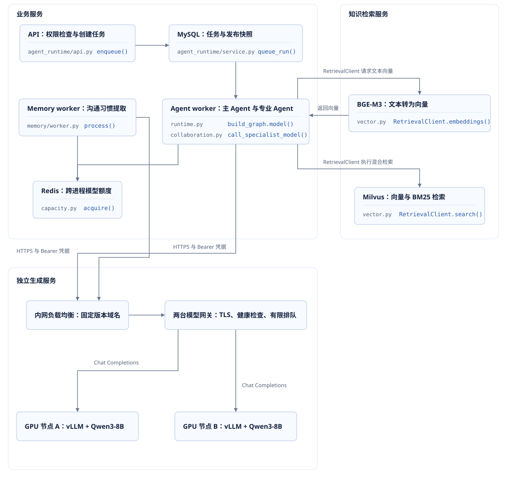
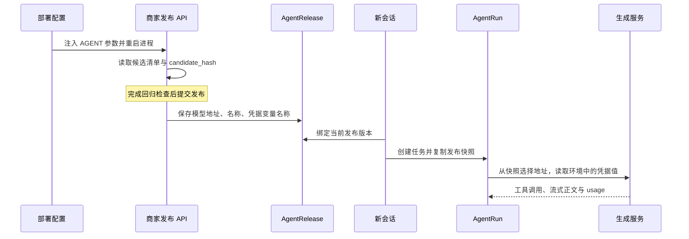

# 项目推理服务部署

用户提交“查询订单并咨询商品资料与换货条件”后，后台会查询订单与换货规则、检索商品资料，并多次请求生成模型。**推理服务需要稳定处理工具调用、正文流式输出和 token 用量，业务请求才能完整结束。** 普通聊天接口检查只覆盖其中一部分。

本文使用最终教学版本 `course-09-course-delivery`，配置独立 GPU 服务器、vLLM 副本和模型网关。部署配置可以直接下载；源码链接指向固定教学提交。模型质量、响应时间和服务器容量通过文中的验收流程确定。

## 一、生成服务在项目中的位置

项目的 API 负责身份、权限和业务请求，Agent worker 执行持久任务。主 Agent 决定查询步骤，OrderAgent 与 KnowledgeAgent 分别处理订单查询和知识查询；它们把工具结果交给模型整理，再由后端检查并保存结果。

**三个 Agent 共用运行快照中的模型地址与模型名称。** 多 Agent 表示多个有独立职责的执行者，当前代码没有为每个角色配置单独的生成模型。后台记忆任务也调用生成模型，但它直接读取自己的 `AgentSettings`。

<figure class="static-diagram" data-diagram-kind="static" tabindex="0" aria-label="业务服务、生成服务与知识检索，可滚动查看">
  
</figure>

项目已有的 Compose 服务 `inference` 运行 BGE-M3，接口是项目自定义的 `/embeddings`。**新增的 vLLM 生成服务通过 `AGENT_MODEL_URL` 接入，保留原有 `KNOWLEDGE_INFERENCE_URL`。** 当前检索使用 dense、BM25 和 RRF 融合，没有独立的神经网络 reranker 服务。

对应源码：[主 Agent 的模型请求](../source.html?stage=09-course-delivery&path=src/zhifu/modules/agent_runtime/runtime.py&symbol=build_graph.model)、[专业 Agent 的模型请求](../source.html?stage=09-course-delivery&path=src/zhifu/modules/agent_runtime/collaboration.py&symbol=call_specialist_model)、[记忆任务](../source.html?stage=09-course-delivery&path=src/zhifu/modules/memory/worker.py&symbol=process)、[知识检索](../source.html?stage=09-course-delivery&path=src/zhifu/modules/knowledge/vector.py&symbol=RetrievalClient.search)。

## 二、服务器与固定版本

本方案配置两台独立 Linux amd64 GPU 服务器，每台一张 NVIDIA L40S 48GB，运行一个完整模型副本。每台规划 128 GiB 主机内存，模型、镜像与运行记录预留至少 100 GiB 的 NVMe 空间；这些是部署资源配置，吞吐量需要测量。两台服务器能够分别维护和退出流量，故障时剩余容量由单个副本承担。

| 项目 | 部署配置 | 选择原因 |
| --- | --- | --- |
| 生成模型 | `Qwen/Qwen3-8B`，BF16 | 支持工具调用；8B 规模可以在单张目标 GPU 上装入完整权重 |
| 模型 revision | `b968826d9c46dd6066d109eabc6255188de91218` | 将模型文件和 tokenizer 固定到同一提交 |
| 服务版本 | vLLM `v0.11.0`，Linux amd64 镜像 digest 固定 | 参数、工具解析器与指标按同一版本核对 |
| 副本配置 | 两台服务器，每台 `tensor-parallel-size=1` | 每个请求在一个副本完成，副本分别处理不同请求 |
| 单序列长度 | 16384 token，含输入和输出 | 给售后规则、工具定义、查询结果与回复保留容量 |
| 调度上限 | 每副本 8 个序列、每轮 4096 token | 配合 chunked prefill 控制每轮计算量 |
| 服务名称 | `zhifu-qwen3-8b-r1` | 发布配置明确引用一个模型版本 |

`Qwen3-8B` 是本部署方案的候选模型。**正式承接售后请求前，必须通过工具选择、订单事实、知识引用和权限失败路径的业务验收。** 参数量与显存配置无法证明业务回答质量。设备规格见 [NVIDIA 官方产品资料](https://www.nvidia.com/en-us/data-center/l40s/)，模型来源见 [Qwen 官方说明](https://huggingface.co/Qwen/Qwen3-8B/blob/main/README.md)与[模型版本元数据](https://huggingface.co/api/models/Qwen/Qwen3-8B)。

vLLM 镜像固定为 `sha256:d8d39b59e909d2378ac4feeb191f7e7b6f1342477dc66b7c47cec89e9985ad8a`。服务器需要兼容该镜像 CUDA 环境的驱动、Docker Compose 和 NVIDIA Container Toolkit。部署前从容器内部执行 `nvidia-smi`，确认 GPU 可见；随后实际加载模型检查兼容性。[镜像元数据](https://hub.docker.com/v2/repositories/vllm/vllm-openai/tags/v0.11.0)、[固定版本 GPU 安装说明](https://raw.githubusercontent.com/vllm-project/vllm/v0.11.0/docs/getting_started/installation/gpu.md)

## 三、GPU 节点部署

下载 [compose.yaml](./inference/compose.yaml)、[start-vllm.sh](./inference/start-vllm.sh) 和 [gpu-node.env.example](./inference/gpu-node.env.example)，保存在目标服务器的同一个部署目录。两台服务器分别执行部署，使用相同模型文件和服务参数。

示例约定节点 A 为 `10.20.10.11`、节点 B 为 `10.20.10.12`。IP 与绝对路径按实际服务器填写。`INFERENCE_SECRET_FILE` 指向部署系统分发的密钥文件；两个副本使用同一发布版本的凭据，文件权限仅允许部署账户读取。将配置保存为 `gpu-node.env`。

```ini
INFERENCE_BIND_IP=10.20.10.11
MODEL_DIRECTORY=/srv/zhifu/models/qwen3-8b-r1
INFERENCE_SECRET_FILE=/srv/zhifu/secrets/inference_api_key
```

在每台 GPU 服务器准备固定模型目录。以下 Bash 命令检查设备并下载模型，下载最长 30 分钟；模型目录需要部署账户的写入权限。

```bash
set -euo pipefail
MODEL_DIRECTORY=/srv/zhifu/models/qwen3-8b-r1
INFERENCE_IMAGE='vllm/vllm-openai@sha256:d8d39b59e909d2378ac4feeb191f7e7b6f1342477dc66b7c47cec89e9985ad8a'
mkdir -p "$MODEL_DIRECTORY"
nvidia-smi
docker pull --platform linux/amd64 "$INFERENCE_IMAGE"
docker run --rm --gpus device=0 --entrypoint nvidia-smi "$INFERENCE_IMAGE"
timeout 1800s docker run --rm --platform linux/amd64 \
  --entrypoint python -v "$MODEL_DIRECTORY:/models/qwen3-8b" \
  "$INFERENCE_IMAGE" -c "from huggingface_hub import snapshot_download; snapshot_download('Qwen/Qwen3-8B', revision='b968826d9c46dd6066d109eabc6255188de91218', local_dir='/models/qwen3-8b')"
sha256sum "$MODEL_DIRECTORY/config.json"
docker compose --env-file gpu-node.env -f compose.yaml config --quiet
docker compose --env-file gpu-node.env -f compose.yaml up -d --wait --wait-timeout 600
```

启动前确认密钥文件存在且非空。Compose 将 GPU 0 分配给容器，模型以只读目录挂载，共享内存配置为 8 GiB。启动脚本从 `/run/secrets/inference_api_key` 读取凭据，设置 `VLLM_API_KEY` 后启动服务。**密钥值不写入课件或版本库。** Secret 的文件权限与分发由部署系统负责。[Compose GPU 配置](https://docs.docker.com/compose/how-tos/gpu-support/)、[Compose secret 文件](https://docs.docker.com/compose/how-tos/use-secrets/)

生成服务的核心参数如下，完整内容保存在下载的 Compose 文件中：

```yaml
command:
  - --model
  - /models/qwen3-8b
  - --served-model-name
  - zhifu-qwen3-8b-r1
  - --dtype
  - bfloat16
  - --kv-cache-dtype
  - auto
  - --tensor-parallel-size
  - "1"
  - --max-model-len
  - "16384"
  - --max-num-seqs
  - "8"
  - --max-num-batched-tokens
  - "4096"
  - --gpu-memory-utilization
  - "0.85"
  - --enable-chunked-prefill
  - --enable-prefix-caching
  - --enable-auto-tool-choice
  - --tool-call-parser
  - hermes
  - --generation-config
  - vllm
```

`hermes` 负责解析 Qwen3 的自动工具选择输出；`required` 通过 vLLM 的结构化输出路径约束工具调用。项目请求在 `chat_template_kwargs` 中关闭 thinking。`--generation-config vllm` 使用服务与请求参数，不额外引入模型目录里的采样配置；项目的 `temperature=0` 继续生效。这里保持默认调度实现。[vLLM 工具调用说明](https://raw.githubusercontent.com/vllm-project/vllm/v0.11.0/docs/features/tool_calling.md)

Compose 健康检查访问 `/health`。服务未能在 600 秒内就绪时，部署命令返回失败，保留容器日志供排查。`restart: unless-stopped` 处理进程退出；容器持续 unhealthy 时，网关停止转发，监控通知运维人员检查。**`/health` 通过只说明服务可接收检查，工具调用与生成质量仍需单独验收。**

## 四、模型网关与网络边界

业务进程使用固定版本地址，例如 `https://model-r1.internal.example/v1`。将示例替换为项目实际内网域名，DNS 指向已有内网负载均衡；负载均衡把 TCP 流量转发给两台独立网关，两台网关使用同一证书与路由配置。

下载 [gateway-compose.yaml](./inference/gateway-compose.yaml)、[gateway.env.example](./inference/gateway.env.example) 和 [haproxy.cfg](./inference/haproxy.cfg)。将实际网关 IP 与 TLS PEM 文件路径保存到 `gateway.env`；PEM 文件包含证书链及私钥。固定网关镜像使用 UID/GID 99，Linux 上由受控账户持有证书文件，设置组 99、权限 0640，确认容器账户可读；Compose 的文件 secret 不会替换源文件的所有者和权限。业务容器的 CA 信任必须包含签发机构；私有 CA 可通过部署环境中的证书文件与 `SSL_CERT_FILE` 配置。

```bash
docker compose --env-file gateway.env -f gateway-compose.yaml config --quiet
docker compose --env-file gateway.env -f gateway-compose.yaml run --rm --no-deps \
  model_gateway haproxy -c -f /usr/local/etc/haproxy/haproxy.cfg
docker compose --env-file gateway.env -f gateway-compose.yaml up -d
```

网关使用 HAProxy 3.2，配置要点如下：

```haproxy
backend vllm_nodes
    balance leastconn
    option httpchk
    http-check send meth GET uri /health ver HTTP/1.1 hdr Host localhost
    http-check expect status 200
    default-server inter 3s fall 3 rise 2 maxconn 8 maxqueue 8
    server gpu_node_01 10.20.10.11:8000 check
    server gpu_node_02 10.20.10.12:8000 check
```

`leastconn` 将新请求交给当前连接数量较少的副本，适合连接持续时间受生成长度影响的场景。`maxconn` 与 `maxqueue` 限制单个网关向一个副本提交的连接和等待请求；两个网关的限制分别生效，全局业务额度由 Redis 管理。

网关连接超时 3 秒、排队超时 2 秒、客户端与服务端空闲超时 35 秒。项目单次模型调用的整体期限最多 30 秒，仍由业务代码控制。**网关不自动重试生成 POST，请求中断交给任务状态和用量记录处理。** 网关持续转发 SSE，不收集完整响应后再返回。[HAProxy 健康检查说明](https://www.haproxy.com/documentation/haproxy-configuration-tutorials/reliability/health-checks/)

网络规则按职责配置：业务进程访问网关 443；网关访问 GPU 私网 8000；监控服务访问 GPU 的 `/metrics`。GPU 端口只允许网关、监控与受控运维主机访问。网关到 GPU 的 HTTP 通信限制在私网内部；需要跨网络传输时，为该链路配置 TLS 并验证证书。

vLLM v0.11.0 对 `/v1` 接口检查 Bearer 凭据，`/health` 与 `/metrics` 通过网络规则控制访问。网关只开放 `/v1/` 与自身的 `/healthz`；后者用于内网负载均衡检查网关进程，GPU 的状态由后端健康检查负责。日志记录状态、耗时与目标副本，不记录 Authorization、完整 Prompt 或订单正文。

## 五、后端配置与商家发布

让 **API、Agent worker、Memory worker 和发布检查进程** 读取相应环境配置。凭据变量 `ZHIFU_INFERENCE_R1_KEY` 由部署系统注入，值与 GPU 节点的 API key 相同。配置中的地址和模型名必须与已部署服务一致。

```ini
AGENT_MODEL_URL=https://model-r1.internal.example/v1
AGENT_MODEL_NAME=zhifu-qwen3-8b-r1
AGENT_CREDENTIAL_ENV=ZHIFU_INFERENCE_R1_KEY
AGENT_MODEL_EXTRA_BODY={"chat_template_kwargs":{"enable_thinking":false}}
AGENT_MODEL_TIMEOUT=30
AGENT_MAX_OUTPUT_TOKENS=1024
AGENT_MAX_CONTEXT_TOKENS=12000
AGENT_GLOBAL_CONCURRENCY=4
AGENT_TENANT_CONCURRENCY=2
AGENT_INTERACTIVE_RESERVED=2
AGENT_BACKGROUND_RESERVED=1
```

`AGENT_MAX_CONTEXT_TOKENS=12000` 是项目按 `cl100k_base` 计算的上下文估算预算。Qwen3 使用自己的 tokenizer，最终请求还包含工具定义与 chat template。**服务端 16384 的限制包含输入和输出；接近上限的请求需要用目标 tokenizer 核对。** 12000 与 1024 的和可以作为规划检查，不能替代最终编码数量。



商家发布使用业务访问令牌，要求启用的员工账户具有店铺 `agent:publish` 权限。读取 `GET /admin/v1/stores/{store_id}/agent-releases`，确认 `errors=[]` 并保留 `candidate_hash`。首次发布的 `current=null`，此时 `expected_version=0`；已有发布时填写 `current.version`。

向同路径提交 POST，携带 `Authorization: Bearer <业务访问令牌>` 和长度 1—64 的 `Idempotency-Key`。请求正文如下，其中摘要来自刚才的 GET；发布原因去除首尾空白后长度为 1—2000：

```json
{
  "expected_version": 0,
  "candidate_hash": "填写候选清单返回的64位小写十六进制摘要",
  "regression_checked": true,
  "reason": "发布已完成接入检查的生成服务配置"
}
```

成功响应为 201。同一次提交重试时保留幂等键和完整正文；同键改变正文返回 `IDEMPOTENCY_CONFLICT`，版本或候选摘要变化返回 `VERSION_CONFLICT`。模型参数来自服务器环境配置，POST 正文不接受 URL、模型名称或密钥。[发布字段](../source.html?stage=09-course-delivery&path=src/zhifu/modules/merchant/api.py&symbol=ReleasePublish)、[发布接口](../source.html?stage=09-course-delivery&path=src/zhifu/modules/merchant/api.py&symbol=publish_release)

发布 API 核对业务资料、配置完整性、版本和操作者确认；它不会请求模型执行回归。部署检查同样只核对生成模型的名称、地址与凭据是否存在。提交发布之前完成远端协议与业务检查，`regression_checked=true` 表示操作者已经检查记录。[发布清单](../source.html?stage=09-course-delivery&path=src/zhifu/modules/merchant/service.py&symbol=release_candidate)

新会话绑定当前发布版本，已有会话继续使用原版本；任务创建时将配置复制到 `AgentRun.release_snapshot`。`max_context_tokens` 在创建任务时另行加入配置，凭据值在执行时读取环境。Memory worker 直接读取自身 `AgentSettings`，单独安排配置更新和回归。[创建会话](../source.html?stage=09-course-delivery&path=src/zhifu/modules/conversations/api.py&symbol=create)、[运行快照](../source.html?stage=09-course-delivery&path=src/zhifu/modules/agent_runtime/service.py&symbol=queue_run)

启用金额预算的租户需要为新的 **base URL 与模型名称** 配置并审批 `BillingRoute` 对应价格，缺少已审批价格时返回 `BILLING_PRICE_MISSING`。自建 GPU 若不设置缓存优惠，让普通输入与缓存输入采用相同的批准价格；若两者价格不同，缺少缓存 token 数量时金额会进入待核对状态。尚未启用金额预算的租户继续执行 token 预算。[金额预占与结算](../source.html?stage=09-course-delivery&path=src/zhifu/modules/billing/ledger.py&symbol=reserve_money)

## 六、工具调用、流式输出与计量验收

本项目使用 Chat Completions。主 Agent 使用 `astream()`，专业 Agent 使用 `ainvoke()`；两种请求都要验证。接口定义见 [v0.11.0 OpenAI 接口说明](https://raw.githubusercontent.com/vllm-project/vllm/v0.11.0/docs/serving/openai_compatible_server.md)。

| 项目调用 | 服务需要返回的内容 | 业务检查 |
| --- | --- | --- |
| 主 Agent 自动选择工具 | 合法工具名称、可解析的 JSON 参数 | 工具在允许列表内，身份与订单范围由后端检查 |
| 专业 Agent 第一轮 `required` | 项目允许的 1—2 个工具调用 | 订单角色查询订单，知识角色查询知识 |
| 专业 Agent 第二轮 `none` | 完整文本结果 | 不继续产生工具调用，交给主 Agent 汇总 |
| 主 Agent 流式响应 | 正文增量、工具参数片段、结束信息 | 工具参数累计完整后执行，正文进入业务事件流程 |
| `stream_usage=True` | 最终 usage，含输入、输出与合计 token | 数值完整、非负、合计正确，预算可以结算 |
| 输出上限 | 接受 `max_completion_tokens` | 主 Agent 使用配置上限，专业 Agent 最多 512 token |
| 记忆任务 | 提取接口所需的工具或结构化结果 | 只处理客户授权的沟通习惯，任务正常结束 |

vLLM v0.11.0 接受 `max_completion_tokens`。项目通过当前 ChatOpenAI 版本将受控输出数量发送为该字段，`model_extra_body` 使用 Qwen3 模板参数。[请求参数定义](https://github.com/vllm-project/vllm/blob/v0.11.0/vllm/entrypoints/openai/protocol.py)、[项目参数处理](../source.html?stage=09-course-delivery&path=src/zhifu/core/model_parameters.py&symbol=chat_parameters)

将下面 JSON 保存为部署目录中的 `tool-check.json`，检查网关后的流式工具输出。`lookup_order` 是本次协议检查声明的只读函数，接口只返回函数调用信息；真实订单查询和权限通过项目验收执行。

```json
{
  "model": "zhifu-qwen3-8b-r1",
  "messages": [{"role": "user", "content": "查询订单 A100 的状态。"}],
  "tools": [{
    "type": "function",
    "function": {
      "name": "lookup_order",
      "description": "按订单号查询订单状态",
      "parameters": {
        "type": "object",
        "properties": {"order_id": {"type": "string"}},
        "required": ["order_id"],
        "additionalProperties": false
      }
    }
  }],
  "tool_choice": "required",
  "temperature": 0,
  "max_completion_tokens": 128,
  "stream": true,
  "stream_options": {"include_usage": true},
  "chat_template_kwargs": {"enable_thinking": false}
}
```

```bash
set -euo pipefail
: "${INFERENCE_BASE_URL:?填写实际网关地址，包含 /v1}"
: "${INFERENCE_SECRET_FILE:?填写实际凭据文件路径}"
mkdir -p records
curl --fail --silent --show-error --no-buffer --max-time 30 --retry 0 \
  --header "Authorization: Bearer $(cat "$INFERENCE_SECRET_FILE")" \
  --header 'Content-Type: application/json' \
  --data-binary @tool-check.json \
  "$INFERENCE_BASE_URL/chat/completions" --output records/tool-check.sse
```

该次检查最多 128 个输出 token，最长 30 秒。读取 SSE 时按事件边界累计内容；工具名称、调用 ID 与参数可能分多次到达，最终 usage 可以位于独立的数据事件中，之后以 `[DONE]` 结束。模型 SSE 与前端的业务事件流分别处理；前端通过项目保存的事件恢复阅读进度，断线后不会重放模型 POST。

业务回归使用独立验收环境的真实数据库、缓存、知识检索和订单服务，覆盖正常售后、缺少订单、越权订单、知识不足、模型超时、客户取消、等待审批及输出中断。核对任务、工具、审批和结算记录，不能只查看聊天文字。

课程已有 [model_sample.py](../source.html?stage=09-course-delivery&path=scripts/course/model_sample.py&symbol=main) 限定真实模型尝试数量、输出上限及期限。提前为测试进程加载数据库、两套 Redis、Milvus、BGE 和 `ACCEPTANCE_API_URL`；API 使用同一验收环境。采样期间由测试自身执行 worker，持续运行的 worker 停止领取该环境任务。接入设置文件仅提供 `AGENT_*` 与所选凭据变量，其他连接参数由测试进程环境提供。

在教学仓库的已准备验收环境执行，每条命令失败后立即终止本组检查：

```powershell
python scripts/course/model_sample.py --settings-file .work/inference-acceptance.env --output .work/inference-streaming.json --mode streaming --maximum 1
if ($LASTEXITCODE -ne 0) { throw '流式检查未通过' }
python scripts/course/model_sample.py --settings-file .work/inference-acceptance.env --output .work/inference-streaming-tool.json --mode streaming_tool --maximum 2
if ($LASTEXITCODE -ne 0) { throw '工具流式检查未通过' }
python scripts/course/model_sample.py --settings-file .work/inference-acceptance.env --output .work/inference-collaboration.json --mode collaboration --maximum 5
if ($LASTEXITCODE -ne 0) { throw '专业协作检查未通过' }
```

三项合计最多 8 次模型尝试，每次最多 512 个输出 token，每项脚本最长 180 秒。`streaming` 包含真实 HTTP SSE 续传；`streaming_tool` 要求两次模型调用与一次订单工具；`collaboration` 覆盖两种专业角色的查询和总结，但没有评测主 Agent 自主选择协作工具的准确率。记忆任务与其他业务用例单独登记。

**失败、重试和工具往返产生的模型请求都计入记录。** `started_attempts` 在发送前计数，预算拒绝也可能已经计入；结合各次状态与 usage 识别实际请求。准备失败或超过期限时，报告可能尚未生成，不能将缺少报告记为通过。

## 七、显存容量与请求并发

Qwen3-8B 包含 36 层、8 个 KV head、head_dim 128。BF16 权重与 KV 元素按 2 字节计算，标准完整 KV 缓存的公式为：

```text
每个 token 的 KV = 2 × 36 × 8 × 128 × 2 = 147456 字节 = 144 KiB
一个 16384 token 序列的 KV = 2.25 GiB
八个同长度序列的 KV = 18 GiB
模型权重估算 = 8190735360 × 2 字节 ≈ 15.26 GiB
```

结构字段来自[固定模型配置](https://huggingface.co/Qwen/Qwen3-8B/raw/b968826d9c46dd6066d109eabc6255188de91218/config.json)。权重加 8 个完整长度序列约 33.26 GiB，此外还需要 CUDA graph、临时张量、分页块和运行时空间。`gpu-memory-utilization=0.85` 限制本引擎使用的显存比例，它不表示 GPU 计算利用率。

计算时统一使用字节单位：设备规格里的 48GB 不能直接填写为 48GiB。本例将可用容量设为 **44 GiB**、运行开销设为 4 GiB、预算内额外保留 2 GiB，作为容量规划输入；部署时换成设备报告和实际运行记录。在课件目录复算：

```powershell
python scripts/gpu_capacity.py --layers 36 --kv-heads 8 --head-dim 128 --kv-bytes 2 --parameters 8190735360 --weight-bytes 2 --gpu-gib 44 --utilization 0.85 --runtime-gib 4 --reserve-gib 2 --context-tokens 16384 --active-requests 8
```

这组输入得到引擎预算 37.4 GiB、可用于 KV 的估算容量约 16.14 GiB，最多容纳 7 个完整长度序列。**调度上限 8 不代表能同时保存 8 个最长请求的全部 KV。** 输入较短时可以调度更多请求；长输入集中到达时，需要排队，KV 紧张也可能触发 preemption。应用的初始全局额度保持 4，调整额度前同时验收单副本故障和长输入集中到达的情况。服务器的可用容量、实际 KV blocks 与临时开销以启动和负载记录为准。

| 数量 | 当前配置或代码行为 | 影响范围 |
| --- | --- | --- |
| 业务任务数量 | AgentRun 与队列中的等待任务 | 用户从提交到完成的总时间 |
| Redis 全局额度 | 默认 4，跨进程共享 | 模型执行阶段的工作；交互与后台分别预留 |
| 租户交互额度 | `TenantQuota.interactive_limit`，默认 2 | 一个租户同时执行的主运行 |
| 专业角色额度 | 一个角色复用父额度，另一个申请额外额度 | 一次业务可能并行请求多个模型调用 |
| HTTP 连接池 | 每个进程、每个地址与凭据身份配置 4 个连接 | 本进程连接复用与传输数量 |
| vLLM 调度序列 | 每副本 8 | 单轮允许调度的序列数量 |

这些限制作用于不同位置。**增加 GPU 副本后，需要同步核对 worker 数量、Redis 额度、连接等待与租户配额。** 当前持续 worker 顺序领取父运行，专业 Agent 在父运行内部并行；只提高 Redis 数值不会自动增加 worker 进程。[worker 主循环](../source.html?stage=09-course-delivery&path=src/zhifu/modules/agent_runtime/worker.py&symbol=main)、[Redis 额度](../source.html?stage=09-course-delivery&path=src/zhifu/modules/agent_runtime/capacity.py&symbol=acquire)、[HTTP 客户端](../source.html?stage=09-course-delivery&path=src/zhifu/modules/agent_runtime/model_clients.py&symbol=ModelClients.for_request)

## 八、从业务请求到模型的优化顺序

用“客户查询订单并咨询商品资料与换货条件”作为固定场景，记录同一批输入从提交到最终回复的时间。**每项调整都同时记录业务结果、实际 token 和时间变化。** 模型请求减少但订单信息错误，无法计入有效收益。

| 位置 | 读取的记录 | 调整方式与边界 |
| --- | --- | --- |
| API 与任务队列 | 入队时间、领取时间、队列长度 | API 返回任务标识；限制等待任务，按任务类别配置 worker |
| Redis 与 HTTP | 额度等待、连接等待、网络耗时 | 设置共享额度、复用连接，检查请求在业务层等待的原因 |
| 工具与检索 | SQL、检索耗时、返回内容长度 | 使用查询索引、BGE 批量处理和过滤条件，减少无关结果 |
| 上下文 | 历史、工具定义与查询结果各自占用的 token | 保留当前订单和售后判断信息，控制历史与冗长工具结果 |
| Prompt 前缀 | 相同模板命中情况、prefill 时间 | 固定稳定模板的排列，发挥 prefix caching，保留租户权限检查 |
| Prefill 调度 | 等待队列、TTFT、每轮输入数量 | 长输入按 chunked prefill 预算处理，测量批处理参数变化 |
| Decode | 输出长度、相邻 token 间隔、总生成时间 | 控制无关正文和 thinking，满足业务解释后停止生成 |
| 显存 | KV 使用、preemption、显存峰值 | 调整上下文与活跃序列；量化需要重新验收工具与业务质量 |
| 扩容与发布 | 单副本、双副本吞吐及故障后能力 | 模型装入单卡时增加副本；更大模型重新评估并行方式 |

prefix caching 复用相同前缀的 KV，主要减少重复 prefill；新输出仍需逐步生成。缓存复用与业务权限分别处理，工具与数据层持续执行权限检查。vLLM 缓存命中也不会自动变成外部供应商账单里的优惠 token。[前缀缓存说明](https://raw.githubusercontent.com/vllm-project/vllm/v0.11.0/docs/features/automatic_prefix_caching.md)

`max-num-batched-tokens=4096` 小于 `max-model-len=16384`，因此开启 chunked prefill 让长输入分多轮参与调度。增大批处理预算可能改善吞吐，也可能增加其他请求等待；通过混合长短输入下的 TTFT 与输出速度判断。[调度参数定义](https://github.com/vllm-project/vllm/blob/v0.11.0/vllm/config/scheduler.py)、[推理优化说明](https://raw.githubusercontent.com/vllm-project/vllm/v0.11.0/docs/configuration/optimization.md)

## 九、监控、负载与验收记录

Prometheus 按副本采集 `/metrics`，保留模型版本、实例与 GPU 节点标签。业务侧记录任务排队、模型尝试、工具耗时和最终状态，GPU 侧记录显存、利用率与错误。客户标识、订单号与完整 Prompt 不作为指标标签。

| 观测项 | 说明 | 排查方向 |
| --- | --- | --- |
| TTFT | 请求到首个模型 token 的时间 | 模型排队、prefill、网络；用户首个可见正文还包含工具流程 |
| TPOT / token 间隔 | 生成后续 token 的时间 | 活跃序列、计算负载、输出长度 |
| Running / Waiting | 执行与等待的请求 | 副本是否饱和，入口配额是否合理 |
| KV 使用与 preemption | 缓存使用与重新计算 | 长上下文、批处理与显存容量 |
| 错误率与取消 | 4xx、5xx、期限到达、连接中断 | 参数、凭据、网络、进程与用户操作分别统计 |
| 完成率与 usage | 完成状态、待核对预算、全部模型尝试 | 生成中断时的结算与恢复行为 |

使用固定版本实际输出的指标建立图表，名称见 [vLLM v0.11.0 metrics](https://raw.githubusercontent.com/vllm-project/vllm/v0.11.0/docs/usage/metrics.md)。容量检查使用匿名化业务输入与真实模型，记录 revision、Prompt 集版本、输出上限和采样参数。

验收设置明确边界：普通与工具流式协议检查各 1 次，每次最多 128 个输出 token、最长 30 秒；上述业务脚本合计最多 8 次尝试；负载检查分别执行并发 1、4、8，每组 32 个生成请求、每次最多 128 个输出 token、每组最长 180 秒，关闭自动重试。三个负载组最多 96 次生成，其他质量用例单独登记数量与期限。

保存成功数、失败原因、输入/输出 token、TTFT、P50/P95 总耗时、输出 token/s、KV 峰值与 GPU 显存峰值。分别验证单个副本、双副本、长短输入混合，以及一个副本停止接收新请求后的表现；每种部署条件沿用同一组数量和期限，分别登记实际调用量。**内存计算通过后，仍需确认规定负载下的响应时间和业务完成率。** 小样本的 P95 只反映这一组请求，容量结论需要说明样本范围。

token 预算限制业务消耗，自建服务的费用还包括 GPU 时长、实例数量、存储、网络和运维。按业务调用次数与 token 分布估算，再与服务器吞吐核对；模型峰值 token/s 不能直接换算为每日客户数量。

## 十、模型版本发布与故障处理

模型文件、tokenizer、parser、vLLM 镜像、生成参数和网关配置共同组成一次推理发布。为新版本建立独立目录、服务名称与域名，例如 `r2`；验收环境完成协议、业务和容量检查后，发布商家的新 Agent 版本。

**保留旧地址、模型名称和凭据变量，直到引用它们的会话与运行全部处理完毕。** 快照保存的是配置字符串；直接在同一个 URL 与模型别名后替换权重，会让旧快照请求到新模型，失去版本固定的作用。Memory worker 的配置单独登记发布版本。

同版本副本维护时，停止向目标副本发送新请求，等待已有请求完成，核对连接和未完成用量后更新。维护期间由健康副本承担流量。新版本业务检查未通过时，新会话继续使用已验证版本。已执行工具与审批按照数据库状态处理，更换模型不能重复提交业务动作。

| 故障现象 | 项目处理与运维动作 |
| --- | --- |
| 一个 GPU 副本退出 | 健康检查移除该副本；按剩余能力限制入口，查看节点与模型日志 |
| 两个副本均不可用 | 网关返回失败，任务记录错误，恢复服务，限制再次执行的次数 |
| 输出中途断开 | 保留已有事件和模型尝试；缺少最终 usage 的预占进入待核对流程 |
| 工具参数无效 | 保存受限请求记录，核对模板、parser 与模型版本，发布验收不通过 |
| 上下文超长 | 核对目标 tokenizer 数量，检查工具结果与历史选择，再提交合规请求 |

HTTP SDK 的 `max_retries=0` 只控制该次客户端请求。持久任务恢复可能重新执行未完成的模型步骤，所有尝试继续统计。审批、幂等和权限由业务后端检查。[运行逻辑](../source.html?stage=09-course-delivery&path=src/zhifu/modules/agent_runtime/runtime.py&symbol=build_graph.model)

## 十一、部署练习与交付文件

沿“查询订单并咨询商品资料与换货条件”提交部署记录：

1. 标明 API、worker、Redis、网关、GPU 副本与 BGE/Milvus 的地址关系，说明每条请求的接口与访问权限。
2. 保存 revision、镜像 digest、目标设备与启动参数，解释 16384、8、4096 和 0.85 各自限制的对象。
3. 展示一个新会话的发布版本与运行快照，证明它使用指定模型服务；说明旧会话与记忆任务读取配置的位置。
4. 记录 `auto`、`required`、`none`、流式工具参数、最终 usage 和取消路径的结果，分别保存协议、业务与性能记录。
5. 用相同输入解释一次优化前后的等待时间、token 和完成率变化，提交单副本失效的处理记录。

部署文件：[GPU Compose](./inference/compose.yaml)、[GPU 启动脚本](./inference/start-vllm.sh)、[GPU 环境示例](./inference/gpu-node.env.example)、[网关 Compose](./inference/gateway-compose.yaml)、[网关环境示例](./inference/gateway.env.example)、[HAProxy 配置](./inference/haproxy.cfg)。正文、命令与图解源文件通过页面的“下载本文源文件”保存。
