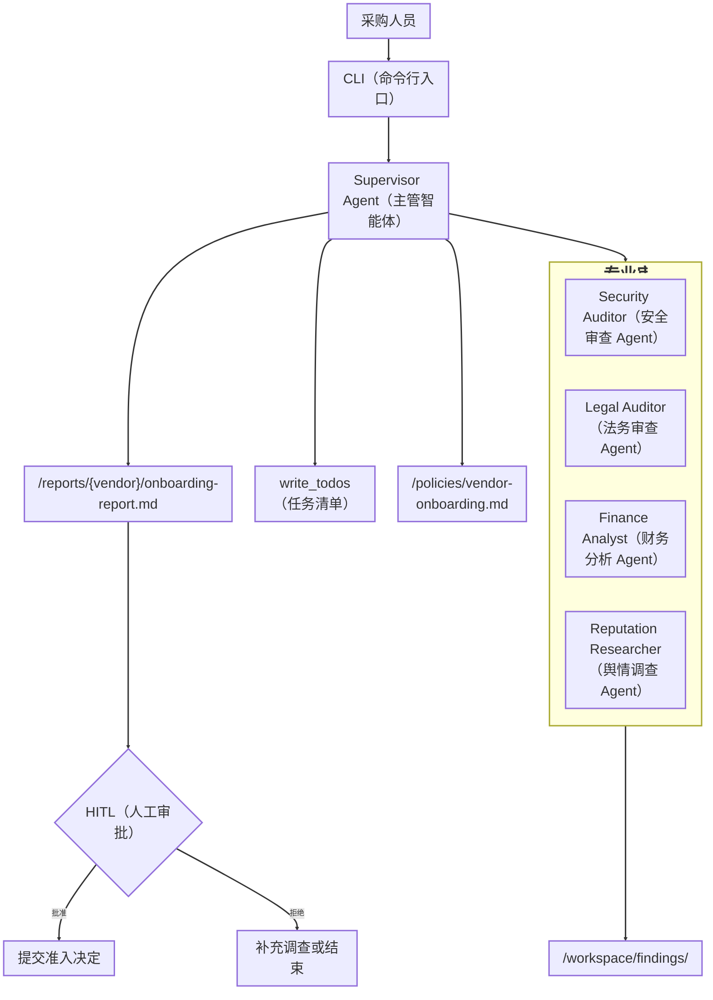

> [**https://git.miaoatech.cn/yangxiaolong/DeepAgent**](https://git.miaoatech.cn/yangxiaolong/DeepAgent)
>
> **本篇目标：** 解释 VendorGuard 如何把 Planning（任务规划）、Virtual Filesystem（虚拟文件系统）、Subagents（子智能体）、Skills（技能包）、Memory（长期记忆）、HITL（人在回路）和 LangSmith（可观测与评估平台）串成一个真实业务项目。
>

---

## 一、项目背景与需求说明
### 业务场景
企业采购人员准备引入一家新供应商。在签约前，企业需要从信息安全、法律合规、财务状况和社会舆情四个方面进行调查，判断该供应商是否符合合作要求。传统方式依赖多个团队分别审查，容易出现材料遗漏、标准不一致、证据分散和审批过程难以追溯等问题。

采购人员向系统提供供应商名称或编号。本文使用虚构的示例供应商编号 `ACME` 进行功能演示；它不代表任何真实企业。系统需要读取该供应商的问卷、渗透测试报告、合同、财务报表等资料，并结合组织准入政策、内部履约记录和本地监管数据完成审查。

> **业务边界：** VendorGuard 负责收集证据、识别风险并提出准入建议，但最终准入决定必须由人工审批人员确认。
>

### 功能需求
| 编号 | 需求 | 系统必须完成的行为 | 可检查的结果 |
| --- | --- | --- | --- |
| REQ-01 | 读取与核验材料 | 根据采购人员输入的供应商名称或编号，找到对应的资料文件夹并读取审查所需文件。例如，输入示例供应商编号 `ACME` 后，系统读取 `data-room/ACME/`；如果文件缺失、内容为空或格式异常，必须如实记录，不得虚构材料内容 | 输出已读取材料清单和缺失材料清单 |
| REQ-02 | 制定尽调计划 | 将任务拆分为安全、法务、财务、舆情、汇总报告和人工审批等步骤，并持续更新任务状态 | `write_todos` 中存在完整任务，且状态可追踪 |
| REQ-03 | 委派专业审查 | 将四个专业领域分别交给对应 Subagent（子智能体）；每个 Subagent 使用本领域规则、资料和查询工具独立审查 | 每个领域都输出风险、证据、影响和建议 |
| REQ-04 | 保存与隔离证据 | 将各领域的详细调查结果写入 `/workspace/findings/`；Supervisor Agent（主管智能体）只接收摘要，避免上下文被大量中间信息占满 | 四份专业发现文件可独立查看，关键结论可追溯到材料或查询记录 |
| REQ-05 | 生成准入报告 | 按 `/policies/vendor-onboarding.md` 汇总四个领域的发现，给出风险等级、待补材料、处置建议和准入结论 | 生成 `/reports/{vendor}/onboarding-report.md`，结论为批准、有条件批准或拒绝之一 |
| REQ-06 | 执行人工审批 | 在提交准入决定前暂停执行，向审批人展示结论和关键风险；只有收到明确批准后才能提交，拒绝后进入补充调查或结束流程 | 系统保留审批状态，并能使用同一 `thread_id`（会话编号）恢复流程 |
| REQ-07 | 追踪与评估质量 | 使用 LangSmith（可观测与评估平台）记录完整调用链、耗时、错误和运行元数据；通过 Dataset（数据集）与 Evaluator（评估器）执行回归检查 | 可以按供应商查询 Trace（运行轨迹），并查看报告完整性、证据引用和流程中断等评分 |


### 最终交付结果
一次完整的供应商准入审查应产生以下结果：

1. 四个专业领域的调查发现文件。
2. 一份证据可追溯的供应商准入报告。
3. 一条等待审批、已批准或已拒绝的人工审批记录。
4. 开启 LangSmith 后可查询的运行轨迹；执行离线评估后可查看实验评分。

### 为什么这个项目适合 Deep Agents
| 业务困难 | Deep Agents 机制 |
| --- | --- |
| 材料多且格式不一 | Virtual Filesystem（虚拟文件系统）按需检索与读取 |
| 流程长，容易遗漏步骤 | `write_todos`（任务清单写入工具）保存结构化计划 |
| 专业跨度大 | Subagent Delegation（子智能体委派） |
| 专家中间过程很长 | Context Quarantine（上下文隔离） |
| 审查标准需要复用 | Skills（技能包）按需加载 |
| 历史经验需要跨会话保留 | StoreBackend（持久化存储后端） |
| 提交决定具有外部副作用 | Human-in-the-loop（人在回路） |
| 多智能体过程难以排查 | LangSmith Trace（运行追踪）记录调用树、耗时和错误 |
| 调整 Agent 的 Prompt（提示词或工作指令）后，不能只凭人工观察判断效果是否变好 | 使用 Dataset（固定测试案例）重新运行任务，再由 Evaluator（评估器）自动评分；对比修改前后的结果，检查报告完整性、证据引用和审批流程是否出现退步，这个过程称为回归实验 |


---

## 二、系统架构


### 核心数据流
```latex
原始资料 → 专家读取 → 完整发现写文件 → 短摘要返回主管
        → 主管回读证据 → 生成报告 → 人工审批 → 外部提交
```

> **核心设计：** 子 Agent 只返回压缩结论，完整证据保存在共享工作区。主 Agent 仅在核实时读取证据文件。
>

---

## 三、项目目录
```latex
vendor-guard/
├── pyproject.toml
├── README.md
├── src/vendor_guard/
│   ├── settings.py
│   ├── schemas.py
│   ├── repository.py
│   ├── tools.py
│   ├── backends.py
│   ├── subagents.py
│   ├── agent.py
│   ├── observability.py
│   ├── evaluators.py
│   ├── langsmith_dataset.py
│   ├── langsmith_evaluation.py
│   └── cli.py
├── policies/
│   └── vendor-onboarding.md
├── skills/
│   ├── security-review/
│   ├── legal-review/
│   ├── finance-review/
│   └── reputation-review/
├── data-room/ACME/
├── fixtures/
├── reports/
└── tests/
```

> **目录原则：** 按职责组织，而不是按框架名称组织。业务数据、Agent 编排、存储策略和专业知识互不混杂。
>

---

## 四、重点文件一：**repository.py**——可独立测试的数据访问层
仓库内路径：`src/vendor_guard/repository.py`

### 职责
+ 读取本地 JSON Fixture（固定测试数据）。
+ 实现供应商、制裁、安全事故和负面新闻查询。
+ 不导入 LangChain（大语言模型应用开发框架）、LangGraph（图式智能体编排框架）或 Deep Agents。

```python
class JsonRepository:
    def get_vendor(self, vendor_name: str) -> dict:
        vendors = self._read("vendor_registry.json")["vendors"]
        return vendors.get(
            vendor_name.upper(),
            {"vendor": vendor_name, "found": False},
        )
```

### 为什么要单独拆分
> **设计收益：** Repository（数据仓库）与 Tool、Agent 编排解耦后，可以直接使用标准库 `unittest` 验证业务逻辑，不必启动模型框架。
>

### 生产替换点
生产环境可以把 `JsonRepository` 替换为 ERP Client（企业资源系统客户端）、数据库 Repository（数据仓库）或 MCP Client（模型上下文协议客户端），而不修改子 Agent 的工作分工。

---

## 五、重点文件二：**tools.py**——把业务能力暴露给模型
仓库内路径：`src/vendor_guard/tools.py`

### 职责
+ 用 `@tool` 将 Repository 方法转换为 LangChain Tool（工具）。
+ 通过类型、函数名和 Docstring（函数说明）告诉模型何时调用。
+ 标记 `submit_onboarding_decision` 为具有外部副作用的工具。

```python
@tool
def search_sanctions(vendor_name: str) -> dict:
    """查询供应商及其受益所有人的制裁或监管名单命中。"""
    return {
        "vendor": vendor_name,
        "hits": _repository.get_sanctions(vendor_name),
    }
```

### 实现要点
> **实现要点：** Deep Agents 没有改变 LangChain 的 Tool Calling（工具调用）方式。真正的差异在于工具分配、上下文归属和审批边界。
>

### 能力边界
> **能力边界：** Tool 只能说明查询接口返回了什么，不能自动证明数据源完整。生产接口仍需超时、重试、鉴权、审计和错误结构。
>

---

## 六、重点文件三：**backends.py**——项目最关键的上下文架构
仓库内路径：`src/vendor_guard/backends.py`

这个文件决定每类路径实际存在哪里、保留多久、是否允许修改。它是 VendorGuard 最能体现 Deep Agents 特点的文件之一。

### 路径路由
```python
return CompositeBackend(
    default=FilesystemBackend(
        root_dir=str(project_root.resolve()),
        virtual_mode=True,
    ),
    routes={
        "/workspace/": StateBackend(),
        "/memories/": StoreBackend(
            namespace=lambda _runtime: namespace,
        ),
    },
)
```

| 路径 | Backend（存储后端） | 生命周期 | 用途 |
| --- | --- | --- | --- |
| `/data-room/` | FilesystemBackend（本地文件后端） | 本地长期存在 | 原始尽调材料 |
| `/skills/` | FilesystemBackend | 随项目版本管理 | 专业审查方法 |
| `/policies/` | FilesystemBackend | 随项目版本管理 | 组织准入规则 |
| `/reports/` | FilesystemBackend | 本地长期存在 | 最终交付物 |
| `/workspace/` | StateBackend（线程状态后端） | 当前 Thread（任务线程） | 子 Agent 的临时发现 |
| `/memories/` | StoreBackend（持久化后端） | 跨 Thread | 经过复盘的长期经验 |


### 权限规则
```python
FilesystemPermission(
    operations=["write"],
    paths=["/data-room/**", "/policies/**", "/skills/**"],
    mode="deny",
)
```

> **权限重点：** 模型不能修改原始证据、组织政策和审查方法，但仍可写入报告与临时工作区。
>

### 能力边界
> **能力边界：** `virtual_mode=True` 会阻止路径逃逸，但不会隐藏项目根目录内的敏感文件。生产 Web 服务应换成 Sandbox Backend（沙箱后端）或受控 Store。
>

---

## 七、重点文件四：**subagents.py**——专业分工与上下文隔离
仓库内路径：`src/vendor_guard/subagents.py`

### 四个专业角色
| Agent | 中文职责 | 专属 Tool | 专属 Skill |
| --- | --- | --- | --- |
| `security-auditor` | 安全审查 | 安全事故查询 | `security-review` |
| `legal-auditor` | 法务与制裁审查 | 制裁查询 | `legal-review` |
| `finance-analyst` | 财务与履约分析 | 供应商主数据 | `finance-review` |
| `reputation-researcher` | 舆情调查 | 负面新闻查询 | `reputation-review` |


### 一个子 Agent 的完整配置
```python
{
    "name": "security-auditor",
    "description": "审查安全问卷、渗透报告、数据保护和安全事故。",
    "system_prompt": "...",
    "tools": [lookup_security_incidents],
    "skills": ["/skills/security-review/"],
}
```

### 五个关键字段
| 字段 | 主管如何使用 | 设计要求 |
| --- | --- | --- |
| `name` | 调用 `task` 时识别 Agent | 唯一、稳定 |
| `description` | 判断是否应该委派 | 写清触发场景和职责边界 |
| `system_prompt` | 约束专家工作方式 | 包含证据要求和返回格式 |
| `tools` | 提供外部动作 | 遵循 Least Privilege（最小权限） |
| `skills` | 注入专业流程 | 自定义子 Agent 必须显式配置 |


### 为什么要求“写文件 + 返回短摘要”
> **上下文隔离原则：** 完整发现写入 `/workspace/findings/security.md`，返回主管的内容只保留等级、证据索引和待补材料。
>

### 并发边界
> **并发边界：** 四个 Agent 写不同文件时不会竞争路径；多个 Agent 修改同一文件时，必须引入单写者、文件锁、版本号或汇总阶段。
>

---

## 八、重点文件五：Skills——把专业方法从 Prompt（提示词）中拆出来
重点文件：

+ `skills/security-review/SKILL.md`
+ `skills/security-review/references/scoring-rubric.md`
+ `skills/legal-review/SKILL.md`
+ `skills/finance-review/SKILL.md`
+ `skills/reputation-review/SKILL.md`

### Skill 的组成
```markdown
---
name: security-review
description: 当需要审查供应商安全问卷、渗透测试报告……时使用。
---

# 执行流程
1. 读取评分规则。
2. 提取证据。
3. 缺失项标记 unknown。
```

启动时只需要暴露 `name` 和 `description`。任务匹配后才加载完整流程，评分细则只有在流程引用时才继续读取。

### 为什么不全部写入 System Prompt
> **核心原因：** Skills 使用 Progressive Disclosure（渐进式披露），只在任务匹配时加载专业规则，避免规则常驻造成 Token 消耗和相互干扰。
>

### 扩展任务
在不改 Python 的情况下，修改安全评分规则，再运行相同任务。观察行为变化来自 Skill，而不是 Tool 或 Agent 编排。

---

## 九、重点文件六：**agent.py**——组装 Harness（智能体运行框架）
仓库内路径：`src/vendor_guard/agent.py`

> **组装原则：** `agent.py` 只负责组合能力，不包含数据查询和专业审查细节。
>

```python
return create_deep_agent(
    model=settings.model_name,
    system_prompt=SUPERVISOR_PROMPT,
    tools=[submit_onboarding_decision],
    subagents=build_subagents(),
    skills=["/skills/"],
    memory=["/memories/AGENTS.md"],
    backend=build_backend(settings.project_root, namespace),
    store=store,
    permissions=build_permissions(),
    interrupt_on={...},
    checkpointer=checkpointer,
)
```

### 参数与项目能力映射
| 参数 | 项目作用 |
| --- | --- |
| `system_prompt` | 定义主管执行协议，不承载全部专业规则 |
| `tools` | 主管只获得最终提交工具 |
| `subagents` | 注册四个专业专家 |
| `skills` | 给主管提供可发现的项目 Skills |
| `memory` | 声明长期经验文件路径 |
| `backend` | 绑定路径生命周期 |
| `store` | 提供跨 Thread 存储底座 |
| `permissions` | 保护资料、政策和 Skills |
| `interrupt_on` | 拦截最终提交动作 |
| `checkpointer` | 支持 Thread 状态与审批恢复 |


### 为什么主管只有一个业务 Tool
> **最小权限：** 主管只负责协调、验证证据、生成报告和申请提交；制裁查询与内部主数据工具属于专业 Agent。
>

### Memory 的实现说明
> **Memory 注意事项：** `/memories/AGENTS.md` 首次运行时可以为空。只有经过人工复盘的稳定经验，才适合写入长期记忆并跨会话复用。
>

### 本地与生产的差异
> **生产提示：** 当前 `InMemoryStore` 和 `InMemorySaver` 会在进程退出后丢失数据。生产环境应使用数据库 Store、持久化 Checkpointer 和分层 Namespace。
>

---

## 十、重点文件七：**cli.py**——运行和恢复人工审批
仓库内路径：`src/vendor_guard/cli.py`

### 首次调用
```python
with langsmith_trace_scope(settings):
    result = agent.invoke(
        {"messages": [...]},
        config={"configurable": {"thread_id": "vendor-acme-001"}},
        version="v2",
    )
```

> **关键关联：** `thread_id`（任务线程标识）把消息、Todo（待办事项）和 `/workspace/` 文件关联到同一任务；`langsmith_trace_scope`（LangSmith 追踪作用域）显式绑定 Client（客户端），并在程序退出前上传缓存的 Trace。
>

### 审批恢复
```python
result = agent.invoke(
    Command(resume={"decisions": [{"type": "approve"}]}),
    config=config,
    version="v2",
)
```

> **恢复原则：** 审批不是重新运行任务，而是从 Interrupt（中断点）继续执行，因此必须使用相同 `thread_id`。
>

### 能力边界
> **能力边界：** 示例 CLI 只有批准或拒绝。真实系统还需要身份认证、审批权限、拒绝原因、超时、多人会签和不可篡改审计记录。
>

---

## 十一、其他重要文件
### **settings.py**
仓库内路径：`src/vendor_guard/settings.py`

集中读取 DeepSeek、LangSmith、组织 ID（标识符）、Agent ID 和项目根目录等配置。所有 API Key 均从项目根目录的 `.env` 加载，再由 `Settings` 显式传给对应客户端；密钥字段不会出现在 `Settings` 的日志表示中。

### **schemas.py**
仓库内路径：`src/vendor_guard/schemas.py`

定义 `RiskLevel`、`RiskFinding` 与 `OnboardingDecision`。基础项目尚未强制子 Agent 使用结构化输出，后续扩展时可以将 `RiskFinding` 配置到 `response_format`。

### **policies/vendor-onboarding.md**
仓库内路径：`policies/vendor-onboarding.md`

这是 Organization Policy（组织政策），包含一票否决项、风险等级和报告必填项。权限层禁止 Agent 修改它。

### **data-room/ACME/**
仓库内路径：`data-room/ACME/`

包含问卷、渗透测试、合同草案和财务数据。它们是原始证据，不应被 Agent 修改。

### **fixtures/**
仓库内路径：`fixtures/`

模拟 ERP、制裁名单、事故库和新闻接口的返回。这样在本地运行时，无需外部账户即可测试 Tool 层。

### **tests/test_repository.py**
仓库内路径：`tests/test_repository.py`

验证大小写无关查询、未知供应商、安全事故和制裁结果。测试不调用模型，不需要 API Key（应用程序接口密钥）。

### **observability.py**
仓库内路径：`src/vendor_guard/observability.py`

统一生成 `run_name`、Tags（标签）和 Metadata（元数据），并创建 LangSmith Client（客户端）。交互式运行进入 `langsmith_trace_scope` 后，Client 会绑定到完整调用过程，并在退出前执行 `flush`（刷新缓存），避免进程结束时 Trace 尚未上传。

### **evaluators.py**
仓库内路径：`src/vendor_guard/evaluators.py`

提供四个不调用模型的代码评估器，分别检查报告完整性、证据路径、人工审批边界和受保护文件。规则评估速度快、结果稳定，适合作为基础回归门禁。

### LangSmith 数据集与实验入口
+ `src/vendor_guard/langsmith_dataset.py`：创建示例评估数据集。
+ `src/vendor_guard/langsmith_evaluation.py`：依次运行样例并上传实验结果。

详细操作见《[03-LangSmith 基础与 VendorGuard 可观测评估实战](./03-VendorGuard项目的LangSmith可观测与评估.md)》。

---

## 十二、运行项目
### 12.1 创建环境
```powershell
cd vendor-guard
uv sync
```

在项目根目录创建并填写 `.env`：

```plain
DEEPSEEK_API_KEY=你的DeepSeek密钥
DEEPSEEK_BASE_URL=https://api.deepseek.com
DEEPSEEK_MODEL_NAME=deepseek-v4-flash
DEEPSEEK_ANSWER_THINKING=true
LANGSMITH_TRACING=true
LANGSMITH_API_KEY=你的LangSmith密钥
LANGSMITH_PROJECT=vendor-guard-course
LANGSMITH_HIDE_INPUTS=true
LANGSMITH_HIDE_OUTPUTS=false
APP_ENV=local
```

> **注意：** 所有 API Key 都必须写入项目根目录的 `.env`，不得写入 Python 源码或提交到代码仓库。不需要上传 Trace 时，将 `LANGSMITH_TRACING` 设为 `false`，此时可以不填写 `LANGSMITH_API_KEY`。
>

> **Trace 体积控制：** DeepAgents 会在多个中间件节点中重复记录完整输入状态。本项目默认隐藏输入、保留输出，仍可查看调用树、模型结果、工具结果和耗时，同时避免 Trace 详情页因数据量过大而加载失败。
>

### 12.2 先运行纯业务测试
```powershell
$env:PYTHONPATH="src"
python -m unittest discover -s tests -v
```

> **预期结果：** 21 个测试全部通过。测试覆盖 Repository、CLI 编码保护、Trace 配置和确定性代码评估器，不调用模型，也不连接 LangSmith。
>

### 12.3 运行完整 Agent
```powershell
uv run vendor-guard ACME
```

如果模型建议准入或有条件准入，CLI 会显示待提交参数并询问是否批准。

### 12.4 在 LangSmith 中定位本次运行
> **检查入口：** CLI 启动时会打印 LangSmith Trace 状态。执行到人工审批时，系统会先上传当前 Trace 并在审批提示前打印完整 URL；按住 `Ctrl` 单击链接，可以先检查任务规划、子 Agent 和工具调用，再回到终端决定是否批准。没有触发审批时，链接会在任务结束后打印。
>

> **页面报错时：** 如果直接链接显示 `Something went wrong`，先确认 `.env` 中 `LANGSMITH_HIDE_INPUTS=true`，然后重新运行生成新 Trace。旧 Trace 已上传的大量输入无法通过修改配置缩小。
>

本次运行包含以下筛选字段：

| 字段 | ACME 示例值 | 用途 |
| --- | --- | --- |
| Tag | `vendor:ACME` | 按供应商筛选 |
| Tag | `environment:local` | 区分本地、测试和生产环境 |
| Metadata | `thread_id=vendor-acme-001` | 关联首次运行与审批恢复 |
| Metadata | `workflow=vendor-onboarding` | 区分不同业务流程 |
| Metadata | `run_kind=interactive` | 区分人工运行与评估实验 |


打开根 Trace 后，可以沿子运行查看主管规划、四个专业子 Agent、文件工具、模型调用和 HITL 中断。LangSmith 负责记录执行事实，不替代业务报告和审批审计。

---

## 十三、运行结果核对清单
> **核对原则：** 重点不是模型说了什么，而是任务是否按预期路径执行、结论是否有证据支撑。
>

| 核对阶段 | 核对内容 | 合格表现 |
| --- | --- | --- |
| 任务规划 | 查看主管的第一批动作 | 先创建任务清单，并覆盖四类调查、报告生成和人工审批 |
| 专业调查 | 查看任务路由和专家上下文 | 四类任务进入对应子 Agent，且只加载本专业的 Tool 和 Skill |
| 证据沉淀 | 对比专家文件与返回消息 | 完整发现写入 `/workspace/findings/`，主管只收到短摘要 |
| 综合判断 | 检查报告生成过程 | 主管回读证据文件，并明确记录风险、冲突、未知项和整改建议 |
| 权限保护 | 尝试写入受保护目录 | 对 `/data-room/`、`/policies/`、`/skills/` 的写入被拒绝 |
| 人工审批 | 查看提交工具的调用顺序 | `submit_onboarding_decision` 在人工审批前暂停，审批后才继续 |
| 运行归档 | 查看根运行的标签和元数据 | 能按供应商、线程、环境和运行类型定位本次 Trace |


> **排错原则：** 先定位 Prompt、Skill、Tool、Backend 或任务路由，再进行针对性修复，不要只靠增加提示词掩盖错误。
>

---

