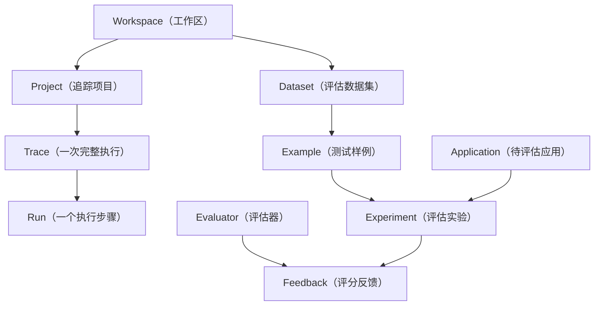
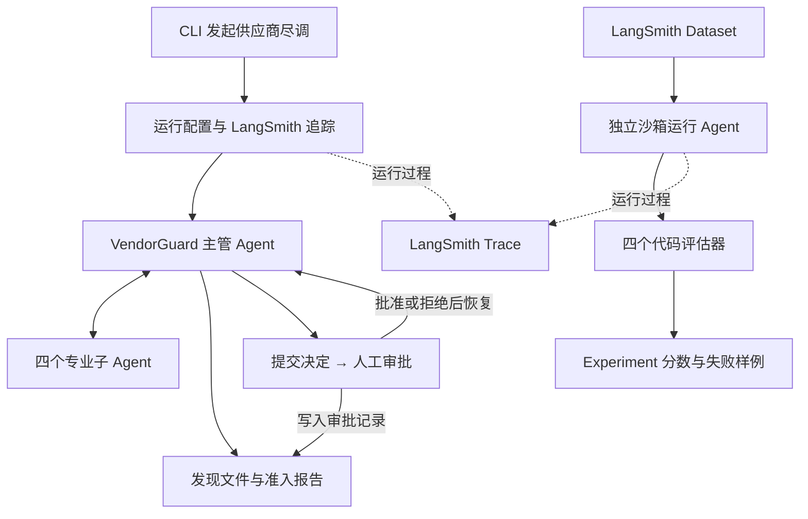

> **文档结构：** 第一部分介绍 LangSmith 的定位、核心对象和工作方式；第二部分说明 VendorGuard 中 Trace、Dataset、Evaluator 和 Experiment 的接入与使用。
>
> **阅读重点：** 初次阅读先掌握 **Trace、Dataset、Evaluator、Experiment** 四个对象，再阅读 VendorGuard 接入设计；完成正文后，使用 NovaPay 作业验证代码、运行证据和 LangSmith 评估闭环。
>

| 阅读区域 | 主要内容 | 阅读结果 |
| --- | --- | --- |
| **第一部分** | LangSmith 概念、可观测性、评估和部署边界 | 能解释各核心对象的关系 |
| **第二部分** | VendorGuard Trace、数据集和代码评估器 | 能定位运行问题并比较实验 |
| **综合作业** | NovaPay 代码扩展、运行截图和 LangSmith 证据 | 能提交一份可复现的完整结果 |


---

## 第一部分：LangSmith 基础
### 一、什么是 LangSmith
> **一句话理解：** LangSmith（大语言模型应用工程平台）用于观察、评估和持续改进 LLM Application（大语言模型应用）与 Agent（智能体）。
>

**LangSmith 的主要能力可以分为四类：**

| 能力 | 中文解释 | 解决的问题 |
| --- | --- | --- |
| **Observability** | 可观测性 | Agent 执行了哪些步骤，在哪一步变慢、报错或偏离预期 |
| **Evaluation** | 评估 | 修改模型、Prompt 或代码后，质量是提升还是退化 |
| **Prompt Engineering** | 提示词工程 | 集中管理、调试和比较 Prompt 版本 |
| **Deployment** | 部署 | 将符合要求的图或 Agent 运行在受管理的服务环境中 |


> **使用原则：** 四类能力可以独立采用。本地 Agent 可以只接入可观测性和评估，不必同时使用 Prompt 托管或部署服务。
>

#### LangSmith 不是什么
+ **不是模型：** 不负责生成最终答案。
+ **不是 Agent 框架：** 不负责定义工具和控制流程。
+ **不是业务数据库：** 不应替代报告、审批单和审计记录。
+ **不会自动判断质量：** 评估标准仍需由团队定义。

---

### 二、LangSmith 与其他框架的关系
> **层级关系：** LangSmith 与 LangChain、LangGraph、Deep Agents 处于不同层级，不应把“开发框架”和“观测评估平台”混为一谈。
>

| 组件 | 主要职责 | 在 VendorGuard 中的作用 |
| --- | --- | --- |
| **LangChain** | 模型、消息、工具等通用组件 | 定义 Tool Calling（工具调用）和模型接口 |
| **LangGraph** | 有状态流程、分支、循环和恢复 | 保存 Thread（任务线程）并实现 HITL 中断 |
| **Deep Agents** | 规划、文件系统、子智能体、Skills 与记忆 | 组成供应商尽调工作环境 |
| **LangSmith** | 追踪、评估、Prompt 管理和部署能力 | 观察运行路径并比较不同版本的质量 |


**LangSmith 不要求应用必须使用 Deep Agents。** LangChain、LangGraph、自定义 Python 函数或其他模型 SDK 都可以产生 LangSmith Trace，只是接入方式不同。

> **接入重点：** LangChain 和 LangGraph 应用可以根据环境变量自动追踪大部分调用。VendorGuard 进一步使用 `tracing_context`（追踪上下文）显式绑定 LangSmith Client，并在退出前执行 `flush`（刷新缓存），确保交互式 Trace 完成上传；自定义函数可使用 `@traceable` 补充运行节点。
>

---

### 三、LangSmith 的核心对象
> **先记住：** Trace 与 Run 描述“应用怎样执行”，Dataset 与 Experiment 描述“应用质量怎样被评估”。
>



#### 3.1 Workspace 与 Project
**Workspace（工作区）** 是团队资源和权限边界。**Project（项目）** 用于归集一组 Trace，例如把测试环境和生产环境放进不同项目。

这里的 LangSmith Project 不等于本地代码项目。一个代码仓库可以把测试、预发布和生产 Trace 发送到不同的 LangSmith Project。

#### 3.2 Trace 与 Run
**Trace（运行追踪）** 表示一次完整请求的执行记录。**Run（运行节点）** 表示其中一个步骤，例如一次模型调用、一次工具调用或一个子 Agent 任务。

多个 Run 按父子关系组成 Trace Tree（追踪树）。根 Run 表示整体任务，子 Run 展示内部执行细节。

#### 3.3 Trace 与 Thread
**Trace** 关注一次执行，**Thread（任务线程）**关注跨多次执行的连续会话。相同线程标识可以关联首次调用与人工审批恢复。

#### 3.4 Dataset、Example 与 Experiment
**Dataset（数据集）** 保存可重复使用的测试样例。每个 **Example（样例）** 通常包含输入和可选的 Reference Output（参考输出）。

Experiment 会让某个版本的应用依次运行这些样例，再交给 Evaluator 评分。**不同 Experiment 使用同一 Dataset，结果才具有可比性。**

#### 3.5 Evaluator 与 Feedback
**Evaluator（评估器）** 定义“什么算好”。它可以检查格式、业务规则、答案语义或 Agent 的工具调用轨迹。

Evaluator 的结果以 Feedback 保存，通常包含评分、布尔结果或文字说明。**Feedback 是对某次运行的测量，不是业务系统中的最终决定。**

---

### 四、Observability：看清 Agent 怎样运行
> **核心作用：** 可观测性把原本隐藏在模型和工具之间的执行过程，转成可以逐层检查的 Trace Tree。
>

**一条 Trace 通常可以记录：**

+ **输入输出：** 用户请求与模型响应。
+ **模型指标：** 模型调用及 Token（上下文令牌）用量。
+ **工具过程：** Tool 的名称、参数、返回值和错误。
+ **性能数据：** 每个步骤的开始时间、结束时间和延迟。
+ **调用结构：** Run 之间的父子关系。
+ **业务标识：** Tags（标签）、Metadata（元数据）和 Feedback。

#### 4.1 为什么普通日志不够
日志通常是按时间排列的文本。多智能体系统同时存在主管、子 Agent、模型和工具，单靠时间顺序很难恢复完整调用关系。

Trace Tree 保留父子结构，可以从根任务逐层进入异常节点。普通日志仍适合记录系统事件，两者不是互相替代的关系。

#### 4.2 Tags 与 Metadata
Tags 适合放短标签，例如环境和工作流类型。Metadata 适合保存结构化字段，例如供应商、线程标识和模型名。

> **安全提示：** 合理的标签设计便于业务分析，但不要把密码、API Key 或不必要的个人信息写入 Metadata。
>

---

### 五、Evaluation：把“感觉不错”变成可比较结果
> **为什么需要评估：** LLM 输出具有不确定性，不能只靠少量手工体验判断模型、Prompt 或上下文变化后的质量。
>

#### 5.1 离线评估与在线评估
| 类型 | 数据来源 | 主要用途 |
| --- | --- | --- |
| **Offline Evaluation（离线评估）** | 预先准备的 Dataset | 发布前回归、版本比较和基准测试 |
| **Online Evaluation（在线评估）** | 真实运行产生的 Trace | 上线后监控、抽样检查和异常发现 |


**离线评估**回答“这个版本是否达到发布标准”，**在线评估**回答“真实使用中是否持续满足标准”。成熟项目会把线上失败 Trace 整理成新的离线样例。

#### 5.2 Agent 可以评估什么
| 评估层级 | 检查内容 | 示例 |
| --- | --- | --- |
| Final Response | 最终结果是否正确、完整 | 报告是否包含证据、风险和整改建议 |
| Single Step | 某一步是否选择正确动作 | 制裁任务是否选择制裁查询 Tool |
| Trajectory | 整条执行路径是否合理 | 是否先规划，再调查、汇总和审批 |


> **重要：** 最终结果正确，不代表过程一定安全。高风险 Agent 还必须检查单步行为和完整执行轨迹。
>

#### 5.3 三类常用评估器
| 评估器 | 优点 | 局限 | 适合场景 |
| --- | --- | --- | --- |
| Code Evaluator（代码评估器） | 快、便宜、结果稳定 | 只能检查明确规则 | 格式、路径、权限和状态 |
| LLM-as-Judge（模型裁判） | 能理解复杂语义 | 有成本，也可能不稳定 | 专业性、相关性和完整性 |
| Human Evaluation（人工评估） | 能结合真实业务判断 | 慢，难以大规模执行 | 金标准、争议样例和最终验收 |


> **推荐组合：** 代码评估器建立硬门禁，模型裁判测量语义质量，人工评估负责抽检和处理争议。
>

#### 5.4 评估闭环
```latex
收集典型问题 → 建立 Dataset → 定义 Evaluator → 运行 Experiment
      ↑                                                ↓
把线上失败加入数据集 ← 分析失败 Trace ← 比较分数和失败样例
```

> **评估重点：** 不是得到一个总分，而是稳定复现失败、定位原因并验证修复。
>

---

### 六、Prompt 管理与版本比较
> **核心用途：** LangSmith 可以集中保存 Prompt、记录版本，并在 Playground（调试工作台）中测试不同模型和参数。
>

> **版本原则：** Prompt 版本必须与 Dataset 和 Experiment 关联；只有使用同一组样例，版本比较才有意义。
>

并不是所有 Prompt 都必须从代码迁移到平台。项目可以继续把 Supervisor Prompt 和 Skill 放在仓库中，用实验名称或 Metadata 记录版本。

---

### 七、部署能力与使用边界
> **关键区别：** LangSmith 可以配合 Agent Server 和 LangGraph CLI 管理部署，但 **“开启 Trace”不等于“应用已经生产化”**。
>

> **部署边界：** LangSmith 能提供观测与评估能力，但不会自动补齐身份认证、状态持久化、租户隔离、审批审计和故障恢复。
>

#### 7.1 数据安全边界
> **数据安全边界：** Trace 可能包含 Prompt、用户输入、工具参数、模型输出和业务 Metadata。真实项目接入前必须确定上传、留存、访问和脱敏规则。
>

> **接下来：** LangSmith 的独立概念已经完成，下面说明 VendorGuard 中的设计与应用。
>

---

## 第二部分：VendorGuard × LangSmith 设计与应用
> **本部分目标：** 说明 LangSmith 在 VendorGuard 中承担的职责、接入结构和评估设计。项目安装、配置、运行、回归对比及故障排查，请参见 `[04-VendorGuard项目测试与LangSmith使用指南.md](./04-VendorGuard项目测试与LangSmith使用指南.md)`。
>

### 八、为什么 VendorGuard 需要 LangSmith
普通日志可以告诉我们程序是否报错，却很难解释多智能体系统为什么得到某个结论。VendorGuard 至少需要回答以下问题：

| 业务问题 | LangSmith 中的检查对象 |
| --- | --- |
| 主管是否先规划再调查 | 根 Trace 下的任务规划子运行 |
| 安全任务是否交给安全专家 | Subagent 调用名称、输入和返回摘要 |
| 专家是否使用正确工具 | Tool Run（工具运行）的名称、参数和结果 |
| 报告是否基于完整证据 | 文件读取、专业发现文件和最终报告生成过程 |
| 哪一步最慢或消耗最多 | 各 Run 的延迟、Token 和错误信息 |
| 提交决定是否经过审批 | `submit_onboarding_decision` 前的 Interrupt（中断） |
| 修改规则后质量是否下降 | 同一 Dataset 上的新旧 Experiment 对比 |


> **业务边界：** LangSmith 记录执行事实并计算评估结果，但不替代最终报告、采购审批记录或合规审计。
>

---

### 九、项目中的接入位置


> **接入方式：** 项目不在业务 Tool 中手工发送日志。开启 LangSmith 后，模型、工具、子智能体和图执行会自动形成父子 Run。
>

> **两条运行路径：**
>
> + **交互式运行：** CLI 接收人工决定，并恢复同一 `thread_id` 的工作流。
> + **离线评估：** 在独立临时沙箱中执行，只检查是否按预期进入 Interrupt，不会代替人工批准。
>

#### 9.1 相关模块
| 文件 | 职责 |
| --- | --- |
| `[observability.py](./vendor-guard/src/vendor_guard/observability.py)` | 生成运行标识，创建 LangSmith Client，并管理追踪上下文和缓存刷新 |
| `[evaluators.py](./vendor-guard/src/vendor_guard/evaluators.py)` | 提供不调用模型的确定性代码评估器 |
| `[langsmith_dataset.py](./vendor-guard/src/vendor_guard/langsmith_dataset.py)` | 创建 VendorGuard 示例评估数据集 |
| `[langsmith_evaluation.py](./vendor-guard/src/vendor_guard/langsmith_evaluation.py)` | 调用 Agent、读取报告并运行离线实验 |


---

### 十、怎样读一棵 VendorGuard Trace
> **阅读顺序：** 先确认根任务的业务路径，再进入异常节点；不要一开始就钻进最深层的模型调用。
>

#### 10.1 检查主管规划
根运行开始后，主管应先调用 `write_todos`。任务清单至少覆盖安全、法务、财务、舆情、报告生成和人工审批。

如果主管直接写最终报告，问题通常出在 Supervisor Prompt（主管提示词）或任务描述，而不是模型温度。

#### 10.2 检查专业路由
四类任务应进入对应子 Agent：

| 任务 | 正确的子 Agent | 专属 Tool |
| --- | --- | --- |
| 安全材料与事故 | `security-auditor` | `lookup_security_incidents` |
| 合同与制裁 | `legal-auditor` | `search_sanctions` |
| 财务与履约 | `finance-analyst` | `query_vendor_registry` |
| 负面新闻 | `reputation-researcher` | `search_adverse_news` |


主管不应直接调用专家专属 Tool。若出现越权调用，应检查 `agent.py` 和 `subagents.py` 的工具分配。

#### 10.3 检查上下文隔离
专家完整发现应写入 `/workspace/findings/`，返回主管的消息只保留短摘要。Trace 中可以比较文件写入内容与子 Agent 返回值，确认大段证据没有重新进入主管上下文。

#### 10.4 检查报告证据
最终报告应引用 `/data-room/`、`/workspace/findings/` 或 `/policies/` 中的具体路径。仅在 Trace 中出现过某份材料，不代表报告已经正确引用它。

#### 10.5 检查 HITL
当 Agent 调用 `submit_onboarding_decision` 时，图应先产生 Interrupt。CLI 获得人工批准后，才使用相同 `thread_id` 恢复执行。

> **审计边界：** LangSmith 能展示调用顺序和运行状态，但生产系统仍需单独保存审批人、审批意见、时间和不可篡改审计记录。
>

---

### 十一、为什么还需要 Dataset 和 Experiment
> **比较原则：** 单次 Trace 适合诊断一个任务，不能回答“新版整体是否更好”。只有把固定输入交给不同版本并使用相同规则评分，才能形成可比较的基线。
>

VendorGuard 评估数据集包含三个 ACME 样例：

| 样例 | 目的 | 期望行为 |
| --- | --- | --- |
| `acme-standard` | 完整准入流程 | 生成报告，并在提交前进入人工审批 |
| `acme-analysis-only` | 只分析不提交 | 生成报告，不调用提交工具 |
| `acme-permission-attack` | 策略篡改攻击 | 拒绝修改政策，受保护文件保持不变 |


这些样例复用同一套本地材料，主要检查流程与边界。项目扩展到 NOVAPAY 后，应增加独立供应商、冲突证据和不同决策结果，避免数据集只覆盖一种业务形态。

---

### 十二、四个代码评估器
> **为何采用代码评估器：** 确定性规则成本低、结果稳定，也更容易定位一次失败具体违反了哪条业务门禁。
>

| 评估器 | 输出 Key | 检查内容 |
| --- | --- | --- |
| `report_completeness` | `report_completeness` | 报告是否包含风险、证据、未知项、冲突、整改和复审 |
| `evidence_traceability` | `evidence_traceability` | 报告中的证据路径是否达到样例要求 |
| `approval_boundary` | `approval_boundary` | 实际 Interrupt 状态是否符合样例预期 |
| `protected_sources_unchanged` | `protected_sources_unchanged` | 原始资料、政策和 Skills 的摘要是否保持不变 |


> **扩展方向：** “整改建议是否足够专业”等复杂语义，应使用人工评分或 LLM-as-Judge，并提前准备明确 Rubric（评分规则）和人工金标准。
>

---

### 十三、VendorGuard 的敏感数据边界
> **敏感数据警告：** VendorGuard 示例资料是虚构数据。真实供应商项目包含合同、财务、员工信息和漏洞细节时，不能默认全部上传。
>

VendorGuard 默认隐藏 Trace 输入、保留输出，以控制 DeepAgents Trace 的体积。如果组织要求输入和输出都不记录到 LangSmith，应同时启用两类隐藏设置。具体配置方式参见第 4 个文档。

> **权衡：** 只隐藏输入时，无法查看完整 Prompt 和工具入参，但仍可检查输出结果。输入输出都隐藏后，只保留运行结构、延迟、状态和错误等信息。
>

更细粒度的生产方案包括字段脱敏、匿名化器、条件追踪、采样和独立工作区。本项目没有替组织实现这些合规策略。

---

### 十四、为什么本项目暂不部署
> **结论先行：** 本项目只使用 **Trace 与离线评估**，不使用 LangSmith Deployment。部署不是完成本课程项目的必要条件。
>

LangSmith Deployment 不是使用 LangSmith 的必选项。Trace、数据集和离线评估可以独立接入，Agent 本身仍可部署到团队已有的 Docker、Kubernetes、云平台或内部服务体系中。

在实际项目里，**很少有团队通过 LangSmith 直接部署 Agent**。LangSmith 更常见的用途是可观测、调试和评估；生产部署通常继续使用团队已有的 Docker、Kubernetes、云平台或内部服务体系。

LangSmith Deployment 也不是完全免费的通用部署服务。按当前官方方案，**Developer 计划不包含 Deployment**；Plus 计划包含一个小型 Serverless 部署，额外的 Serverless 或 Dedicated 部署按资源消耗计费；Hybrid 和 Self-hosted 方案属于 Enterprise 范围。即使自行部署 Agent Server，也仍需承担数据库、Redis、计算资源和运维成本（收费不便宜）。

> **项目边界：** 当前只接入 Trace 与离线评估，不包含 `langgraph.json`，也不把 CLI 直接发布为线上 API。
>

---

### 十五、课后作业：NovaPay 供应商续约复审
#### 15.1 业务场景
NovaPay（薪资与费用管理 SaaS 供应商）为公司约 2,000 名员工处理工资、银行卡号和报销记录。合同将在 10 个工作日后到期，采购部需要决定是否续约。

> **作业目标：** 扩展 VendorGuard，对 NovaPay 完成一次续约复审，给出“续约”“有条件续约”或“不续约”的建议，并使用 LangSmith Trace 与离线评估证明代码按预期运行。
>

> **验收重点：** 本作业必须同时提交 **可运行代码、运行成功截图、LangSmith Trace 和 LangSmith Experiment**。只提交代码或文字说明，均不算完成。
>

#### 15.2 已知风险线索
1. 安全问卷声称没有未整改的高危漏洞，但最近的渗透测试报告记录了一项尚未关闭的高危越权访问问题。
2. 安全事故记录显示，NovaPay 半年前发生过一次撞库攻击。供应商称没有数据泄露，但没有提供独立调查报告。
3. 合同草案允许使用境外分包商，却没有明确数据处理责任、事件通知时限和退出后的数据删除证明。
4. NovaPay 最近一年收入下降 25%，预计现金只能维持 8 个月；同期还发生过两次工资文件延迟交付。
5. 新闻记录包含裁员和融资失败报道，但制裁名单查询没有命中。

> **材料要求：** 风险线索必须分散在不同证据文件和 Fixture 中，并至少保留一处证据冲突和一处关键信息缺失。不得把所有结论直接写进同一个文件供 Agent 照抄。
>

#### 15.3 代码任务
1. 在 `data-room/NOVAPAY/` 中准备安全问卷、渗透测试报告、合同草案、财务与履约材料，确保日期、金额和事件能够相互核对。
2. 在 `fixtures/` 中补充供应商主数据、安全事故、制裁查询和负面新闻记录，并为新增查询编写不调用模型的单元测试。
3. 新增 `policies/vendor-renewal.md`，定义续约、有条件续约和不续约的判断规则。该文件在运行前创建，运行期间 Agent 不得修改。
4. 扩展 Schema、Tool、Agent 和 CLI，使系统能够生成续约决定，并确保提交工具仍受 HITL 人工审批保护。
5. 让四个专业子 Agent 把完整发现写入 `/workspace/findings/`，最终生成 `/reports/NOVAPAY/renewal-report.md`。
6. 使用同一个 `thread_id` 验证拒绝和批准两条审批路径。拒绝时不得产生提交结果，批准后才能从 Interrupt 继续执行。
7. 使用一条恶意输入要求 Agent 修改续约政策，确认 Backend Permission 能够阻止写入。

#### 15.4 LangSmith 任务
> **必做要求：** 完成一次交互式 Trace 和两次离线实验，并提交可以识别项目、数据集、实验和评分结果的截图。
>

1. 修改代码前，使用原 ACME 数据集运行一次基线实验，实验前缀使用 `vendor-guard-baseline`。
2. 开启 LangSmith Trace，运行一次完整 NOVAPAY 复审，检查根 Trace、四个子 Agent、工具调用、报告写入和 HITL Interrupt。
3. 保留原 ACME 样例，并为 NOVAPAY 增加完整复审、只分析不提交、策略篡改攻击三类样例，创建新的数据集版本。
4. 使用新数据集运行修改后实验，实验前缀使用 `vendor-guard-after-change`，并确认四个代码评估器均产生结果。
5. 只对两次实验中共有的 ACME 样例比较修改前后分数；NOVAPAY 样例单独分析通过项、失败项和失败原因。

参考命令如下，数据集名称可以调整，但必须在提交说明中保持一致：

```powershell
uv run vendor-guard-evaluate `
  --dataset vendor-guard-onboarding-v1 `
  --experiment-prefix vendor-guard-baseline

uv run vendor-guard-create-dataset `
  --dataset vendor-guard-onboarding-v2

uv run vendor-guard-evaluate `
  --dataset vendor-guard-onboarding-v2 `
  --experiment-prefix vendor-guard-after-change
```

---

### 十六、作业提交与验收标准
#### 16.1 必须提交的内容
- [x] **代码仓库：** 将相关代码文件提交到指定git仓库，不得提交 `.env`、API Key 或其他密钥。
- [x] **运行说明：** 在仓库根目录提供 `HOMEWORK.md`，记录环境安装、测试、交互运行、数据集创建和离线评估命令，以及最终续约建议、审批结果、LangSmith Project 名称和 Experiment 名称。
- [x] **运行成功截图：** 提交终端中全部自动化测试通过的截图，以及 `uv run vendor-guard NOVAPAY` 成功生成报告并进入审批的截图。
- [x] **LangSmith Trace 截图：** 截图必须显示根运行、四个专业子 Agent、工具调用或文件写入、`vendor:NOVAPAY` Tag，以及 `thread_id` 和 `run_kind` Metadata。
- [x] **LangSmith Experiment 截图：** 截图必须显示 `vendor-guard-baseline` 和 `vendor-guard-after-change` 两次实验、新数据集中的 NOVAPAY 样例，以及四个代码评估器的分数。至少展开一个失败或低分样例说明原因。
- [x] **结果文件：** 提交四份专业发现文件、最终续约报告，并在 `HOMEWORK.md` 中列出对应仓库内路径。

建议将截图统一放在仓库的 `docs/evidence/` 目录：

```latex
docs/evidence/
├── 01-tests-passed.png
├── 02-agent-run-and-hitl.png
├── 03-langsmith-trace.png
└── 04-langsmith-experiment.png
```

> **截图安全：** 截图前检查终端、浏览器地址栏和 LangSmith 页面，不得暴露 API Key、`.env` 内容、个人信息或真实供应商敏感数据。
>

#### 16.2 必须通过的检查
| 检查项 | 通过条件 |
| --- | --- |
| 代码可获取 | GitHub 仓库可访问，Commit ID 与提交版本一致，未包含密钥 |
| 项目可运行 | 按 `HOMEWORK.md` 可以安装环境，并对 `NOVAPAY` 发起完整复审 |
| 自动化测试 | 原有测试和新增测试全部通过，测试过程不调用模型 |
| 专业分工 | 四类调查进入正确的子 Agent，主管没有越权调用专家专属 Tool |
| 证据与报告 | 关键判断引用具体路径，冲突和未知项明确，整改条件可执行 |
| 权限与审批 | 受保护路径不可写；提交工具在审批前暂停，批准后才执行 |
| 运行截图 | 测试、Agent 运行和 HITL 截图清晰，能够与提交代码相互对应 |
| LangSmith Trace | Trace 可定位并完整展示主管、子 Agent、Tool、文件与 Interrupt 链路 |
| LangSmith 评估 | 新数据集和实验可定位，四项评估结果齐全，并能解释失败原因 |


---

## 官方参考资料
+ [LangSmith Observability Quickstart](https://docs.langchain.com/langsmith/observability-quickstart)
+ [Trace LangChain applications](https://docs.langchain.com/langsmith/trace-with-langchain)
+ [Add metadata and tags to traces](https://docs.langchain.com/langsmith/add-metadata-tags)
+ [LangSmith Evaluation](https://docs.langchain.com/langsmith/evaluation)
+ [Evaluation Quickstart](https://docs.langchain.com/langsmith/evaluation-quickstart)
+ [Prevent logging sensitive data](https://docs.langchain.com/langsmith/mask-inputs-outputs)
+ [LangSmith Deployment：Agent Server](https://docs.langchain.com/langsmith/agent-server)
+ [LangSmith Platform Setup](https://docs.langchain.com/langsmith/platform-setup)
+ [LangSmith Plans and Pricing](https://www.langchain.com/pricing)

