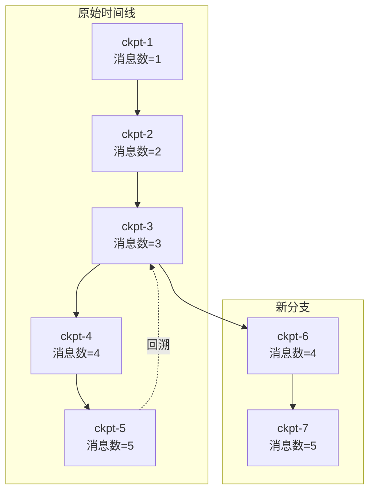

## 一、ReAct Agent：让大模型学会"边想边做"(重点)
### 1.1 一句话理解 ReAct
ReAct = **Reasoning（推理）+ Acting（行动）**。说白了就是让 LLM 不再"一条直线走到黑"，而是在一个循环里反复做三件事：

<!-- 这是一个文本绘图，源码为：graph LR
    U[👤 用户输入] --> T[🧠 Think<br/>推理当前状况]
    T --> D{需要调用工具?}
    D -->|是| A[🔧 Act<br/>执行工具调用]
    A --> O[👁️ Observe<br/>观察工具返回]
    O --> T
    D -->|否| F[✅ 输出最终答案] -->


这个循环看着简单，但它是 Agent 区别于"一次性问答"的核心差异。传统的 LLM 调用是：**用户问 → 模型答**，一锤子买卖。而 ReAct Agent 是：**用户问 → 模型想 → 调工具 → 看结果 → 再想 → 可能再调工具 → ... → 最终答**。

> **关键洞察**：Agent 的能力上限，很大程度上取决于你给了它什么工具。模型本身只负责"推理该用哪个工具、什么时候该停"，真正的执行能力来自工具链。
>

### 1.2 一个经典的翻车现场
见过 Agent 死循环的兄弟都知道，最常见的翻车姿势是这样的：

```plain
翻译 PDF → 拿到翻译结果 → 又把翻译结果当成"待翻译内容" → 再翻译一遍 → 无限循环...
```

新手的第一反应往往是："加个最大重试次数不就行了？"

**这治标不治本。** 真正的问题出在 **Think 步骤缺失**——Agent 在 Observe 之后没有停下来判断"我是不是已经做完了？"，而是机械地又跳回了 Act。

<!-- 这是一个文本绘图，源码为：graph TD
    subgraph 错误循环
        A1[📄 翻译 PDF] --> B1[📝 拿到译文]
        B1 -->|❌ 没有 Think| A1
    end
    subgraph 正确流程
        A2[📄 翻译 PDF] --> B2[📝 拿到译文]
        B2 --> C2[🤔 Think: 翻译完成了吗?]
        C2 -->|✅ 是| D2[输出结果]
        C2 -->|❌ 否| A2
    end -->


记住这个原则：**Think 决定"做什么"，重试上限决定"做多久"。两者各司其职，谁也不能替代谁。** 如果你的 Agent 频繁死循环，先检查 prompt 里的停止条件是否清晰，再考虑加工程上的兜底。

### 1.3 搭建第一个 ReAct Agent
理论聊完，直接写代码。我们做一个**天气+计算助手**——只有两个工具，代码不到 60 行，但完整展示了 Think → Act → Observe 循环的真实运行过程。

**场景设定**：用户问"北京天气怎么样？顺便帮我算一下 356×128"。Agent 需要自己判断：这涉及两个不同的工具，先调哪个？查完天气后还要不要继续调计算器？

```python
import os
from langchain_openai import ChatOpenAI
from langchain_core.tools import tool
from langchain.agents import create_agent

# ============================================================
# 第一步：初始化模型
# ============================================================
model = ChatOpenAI(
    model_name="deepseek-chat",
    api_key=os.getenv("DEEPSEEK_API_KEY"),
    base_url="https://api.deepseek.com"
)


# ============================================================
# 第二步：定义工具（只有两个，一清二楚）
# docstring 就是给模型的"使用说明书"
# ============================================================

@tool
def get_weather(city: str) -> str:
    """查询指定城市的实时天气。

    当用户问"某地天气怎么样"、"热不热"、"要不要带伞"时调用。

    Args:
        city: 城市名称，例如"北京"、"上海"、"深圳"
    """
    # 模拟天气数据（实际项目中对接真实天气 API）
    weather_db = {
        "北京": "☀️ 晴天，32°C，湿度 45%，适合出行",
        "上海": "🌧️ 小雨，28°C，湿度 80%，建议带伞",
        "深圳": "⛅ 多云，30°C，湿度 65%",
    }
    return weather_db.get(city, f"抱歉，暂无「{city}」的天气数据")


@tool
def calculator(expression: str) -> str:
    """执行数学计算，支持加减乘除和括号。

    当用户说"帮我算"、"等于多少"、"计算一下"时调用。

    Args:
        expression: 数学表达式，例如 "128 * 456"、"2 ** 10"、"(88 + 12) / 5"
    """
    try:
        result = eval(expression)
        return f"🧮 {expression} = {result}"
    except Exception as e:
        return f"❌ 计算出错：{e}"


# ============================================================
# 第三步：组装 Agent
# create_agent 内部自动构建了 Think→Act→Observe 循环
# ============================================================
tools = [get_weather, calculator]

agent = create_agent(
    model=model,
    tools=tools,
    system_prompt=(
        "你是一个热心肠的生活助手，会查天气、会做算术。\n"
        "规则：\n"
        "1. 用户问天气 → 调用 get_weather。\n"
        "2. 用户要计算 → 调用 calculator。\n"
        "3. 一个请求涉及多个工具时，逐个调用，每次观察结果后再决定下一步。\n"
        "4. 闲聊类的问候直接回答，不用调工具。"
    ),
)

# ============================================================
# 第四步：运行 Agent
# ============================================================
response = agent.invoke({
    "messages": [
        {"role": "user", "content": "北京今天天气怎么样？顺便帮我算一下 356 × 128"}
    ]
})

print(response["messages"][-1].content)
```

执行上面这段代码，Agent 的**实际思考过程**如下：

```plain
第1轮 — Think: 用户问了天气和计算，先查天气
       Act:  调用 get_weather("北京")
       Observe: "☀️ 晴天，32°C，湿度 45%，适合出行"

第2轮 — Think: 天气查完了，还有计算任务没做
       Act:  调用 calculator("356 * 128")
       Observe: "🧮 356 * 128 = 45568"

第3轮 — Think: 两个任务都完成，汇总输出
       → ✅ 最终答案（无需再调工具，循环结束）
```

把这个过程画成流程图，ReAct 的"边想边做"一目了然：

<!-- 这是一个文本绘图，源码为：graph TD
    U(["👤 用户输入<br/>查天气 + 算数学"]) --> T1["🧠 Think 第1轮<br/>两个任务，先查天气"]
    T1 --> A1["🔧 Act<br/>get_weather('北京')"]
    A1 --> O1["👁️ Observe<br/>晴天 32°C"]
    O1 --> T2["🧠 Think 第2轮<br/>天气 OK，还剩计算"]
    T2 --> A2["🔧 Act<br/>calculator('356*128')"]
    A2 --> O2["👁️ Observe<br/>结果 = 45568"]
    O2 --> T3["🧠 Think 第3轮<br/>全部完成！"]
    T3 --> F(["✅ 输出最终答案"])

    style U fill:#e3f2fd,stroke:#1976d2
    style T1 fill:#fff3e0,stroke:#f57c00
    style T2 fill:#fff3e0,stroke:#f57c00
    style T3 fill:#fff3e0,stroke:#f57c00
    style A1 fill:#e8f5e9,stroke:#388e3c
    style A2 fill:#e8f5e9,stroke:#388e3c
    style O1 fill:#fce4ec,stroke:#c2185b
    style O2 fill:#fce4ec,stroke:#c2185b
    style F fill:#c8e6c9,stroke:#2e7d32 -->


提炼成通用模式，就是这张经典的 **Think → Act → Observe 循环图**：

<!-- 这是一个文本绘图，源码为：graph LR
    U[👤 用户输入] --> T[🧠 Think<br/>推理当前状况]
    T --> D{需要调用工具?}
    D -->|是| A[🔧 Act<br/>执行工具调用]
    A --> O[👁️ Observe<br/>观察工具返回]
    O --> T
    D -->|否| F[✅ 输出最终答案] -->


> **一句话总结 ReAct**：每一步都先想、再做、再看，三件事反复循环，直到模型判断"可以交差了"才停下来。这也是 Agent 区别于"一次性问答"的核心差异。
>

> **小提示**：`create_agent` 是 LangChain 提供的一键封装（底层基于 LangGraph 运行时）。如果你想手动搭图（后面会讲到），本质上就是把 Think→Act→Observe 分别映射成图中的节点，用条件边把它们串成一个循环。
>

### 1.4 可视化图结构
LangGraph 的一大爽点是能把图结构直接渲染出来，看一眼就知道 Agent 内部是怎么流转的：

```python
from IPython.display import Image, display

# draw_mermaid_png() 生成 Mermaid 格式的流程图 PNG
display(Image(agent.get_graph().draw_mermaid_png()))
```

<!-- 这是一张图片，ocr 内容为： -->


如果你在笔记本里运行，会看到一张清晰的流程图——通常包含一个 LLM 节点（Think）、一个工具节点（Act），以及连接两者的条件边（Observe 后判断是否继续）。

---

## 二、Plan-and-Execute：给 Agent 一张地图(重点)
第一部分我们搭了一个能用的 ReAct Agent，它能处理"查天气+算数学"这种简单指令。但如果用户的需求变成了下面这种——

> "帮我调研一下 2025 年国内主流代码助手工具（通义灵码、文心快码、CodeGeeX），从代码补全准确率、支持语言、价格三个维度做对比，最后给出选型建议。"
>

ReAct 还能应付吗？能是能，但过程会非常狼狈。这一节我们就来看看**专门为多步骤复杂任务设计的 Plan-and-Execute 模式**。

### 2.1 ReAct 的"近视眼"毛病
ReAct 的工作方式很直觉：思考一步 → 调个工具 → 拿到结果 → 再思考下一步 → ……循环到出结果。

这很像一个**没有导航的司机**，走到每个路口才临时决定左转还是右转。对于"今天北京天气怎么样"这种一问一答的任务，ReAct 完全够用。但碰上多步骤、有依赖关系的任务，短板就暴露了——它可能在第一步搜了工具 A 的信息就急着写结论，写到一半才发现工具 B 的数据还没查，于是回头再搜，最后拼出一个逻辑割裂的结果。

**Plan-and-Execute** 正是为了解决这类问题而生的。

### 2.2 两种范式的本质区别
<!-- 这是一个文本绘图，源码为：flowchart LR
    subgraph ReAct["ReAct 模式"]
        R1["思考"] --> R2["行动"] --> R3["观察"] --> R4["思考"] --> R5["行动"] --> R6["观察"] --> R7["..."]
    end

    subgraph PnE["Plan-and-Execute 模式"]
        P1["📋 全局规划"] --> P2["⚙️ 逐步执行"] --> P3["🔍 审视结果"] --> P4{"需要调整?"}
        P4 -->|"是"| P1
        P4 -->|"否"| P5["✅ 输出最终答案"]
    end -->


| 对比维度 | ReAct | Plan-and-Execute |
| --- | --- | --- |
| **决策粒度** | 一次想一步 | 先出完整计划，再分批执行 |
| **全局视野** | 弱，容易在中间步骤迷路 | 强，计划阶段就梳理了全貌 |
| **纠错方式** | 靠下一步"补救"上一步 | 执行后整体审视，必要时重规划 |
| **模型策略** | 全程用同一模型 | 规划用强模型，执行可以用小模型 |
| **适用场景** | 简单问答、单步工具调用 | 多步推理、调研报告、数据处理流水线 |


这个表格里最值得展开的是**大小模型分工**。规划阶段需要强的推理能力，用 DeepSeek V4 或 Qwen-Max 来出计划；执行阶段任务明确，完全可以换成 Qwen-Turbo 甚至更轻量的模型来省钱。这是 ReAct 做不到的——它的每一步都可能涉及方向性决策，没办法把"决策"和"执行"拆开。

### 2.3 整体架构：三个角色一台戏
Plan-and-Execute 在 LangGraph 中的实现，本质上是由三个核心节点组成的状态图：

<!-- 这是一个文本绘图，源码为：stateDiagram-v2
    [*] --> Planner: 用户输入
    Planner --> Executor: 生成步骤计划
    Executor --> Replanner: 完成当前步骤
    Replanner --> Executor: 计划需要继续
    Replanner --> [*]: 直接回复用户

    note right of Planner: 大模型分析任务\n输出步骤列表
    note right of Executor: ReAct Agent\n按计划执行单步
    note right of Replanner: 检查进度\n决定继续还是结束 -->


+ **Planner（规划器）**：接收用户原始需求，输出一串有序的执行步骤。这是"动脑子"的环节。
+ **Executor（执行器）**：拿到规划的第一步，当作独立任务去执行。它本身通常就是一个 ReAct Agent。
+ **Replanner（重规划器）**：审视已完成的步骤和剩余计划，判断"还需要继续吗"或者"计划需要调整吗"。

下面我们一步步把这个模式实现出来。

<!-- 这是一张图片，ocr 内容为： -->


<!-- 这是一张图片，ocr 内容为： -->


### 2.4 环境准备
先装好依赖。这里用通义千问作为规划模型，Tavily 做联网搜索工具——都是国内可以直接用的服务：

```bash
pip install -U langgraph langchain-core langchain-community tavily-python -i https://pypi.tuna.tsinghua.edu.cn/simple
```

```python
import os
import operator
from typing import Annotated, List, Tuple, TypedDict, Union, Literal

from langchain_community.tools.tavily_search import TavilySearchResults
from langchain_community.chat_models import ChatTongyi
from langchain_core.prompts import ChatPromptTemplate
from langchain.agents import create_agent
from pydantic import BaseModel, Field

#https://tavily.com/
#uv pip install tavily-python -i https://pypi.tuna.tsinghua.edu.cn/simple

# ---- 配置区：请替换为你自己的 Key ----
os.environ["TAVILY_API_KEY"] = "your-tavily-key-here"
DASHSCOPE_API_KEY = "your-dashscope-key-here"
```

### 2.5 工具与执行 Agent
Executor 需要一个能干活的小弟——这里用一个带搜索能力的 ReAct Agent 来扮演这个角色：

```python
# 初始化搜索工具，max_results 控制每次搜索返回的条数
search_tool = TavilySearchResults(max_results=3)
tools = [search_tool]

# 规划阶段用推理能力强的 Qwen-Max
planner_llm = ChatTongyi(
    model="qwen-max",
    temperature=0.1,          # 低温度保证规划稳定
    api_key=DASHSCOPE_API_KEY,
)

# 执行阶段可以用更经济的模型，这里用 Qwen-Plus
executor_llm = ChatTongyi(
    model="qwen-plus",
    temperature=0.01,
    api_key=DASHSCOPE_API_KEY,
)

# 创建执行 Agent—— 它就是一个标准的 ReAct Agent
executor_agent = create_agent(
    model=executor_llm,
    tools=tools,
    system_prompt="你是一个执行力很强的助手。请根据给定的任务步骤，准确完成并给出结果。",
)
```

> **选模型的小建议**：如果你的执行步骤特别多且对成本敏感，`qwen-plus` 可以换成 `qwen-turbo`，甚至换成本地部署的 Qwen2.5-7B。DeepSeek 的 `deepseek-chat` 也是性价比很高的选择。
>

### 2.6 状态设计：Graph 的"共享内存"
在 LangGraph 里，所有节点之间的数据传递都靠一个状态字典。我们先把它长什么样定义清楚：

```python
class PlanExecute(TypedDict):
    """贯穿整个工作流的状态对象"""
    input: str                                              # 用户原始输入
    plan: List[str]                                         # 当前计划步骤列表
    # past_steps 用 operator.add 做累加——每次节点返回新步骤时自动追加到历史
    past_steps: Annotated[List[Tuple[str, str]], operator.add]
    response: str                                           # 最终回复（非空时流程结束）


class Plan(BaseModel):
    """规划器输出的结构化计划"""
    steps: List[str] = Field(
        description="需要顺序执行的步骤列表，每一步必须独立且包含完整上下文"
    )


class Response(BaseModel):
    """直接回复用户的内容"""
    response: str


class Act(BaseModel):
    """
    重规划器的决策输出——要么回复用户，要么给出更新后的计划。
    用 Union 类型确保一次只走一条分支。
    """
    action: Union[Response, Plan] = Field(
        description="如果任务已完成，返回 Response；如果还需要继续，返回 Plan"
    )
```

这里有一个容易被忽略的细节：`past_steps` 的类型标注了 `Annotated[List[Tuple], operator.add]`。这是 LangGraph 的约定——`operator.add` 意味着每次节点返回 `{"past_steps": [...]}` 时，LangGraph 不会用新值**覆盖**旧值，而是把新旧列表**拼接**起来。这样过去的每一步都被自动保留了下来。

### 2.7 规划器：把大任务拆成小步骤
```python
# 规划器的系统提示——核心是"拆得合理、不越界"
planner_prompt = ChatPromptTemplate.from_messages([
    (
        "system",
        """你是一个擅长任务分解的规划专家。对于用户提出的目标，请将其拆解为顺序执行的步骤列表。

规则：
1. 每一步必须自包含——执行者不需要上下文就能理解这步要做什么
2. 不要添加无关步骤，最后一步的结果应该直接导向最终答案
3. 优先使用中文描述步骤
4. 步骤数量控制在 3~6 步，过少说明拆分不到位，过多说明混入了无关操作""",
    ),
    ("placeholder", "{messages}"),
])

# 将提示词模板和 LLM 拼成一条链，with_structured_output 让 LLM 直接输出 Plan 对象
planner_chain = planner_prompt | planner_llm.with_structured_output(Plan)


def plan_step(state: PlanExecute) -> dict:
    """规划节点：分析用户原始输入，生成执行计划"""
    result = planner_chain.invoke({"messages": [("user", state["input"])]})
    return {"plan": result.steps}
```

试试规划器的效果：

```python
result = planner_chain.invoke({
    "messages": [(
        "user",
        "帮我调研一下2025年国内主流代码助手工具（通义灵码、文心快码、CodeGeeX），"
        "从代码补全准确率、支持语言、价格三个维度做对比，最后给出选型建议。"
    )]
})

for i, step in enumerate(result.steps, 1):
    print(f"  Step {i}: {step}")
```

输出大致会是这样：

```plain
  Step 1: 搜索通义灵码在代码补全准确率、支持语言、价格方面的信息
  Step 2: 搜索文心快码在代码补全准确率、支持语言、价格方面的信息
  Step 3: 搜索 CodeGeeX 在代码补全准确率、支持语言、价格方面的信息
  Step 4: 将三家工具的信息整理为对比表格
  Step 5: 基于对比表格，撰写 300 字以内的选型建议
```

### 2.8 执行器：一次只干一件事
执行器的逻辑很简单——取计划的**第一条**，告诉 Agent "按这个计划行事，先做第一步"：

```python
def execute_step(state: PlanExecute) -> dict:
    """
    从当前计划中取出第一步，交给执行 Agent 去跑。
    执行完后把 (步骤描述, 执行结果) 追加到 past_steps。
    """
    plan = state["plan"]

    # 把完整计划格式化，让 Agent 知道"我在做什么、后面还有什么"
    plan_overview = "\n".join(f"  {i+1}. {step}" for i, step in enumerate(plan))
    current_task = plan[0]  # 只取第一步

    # 拼装给 Agent 的指令：先展示全貌，再指定当前任务
    task_prompt = f"""以下是完整的执行计划：
{plan_overview}

现在请你只执行第 1 步，不要做后续步骤：
  → {current_task}

请直接给出这一步的执行结果，不要啰嗦。"""

    agent_result = executor_agent.invoke({
        "messages": [("user", task_prompt)]
    })

    # 取 Agent 最后一条消息的内容作为这一步的产出
    step_output = agent_result["messages"][-1].content

    return {
        # 这一步走完后，计划需要弹出已执行的第一项——这个逻辑在 replan_step 里
        "past_steps": [(current_task, step_output)],
    }
```

### 2.9 重规划器：审视进度，决定去向
这是整个模式的"大脑"——根据已完成步骤的情况，判断是继续执行、更新计划、还是直接输出结果。

```python
replanner_prompt = ChatPromptTemplate.from_template("""
你是一个项目进度管控专家。根据以下信息，判断当前任务的状态并做出决策。

## 用户原始目标
{input}

## 原始计划
{plan}

## 已完成的步骤及结果
{past_steps}

## 决策规则
1. 如果所有步骤已完成且结果充分，直接给出最终答案（使用 Response）
2. 如果还有步骤未执行，返回更新后的计划（使用 Plan），注意：
   - 只保留尚未执行的步骤
   - 如果已完成步骤的结果表明原计划的后续步骤需要调整，直接修改
   - 不要返回已经做过的步骤
3. 如果某个步骤执行失败了，请在计划中补充重试或替代方案
""")

replanner_chain = replanner_prompt | planner_llm.with_structured_output(Act)


def replan_step(state: PlanExecute) -> dict:
    """审视执行进度，决定下一步走向"""
    output = replanner_chain.invoke(state)

    if isinstance(output.action, Response):
        # 任务完成，直接返回给用户
        return {"response": output.action.response}
    else:
        # 还有步骤要执行，更新计划列表
        return {"plan": output.action.steps}
```

### 2.10 装配与运行
```python
from langgraph.graph import StateGraph, START, END

# ---- 第一步：创建状态图，绑定状态类型 ----
workflow = StateGraph(PlanExecute)

# ---- 第二步：注册三个核心节点 ----
workflow.add_node("planner", plan_step)       # 规划节点
workflow.add_node("executor", execute_step)   # 执行节点
workflow.add_node("replanner", replan_step)   # 重规划节点

# ---- 第三步：编排边的流向 ----
workflow.add_edge(START, "planner")           # 入口 → 规划
workflow.add_edge("planner", "executor")      # 规划 → 执行
workflow.add_edge("executor", "replanner")    # 执行 → 重规划

# ---- 第四步：条件分支——重规划后走哪条路 ----
def should_continue(state: PlanExecute) -> Literal["executor", "__end__"]:
    """如果 response 字段非空，说明重规划器认为任务完成，结束流程"""
    if state.get("response"):
        return END
    return "executor"

workflow.add_conditional_edges("replanner", should_continue, {
    "executor": "executor",
    "__end__": END,
})

# ---- 编译 ----
app = workflow.compile()
```

整个图的流转逻辑一目了然：

<!-- 这是一个文本绘图，源码为：flowchart TD
    START((开始)) --> planner["🧠 Planner\n拆解任务 → 步骤列表"]
    planner --> executor["🔧 Executor\n执行当前第一步"]
    executor --> replanner["🔄 Replanner\n审视进度，做出决策"]
    replanner -->|"还有步骤"| executor
    replanner -->|"任务完成"| ENDN((结束)) -->


可视化（在 Jupyter 中可直接渲染）：

```python
from IPython.display import Image, display

# xray=True 会展示更多内部细节
display(Image(app.get_graph(xray=True).draw_mermaid_png()))
```

实际跑起来：

```python
inputs = {
    "input": (
        "帮我调研2025年国内三大代码助手工具（通义灵码、文心快码、CodeGeeX），"
        "从代码补全准确率、支持语言、价格三个维度做对比，最后给出选型建议。"
        "请用中文输出最终结果。"
    )
}

# stream 模式可以看到每一步的中间输出
for event in app.stream(inputs):
    for node_name, node_output in event.items():
        print(f"\n{'='*50}")
        print(f"📍 当前节点: {node_name}")
        # 避免打印太长的内容
        for key, value in node_output.items():
            if isinstance(value, str) and len(value) > 200:
                print(f"  {key}: {value[:200]}...")
            else:
                print(f"  {key}: {value}")
```

### 2.11 常见坑与取舍
**规划太粗糙 = 白规划**

如果 Planner 给出的步骤很模糊（比如 "搜索资料 → 整理 → 输出"），那 Plan-and-Execute 就退化成了 ReAct。关键在于让规划步骤粒度适中——每步有明确的输入输出边界。提示词里加一句"每一步必须自包含"能大幅改善这个问题。

**Replanner 的 prompt 是命门**

Replanner 如果 prompt 不够细致，容易出现两种问题：

+ **永远不结束**：它总觉得"还可以再完善"，于是不断生成新步骤
+ **过早结束**：第一步执行完就急着输出 Response，后面步骤被丢弃

解决办法是在 prompt 里明确列出结束条件（参考 2.9 的决策规则）。

**执行失败要能容错**

如果某一步执行失败（比如搜索 API 挂了），Executor 返回的结果可能是一段报错文本。Replanner 看到这个结果后应该能识别出"这步没成功"，并在新计划中加入重试或替代路径。在 Replanner 的 prompt 里补一条："如果某步骤的执行结果表明操作失败，请在计划中加入重试步骤或标注替代方案。"

**大小模型混用控成本**

Plan-and-Execute 天然支持这个：

+ **规划 + 重规划**用强模型（Qwen-Max / DeepSeek-V4）——需要全局判断
+ **执行**用小模型（Qwen-Turbo / DeepSeek-Chat）——执行单步不需要顶尖推理

**什么时候用 ReAct，什么时候用 Plan-and-Execute？**

| 适合 Plan-and-Execute | 适合 ReAct |
| --- | --- |
| 多步调研 / 报告生成 | 单轮问答 |
| 需要交叉对比多个信息源 | 简单工具调用（查天气、算汇率） |
| 有明确步骤依赖的任务 | 用户意图不确定，需要多轮澄清 |
| 需要在执行前做整体规划 | 实时交互，要求低延迟 |


一个简单的判断标准：**如果你自己对这个问题也要先在脑子里过一遍"先做什么再做什么"，那就用 Plan-and-Execute。**

---

## 三、流式处理：让 Agent 的输出"活"起来
第一节我们写了 `agent.invoke()` 来跑 ReAct Agent，上一节的 Plan-and-Execute 用的是 `app.stream()`。但不管是哪种 Agent 模式，你都得等整个循环全部跑完才能看到结果——这在聊天产品里是不可接受的。**流式处理（Streaming）** 解决的就是这个问题：数据一边产生、一边往外推。

LangGraph 提供了三种流式模式：

| 模式 | 返回内容 | 类比 |
| --- | --- | --- |
| `values` | 每个节点完成后，返回**完整的当前状态** | 每做完一步就拍一张全景快照 |
| `updates` | 每个节点完成后，只返回**该节点新增的内容** | 只告诉你"这一步变了什么" |
| `messages` | 逐 Token 流式输出 LLM 的回复内容 | ChatGPT 那种一个字一个字往外蹦 |


> **注意**：这三种模式对 ReAct Agent 和 Plan-and-Execute Agent 都适用。下面以 ReAct Agent 为例演示，你完全可以替换成上一节编译好的 `app`。
>

### 3.1 模式一：values —— 全量状态流
```python
# ============================================================
# stream_mode="values"
# 每次迭代拿到的是图的完整状态（messages 的完整列表）
# 适合需要"每步都有完整上下文"的场景，比如调试、审计日志
# ============================================================

# 沿用第一节的 agent 和 tools，直接调用 .stream()
inputs = {"messages": [("human", "帮我查一下上海天气，再算算 999 除以 37 等于多少")]}

for chunk in agent.stream(inputs, stream_mode="values"):
    # chunk 是一个 dict，key 为 "messages"，value 是截至目前所有消息的完整列表
    last_msg = chunk["messages"][-1]
    # pretty_print() 会根据消息类型（人类/AI/工具）用不同颜色格式化输出
    last_msg.pretty_print()
    print("---")  # 分隔符，方便看到每次迭代的边界
```

**输出节奏大概是这样的：**

```plain
第 1 次迭代 → AI 决定调用 get_weather（含 tool_calls）
第 2 次迭代 → 工具返回结果 + AI 判断还需要调用 calculator
第 3 次迭代 → AI 输出最终回答（不含 tool_calls，循环结束）
```

每次迭代你拿到的都是**从对话开始到当前步骤的完整消息历史**。对于需要把中间状态完整记录下来的场景（比如合规审计）非常有用。

### 3.2 模式二：updates —— 增量更新流
```python
# ============================================================
# stream_mode="updates"
# 只返回本轮节点产生的新内容，不是全量
# 适合需要"追踪每个节点的输入输出"的场景，比如调试工具调用
# ============================================================

inputs = {"messages": [("human", "深圳天气怎么样？顺便帮我算一下 (88 + 12) × 5")]}

for chunk in agent.stream(inputs, stream_mode="updates"):
    # chunk 的结构：{ 节点名称: 该节点本次产出的数据 }
    # 例如 {"agent": {...}} 或 {"tools": {...}}
    for node_name, node_output in chunk.items():
        print(f"📍 节点: {node_name}")
        print(f"📤 产出: {node_output}")
        print("=" * 40)
```

**和 **`values`** 的核心区别**：`values` 给你完整历史，`updates` 只给你增量 diff。打个比方——`values` 是每次 commit 后的完整代码库快照，`updates` 是每次 commit 的 diff。

### 3.3 模式三：messages —— 逐 Token 打字机
```python
# ============================================================
# stream_mode="messages"
# 最细粒度的流式：LLM 每生成一个 token，你就能拿到它
# 适合聊天 UI 那种"一个字一个字往外蹦"的打字机效果
# ============================================================

inputs = {"messages": [("human", "简单介绍一下敏捷开发中的每日站会")]}

for chunk in agent.stream(inputs, stream_mode="messages"):
    # chunk 是一个元组：(message_obj, metadata_dict)
    message, metadata = chunk

    # 关键：message.content 可能为空字符串
    # （比如工具调用的内部消息不产生可见文本）
    # 所以必须判断 content 是否有值再打印
    if message.content:
        # end="" 不换行，flush=True 立即刷新缓冲区 → 打字机效果
        print(message.content, end="", flush=True)

print()  # 最后补一个换行
```

**运行效果**：你会看到文字像 ChatGPT 那样逐字出现，而不是等 3 秒一口气刷出一大段。

> **注意**：`stream_mode="messages"` 返回的 chunk 里有时 `content` 是空字符串——这不是 bug。某些内部消息（比如工具调用的参数传递）不会产生面向用户的文本。所以那句 `if message.content:` 不是可选的，是必须的。
>

### 3.4 三种模式速查表
<!-- 这是一个文本绘图，源码为：graph TD
    subgraph values[values 模式]
        direction LR
        V1["节点1 完成"] --> V2["返回: 消息1"]
        V2 --> V3["节点2 完成"]
        V3 --> V4["返回: 消息1 + 消息2"]
        V4 --> V5["节点3 完成"]
        V5 --> V6["返回: 消息1 + 消息2 + 消息3"]
    end

    subgraph updates[updates 模式]
        direction LR
        U1["节点1 完成"] --> U2["返回: 消息1"]
        U2 --> U3["节点2 完成"]
        U3 --> U4["返回: 消息2"]
        U4 --> U5["节点3 完成"]
        U5 --> U6["返回: 消息3"]
    end

    subgraph messages[messages 模式]
        direction LR
        M1["LLM 生成中"] --> M2["返: '今'"]
        M2 --> M3["返: '天'"]
        M3 --> M4["返: '天'"]
        M4 --> M5["返: '气'"]
        M5 --> M6["...逐 token 返回..."]
    end -->


| 场景 | 推荐模式 | 理由 |
| --- | --- | --- |
| 调试 Agent 决策过程 | `updates` | 能清晰看到每个节点做了什么 |
| 合规审计 / 全链路日志 | `values` | 每步都有完整上下文 |
| 聊天 UI / 实时展示 | `messages` | 打字机效果，用户体验最佳 |
| 后端 API 返回 | `values` 或 `updates` | 不需要逐 token，一次返回效率更高 |


---

## 四、断点与人工介入：给 Agent 装上"刹车"(重点)
流式输出解决了"等太久"的问题，但还有一个更根本的需求：**在执行到关键步骤之前，让 Agent 停下来等人确认。**

这在生产环境里几乎是个刚需——比如：

+ 发送邮件前需要人工审核内容
+ 执行数据库变更前需要 DBA 确认
+ 调用付费 API 前需要二次确认预算（Plan-and-Execute 的执行阶段尤其适用）

LangGraph 通过 **checkpoint（检查点）+ interrupt（断点）** 机制来支持这类场景。

### 4.1 基础断点：interrupt_before 与 interrupt_after
断点有两种设置方式：

+ `interrupt_before=["节点名"]` — 在指定节点**执行之前**暂停
+ `interrupt_after=["节点名"]` — 在指定节点**执行之后**暂停

它们依赖于 **MemorySaver**（内存检查点存储器），每次节点执行完都会自动保存一次状态快照。

**场景**：做一个简单的三步处理流水线，在最后一步（发送通知）之前暂停，等待人工确认。

```python
from typing import TypedDict
from langgraph.graph import StateGraph, START, END
from langgraph.checkpoint.memory import MemorySaver


# ============================================================
# 定义状态结构 —— 贯穿所有节点的"共享内存"
# ============================================================
class PipelineState(TypedDict):
    content: str      # 要处理的内容
    step_log: str     # 记录每一步的日志


# ============================================================
# 三个处理节点：采集 → 清洗 → 发送
# ============================================================
def step_collect(state: PipelineState) -> dict:
    """模拟数据采集：从上游拿到原始数据"""
    print("📥 [采集] 正在拉取数据...")
    return {
        "content": "原始用户反馈数据（含噪声）",
        "step_log": state.get("step_log", "") + "\n→ 采集完成",
    }


def step_clean(state: PipelineState) -> dict:
    """模拟数据清洗：去噪、去重、格式化"""
    print("🧹 [清洗] 正在处理数据...")
    return {
        "content": "用户反馈：希望增加夜间模式功能（已清洗）",
        "step_log": state["step_log"] + "\n→ 清洗完成",
    }


def step_notify(state: PipelineState) -> dict:
    """模拟通知发送：把结果推送给产品经理"""
    print("📨 [通知] 正在推送结果...")
    return {
        "step_log": state["step_log"] + "\n→ 通知已发送",
    }


# ============================================================
# 构建图
# ============================================================
builder = StateGraph(PipelineState)
builder.add_node("collect", step_collect)
builder.add_node("clean", step_clean)
builder.add_node("notify", step_notify)

# 连线：START → collect → clean → notify → END
builder.add_edge(START, "collect")
builder.add_edge("collect", "clean")
builder.add_edge("clean", "notify")
builder.add_edge("notify", END)

# 编译时设置断点：在 notify 节点执行前暂停
# 同时必须传入 checkpointer，不然中断后没法恢复
memory = MemorySaver()
graph = builder.compile(
    checkpointer=memory,
    interrupt_before=["notify"],  # 👈 关键：在发送通知前等人确认
)
```

图的执行流程：

<!-- 这是一个文本绘图，源码为：graph LR
    S[START] --> A[collect<br/>数据采集]
    A --> B[clean<br/>数据清洗]
    B --> C[🛑 断点<br/>等待确认]
    C -->|用户确认| D[notify<br/>发送通知]
    D --> E[END]
    C -->|用户取消| F[终止执行] -->


```python
# ============================================================
# 第一段执行：跑到断点自动暂停
# ============================================================
config = {"configurable": {"thread_id": "pipeline-001"}}
initial_input = {"content": "", "step_log": ""}

print("=" * 50)
print("开始执行流水线...")
print("=" * 50)

for event in graph.stream(initial_input, config, stream_mode="values"):
    print(f"当前步骤日志: {event.get('step_log', '无')}")

# 此时 graph 在 notify 节点前自动停住了
# 控制权交还给开发者——你可以在这里做任何检查

print("\n🛑 流水线已在「发送通知」前暂停。")

# ============================================================
# 人工确认环节
# ============================================================
user_approval = input(">>> 数据已清洗完毕，是否发送通知？(yes/no): ")

if user_approval.lower() == "yes":
    # 传入 None 表示"没有新输入，从断点继续跑"
    print("\n✅ 用户批准，继续执行...")
    for event in graph.stream(None, config, stream_mode="values"):
        print(f"当前步骤日志: {event.get('step_log', '无')}")
else:
    print("\n❌ 用户取消，流水线终止。")
```

执行这段代码，你会发现程序在采集和清洗完成后自动停下，弹出 `input()` 等你打字。输入 `yes` 才继续往下走——这就是最基础但最实用的 Human-in-the-Loop。

### 4.2 断点处修改消息：偷天换日
有时候"暂停 + 确认"还不够，你需要在断点处**修改 Agent 的内部状态**再继续。比如：

+ Agent 调了一个工具但参数不对，你想在工具实际执行前纠正参数
+ Agent 生成了一段文案但你不太满意，想在它发出去之前改一版

下面演示一个更真实的场景：Agent 尝试调工具，我们在工具执行前拦截、修改参数。

```python
from langchain_core.messages import ToolMessage, AIMessage
from langgraph.prebuilt import ToolNode, tools_condition
from typing import Annotated
from operator import add


# ============================================================
# 定义工具：模拟向外部系统发送消息
# ============================================================
@tool
def send_message(channel: str, content: str) -> str:
    """向指定渠道发送消息。

    Args:
        channel: 发送渠道，"wechat"（企业微信）、"email"（邮件）、"sms"（短信）
        content: 消息正文内容
    """
    # 实际生产环境这里会调飞书/钉钉/企微的 API
    return f"📨 已通过 {channel} 发送：{content}"


tools = [send_message]

# 模型绑定工具
model_with_tools = ChatOpenAI(
    model_name="deepseek-chat",
    api_key=os.getenv("DEEPSEEK_API_KEY"),
    base_url="https://api.deepseek.com",
).bind_tools(tools)


# ============================================================
# 定义状态
# ============================================================
class MsgState(TypedDict):
    messages: Annotated[list, add]   # add 表示追加而非覆盖


# ============================================================
# 定义节点
# ============================================================
def chatbot_node(state: MsgState) -> dict:
    """LLM 推理节点：决定是否调工具、调哪个工具"""
    response = model_with_tools.invoke(state["messages"])
    return {"messages": [response]}


# 工具执行节点（LangGraph 内置）
tool_node = ToolNode(tools=tools)


# ============================================================
# 构建图：chatbot → 条件判断 → tools → chatbot（循环）
# ============================================================
builder = StateGraph(MsgState)
builder.add_node("chatbot", chatbot_node)
builder.add_node("tools", tool_node)

builder.set_entry_point("chatbot")
builder.add_conditional_edges(
    "chatbot",
    tools_condition,           # 内置函数：有 tool_calls → "tools"，否则 → END
    {"tools": "tools", "__end__": END},
)
builder.add_edge("tools", "chatbot")

# 编译 + 断点：在工具节点执行前暂停
memory = MemorySaver()
graph = builder.compile(
    checkpointer=memory,
    interrupt_before=["tools"],  # 👈 工具实际调用前拦截
)
```

上图的流转逻辑：

<!-- 这是一个文本绘图，源码为：graph TD
    S[START] --> CB[chatbot<br/>LLM 推理]
    CB --> TC{有 tool_calls?}
    TC -->|有| BRK[🛑 interrupt_before<br/>等待人工检查]
    BRK -->|继续| T[tools<br/>执行工具]
    T --> CB
    TC -->|无| E[END] -->


```python
# ============================================================
# 运行 + 断点拦截
# ============================================================
config = {"configurable": {"thread_id": "msg-001"}}
inputs = {"messages": [("human", "把这条消息通过企业微信发给全员：明天下午3点开会")]}

print("▶️ 第一段：Agent 推理...")
for chunk in graph.stream(inputs, config=config, stream_mode="updates"):
    print(chunk)
    print("-" * 40)

# ============================================================
# 在断点处检查当前状态
# ============================================================
snapshot = graph.get_state(config)

# 看看最后一条消息是什么（应该是 AIMessage，包含 tool_calls）
print("\n📌 最后一条消息：")
print(snapshot.values["messages"][-1])

# 看看下一步要去哪
print(f"\n📍 下一步: {snapshot.next}")  # 应该输出 ('tools',)

# ============================================================
# 场景：人工修改消息内容
# 假设我们发现 Agent 选错了渠道或者内容需要调整
# ============================================================
last_msg = snapshot.values["messages"][-1]

# 构造一个 ToolMessage 告诉 Agent"不需要调工具了，直接回答"
# tool_call_id 必须和原始 tool_call 的 id 匹配
override_msg = ToolMessage(
    content="已确认：消息内容无误，渠道改为邮件发送，直接告知用户已发送即可。",
    tool_call_id=last_msg.tool_calls[0]["id"],
)

# update_state 将人工消息注入到图状态中
# 这样下次执行时 Agent 会看到这条 ToolMessage，认为工具已经"执行过了"
graph.update_state(config, {"messages": [override_msg]})

# ============================================================
# 从断点继续执行
# ============================================================
print("\n▶️ 第二段：注入修正后继续...")
for chunk in graph.stream(None, config=config, stream_mode="values"):
    chunk["messages"][-1].pretty_print()
    print("-" * 40)
```

这里的核心技巧是 `graph.update_state()`——它让你在断点处像外科手术一样精确修改图状态。你可以改消息内容、替换参数、甚至直接注入一个"假的"工具返回结果来引导 Agent 走不同的分支。

### 4.3 设计人工节点：规范的 Human-in-the-Loop
上一节的方式适合"临时救急"，但如果你有一套规范的审批流程（比如所有外部通信都要经人工确认），更好的做法是**直接在图中设计一个人工节点**。

```python
from typing import Annotated
from typing_extensions import TypedDict
from langgraph.graph.message import add_messages


# ============================================================
# 工具定义
# ============================================================
@tool
def search_docs(query: str) -> str:
    """在内部文档库中搜索相关内容。

    Args:
        query: 搜索关键词或问题
    """
    # 模拟文档搜索
    return f"🔍 关于「{query}」的搜索结果：找到 3 篇相关文档..."


@tool
def escalate_to_human(request: str) -> str:
    """当你无法准确回答、或者用户明确要求人工服务时，
    将请求升级给人工专家处理。

    调用此工具后，系统会自动将对话转接给值班专家。

    Args:
        request: 需要专家处理的完整请求描述
    """
    return f"📞 已转接人工专家：{request}"


tools = [search_docs, escalate_to_human]


# ============================================================
# 状态：比基础版多了一个 ask_human 标志位
# ============================================================
class SupportState(TypedDict):
    messages: Annotated[list, add_messages]
    ask_human: bool   # True = 需要人工介入


# ============================================================
# 模型
# ============================================================
llm = ChatOpenAI(
    model_name="deepseek-chat",
    api_key=os.getenv("DEEPSEEK_API_KEY"),
    base_url="https://api.deepseek.com",
)
llm_with_tools = llm.bind_tools(tools)


# ============================================================
# 节点 1：聊天机器人（自动决策）
# ============================================================
def chatbot(state: SupportState) -> dict:
    """核心推理节点：决定是搜索文档还是升级人工"""
    response = llm_with_tools.invoke(state["messages"])

    # 检查 LLM 是否调用了 escalate_to_human
    needs_human = bool(
        response.tool_calls
        and response.tool_calls[0]["name"] == "escalate_to_human"
    )
    return {"messages": [response], "ask_human": needs_human}


# ============================================================
# 节点 2：人工节点（等待人工输入）
# ============================================================
def human_node(state: SupportState) -> dict:
    """这个节点在 interrupt_before 暂停后由人工通过 update_state 填充结果。
    如果意外直接执行到此处（没人注入回复），则返回默认占位消息。
    """
    last_msg = state["messages"][-1]
    # 正常情况下，这个节点执行前会被 interrupt_before 拦截
    # 如果走到了这里，说明没有人工回复——给个兜底
    if not isinstance(last_msg, ToolMessage):
        return {
            "messages": [
                ToolMessage(
                    content="人工专家当前不在线，请稍后重试。",
                    tool_call_id=last_msg.tool_calls[0]["id"],
                )
            ],
            "ask_human": False,
        }
    return {"messages": [], "ask_human": False}


# ============================================================
# 路由函数：决定下一步去哪个节点
# ============================================================
def select_next_node(state: SupportState) -> str:
    """优先级：人工请求 > 工具调用 > 结束"""
    if state["ask_human"]:
        return "human_node"
    # tools_condition 是 LangGraph 内置函数
    # 有 tool_calls → "tools"，否则 → "__end__"
    return tools_condition(state)


# ============================================================
# 构建图
# ============================================================
builder = StateGraph(SupportState)
builder.add_node("chatbot", chatbot)
builder.add_node("tools", ToolNode(tools=[search_docs]))  # 只自动执行搜索，升级工具由人工节点处理
builder.add_node("human_node", human_node)

builder.set_entry_point("chatbot")

# 条件路由：chatbot 执行完后判断去向
builder.add_conditional_edges(
    "chatbot",
    select_next_node,
    {"tools": "tools", "human_node": "human_node", "__end__": END},
)
builder.add_edge("tools", "chatbot")        # 工具执行完 → 回到 chatbot 继续思考
builder.add_edge("human_node", "chatbot")   # 人工处理完 → 回到 chatbot 继续对话

memory = MemorySaver()
graph = builder.compile(
    checkpointer=memory,
    interrupt_before=["human_node"],  # 👈 人工节点执行前必须等人
)
```

<!-- 这是一个文本绘图，源码为：graph TD
    S[START] --> CB[chatbot<br/>LLM 推理决策]
    CB --> RT{路由判断}
    RT -->|搜索文档| T[tools<br/>自动搜索]
    T --> CB
    RT -->|升级人工| BRK[🛑 interrupt_before<br/>等待专家回复]
    BRK --> HN[human_node<br/>注入专家回复]
    HN --> CB
    RT -->|直接回答| E[END] -->


```python
# ============================================================
# 运行演示
# ============================================================
config = {"configurable": {"thread_id": "support-001"}}

# 用户问了一个复杂问题，Agent 判断需要升级人工
inputs = {"messages": [("user", "我们公司的服务器出现了大规模宕机，需要紧急排查原因")]}

print("▶️ Agent 自动处理中...")
for chunk in graph.stream(inputs, config, stream_mode="values"):
    chunk["messages"][-1].pretty_print()

# ---- 人工专家介入 ----
current_state = graph.get_state(config)
last_msg = current_state.values["messages"][-1]

print(f"\n📌 当前状态：下一步是 {current_state.next}")


```

```python
# 构造人工专家的真实回复（模拟专家排查后的结论）
expert_reply = ToolMessage(
    content="专家诊断结果：主数据库连接池耗尽，已重启数据库实例，服务正在恢复中。预计 5 分钟内完全恢复。",
    tool_call_id=last_msg.tool_calls[0]["id"],
)

# 以 human_node 的身份注入回复
# as_node="human_node" 告诉 LangGraph：这个状态更新"算作"human_node 节点的输出
# 这样继续执行时会跳过 human_node 的内部逻辑
graph.update_state(
    config,
    {"messages": [expert_reply], "ask_human": False},
    as_node="human_node",
)

print("\n▶️ 人工处理后继续...")
for chunk in graph.stream(None, config, stream_mode="values"):
    chunk["messages"][-1].pretty_print()
```

这款"人工节点"设计模式的核心要点：

1. `ask_human`** 标志位** 放在状态里，让路由函数能识别"这一轮需要人工"
2. `interrupt_before=["human_node"]` 确保图停住等人
3. `as_node="human_node"` 在注入时指定——这样 LangGraph 知道"这个节点的执行已完成"，恢复时直接跳过它

---

## 五、状态回溯：让 Agent 拥有"时光机"
### 5.1 Checkpoint 是怎么工作的
每次节点执行完毕，LangGraph 都会在 checkpointer 里存一份状态快照。这就像是打游戏时的自动存档——你可以随时回到之前的任何一个存档点，从那里重新开始。

关键概念：

+ **thread_id**：对话/会话的唯一标识，同一个 thread_id 共享一份 checkpoint 历史
+ **checkpoint_id**：每个快照的全局唯一 ID（UUID），类似存档点的编号
+ **get_state_history()**：遍历当前 thread 的所有历史快照

```python
from typing import Annotated
from typing_extensions import TypedDict
from langgraph.graph import StateGraph, START, END
from langgraph.graph.message import add_messages
from langgraph.checkpoint.memory import MemorySaver


# ============================================================
# 一个简单的计数器状态，每次经过节点 +1
# ============================================================
class CounterState(TypedDict):
    messages: Annotated[list, add_messages]
    step_count: int


def chatbot_node(state: CounterState) -> dict:
    """模拟 AI 节点的处理"""
    step = state["step_count"]
    return {
        "messages": [("assistant", f"🤖 AI 处理第 {step} 步")],
        "step_count": step + 1,
    }


def tool_node(state: CounterState) -> dict:
    """模拟工具节点的处理"""
    step = state["step_count"]
    return {
        "messages": [("system", f"🔧 工具执行第 {step} 步")],
        "step_count": step + 1,
    }


# ============================================================
# 构建图：chatbot → tools → chatbot → tools → ...（没有终点）
# 这是一个演示用的无限循环图，实际运行时会手动中断
# ============================================================
builder = StateGraph(CounterState)
builder.add_node("chatbot", chatbot_node)
builder.add_node("tools", tool_node)

builder.add_edge(START, "chatbot")
builder.add_edge("chatbot", "tools")
builder.add_edge("tools", "chatbot")   # 循环回 chatbot

graph = builder.compile(checkpointer=MemorySaver())
```

图中节点关系：

<!-- 这是一个文本绘图，源码为：graph LR
    S[START] --> CB[chatbot<br/>step +1]
    CB --> T[tools<br/>step +1]
    T --> CB -->


### 5.2 浏览历史状态
```python
# ============================================================
# 先执行几步，积累 checkpoint 历史
# ============================================================
config = {"configurable": {"thread_id": "demo-001"}}
inputs = {"messages": [("user", "开始处理")], "step_count": 1}

print("▶️ 执行前 4 步：")
for i, event in enumerate(graph.stream(inputs, config, stream_mode="values")):
    msgs = event.get("messages", [])
    if msgs:
        print(f"  步骤 {i}: {msgs[-1]}")
    if i >= 3:   # 执行 4 个节点后手动中断
        break

# ============================================================
# 遍历所有历史快照
# get_state_history() 返回快照列表，最新的在前面
# ============================================================
print("\n📜 历史快照列表：")
for snapshot in graph.get_state_history(config):
    msg_count = len(snapshot.values.get("messages", []))
    step = snapshot.values.get("step_count", "?")
    # checkpoint_id 是一个 UUID，全局唯一
    ckpt_id = snapshot.config["configurable"]["checkpoint_id"]
    print(f"  快照 {ckpt_id[:8]}... | 消息数: {msg_count} | 步数: {step}")
```

典型的输出如下：

```plain
📜 历史快照列表：
  快照 1a2b3c4d... | 消息数: 5 | 步数: 5
  快照 e5f6g7h8... | 消息数: 4 | 步数: 4
  快照 i9j0k1l2... | 消息数: 3 | 步数: 3
  快照 m3n4o5p6... | 消息数: 2 | 步数: 2
  快照 q7r8s9t0... | 消息数: 1 | 步数: 1
```

### 5.3 从任意快照恢复执行
```python
# ============================================================
# 找到消息数为 3 的快照，从那里"穿越回去"
# ============================================================
target_snapshot = None
for snapshot in graph.get_state_history(config):
    if len(snapshot.values["messages"]) == 3:
        target_snapshot = snapshot
        break

if target_snapshot is None:
    print("没找到消息数为 3 的快照")
else:
    print(f"⏪ 回溯到快照: {target_snapshot.config['configurable']['checkpoint_id'][:8]}...")
    print(f"   当前消息数: {len(target_snapshot.values['messages'])}")
    print(f"   当前步数: {target_snapshot.values['step_count']}")

    # 从目标快照的 config 继续执行
    # 注意这里传的是 target_snapshot.config，不是原来的 config
    print("\n▶️ 从回溯点继续执行 2 步：")
    for i, event in enumerate(
        graph.stream(None, target_snapshot.config, stream_mode="values")
    ):
        msgs = event.get("messages", [])
        if msgs:
            print(f"  新步骤 {i}: {msgs[-1]}")
        if i >= 1:
            break
```

回溯机制的执行示意：



> **注意**：回溯后产生的新快照（ckpt-6、ckpt-7）会创建一条**新分支**，原来的 ckpt-4 和 ckpt-5 不会消失。这个行为和 Git branch 非常像——你可以有多个并行的"时间线"。这个特性对 Plan-and-Execute 模式尤其有用：如果某次执行发现计划不合理，可以回到规划阶段重新来过，而不是从头跑。
>

---

## 总结
我们把 LangGraph Agent 开发的核心能力从头到尾串了一遍：

| 能力 | 一句话总结 | 关键 API |
| --- | --- | --- |
| ReAct Agent | LLM 在 Think → Act → Observe 循环中自主决策 | `create_agent()` |
| Plan-and-Execute | 先出完整计划，再分批执行，执行后审视调整 | Planner → Executor → Replanner 三节点图 |
| 流式输出 | 三种粒度看 Agent 运行过程 | `.stream(stream_mode=...)` |
| 断点暂停 | 关键步骤前刹车等人确认 | `interrupt_before` / `interrupt_after` |
| 状态注入 | 断点处精确修改 Agent 内部状态 | `graph.update_state()` |
| 人工节点 | 把人纳入图的一环 | 自定义 human_node + `interrupt_before` |
| 状态回溯 | 回到任意 checkpoint 重来 | `get_state_history()` + checkpoint config |


这些能力可以自由组合。比如你可以在 Plan-and-Execute 的执行节点加上 `interrupt_before`，让每个步骤执行前都经人工确认；也可以给 ReAct Agent 加上流式输出，用户在等待工具调用时能看到实时进度。

> **写完后的几点碎碎念：**
>
> 1. **Prompt 是 Agent 的灵魂**。代码搭得再花哨，prompt 写得模糊，Agent 该迷路还是迷路。花时间打磨 system_prompt 里的"停止条件"和"工具选择逻辑"，比加一百层工程兜底都管用。
> 2. **工具描述即文档**。`@tool` 的 docstring 是给模型看的，不是给人看的。写清楚"什么时候调用"比写清楚"内部怎么实现"重要十倍。
> 3. **先跑通再优化**。很多人一上来就搞并行执行、自定义 checkpoint 存储，结果连基本循环都跑不顺。先把 ReAct + Plan-and-Execute + streaming + 断点这几板斧练熟，其他都是锦上添花。
> 4. **选对范式比优化范式更重要**。如果一个任务你自己说得出"先做什么、再做什么"，别犹豫，直接用 Plan-and-Execute。如果用户意图模糊需要多轮对话澄清，ReAct 反而更灵活。
>

