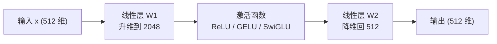

# Transformer
---

## 第一章 架构全景：从 Seq2Seq 困境到自注意力革命
### 1.1 一个比模型更古老的问题：Seq2Seq
在聊 Transformer 之前，得先搞清楚它要解决什么问题。

"Seq2Seq（Sequence-to-Sequence）"不是某个具体模型，而是一类**问题的抽象**：给定一个序列，产出另一个序列。这类问题在生活中到处都是：

+ 机器翻译：`"今天天气不错"` → `"The weather is nice today"`
+ 文本摘要：三千字的长文 → 三句话的核心观点
+ 智能客服：用户的一句抱怨 → 一段得体的回复
+ 代码生成：一句自然语言需求 → 一段可运行的代码

在 Transformer 出现之前，这个赛道的主角是 RNN（循环神经网络）。RNN 的思路很"人类"：一个词一个词地读，边读边把信息压缩进一个隐藏状态里。问题也正出在这里——**它是个串行的"传话游戏"**。

想象二十个人排成一列传一句话，传到队尾时信息早就失真了。RNN 处理长序列时同样如此：开头的内容经过几十次传递，到结尾基本剩不下什么，这就是经典的**长序列依赖丢失**问题。更要命的是，串行结构天生没法并行——你必须算完第 t 步才能算第 t+1 步，GPU 的并行算力只能干瞪眼。

2017 年 Google 的论文《Attention Is All You Need》给出的解法相当激进：**干脆把循环结构整个扔掉，只用注意力机制**。这就是 Transformer 的本质——

> Transformer 是一种完全基于自注意力机制的序列建模架构，设计初衷就是解决 RNN 搞不定的长距离依赖和并行计算问题。
>

它能火到今天（你现在用的 DeepSeek、Qwen、豆包，骨子里全是它的变体），靠的不是运气，而是三个直击要害的设计。

### 1.2 注意力机制：学会给信息"分轻重"
**Transformer本质:Transformer是一种基于自注意力机制的深度学习模型,为了解决RNN无法处理长序列依赖问题而设计的**

<!-- 这是一张图片，ocr 内容为： -->


+ **为什么要判断序列中样本的重要性？一个序列里，不同样本对理解整体的贡献是不平等的**。

看一条外卖评价：

> 虽然配送**慢了半小时**，但这家店的**<font style="color:#DF2A3F;">红烧牛腩确实软烂入味</font>**<font style="color:#DF2A3F;">，</font>**<font style="color:#DF2A3F;">非常好吃</font>**。
>

如果让模型判断这条评价的情感倾向，"慢了半小时"这种铺垫信息其实无关紧要，真正定调的是"**<font style="color:#DF2A3F;">软烂入味</font>**"和"**<font style="color:#DF2A3F;">非常好吃</font>**"。一个聪明的算法应该把算力倾斜到这些关键词上，而不是平均分配到每个字。

注意力机制干的就是这件事：**给序列中每个样本算出一个权重，权重代表它对当前任务的重要程度**。如果我们能够判断出一个序列中哪些样本是重要的、哪些是无关紧要的，就可以引导算法去重点学习更重要的样本，从而提升模型的表现。

紧接着第二个问题：重要性怎么量化？自注意力给出的答案很有味道——**用样本之间的相关性来衡量**。

+ **那样本的重要性是如何定义的？**

再看一个例子：

> **老板在会议上宣布了重大的公司****<font style="color:red;">重组</font>****计划，员工们反应各异，但都对未来充满期待。**
>
> 在这个例子中，“重组”这个词与“公司”、“计划”、“会议”、“宣布”和“未来”等词汇都高度相关。如果我们针对这些词汇进行提问，你会发现——
>
> **公司**发生了什么策略变化？  
**宣布**了什么内容？  
**计划**是什么？  
**未来**会发生什么？  
**会议**上的主要内容是什么？
>
> 所有这些问题的答案都是**重组**。很明显，重组这个词不仅提示了事件的性质、是整个句子的关键，而且也对其他词语的理解有着重大的影响。这个单词对于理解句子中的事件——公司正在经历重大变革，以及员工们的情绪反应——都至关重要。如果没有“重组”这个词，整个句子的意义将变得模糊和不明确，因为不再清楚“宣布了什么”以及“未来期待”是指什么。因此，“重组”这个词很明显对整个句子的理解有重大影响，而且它也和句子中的其他词语高度相关。
>
> 这样的规律可以被推广到许多序列数据上，在序列数据中我们认为**与其他样本高度相关的样本，大概率会对序列整体的理解有重大影响。因此样本与样本之间的相关性可以用来衡量一个样本对于序列整体的重要性**。
>

<!-- 这是一张图片，ocr 内容为： -->


### 1.3 样本的相关性怎么算：点积、矩阵与 Q/K/V
直觉讲完了，轮到数学登场。在 NLP 里，每个样本（token）都会被编码成一个向量，所以"算样本相关性"就落实为"算向量相关性"。最顺手的度量是**点积**：

+ 两向量同向（夹角 0°）→ 点积最大正数 → 完全正相关
+ 两向量垂直（夹角 90°）→ 点积为 0 → 互不相关
+ 两向量反向（夹角 180°）→ 点积最大负数 → 完全负相关

两个三维向量的点积写出来就是：

$ \mathbf{A} \cdot \mathbf{B}^T = \begin{pmatrix} a_1, a_2, a_3 \end{pmatrix} \cdot \begin{pmatrix} b_1 \\ b_2 \\ b_3 \end{pmatrix} = a_1 b_1 + a_2 b_2 + a_3 b_3 $

形状变化是 `(1,3) × (3,1) → (1,1)`，最终塌缩成一个标量分数。

但这里有个容易忽略的细节：**相关性的计算是有方向的**。以谁为核心去问，结果不一样。举个例子：

> 我给我家猫开了个罐头。
>

+ 站在"我"的视角："开罐头"说明我在干什么，"猫"说明对象是谁，这两个词对"我"都很重要；
+ 站在"猫"的视角：谁开的罐头其实无所谓——反正罐头已经开了，"我"对理解"猫"的状态贡献寥寥。

换更长的上下文，这种不对称会更明显："我给我家猫开了个罐头，但我妈对它过敏"——这时候猫是谁的猫、谁对它什么态度，又变得至关重要了。

所以面对 A、B 两个样本，我们要算的不是一组相关性，而是 **AA、AB、BA、BB 四组**：A 问 A、A 问 B、B 问 A、B 问 B。发起询问的一方扮演 **Query**，负责应答的一方扮演 **Key**。把这个过程推广到整个序列，其实就是一次矩阵乘法——**让特征矩阵 X 和它自己的转置相乘**，一次性得到所有样本两两之间的相关性矩阵：

<!-- 这是一张图片，ocr 内容为： -->


<!-- 这是一张图片，ocr 内容为： -->


当然，工程上不会直接拿原始特征矩阵去乘。原始向量里装的是"字面信息"，而我们要的是**语义层面**的相关性。所以标准做法是先给 X 乘上三块可学习的参数矩阵 $ W^Q $、$ W^K $、$ W^V $，把它投影成三个新矩阵：

<!-- 这是一张图片，ocr 内容为： -->
<!-- 这是一张图片，ocr 内容为： -->


+ **Q（Query）**：每个位置"想问什么"
+ **K（Key）**：每个位置"能回答什么"
+ **V（Value）**：每个位置"实际携带的内容"

这三块 W 矩阵是神经网络的参数，会在训练中被梯度下降反复打磨，学着把原始特征解读成最适合算相关性的语义表示。真正的相关性分数是在 Q 和 K 之间算的，算出的权重再用来加权混合 V——**这就是自注意力的核心三板斧**。

### 1.4 整体架构一览
把上面这些零件组装起来，就是论文里那张著名的架构图。左边一摞是 Encoder（负责"读懂"输入），右边一摞是 Decoder（负责"生成"输出），中间靠交叉注意力搭桥

<!-- 这是一张图片，ocr 内容为： -->


<!-- 这是一张图片，ocr 内容为： -->


<!-- 这是一张图片，ocr 内容为： -->


<!-- 这是一张图片，ocr 内容为： -->


<!-- 这是一张图片，ocr 内容为： -->


<!-- 这是一张图片，ocr 内容为： -->


<!-- 这是一张图片，ocr 内容为： -->


用数据流的视角再看一遍，整条链路其实非常规整：

<!-- 这是一张图片，ocr 内容为： -->


回过头看，Transformer 的核心思路可以浓缩成三句话：

1. **用注意力替代循环**：直接计算序列里任意两个位置的关联，不再按顺序传话，长距离依赖一步到位；
2. **用位置编码补顺序**：注意力本身是"无序"的（打乱输入顺序，算出来的相关性不变），所以必须额外注入位置信息；
3. **全并行计算**：所有位置同时处理，把 GPU 的矩阵乘法能力吃到满——这也是为什么它能撑得起今天动辄千亿参数的大模型训练。

---

## 第二章 Embedding 与位置编码：给词向量打上位置标记
### 2.1 文本向量化
<!-- 这是一张图片，ocr 内容为： -->


<!-- 这是一张图片，ocr 内容为： -->


神经网络只认数字，所以一切得从"把字变成向量"开始。Embedding 层位于 Encoder 和 Decoder 的最前端，负责的就是这件事，整个过程分两步：

1. **查索引**：分词之后，每个 token 在词表里都有一个唯一的整数索引（类似字典的页码）；
2. **取向量**：拿着索引去一张 lookup table（查找表）里，把对应的向量行取出来。

这张查找表本身就是一个 `(vocab_size, d_model)` 的参数矩阵——比如词表 10000 个词、每个词 512 维，那就是一张 `10000 × 512` 的大表。它的每一行对应一个 token 的向量表示，初始时是随机数，训练结束后就会沉淀出真正的语义（意思相近的词，向量也靠得近）。

<!-- 这是一张图片，ocr 内容为： -->


```python
import math
import torch
from torch import nn

# 演示场景：假设词表只有 10 个 token，每个 token 用 8 维向量表示
emb = nn.Embedding(num_embeddings=10, embedding_dim=8)

# nn.Embedding 内部维护的就是那张 (10, 8) 的查找表，随机初始化
print(emb.weight.shape)   # torch.Size([10, 8])

# 查单个 token：索引 1 对应的 8 维向量
print(emb(torch.tensor([1])).shape)   # torch.Size([1, 8])

# 查一个 batch：两句话，每句 3 个 token
# 输出形状 (2, 3, 8) —— (batch, seq_len, d_model)
two_sentences = torch.tensor([
    [1, 2, 3],
    [4, 5, 0],   # 0 预留给 padding（填充位），让两句话对齐长度
])
print(emb(two_sentences).shape)
```

工程实现里还要包一层缩放，这是原版论文的写法：

```python
class Embeddings(nn.Module):
    """词嵌入层：查表 + 按 sqrt(d_model) 缩放"""

    def __init__(self, vocab_size: int, d_model: int):
        super().__init__()
        # lut = look-up table，本质就是那张 (vocab_size, d_model) 的参数矩阵
        self.lut = nn.Embedding(vocab_size, d_model)
        self.d_model = d_model

    def forward(self, x):
        # x 形状: (batch, seq_len)，装的是 token 索引
        # 输出形状: (batch, seq_len, d_model)
        # 注意这里乘了 sqrt(d_model)，原因见 2.2 节
        return self.lut(x) * math.sqrt(self.d_model)


emb_layer = Embeddings(vocab_size=10, d_model=8)
emb_out = emb_layer(two_sentences)
print(emb_out.shape)   # torch.Size([2, 3, 8])
```

### 2.2 为什么要乘 √d_model？
这个 `* math.sqrt(d_model)` 不是拍脑袋加的，它和后面的参数初始化方式环环相扣。

<!-- 这是一张图片，ocr 内容为： -->


Transformer 采用 Xavier 初始化，在它的设定下，Embedding 每个维度的取值大致服从 $ N(0, \frac{1}{d_{model}}) $ 分布——d_model 越大，方差越小，向量整体就缩在 0 附近很小的范围里。而位置编码（下一节的主角）的值域是 `[-1, 1]` 的标准尺度。两边量纲差了一大截，直接相加，词向量的信息会被位置编码"淹掉"。

乘上 $ \sqrt{d_{model}} $ 之后，词向量的分布被重新拉回 $ N(0, 1) $ 附近，和位置编码站到同一量级上，两者相加才不会谁压制谁。顺带复习一下正态分布的经验法则：约 68% 的值落在 ±1σ 内，95% 落在 ±2σ 内，99.7% 落在 ±3σ 内——知道 σ 是 1，向量的数值范围心里就有数了。

### 2.3 自注意力的"脸盲症"：它分不清语序
接下来的问题很刁钻但极其关键：**自注意力机制本身感知不到位置**。

做个小实验就能验证。准备两组 Q、K、V，第二组只是第一组打乱行序后的版本：

```python
import torch

# 第一组：三行向量按原始顺序排列
q1 = torch.tensor([[0., 1., 2., 1., 5.],
                   [3., 9., 3., 8., 2.],
                   [2., 3., 1., 5., 6.]])
k1 = torch.tensor([[3., 2., 1., 5., 5.],
                   [1., 5., 5., 0., 1.],
                   [0., 8., 9., 6., 1.]])
v1 = torch.tensor([[7., 3., 1., 2., 1.],
                   [4., 7., 1., 1., 9.],
                   [5., 7., 1., 9., 8.]])

# 第二组：把前两行对调（相当于把句子里的词换了顺序）
q2 = torch.tensor([[3, 9, 3, 8, 2],
                  [0, 1, 2, 1, 5],
                  [2, 3, 1, 5, 6]],dtype=torch.float)
k2 = torch.tensor([[1, 5, 5, 0, 1],
                  [3, 2, 1, 5, 5],
                  [0, 8, 9, 6, 1]],dtype=torch.float)
v2 = torch.tensor([[4, 7, 1, 1, 9],
                  [7, 3, 1, 2, 1],
                  [5, 7, 1, 9, 8]],dtype=torch.float)

softmax = torch.nn.Softmax(dim=1)

def simple_attention(q, k, v):
    """最朴素的注意力：QK^T -> softmax -> 加权 V"""
    scores = torch.matmul(q, k.transpose(-1, -2))
    weights = softmax(scores)
    return torch.matmul(weights, v)

out1 = simple_attention(q1, k1, v1)
out2 = simple_attention(q2, k2, v2)

# 对比会发现：out2 就是 out1 的行跟着对调了一下
# 注意力分数本身毫无变化 —— 模型根本不知道谁在前谁在后
print(out1)
print(out2) 
```

结论很清楚：**交换词的顺序，自注意力的计算结果只是跟着平移，数值本身不变**。但自然语言里语序就是语义——"狗咬我"和"我咬狗"完全是两个故事。

这样会导致一个很严重的问题：当调换文字顺序之后，其语义将发生极大改变，而自注意力机制无法捕捉到这种改变，这将会产生理解上的问题。

位置信息其实有两类：

<!-- 这是一张图片，ocr 内容为： -->


+ **绝对位置**：第 1 个 token、第 2 个 token……每个位置一个唯一编号；
+ **相对位置**：a₂ 在 a₁ 后面一位，a₄ 在 a₂ 后面两位……描述的是词与词之间的间距。

### 2.4 正余弦位置编码：给每个位置造一枚"多刻度指纹"
<!-- 这是一张图片，ocr 内容为： -->


<!-- 这是一张图片，ocr 内容为： -->


<!-- 这是一张图片，ocr 内容为： -->


<!-- 这是一张图片，ocr 内容为： -->


正余弦位置编码的公式长这样：

<!-- 这是一张图片，ocr 内容为： -->


<!-- 这是一张图片，ocr 内容为： -->


<!-- 这是一张图片，ocr 内容为： -->


<!-- 这是一张图片，ocr 内容为： -->


<!-- 这是一张图片，ocr 内容为： -->


其中 `pos` 是 token 在句子里的位置索引（0 到 max_len-1），`i` 是维度对的编号，`2i` 和 `2i+1` 分别对应偶数维和奇数维。说白了就是：**给每个位置生成一个独一无二的 d_model 维向量，再把它加到词向量上**。

代码实现就是对着公式搬砖：

```python
# 位置编码层
## 位置编码的实现其实很简单，直接对照着公式去敲代码就可以，下面这个代码只是其中一种实现方式；
## 从理解来讲，需要注意的就是偶数和奇数在公式上有一个共同部分；
## pos代表的是单词在句子中的索引，这点需要注意；比如max_len是128个，那么索引就是从0，1，2，...,127
##假设我的d_model是512，2i那个符号中i从0取到了255，
# 那么2i对应取值就是0,2,4...510,那么2i+1对应取值就是1,3,5...511
import torch
from torch import nn
class PositionalEncoding(nn.Module):
    def __init__(self, d_model,max_len=5000,dropout=0.1) -> None:
        super().__init__()
        self.dropout = nn.Dropout(dropout)
        
        pe = torch.zeros(max_len,d_model)
        
        pos = torch.arange(0,max_len).unsqueeze(1)
        div_term = torch.pow(10000, torch.arange(0, d_model, 2).float() / d_model)
        
        ## 这里需要注意的是pe[:, 0::2]这个用法，就是从0开始到最后面，步长为2，其实代表的就是偶数位置
        pe[:, 0::2] = torch.sin(pos / div_term)
        ##这里需要注意的是pe[:, 1::2]这个用法，就是从1开始到最后面，步长为2，其实代表的就是奇数位置
        pe[:, 1::2] = torch.cos(pos / div_term)

        #升维
        pe = pe.unsqueeze(0)
        #将位置编码矩阵设置为缓冲区
        # (这些缓冲区不会被视为模型的可训练参数（即不会被优化器更新），
        # 但会作为模型状态的一部分保存和加载)
        #相当于把位置信息保存在了一个常量数组中
        self.register_buffer("pe",pe)
    
    def forward(self,x):
        print(self.pe[:,:x.size(1)])
        x = x+ self.pe[:,:x.size(1)]
        return self.dropout(x)

pos = PositionalEncoding(8)
pos_out = pos(emb_out)
print(pos_out.shape)
```

顺带解释一句 `register_buffer` 的定位，新手很容易在这里犯迷糊：

```python
class MyModel(nn.Module):
    def __init__(self):
        super().__init__()
        # nn.Parameter：会被优化器更新的可训练参数
        self.weight = nn.Parameter(torch.randn(2, 2))
        # buffer：不训练但需要持久化的张量（如位置编码、BatchNorm 的 running_mean）
        # 会出现在 state_dict 里，随模型一起保存/加载/迁移设备
        self.register_buffer("running_mean", torch.zeros(2))

model = MyModel()
print(model.state_dict().keys())   # 同时包含 weight 和 running_mean
```

这套设计的优点可以归纳成三点：**每个位置的编码全局唯一**（不同位置在所有维度上不会撞车）；**相对位置可推**（数学上可以证明 $ PE_{pos+k} $ 能表示成 $ PE_{pos} $ 的线性变换，模型想算"间隔 k 个位置"易如反掌）；**天然外推**（函数对任意 pos 都有定义，训练时没见过更长的序列也能现算）。

```python
import matplotlib.pyplot as plt

# 创建位置编码实例
pos_encoder = PositionalEncoding(d_model=512, max_len=100)

# 获取位置编码矩阵
pe = pos_encoder.pe.squeeze(0)  # (100, 512)

# 可视化
plt.figure(figsize=(10, 6))
plt.imshow(pe.numpy(), cmap='viridis', aspect='auto')
plt.xlabel('Embedding Dimension')
plt.ylabel('Position')
plt.colorbar(label='Value')
plt.title('Positional Encoding')
plt.show()
```

<!-- 这是一张图片，ocr 内容为： -->


<!-- 这是一张图片，ocr 内容为： -->


### 2.5 位置编码设计的优点
**<font style="color:rgb(13, 13, 13);">1. 捕捉相对位置信息</font>**

+ **<font style="color:rgb(13, 13, 13);">正弦和余弦函数的周期性</font>**<font style="color:rgb(13, 13, 13);">：sin和cos函数是周期性的，能够自然地表示序列中不同位置之间的相对距离。例如，两个位置 pos 和 pos+k之间的位置编码差异可以通过三角函数的性质（如和角公式）来表示：</font>

<!-- 这是一张图片，ocr 内容为： -->


[https://mp.weixin.qq.com/s/UbbmOd00sqgfG4Zq9TwO3Q](https://mp.weixin.qq.com/s/UbbmOd00sqgfG4Zq9TwO3Q)

<font style="color:rgb(13, 13, 13);">这种性质使得模型能够通过位置编码的线性组合来捕捉相对位置信息。</font>

+ **<font style="color:rgb(13, 13, 13);">相对位置的重要性</font>**<font style="color:rgb(13, 13, 13);">：在许多任务中（如机器翻译、文本生成），相对位置比绝对位置更重要。例如，单词之间的距离比它们在句子中的具体位置更有意义。</font>

**<font style="color:rgb(13, 13, 13);">2. 多频率编码</font>**

+ **<font style="color:rgb(13, 13, 13);">不同频率的正弦和余弦函数</font>**<font style="color:rgb(13, 13, 13);">：位置编码公式中的分母</font><!-- 这是一张图片，ocr 内容为： -->
  <font style="color:rgb(13, 13, 13);">引入了不同的频率。随着维度索引 i 的增加，频率逐渐降低，这使得位置编码能够捕捉到不同尺度的位置信息。</font>
    - <font style="color:rgb(13, 13, 13);">低维度（较小的 i</font>_<font style="color:rgb(13, 13, 13);"></font>_<font style="color:rgb(13, 13, 13);">）：高频信号，捕捉短距离的相对位置。</font>
    - <font style="color:rgb(13, 13, 13);">高维度（较大的 i</font>_<font style="color:rgb(13, 13, 13);"></font>_<font style="color:rgb(13, 13, 13);">）：低频信号，捕捉长距离的相对位置。</font>
+ **<font style="color:rgb(13, 13, 13);">多频率编码的优势</font>**<font style="color:rgb(13, 13, 13);">：这种设计使得位置编码能够同时捕捉局部和全局的位置信息，增强了模型的表达能力。</font>

**<font style="color:rgb(13, 13, 13);">3. 唯一性和连续性</font>**

+ **<font style="color:rgb(13, 13, 13);">唯一性</font>**<font style="color:rgb(13, 13, 13);">：每个位置</font><font style="color:rgb(13, 13, 13);"> </font><font style="color:rgb(13, 13, 13);">p</font><font style="color:rgb(13, 13, 13);">o</font><font style="color:rgb(13, 13, 13);">s</font>_<font style="color:rgb(13, 13, 13);">p</font>__<font style="color:rgb(13, 13, 13);">os</font>_<font style="color:rgb(13, 13, 13);"> </font><font style="color:rgb(13, 13, 13);">的位置编码是唯一的，因为正弦和余弦函数的组合可以生成一个独特的向量。</font>
+ **<font style="color:rgb(13, 13, 13);">连续性</font>**<font style="color:rgb(13, 13, 13);">：位置编码是连续的，相邻位置的编码值变化平滑，这有助于模型更好地泛化到未见过的序列长度。</font>

---

**<font style="color:rgb(13, 13, 13);">4. 无参数设计</font>**

+ **<font style="color:rgb(13, 13, 13);">固定公式</font>**<font style="color:rgb(13, 13, 13);">：正弦和余弦函数生成的位置编码是确定性的，不需要额外的可学习参数。这使得位置编码的计算高效且易于实现。</font>
+ **<font style="color:rgb(13, 13, 13);">可扩展性</font>**<font style="color:rgb(13, 13, 13);">：由于位置编码是固定的，模型可以处理比训练时更长的序列（只要位置编码能够生成）。</font>

---

**<font style="color:rgb(13, 13, 13);">5. 与输入嵌入的兼容性</font>**

+ **<font style="color:rgb(13, 13, 13);">相加操作</font>**<font style="color:rgb(13, 13, 13);">：位置编码与输入嵌入直接相加，而不是拼接。由于正弦和余弦函数的取值范围是</font><font style="color:rgb(13, 13, 13);"> </font><font style="color:rgb(13, 13, 13);">[</font><font style="color:rgb(13, 13, 13);">−</font><font style="color:rgb(13, 13, 13);">1</font><font style="color:rgb(13, 13, 13);">,</font><font style="color:rgb(13, 13, 13);">1</font><font style="color:rgb(13, 13, 13);">]</font><font style="color:rgb(13, 13, 13);">[</font><font style="color:rgb(13, 13, 13);">−</font><font style="color:rgb(13, 13, 13);">1</font><font style="color:rgb(13, 13, 13);">,</font><font style="color:rgb(13, 13, 13);">1</font><font style="color:rgb(13, 13, 13);">]</font><font style="color:rgb(13, 13, 13);"> </font><font style="color:rgb(13, 13, 13);">，与输入嵌入的值域兼容，不会破坏输入嵌入的分布。</font>
+ **<font style="color:rgb(13, 13, 13);">线性变换</font>**<font style="color:rgb(13, 13, 13);">：位置编码的线性性质使得它可以通过矩阵运算高效地与输入嵌入结合。</font>

<!-- 这是一张图片，ocr 内容为： -->


<font style="color:rgb(13, 13, 13);"></font>

### 2.6 灵魂拷问：直接相加，信息不会互相覆盖吗？
很多人第一次看到这里都会犯嘀咕：词向量 512 维，位置编码也 512 维，逐位相加——两种完全不同的信息这么一混，不会"打架"吗？

这个直觉来自一维空间的惨痛经验：5 加 3 等于 8，但你盯着 8，永远猜不出它是 5+3 还是 4+4。一维世界里，相加就是信息的坟场。

但 Transformer 的向量活在 512 维空间里，这里的游戏规则完全不同。高维空间有个近乎魔幻的性质：**任意两个独立生成的向量，夹角几乎必然接近 90°**——也就是正交。词向量指向"语义子空间"的方向，位置编码指向"位置子空间"的方向，两者各走各的"频道"，相加只是让向量在垂直方向上延伸，谁也不盖住谁。

生活化一点的类比：词向量是一张色彩丰富的照片，位置编码是一张印着坐标网格的透明胶片。把胶片盖在照片上，猫的图案没有被擦掉，颜色没有混淆，但你现在能读出猫在画面里的精确位置了。**这不是混合，是透明叠加。**

更妙的是，模型根本不需要额外费力去"拆解"这份叠加信息。叠加后的向量 $ (x + p) $ 进入注意力层时，$ (x+p)W^Q $ 与 $ (x+p)W^K $ 做点积会自然展开成四项：

$ \underbrace{xW^Q (xW^K)^T}_{\text{语义×语义}} + \underbrace{xW^Q (pW^K)^T}_{\text{语义×位置}} + \underbrace{pW^Q (xW^K)^T}_{\text{位置×语义}} + \underbrace{pW^Q (pW^K)^T}_{\text{位置×位置}} $

矩阵乘法像一台自动分拣机，把揉在一起的信息拆成了四条独立的信息流：纯词义关系、词与位置的上下文关系、纯相对距离关系。模型只要在训练中学会各取所需就行。

<!-- 这是一张图片，ocr 内容为： -->


<!-- 这是一张图片，ocr 内容为： -->


---

## 第三章 多头注意力与掩码：并行看清句子全局
### 3.1 为什么一个头不够用
第一章讲过，自注意力让每个位置都能"看到"序列里的所有其他位置。拿一句话来说：

> 这家火锅店的**毛肚**确实新鲜，就是**排队**要两个小时。
>

理解"毛肚"时，模型需要关注"火锅店"（什么东西在哪）和"新鲜"（品质如何）；理解"排队"时，又得关注"两个小时"（代价多大）。一句话里同时交织着主谓、修饰、转折等好几种关系。

问题来了：**单个注意力头只有一套 Q/K/V 投影，一个时间只能在一个"语义子空间"里算相关性**，算出来的权重是所有关系揉在一起的平均结果——想同时看清"主谓关系"和"转折关系"，就像想用一把尺子同时量长度和重量，力不从心。

这个困境在计算机视觉里有个现成的参考答案：CNN 的每一层都不只用一个卷积核，而是几十个——有的卷积核专门提边缘，有的提纹理，有的提色块，最后拼成多通道的特征图。**多头注意力就是同一个哲学**：把 d_model 维的向量切成 h 份（比如 512 维切 8 头，每头 64 维），每个头拥有自己独立的 $ W^Q_i, W^K_i, W^V_i $，各自在各自的子空间里算注意力：

+ 头 1 可能学会盯"指代关系"（"它"指谁）；
+ 头 2 可能学会盯"时态/程度"（"确实""有点""非常"）；
+ 头 3 可能学会盯"转折关系"（"就是""但是"后面才是重点）。

最后把 h 个头的输出拼起来，再过一次线性映射融合。**相比单头，多头只多付出一次线性融合的计算量，换来的却是从多个角度理解语义的能力**——这也是 Transformer 能捕捉长距离依赖的关键：每个位置的表示，都可以被任意远的词影响。

<!-- 这是一张图片，ocr 内容为： -->


<!-- 这是一张图片，ocr 内容为： -->


<!-- 这是一张图片，ocr 内容为： -->


<!-- 这是一张图片，ocr 内容为： -->
<!-- 这是一张图片，ocr 内容为： -->


**多头注意力相比单个注意力模块,只增加了一个线性映射的计算量,却可以提取到更丰富的信息.**

### 3.2 Padding Mask：别让填充位带偏计算
现实中的句子有长有短，但 GPU 批处理要求一个 batch 里的序列等长。通行做法是拿特殊的 `pad` token（索引通常设为 0）把短句补齐。

麻烦在于：pad 也会过 Embedding 和位置编码，变成一个"看起来正常"的特征向量。如果不加处理，它会在注意力计算里分走权重——模型对着一堆空气分配注意力，结果自然被带偏。

解决思路干净利落：**在 softmax 之前，把 pad 位置的分数填成 -1e9**。softmax 之后这些位置的权重约等于 0，等于在注意力层面"隐身"了。

<!-- 这是一张图片，ocr 内容为： -->


<!-- 这是一张图片，ocr 内容为： -->


```python
#mask_fill方法
import torch
scores = torch.randn(2, 3, 3)
print(scores)

inputs = torch.tensor([
    [1, 2, 3],
    [4, 5, 0]
])

mask = (inputs == 0).unsqueeze(1)
print(mask)
print(mask.shape)

scores = scores.masked_fill(mask, -1e9)
print(scores)
```

```python
import torch
#注意力机制增加掩码
def get_padding_mask(x, padding_idx=0):
    """生成 padding 掩码：pad 位置为 True（待屏蔽）

    输入 x: (batch, seq_len)
    输出:   (batch, 1, seq_len) —— 第 1 维留给注意力分数的行做广播
    """
    return (x == padding_idx).unsqueeze(1)

mask = get_padding_mask(inputs)
print(mask.shape)   # torch.Size([2, 1, 3])

# 看看 masked_fill 的实际效果
scores = torch.randn(2, 3, 3)   # 假装是两个样本的注意力分数
print("屏蔽前:\n", scores)
scores = scores.masked_fill(mask, -1e9)
print("屏蔽后:\n", scores)
# 第二句的最后一个位置全被压成 -1e9，
# softmax 之后它对任何位置的注意力权重都 ≈ 0
```

---

### 3.3 缩放点积注意力：完整计算链路
先把单个头的计算流程定死：

<!-- 这是一张图片，ocr 内容为： -->


下面给出带掩码支持的完整注意力函数：

```python
import math
import torch

def attention(q, k, v, mask=None, dropout=None):
    """缩放点积注意力（Scaled Dot-Product Attention）

    参数:
        q, k, v: 形状 (batch, n_head, seq_len, d_k) 的查询/键/值张量
        mask:    布尔掩码，True 的位置会被屏蔽（不参与注意力分配）
        dropout: 对注意力权重做随机失活，训练时防过拟合
    返回:
        上下文向量，形状与 v 一致
    """
    # d_k 是每个头的维度（不是总维度 d_model！）
    d_k = k.size(-1)

    # 第一步：Q·K^T 算原始相关性分数，形状 (batch, n_head, seq_len, seq_len)
    # 第 (i, j) 个元素 = 第 i 个位置"问"第 j 个位置的匹配程度
    # 第二步：除以 sqrt(d_k) 缩放，防止大维度下 softmax 饱和
    scores = torch.matmul(q, k.transpose(-2, -1)) / math.sqrt(d_k)

    # 第三步（可选）：掩码。把不该看的位置填成 -1e9（约等于负无穷）
    # softmax(-1e9) ≈ 0，这些位置分到的注意力权重趋近于零，等于被"蒙住眼睛"
    if mask is not None:
        scores = scores.masked_fill(mask, -1e9)

    # 第四步：softmax 在最后一维归一化，每行权重之和为 1
    # 至此，分数变成了"每个位置该分多少注意力"的概率分布
    p_attn = torch.softmax(scores, dim=-1)

    if dropout is not None:
        p_attn = dropout(p_attn)

    # 第五步：用权重对 V 加权求和，得到融合了全局上下文的新表示
    # 输出形状 (batch, n_head, seq_len, d_k)
    return torch.matmul(p_attn, v)


# 用第二章的位置编码输出做个冒烟测试：q=k=v（自注意力就是"自己问自己"）
result = attention(pos_out, pos_out, pos_out)
print(result.shape)   # 与输入形状一致
```

## 第四章 残差、归一化与前馈网络：稳定训练的三大护法
注意力和位置编码解决了"算得准"的问题，而这一章的三个组件解决的是"训得动"的问题。Transformer 动辄几十层，没有它们，梯度早就消失在深层网络里了。

### 4.1 残差连接：深层网络的生命线
你在前面的代码里已经见过它了：`return self.norm(res + output)`。结构上就一行公式：

$ \text{输出} = \text{LayerNorm}\big(x + \text{Sublayer}(x)\big) $

每个子层（注意力或 FFN）的输入会被**原封不动地加回到输出上**。为什么要这么做？两个层面的理由：

+ **梯度层面**：反向传播时，梯度可以沿着 `+x` 这条"高速公路"跳过子层直接回传，不必穿过几十层矩阵乘法被反复连乘稀释。没有它，几十层网络的梯度早就消失（或爆炸）得没影了；
+ **兜底层面**：即使某个子层什么都没学到（输出接近 0），`x + 0 = x`，信息至少不会比进来时更差。每一层只需要学"增量改进"，而不是从零重构表示。

残差连接有个硬性前提：**子层的输入输出维度必须完全一致**。这也是为什么整个 Transformer 里所有模块都死守 `d_model` 这个维度不放，也是第二章里位置编码选择"相加"而非"拼接"的深层原因——一切都是为了给这条梯度高速公路让路。

### 4.2 LayerNorm：把每个向量拉回稳定分布
残差负责"加"，加完之后的"整理"工作交给 LayerNorm。它对单个向量做两步操作：

1. **标准化**：减均值、除标准差，把向量拉成均值 0、方差 1 的规整分布；
2. **缩放平移**：再用可学习参数 γ（缩放）和 β（平移）微调——因为"标准分布"不一定是最适合下一层的形态，模型可以自己学着调。

$ \text{LN}(x) = \gamma \odot \frac{x - \mu}{\sqrt{\sigma^2 + \epsilon}} + \beta $

为什么需要它？Transformer 层层堆叠，每一层的输出就是下一层的输入。如果不加约束，各层输出的数值范围会飘忽不定——这层偏大、那层偏小，下一层的参数就得疲于应付这种分布抖动，训练又慢又不稳。LayerNorm 在数据进入下一层之前先把尺度统一，**让每一层拿到的输入分布都稳定可控**，收敛自然顺畅。

常有人拿它和 BatchNorm 比，两者最本质的区别是**沿哪个方向算统计量**。把一批数据想成一张表：行是样本，列是特征维度——

| 对比项 | LayerNorm | BatchNorm |
| --- | --- | --- |
| 统计方向 | 横着算：一个样本自己的所有特征 | 竖着算：一批样本在同一特征上的取值 |
| 依赖 batch？ | 不依赖，单样本也能算 | 强依赖，batch 小了统计量会剧烈抖动 |
| 对变长序列 | 天然适配，各算各的 | 很尴尬，同一列凑的是长短不一的句子 |
| 典型场景 | NLP / Transformer | 图像 CNN |


NLP 的句子长短不一、训练 batch 也未必大，BatchNorm 的两个前提全都不成立。所以 **Transformer 选 LayerNorm 不是偏好问题，是被数据结构逼出来的必然**。

### 4.3 多头注意力+残差连接+layernorm的完整实现
<!-- 这是一张图片，ocr 内容为： -->


```python
class MultiHeadedAttention(nn.Module):
    """多头注意力 + 残差连接 + LayerNorm（Encoder/Decoder 通用积木）"""

    def __init__(self, d_model: int, n_head: int, dropout: float = 0.1):
        super().__init__()
        self.dropout = nn.Dropout(dropout)

        # d_model 必须能被头数整除，每头分到 d_token 维
        # 例: d_model=512, n_head=8 -> 每头 64 维
        assert d_model % n_head == 0
        self.d_token = d_model // n_head
        self.n_head = n_head

        # 注意这里 Q/K/V 的投影矩阵都是 (d_model, d_model)：
        # 实现上不为每个头单独建小矩阵，而是用一个大矩阵投影后再"切分"，
        # 数学上等价于 h 个小矩阵，但矩阵运算效率高得多
        self.W_Q = nn.Linear(d_model, d_model, bias=False)
        self.W_K = nn.Linear(d_model, d_model, bias=False)
        self.W_V = nn.Linear(d_model, d_model, bias=False)

        # 所有头的输出拼接后，再过一次线性层做跨头信息融合
        self.linear = nn.Linear(d_model, d_model, bias=False)
        self.norm = nn.LayerNorm(d_model)

    def forward(self, q, k, v, mask=None):
        # 残差连接要用的"原始输入"，先存一份（残差见第四章）
        res = q

        # ---- 分头 ----
        # 投影后形状: (batch, seq_len, d_model)
        # view 拆成 (batch, seq_len, n_head, d_token)
        # transpose 换成 (batch, n_head, seq_len, d_token)
        # 把头数提到第 1 维，后面就可以对"每个头"并行做矩阵乘
        q = self.W_Q(q).view(q.shape[0], q.shape[1], self.n_head, self.d_token).transpose(1, 2)
        k = self.W_K(k).view(k.shape[0], k.shape[1], self.n_head, self.d_token).transpose(1, 2)
        v = self.W_V(v).view(v.shape[0], v.shape[1], self.n_head, self.d_token).transpose(1, 2)

        # 掩码升一维以对齐广播: (batch, 1, seq_len) -> (batch, 1, 1, seq_len)
        # 这样同一个掩码会作用到所有头上
        if mask is not None:
            mask = mask.unsqueeze(1)

        # ---- 每个头各自算注意力 ----
        context = attention(q, k, v, mask, self.dropout)

        # ---- 拼头 + 融合 ----
        # transpose 回来: (batch, seq_len, n_head, d_token)
        # reshape 拼回: (batch, seq_len, d_model)
        concat = context.transpose(1, 2).reshape(q.shape[0], -1, self.n_head * self.d_token)
        output = self.linear(concat)

        # ---- 残差 + 层归一化（第四章详解）----
        return self.norm(res + output)


# 测试：8 维模型、2 个头
mha = MultiHeadedAttention(d_model=8, n_head=2)
mha_out = mha(pos_out, pos_out, pos_out)
print(mha_out.shape)   # 输入什么形状，输出还是什么形状
```

### 4.3 FFN：先摊开加工，再收拢输出
注意力模块把信息融合好之后，每个 Encoder/Decoder 层里还有第二块主计算：**前馈神经网络（FFN）**。它的结构朴素得让人想笑——两个线性层夹一个激活函数：

$ \text{FFN}(x) = W_2 \cdot \text{ReLU}(W_1 x + b_1) + b_2 $

但它有个很显眼的形状特征：**两头窄、中间宽**。原论文里向量以 512 维进来，先撑到 2048 维，做完非线性再压回 512：



**为什么先升维？** 注意力输出的 512 维里，信息是"挤"在一起的——词本身的含义、从别的位置搬来的上下文、各种搭配关系，全都压缩纠缠在这 512 个数字里。在这么窄的空间里做非线性变换，想单独处理某一类信息很难施展。升到 2048 维，相当于把信息**摊开**到更大的空间里，不同特征各占各的方向，激活函数才能对每一部分单独取舍——该放大的放大，该压成 0 的压成 0。

**为什么又降回去？** 一是接口对齐：残差连接要求 `x + FFN(x)` 形状一致，下一层也等着收 512 维；二是第二个线性层并非简单丢弃数字，而是把宽空间里加工筛选过的结果**重新浓缩打包**回 512 维，交还给主干。升维是"摊开加工"，降维是"收拢输出"，一套动作缺一不可。

还有个常考的问题：注意力都融合好信息了，为什么还需要 FFN？因为两者分工完全不同——

+ **注意力是横向通信**：它的核心动作是"加权求和"，负责把别的位置的信息搬到当前位置，回答"谁跟谁有关"；
+ **FFN 是纵向加工**：它对每个位置**独立地**做非线性深加工（所有位置共享同一套参数，位置之间互不交流），回答"这些信息该怎么提炼表达"。

注意力本身对单点信息的加工其实很弱——加权求和本质上是线性操作，学不了"如果 A 特征高且 B 特征也高，就激活某种模式"这类非线性规则。研究还表明，**FFN 里存储了模型学到的大量"事实知识"**，像个可查询的记忆库——这也解释了为什么整个模型约 2/3 的参数都在 FFN 里（d_model=4096 时，注意力约 67M 参数，FFN 约 134M）。

至于那个 4 倍扩张比，纯属大量实验后的经验折中：太小表达力不足，太大参数浪费。后来用 SwiGLU 的模型（LLaMA、Qwen）把比例调成约 8/3 倍，思路不变。

### 4.4 激活函数的现代选择
原论文用 ReLU，今天的模型基本换完了：

| 激活函数 | 特点 | 谁在用 |
| --- | --- | --- |
| **ReLU** | `max(0, x)`，负值直接清零，简单高效，但有"死神经元"问题 | 原版 Transformer |
| **GELU** | 软化版 ReLU，负值不完全清零，梯度更平滑 | BERT、GPT-2 |
| **SwiGLU** | 多一组权重做门控 `(W₁x ⊙ σ(W₂x))·W₃`，效果最好，参数多 1/3 | DeepSeek、Qwen、LLaMA |


理解原理阶段用 ReLU 完全没问题，"升维 → 非线性 → 降维"的主干思想三者一致。

### 4.5 FFN 代码实现
```python
class FeedForwardNet(nn.Module):
    """位置前馈网络：升维 -> 激活 -> 降维，外加残差 + LayerNorm

    注意"position-wise"的含义：每个位置的向量独立过同一个 FFN，
    位置之间在这里没有任何信息交流（交流已经在注意力里做完了）。
    """

    def __init__(self, d_model: int, d_ff: int, dropout: float = 0.1):
        super().__init__()
        self.dropout = nn.Dropout(dropout)
        # w1: 升维，d_model -> d_ff（原论文 d_ff = 4 * d_model）
        self.w1 = nn.Linear(d_model, d_ff)
        # w2: 降维，d_ff -> d_model，必须压回去才能接残差
        self.w2 = nn.Linear(d_ff, d_model)
        self.relu = nn.ReLU()   # 现代实践可换成 nn.GELU()
        self.norm = nn.LayerNorm(d_model)

    def forward(self, x):
        # 存一份输入，给残差用
        res = x
        # 升维 + 非线性：在更宽的空间里筛选、加工特征
        x = self.relu(self.w1(x))
        # 降维 + dropout：浓缩回 d_model，顺带正则化
        x = self.dropout(self.w2(x))
        # 残差相加 + 层归一化，与注意力子层的收尾方式完全一致
        return self.norm(x + res)


# 接在多头注意力后面测试
ffn = FeedForwardNet(d_model=8, d_ff=32)
ffn_out = ffn(mha_out)
print(ffn_out.shape)   # 形状依旧不变，Transformer 的维度守恒铁律
```

---

## 第五章 编码器-解码器协作：掩码自回归与交叉注意力
零件全部备齐，现在开始组装整机。先看一张简化版的对照图：Encoder 每层两个组件（自注意力 + FFN），Decoder 每层三个组件（掩码自注意力 + 交叉注意力 + FFN）：

<!-- 这是一张图片，ocr 内容为： -->
<!-- 这是一张图片，ocr 内容为： -->


### 5.1 Encoder：把输入读成语义表示
Encoder 的任务就一句话：**理解输入序列，把它转成富含语义的向量表示**（下游管它叫 memory 或 context）。单层 Encoder 只有两个子层，堆 N 层（原论文 N=6）就是完整的 Encoder：

```python
class EncoderLayer(nn.Module):
    """编码器子层：多头自注意力 + 前馈网络（各自带残差和归一化）"""

    def __init__(self, d_model: int, n_head: int, d_ff: int, dropout: float = 0.1):
        super().__init__()
        self.mha = MultiHeadedAttention(d_model, n_head, dropout)
        self.ffn = FeedForwardNet(d_model, d_ff, dropout)

    def forward(self, x, mask=None):
        # 自注意力的典型特征：q、k、v 全是同一个 x（自己问自己）
        output = self.mha(x, x, x, mask)
        return self.ffn(output)


class Encoder(nn.Module):
    """完整编码器：Embedding -> 位置编码 -> N 个 EncoderLayer"""

    def __init__(self, vocab_size, d_model, n_head, d_ff, N=6, dropout=0.1):
        super().__init__()
        self.emb = Embeddings(vocab_size, d_model)
        self.pos = PositionalEncoding(d_model=d_model, dropout=dropout)
        # nn.ModuleList 专门用来装"一组结构相同的层"，
        # 用普通 list 的话 PyTorch 注册不上参数，模型会漏学
        self.layers = nn.ModuleList([
            EncoderLayer(d_model, n_head, d_ff, dropout)
            for _ in range(N)
        ])

    def forward(self, x, mask=None):
        x = self.emb(x)    # 索引 -> 向量
        x = self.pos(x)    # 注入位置信息
        for layer in self.layers:
            x = layer(x, mask)   # 逐层提炼语义
        return x


# 冒烟测试
src_inputs = torch.tensor([[1, 2, 3], [4, 5, 0]])
src_mask = get_padding_mask(src_inputs, 0)
encoder = Encoder(vocab_size=10, d_model=8, n_head=2, d_ff=32)
memory = encoder(src_inputs, src_mask)
print(memory.shape)   # (2, 3, 8)：源序列的语义表示，等下喂给 Decoder
```

Encoder 为什么不需要掩码遮住未来？因为它的职责是"理解"，理解本来就需要看到完整的输入——就像翻译之前，译者当然可以把整句原文读完。

### 5.2 自回归与三角掩码：生成时禁止"剧透"
Decoder 的职责是**生成**，而生成本质上是**自回归（Autoregressive）**的：当前时刻的输出依赖之前已经生成的内容，一个词一个词往外蹦：

> 词 1 → 预测词 2；词 1、2 → 预测词 3；词 1、2、3 → 预测词 4 ……
>

问题来了：训练时我们手里是有完整标准答案的（比如参考译文），可以整句喂进去并行计算——但如果直接喂，模型生成第 3 个词时能直接"偷看"到第 4、5 个词，等于考试作弊，学出来的东西毫无用处。

解决办法是**三角掩码（look-ahead mask / causal mask）**：构造一个上三角矩阵，把"当前位置之后"的所有位置全部屏蔽。第 i 个位置只能看到第 1 到第 i 个位置，未来信息一律不可见：

<!-- 这是一张图片，ocr 内容为： -->
<!-- 这是一张图片，ocr 内容为： -->


```python
import torch

# torch.tril 保留下三角（含对角线），上三角置 0
lower = torch.tril(torch.ones((3, 3)))
print(lower)
# tensor([[1., 0., 0.],
#         [1., 1., 0.],
#         [1., 1., 1.]])

def get_subsequent_mask(size: int):
    """生成三角掩码：需要屏蔽的"未来位置"为 True

    size 为序列长度，输出形状 (1, size, size)，1 是广播用的 batch 维
    用 1 减去下三角矩阵，就把"上三角（未来）"标成了 1（待屏蔽）
    """
    mask_shape = (1, size, size)
    return 1 - torch.tril(torch.ones(mask_shape)).byte()

# Decoder 的最终掩码 = padding mask 和三角掩码的叠加（按位或）
# 既要遮住填充位，也要遮住未来位置
tgt_inputs = torch.tensor([[1, 2, 3], [4, 5, 0]])
pad_mask = get_padding_mask(tgt_inputs, 0)   # (2, 1, 3)
sub_mask = get_subsequent_mask(3)            # (1, 3, 3)
tgt_mask = (sub_mask | pad_mask) != 0        # 广播后 (2, 3, 3)，True = 屏蔽
```

训练时这种"把答案右移一位喂进去、用三角掩码防偷看"的技巧叫 **Teacher Forcing**——模型每个位置都在"已知前文是标准答案"的条件下练习预测下一个词，并行高效。你今天和 DeepSeek 聊天时它逐字蹦出回答，推理阶段跑的就是同一个自回归逻辑，只是没有答案可看，全靠自己刚生成的前文。

### 5.3 Decoder 层：三件套流水线
Decoder 比 Encoder 复杂，因为它既要"理解自己已经写了什么"，又要"回看原文"，最后还要"加工生成"。三个子层的固定顺序：

<!-- 这是一张图片，ocr 内容为： -->


<!-- 这是一张图片，ocr 内容为： -->


```python
class DecoderLayer(nn.Module):
    """解码器子层：掩码自注意力 + 交叉注意力 + 前馈网络"""

    def __init__(self, d_model, n_head, d_ff, dropout=0.1):
        super().__init__()
        # 自注意力：理解目标序列自身（带三角掩码，防偷看未来）
        self.self_mha = MultiHeadedAttention(d_model, n_head, dropout)
        # 交叉注意力：q 来自 Decoder，k/v 来自 Encoder 的输出 memory
        self.cross_mha = MultiHeadedAttention(d_model, n_head, dropout)
        self.ffn = FeedForwardNet(d_model, d_ff, dropout)

    def forward(self, x, mask, memory, src_mask):
        # mask:     目标序列的掩码（padding + 三角叠加）
        # src_mask: 源序列的 padding mask（交叉注意力用，不用三角——原文随便看）
        x = self.self_mha(x, x, x, mask)
        x = self.cross_mha(x, memory, memory, src_mask)
        return self.ffn(x)


class Decoder(nn.Module):
    """完整解码器：Embedding -> 位置编码 -> N 个 DecoderLayer"""

    def __init__(self, vocab_size, d_model, n_head, d_ff, N=6, dropout=0.1):
        super().__init__()
        self.emb = Embeddings(vocab_size, d_model)
        self.pos = PositionalEncoding(d_model=d_model, dropout=dropout)
        self.layers = nn.ModuleList([
            DecoderLayer(d_model, n_head, d_ff, dropout)
            for _ in range(N)
        ])

    def forward(self, x, mask, memory, src_mask):
        x = self.emb(x)
        x = self.pos(x)
        for layer in self.layers:
            x = layer(x, mask, memory, src_mask)
        return x
```

### 5.4 Cross-Attention：到底是谁在"交叉"谁？
中间那层交叉注意力是全架构里最容易想歪的地方，值得单独掰开。**它在算法上和自注意力没有任何区别**——还是 Q·K 打分、softmax、加权 V 那套流程，唯一的差别是**来源**：

|  | Self-Attention | Cross-Attention |
| --- | --- | --- |
| Q 来自 | 当前序列自己 | **Decoder 当前位置**（"我现在需要什么"） |
| K 来自 | 当前序列自己 | **Encoder 输出**（原文每个位置的索引） |
| V 来自 | 当前序列自己 | **Encoder 输出**（原文每个位置的内容） |
| 需要三角掩码？ | Decoder 侧需要 | **不需要**——原文完整摆在那儿，随便看 |


一句大白话：**问题是解码器自己的，资料库是编码器给的。**

拿翻译举例，源句 `"我 喜欢 机器 学习"` 经过 Encoder 变成了一串带上下文的向量。Decoder 要生成下一个英文词时，拿自己的 q 去和原文每个位置的 k 打分，softmax 之后可能得到 `{我: 0.05, 喜欢: 0.10, 机器: 0.55, 学习: 0.30}` 这样的权重，然后加权汇总 v——这一步等于回原文"查"了一次"现在该重点看哪几个词"。每生成一个词，都重新查一次，译文自然和原文对得上。

两个容易误解的点要澄清：

1. **查回来的向量 z 不带语种**。加权求和得到的 z 是一串纯数值向量，表达"这一步原文想说什么"的语义，而不是"挑中了某个中文词"。最终输出为什么是英文？那是输出层英文词表投影矩阵的功劳（见 5.5），z 只负责提供语义；
2. **Cross-Attention 负责查资料，FFN 负责消化资料**。查回来的信息要和"自己已经生成到哪一步"的状态揉在一起，这个整合加工由后面的 FFN 完成。也正因如此，Decoder 里的 FFN 虽然结构和 Encoder 的一模一样，但吃进去的内容完全不同——Encoder FFN 加工的是"源句子的上下文表示"，Decoder FFN 加工的是"目标前文 + 原文信息"的综合结果。

这张中文标注的架构图把三种注意力（自注意力、掩码自注意力、交叉注意力）的位置标得很清楚：

<!-- 这是一张图片，ocr 内容为： -->
<!-- 这是一张图片，ocr 内容为： -->


### 5.5 输出层：把向量变回词，以及温度这个"旋钮"
Decoder 的顶层输出还是 `(batch, seq_len, d_model)` 的向量，要变回具体的词，得经过 **Generator**：一个线性层把 d_model 维投影到 vocab_size 维（每个词一个 logits 分数），再过 softmax 变成概率分布——词表里每个词作为"下一个词"的概率。然后根据分布采样或取最大概率的词，查词表还原成文字。

```python
class Generator(nn.Module):
    """输出层：高维向量 -> 词表概率分布（本质是个分类网络）"""

    def __init__(self, d_model: int, vocab_size: int):
        super().__init__()
        self.linear = nn.Linear(d_model, vocab_size)

    def forward(self, x):
        return torch.softmax(self.linear(x), dim=-1)
```

<!-- 这是一张图片，ocr 内容为： -->
<!-- 这是一张图片，ocr 内容为： -->


概率分布到手之后，"怎么选词"又是一门学问，核心旋钮是**温度（Temperature）**。它在 softmax 里长这样：

$ p_i = \frac{\exp(z_i / T)}{\sum_j \exp(z_j / T)} $

+ **T = 1**：原样输出，不做调整；
+ **T > 1**：分布被"熨平"，低概率词分到更多机会，输出更发散、更有"惊喜感"——但调太高就是胡言乱语，T→∞ 时退化成均匀乱采；
+ **T < 1**：分布被"削尖"，高概率词优势被放大，输出更保守、更确定；T→0 时等价于贪心解码（每步只选概率最大的词）。

经验法则：**翻译、代码、事实问答这类求准的任务用低温**（0.1<sub>0.3），</sub><sub>**文案、头脑风暴这类求活的任务用高温**</sub><sub>（0.7</sub>1.0）。DeepSeek 官方 API 文档给的建议也类似——代码生成直接推荐 0.0，文学创作推荐 1.5。温度不是"创意开关"，它只是个概率分布的调节旋钮，这个认知能帮你少踩很多坑。

### 5.6 封装完整模型
所有零件到齐，拼装成整机：

```python
class Transformer(nn.Module):
    """完整的 Encoder-Decoder Transformer"""

    def __init__(self, src_vocab_size, tgt_vocab_size, d_model, n_head, d_ff, N=6, dropout=0.1):
        super().__init__()
        # 源语言和目标语言各有自己的词表，所以 Embedding 也是两套
        self.encoder = Encoder(src_vocab_size, d_model, n_head, d_ff, N, dropout)
        self.decoder = Decoder(tgt_vocab_size, d_model, n_head, d_ff, N, dropout)
        self.generator = Generator(d_model, tgt_vocab_size)

    def forward(self, src_x, src_mask, tgt_x, tgt_mask):
        # 第一步：Encoder 把源序列读成 memory
        memory = self.encoder(src_x, src_mask)
        # 第二步：Decoder 结合 memory 和已生成的前文，产出每个位置的表示
        output = self.decoder(tgt_x, tgt_mask, memory, src_mask)
        # 第三步：投影到目标词表，得到概率分布
        return self.generator(output)


def make_model(src_vocab_size, tgt_vocab_size, d_model=512, n_head=8, d_ff=2048, N=6, dropout=0.1):
    """建模型 + Xavier 初始化（初始化详见第六章）"""
    model = Transformer(src_vocab_size, tgt_vocab_size, d_model, n_head, d_ff, N, dropout)
    for p in model.parameters():
        if p.dim() > 1:   # 只初始化二维以上的权重矩阵，一维的 bias/LayerNorm 参数跳过
            nn.init.xavier_uniform_(p)
    return model


# 完整跑一遍：玩具级词表 + 论文标准超参
model = make_model(src_vocab_size=6, tgt_vocab_size=8)
total_params = sum(p.numel() for p in model.parameters())
print(f"总参数量: {total_params:,}")   # 四千多万，小模型也有大身板

# 构造输入
src_inputs = torch.tensor([[1, 2, 3], [4, 5, 0]])
src_mask = get_padding_mask(src_inputs, 0)
tgt_inputs = torch.tensor([[1, 2, 3, 4], [4, 5, 0, 0]])
tgt_pad_mask = get_padding_mask(tgt_inputs, 0)
tgt_mask = (get_subsequent_mask(4) | tgt_pad_mask) != 0

predict = model(src_inputs, src_mask, tgt_inputs, tgt_mask)
print(predict.shape)   # (2, 4, 8)：2 句话 × 4 个位置 × 8 词表概率
print(torch.argmax(predict, dim=-1))   # 每个位置概率最大的 token 索引
```

到这里，一个结构完整的 Transformer 已经从零手写完毕。工程上建议把这些类规整进一个 `model.py`，训练代码另放——下一章就聊训练。

---

## 第六章 从零训练到工程落地：初始化、评估与官方模块速查
模型结构搭好了，最后这一章解决"怎么把它训练出来"和"什么时候别自己造轮子"的问题。

### 6.1 Xavier 初始化：让梯度一开始就保持健康
神经网络的训练从随机参数开始，但"怎么随机"大有讲究。初始化太差（全零、全同值或方差离谱），梯度要么消失要么爆炸，模型在起跑线上就废了。

**Xavier 初始化**的核心思想是：让每一层输出的方差和输入的方差大致相等，信号在前向和反向传播中既不放大也不衰减。对均匀分布版本来说，权重从 $ U\left(-\frac{\sqrt{6}}{\sqrt{n_{in}+n_{out}}}, +\frac{\sqrt{6}}{\sqrt{n_{in}+n_{out}}}\right) $ 里采样，$ n_{in} $、$ n_{out} $ 是该层的输入输出维度。

```python
import torch.nn as nn

def make_model(src_vocab_size, tgt_vocab_size, d_model=512, n_head=8, d_ff=2048, N=6, dropout=0.1):
    """建模 + Xavier 初始化，一步到位"""
    model = Transformer(src_vocab_size, tgt_vocab_size, d_model, n_head, d_ff, N, dropout)
    for p in model.parameters():
        # 只初始化矩阵型参数（权重），跳过 bias、LayerNorm 的 γ/β 这类一维参数
        # 一维参数按 PyTorch 默认值走就挺好
        if p.dim() > 1:
            nn.init.xavier_uniform_(p)
    return model
```

顺便呼应一下第二章的伏笔：Xavier 初始化后 Embedding 层每个维度服从 $ N(0, 1/d_{model}) $，所以才需要乘 $ \sqrt{d_{model}} $ 拉回标准尺度——前后两个知识点在这里闭环了。

### 6.2 数据预处理管线
训练翻译模型的数据准备通常拆成三个模块，职责各一：

+ `data_processor.py`**（生成词表）**：扫描全部语料，统计 token 频次，生成词表文件（token → 索引的映射）；
+ `utils.py`**（词表解析与特殊词配置）**：加载词表，定义 `<pad>`（填充）、`<bos>`（句首）、`<eos>`（句尾）等特殊 token 的索引，提供"句子 ↔ 索引序列"的双向转换函数；
+ `data_loader.py`**（加载数据集）**：读取平行语料（源语言 + 目标语言成对的句子），转索引、对齐长度、打 batch，吐给训练循环。

这里最容易踩的坑是**特殊 token 的处理顺序**：目标序列输入 Decoder 前要在开头加 `<bos>`（这就是"右移"的含义），而计算损失时用来对齐的标签要在结尾加 `<eos>`——一个是"给模型的提示"，一个是"要模型预测的目标"，错位一个位置，整个训练就白费。

### 6.3 Label Smoothing：别让模型"过度自信"
标准分类任务用 one-hot 标签：正确类别是 1，其余全是 0。这等于告诉模型"正确答案的概率必须是 100%"，模型会拼命把正确类别的 logits 推到无穷大——训练集上信心满满，测试集上脆得像纸，这就是过拟合的典型姿势。

**标签平滑（Label Smoothing）** 的做法是把标签"软化"：正确类别从 1 降到 $ 1-\varepsilon $（比如 0.9），剩下的 $ \varepsilon $ 均摊给词表里其他所有词。模型不再追求"绝对正确"，而是学会"高度倾向但留有余地"，泛化能力明显改善。对几万词的词表来说，这个改动还能避免模型在无关词上浪费无谓的区分度。从 GPT 时代到 DeepSeek 的训练实践，Label Smoothing（或其思想变体）一直是标配正则手段之一。

### 6.4 BLEU：给翻译质量打个分
机器翻译的好坏不能靠肉眼一句句看，业界通用指标是 **BLEU**：衡量模型输出与参考译文之间的 n-gram 重合度，分数越高越接近人工翻译。训练过程中每轮算一次 BLEU，把分数最高的模型权重缓存下来（early stopping 的常规操作），供后续推理使用。

直接调库就行，别手写：

```python
# pip install sacrebleu
import sacrebleu

# 场景：给"菜谱描述生成"模型的输出打分
# 参考译文（每个样本可以给多个参考，更稳）
refs = [
    ['这道菜外酥里嫩，一口下去满嘴香。', '这道菜外皮酥脆，内里鲜嫩多汁。'],
    ['汤底用老母鸡熬了八个小时。',     '高汤以老母鸡慢炖八小时而成。'],
    ['这家店的服务态度特别好。',         '该店服务热情周到。'],
]
# 模型的实际输出
hyps = [
    '这道菜外皮酥脆，里面鲜嫩多汁。',
    '汤底是用老母鸡炖了八个小时。',
    '这家店服务特别棒。',
]

# tokenize='zh' 启用中文分词模式；BLEU 满分 100
bleu = sacrebleu.corpus_bleu(hyps, refs, tokenize='zh')
print(f"BLEU = {bleu.score:.2f}")
```

### 6.5 PyTorch 官方模块速查：什么时候别自己造轮子
手写一遍是为了理解，生产环境里 PyTorch 官方已经把整套 Transformer 封装好了：

| 类名称 | 作用 |
| --- | --- |
| `nn.Transformer` | 完整的 Encoder-Decoder 模型（不含 Embedding 和输出层） |
| `nn.TransformerEncoder` / `nn.TransformerDecoder` | 编码器/解码器的 N 层堆叠容器 |
| `nn.TransformerEncoderLayer` | 单个编码器层（自注意力 + FFN） |
| `nn.TransformerDecoderLayer` | 单个解码器层（自注意力 + 交叉注意力 + FFN） |
| `nn.MultiheadAttention` | 独立的多头注意力模块 |
| `nn.LayerNorm` / `nn.Embedding` | 归一化层 / 嵌入层 |


日常定制中最常用的是 `nn.TransformerEncoderLayer`，它的关键参数一览：

| 参数 | 说明 |
| --- | --- |
| `d_model` | 嵌入维度，全文反复强调的"维度守恒"主角 |
| `nhead` | 注意力头数，必须整除 d_model |
| `dim_feedforward` | FFN 隐藏层维度，默认 2048 |
| `dropout` | 默认 0.1，业内习惯在每个复杂结构后都加 |
| `activation` | 默认 `"relu"`，可换 `"gelu"` |
| `batch_first` | **务必设 True**，让输入形状是 `(batch, seq, feature)`，否则默认 `(seq, batch, feature)` 反人类 |
| `norm_first` | True = Pre-Norm（现代大模型同款），默认 False = Post-Norm |


只用一个 Encoder 层拼个文本分类模型，代码量也就这么多：

```python
import torch
import torch.nn as nn

class TextClassifier(nn.Module):
    """基于官方 Encoder 层的文本分类器（例：外卖评价情感分析）"""

    def __init__(self, vocab_size, d_model=512, nhead=8, num_layers=2, num_classes=2):
        super().__init__()
        self.embedding = nn.Embedding(vocab_size, d_model)
        self.pos_encoder = PositionalEncoding(d_model)
        # 官方积木：batch_first=True 切记
        encoder_layer = nn.TransformerEncoderLayer(
            d_model=d_model, nhead=nhead, batch_first=True, norm_first=True
        )
        self.encoder = nn.TransformerEncoder(encoder_layer, num_layers=num_layers)
        self.fc_out = nn.Linear(d_model, num_classes)

    def forward(self, src, src_key_padding_mask=None):
        # 索引 -> 向量 -> 加位置信息（同样要乘 sqrt(d_model) 缩放）
        x = self.embedding(src) * torch.sqrt(torch.tensor(512.0))
        x = self.pos_encoder(x)
        # padding 掩码直接传官方参数，不用自己 masked_fill
        x = self.encoder(x, src_key_padding_mask=src_key_padding_mask)
        # 序列维做平均池化，把变长输出压成固定长度，再接分类头
        return self.fc_out(x.mean(dim=1))
```


