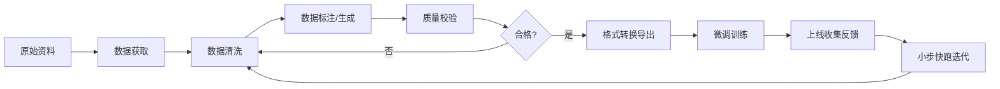

# 大模型微调数据集完全指南


## 一、训练数据的底层逻辑：规模、质量与多样性
先聊一个扎心的事实：很多团队微调翻车，第一反应是调参——学习率从 1e-5 改到 5e-5，LoRA rank 从 8 加到 64，epoch 从 3 加到 10……折腾半个月，模型还是答非所问。最后发现问题根本不在参数，而在数据。**调参决定的是模型学习的「效率」，数据决定的是模型学习的「内容」。教材错了，老师再会教也没用。**

这一章先把数据层面的底层规律讲清楚，后面所有章节的方法论都建立在这些规律之上。

### 1.1 数据规模：模型越大，饭量越大
早期大家迷信「大力出奇迹」，拼命堆参数。DeepMind 在 Chinchilla 论文里做了一个奢侈的实验：训练了 400 多个模型，参数量从几千万到上百亿，数据量从几亿到几千亿 tokens 不等，最后得出一个朴素的结论——

**模型参数量和训练数据量应该等比例增长。** 参数翻倍，数据也得翻倍，否则算力就是在空转。

最有说服力的对比是：1370 亿参数的 LaMDA 只用了 3000 亿 tokens，而 700 亿参数的 Chinchilla 吃了 1.4 万亿 tokens——参数量减半、数据量翻 8 倍，结果后者在一大批任务上反超 GPT-3、Gopher 这些「大块头」。

后来的开源模型基本都在贯彻这个思路，甚至更加激进：

| 模型 | 参数量 | 训练数据量 |
| --- | --- | --- |
| LLaMA-1 | 7B | 超 1 万亿 tokens |
| LLaMA-2 | 7B~70B | 2 万亿 tokens |
| LLaMA-3 | 8B~405B | 15 万亿 tokens |
| Qwen2.5 | 72B | 18 万亿 tokens |


对微调场景的启示：**数据量没有标准答案，但有行业共识。**

+ 轻量级指令微调（让模型学会某个领域的表达风格和高频知识点）：**几千到几万条**高质量样本就能看到明显效果；
+ 通用能力提升（推理、代码这类硬能力）：通常需要**几十万到上百万条**才能在评测上拉开差距；
+ 永远记住：**一万条精洗过的数据，胜过十万条噪声数据。**

### 1.2 数据质量：脏数据的破坏力超乎想象
数据质量的重要性，有几个实验讲得特别明白：

**干净数据 vs 脏数据。** DeepMind 训练 Gopher 时对比过几种数据源：严格过滤去重后的 MassiveWeb，在摘要、预测类任务上明显优于未处理的 C4 和 OpenWebText。Google 的 GLaM 实验进一步确认：高质量数据对生成能力的影响尤其显著——想让模型写人话，先得让它读人话。

**重复数据的毒性。** 有研究把仅仅 0.1% 的数据重复 100 次，其余 90% 保持不变，结果模型性能掉到接近「参数量小一半」的水平。重复数据还会诱发「死记硬背」：PaLM 的测试显示，只出现 1 次的样本被模型记住的概率约 0.75%，而出现 500 次以上的样本，记忆率飙到 40% 以上。模型不是在学知识，是在背课文。

**数据的时效性。** Google 对比过不同年份的 C4 快照：训练数据和测试数据年代差越大，模型表现越差。拿 2014 年的语料回答 2026 年的问题，相当于让一个人用十年前的地图导航——路都改了。

### 1.3 数据多样性：别让模型「偏科」
只喂单一来源的数据，模型就像只读一类书的学生，视野必然受限。LLaMA 的训练数据混合了网页、代码、论文、书籍等多种来源，并且按质量和重要性设置了不同的采样权重——好菜多夹几筷子。

Gopher 的数据配比实验更直观：固定 Wikipedia（2%）和 GitHub（3%）后，在网页、新闻、书籍、C4 之间尝试了 7 种配比，最佳组合是 MassiveWeb 50% + Books 30% + C4 10% + News 10%。增加书籍数据后，模型在长文本逻辑（Lambada 测试）上提升明显——**数据配比就像炒菜时的调味比例，配方不同，出锅的味道完全不同。**

### 1.4 训练集 / 验证集 / 测试集：别把答案泄露给考生
你精心准备的数据集，并不是一股脑全拿去训练的。标准做法是拆成几份，各管一摊事。用「备考」来类比最直观：

| 数据集 | 类比 | 作用 | 关键纪律 |
| --- | --- | --- | --- |
| 训练集 | 日常练习题 | 模型学习规律的核心资料，量大管饱 | 覆盖各种场景变体 |
| 验证集 | 模拟考卷 | 训练中阶段性检验，用于选 checkpoint、调超参 | 发现过拟合就调整策略 |
| 测试集 | 期末绝密试卷 | 训练结束后评估真实水平 | **绝对隔离**，训练全程不得出现 |
| 完整集 | 所有习题库 | 三者的原始合集 | 划分时保证分布一致 |


常见划分比例：

+ 常规场景：**70% 训练 + 15% 验证 + 15% 测试**
+ 小数据场景：**80% 训练 + 10% 验证 + 10% 测试**

几个高频踩坑点：

+ **为什么不能混用？** 测试集泄进训练集，等于考前发答案，评测分数虚高，上线就露馅。
+ **数据不够怎么办？** 用交叉验证：把完整集切成 5 份，轮流拿 4 份训练、1 份验证，类似「轮换座位考试」。也可以用同义改写、句式变换做数据增强来扩充量。
+ **时序数据是特例。** 必须按时间顺序切分，不能随机打散。比如做销量预测，就得用 2024 年之前的数据训练、2025 年的数据测试——随机切等于让模型「偷看未来」。

---

## 二、微调数据集的分类与任务场景
很多人卡在第一关：「给模型喂的数据到底长什么样？」其实格式困惑的根源，是没想清楚自己要做的微调属于哪种任务。任务不同，数据形态完全不同。

先看全景：

<!-- 这是一个文本绘图，源码为：graph TD
    A[预训练模型] --> B[多模态微调]
    A --> C[文本模型微调]
    C --> D[监督微调 SFT]
    C --> E[其他微调]
    C --> F[特殊微调]
    D --> D1[指令微调]
    D --> D2[对话微调]
    D --> D3[领域适配]
    D --> D4[文本分类]
    D --> D5[推理微调 CoT]
    E --> E1[无监督/自监督]
    E --> E2[强化学习微调]
    F --> F1[知识蒸馏] -->


普通开发者在垂直行业微调自己的模型，**90% 的场景落在监督微调（SFT）上**，所以本章重点讲 SFT 的五类任务。强化学习微调和知识蒸馏只做概念性了解。

### 2.0 先搞清楚：预训练和微调的数据为什么不一样
预训练是从零教模型「说话」，吃的是海量非结构化文本（网页、书籍、代码），目标是掌握语言规律。这个过程无需人工标注，就像婴儿学说话——听到的声音足够多，自然就会了。

但想让模型具备**特定能力**（比如「听到问题要按业务规则回答」），就得换成监督微调：每条数据都明确告诉模型「问题是什么，标准答案长什么样」。拿无结构的闲聊语料去做指令微调，模型学了也没印象。

一个直觉判断：**预训练阶段喂的是「原文」，微调阶段喂的是「问答」。**

### 2.1 指令监督微调（Instruction Tuning）
指令监督微调(Instruct Tuning)通过让模型学习详细的指令以及对应的回答来优化模型在特定指令下的表现。

`instruction` 列对应的内容为人类指令， `input` 列对应的内容为人类输入， `output` 列对应的内容为模型回答。下面是一个例子

最基础也最常用的形态。三元组结构：指令、输入、输出。

```json
[
  {
    "instruction": "把这段中文翻译成英文",
    "input": "这家店的招牌菜是外婆红烧肉。",
    "output": "The restaurant's signature dish is Grandma's Braised Pork Belly."
  }
]
```

为什么要 `instruction` 和 `input` 分开？因为同一个输入，任务不同答案就不同。输入「Hello, how are you?」，指令是「翻译成法语」和「翻译成日语」，输出显然不一样。指令字段就是告诉模型「这条数据在练哪门功夫」。

**典型业务场景**：智能教育（作业辅导）、智能办公（文档/邮件处理）、数据分析（按指令解读报表）。

**典型开源数据集**：`shibing624/alpaca-zh`（Alpaca 中文增强版，约 5.2 万条指令样本，覆盖常识问答、文本生成等）。

这类数据集最好造——任务明确、答案客观，很多场景有现成物料（翻译 API、题库+答案），主要工作量在格式转换。

### 2.2 对话微调（Dialogue Tuning）
用多轮对话数据训练模型生成连贯、符合语境的回复，核心是让模型理解对话历史里的上下文、指代和角色关系。

```json
[
  {
    "dialogue": [
      {"role": "user", "content": "我上周买的空气炸锅今天到了"},
      {"role": "assistant", "content": "好的，请问使用过程中有什么问题吗？"},
      {"role": "user", "content": "它通电后指示灯不亮"},
      {"role": "assistant", "content": "请先确认插座是否正常供电，再检查电源线是否插紧。若仍不亮，我可以帮您申请换新，需要提供订单号。"}
    ]
  }
]
```

注意第二轮用户说的是「它」——模型必须从上下文推断出指代的是空气炸锅。这就是对话数据和单轮问答的本质区别。

**典型业务场景**：智能客服、AI 陪伴、语音助手。

**典型开源数据集**：`guanaco-sharegpt-style`（ShareGPT 风格多轮对话）。

### 2.3 领域适配（Domain Adaptation）
预训练模型的通用能力很强，但落到医疗、法律、金融这些垂直领域，术语覆盖不足、专业规则不熟，表现就会露怯。领域适配就是在特定领域数据上微调，让模型补齐这块短板：

```json
[
  {
    "instruction": "分析患者的症状描述",
    "input": "55岁男性，持续性胸骨后疼痛3小时，含服硝酸甘油无效",
    "output": "可能诊断：急性心肌梗死（STEMI），建议立即行心电图检查及心肌酶谱检测",
    "domain": "医疗"
  },
  {
    "instruction": "解释法律条款",
    "input": "《民法典》第1032条",
    "output": "该条款规定自然人享有隐私权，任何组织或个人不得以刺探、侵扰、泄露、公开等方式侵害他人隐私权",
    "domain": "法律"
  }
]
```

这类数据集的核心特征是：**领域术语标注**（医学本体库、法律术语库）、**复杂规则建模**（药物相互作用、合同条款逻辑）、**场景化数据增强**（模拟问诊、合同审查流程）。

**典型开源数据集**：`qiaojin/PubMedQA`（基于 PubMed 文献的医学问答）。

⚠️ 诚实提醒：领域数据集是五类里最难造的。先去 HuggingFace、ModelScope 上检索有没有现成的；没有的话，两条路——人工/专家标注（慢但准），或者 AI 辅助生成（快但必须人工二次确认）。**AI 生成的领域数据未经校验直接拿去训练，等于让模型跟着一个会一本正经胡说八道的老师学习。** 第五章会讲怎么用工具把这条路走顺。

### 2.4 文本分类（Text Classification）
NLP 的经典任务：通过标注数据训练模型对文本做类别预测。结构最简单——文本 + 标签：

```json
[
  {"text": "这款手机续航长达48小时，拍照效果惊艳", "label": "positive"},
  {"text": "系统频繁卡顿，客服响应速度慢", "label": "negative"},
  {"text": "央行宣布下调存款准备金率0.5个百分点", "label": "finance_news"}
]
```

**典型业务场景**：情感分析、内容审核、新闻分类、意图识别。

**典型开源数据集**：`stanfordnlp/imdb`（电影评论情感二分类）。

分类数据的标注可以借助 LabelStudio 这类第三方平台，标注效率和质量都有保障。

### 2.5 推理微调（CoT）
推理微调是 SFT 的特殊形式：在数据里显式标注**思维链（Chain of Thought）**，训练模型不只给答案，还给出分步推导过程。你在 DeepSeek-R1 的回答里看到的 `<think>...</think>` 部分，就是这个东西。

```json
[
  {
    "instruction": "解决数学应用题",
    "input": "小明买了3支铅笔，每支2元；又买了5本笔记本，每本比铅笔贵4元。总花费多少？",
    "chain_of_thought": [
      "铅笔单价：2元/支 → 3支总价：3×2=6元",
      "笔记本单价：2+4=6元/本 → 5本总价：5×6=30元",
      "合计花费：6+30=36元"
    ],
    "output": "总花费为36元"
  }
]
```

**一个反直觉的提醒**：不是所有任务都适合推理模型。推理模型幻觉偏大，处理简单明确的任务时容易「想太多」——把问题复杂化、响应变慢、甚至自己脑补出错。检索、解释类任务让它去做，它找不到依据时会按自己的思路硬编。适合推理微调的反而是这些硬骨头场景：

+ **代码生成与调试**：复杂编程问题的分步求解
+ **数学问题求解**：数学建模、多步计算
+ **复杂数据分析**：多步骤推理和策略规划
+ **法律与金融分析**：从复杂文档中提取关键条款、理清模糊信息

CoT 数据从哪来？三条路：

1. **现成数据集自带解题过程**，如 `AI-MO/NuminaMath-CoT`（约 86 万道数学题，解答均为 CoT 格式，含中国高中练习题和国际奥赛题）；
2. **从推理模型蒸馏**。OpenAI 的 o1/o3 把思维链藏着掖着，而 DeepSeek-R1 完全开源且开放思考过程——目前市面上带思维链的开源数据集，很多都是从 R1 蒸馏来的；
3. **引导非推理模型产出思考过程**（第五章的工具支持这个玩法）。

---

## 三、数据集格式详解：Alpaca 与 ShareGPT
看了上一章那么多形态，你可能有点晕：到底该用什么格式存数据？微调的代码能自动适配吗？

先给结论：**训练框架对数据集没有强制的格式要求。** 因为无论什么格式，进训练器之前都要经过一道「格式化」工序，把字段拼成模型能读的文本。格式的差异，在代码里是被抹平的。

### 3.1 格式化的真相：一切皆可 Prompt 模板
看一段典型的数据预处理代码（以「电商售后客服」场景为例）：

```python
# 定义格式化模板：把每条数据的三个变量拼成一段完整训练文本
# 三个 {} 分别对应：用户问题、思考过程、最终回复
train_prompt_style = """以下是一段电商售后场景的客服对话训练数据。
请先仔细分析问题，再给出一个逻辑连贯、符合售后规则的回复。

### 角色设定：
你是一位专业的电商售后客服，熟悉退换货政策、物流规则和价保流程。

### 用户问题：
{}

### 回复：
<思考>
{}
</思考>

{}"""

# EOS_TOKEN 是结束标记，告诉模型「这段文本到此为止」
# 缺少它，模型可能学不到「什么时候该停止输出」
def formatting_prompts_func(examples):
    # 从原始数据集提取三个字段（按批处理，所以是列表）
    inputs  = examples["Question"]      # 用户问题
    cots    = examples["Complex_CoT"]   # 思考过程
    outputs = examples["Response"]      # 最终回复
    texts = []  # 存放格式化后的文本
    # 逐条把字段填进模板，末尾拼接 EOS 标记
    for input, cot, output in zip(inputs, cots, outputs):
        text = train_prompt_style.format(input, cot, output) + EOS_TOKEN
        texts.append(text)
    return {"text": texts}  # 返回统一字段 text

# batched=True 表示按批次处理，比逐条处理快得多
dataset = dataset.map(formatting_prompts_func, batched=True)
```

处理完后，每条数据就是一个 `text` 字符串。到了训练器这一层，真正关键的参数只有两个：

```python
trainer = SFTTrainer(
    model=model,
    tokenizer=tokenizer,
    train_dataset=dataset,        # 处理好的数据集
    dataset_text_field="text",    # 告诉训练器：读哪个字段做训练
    max_seq_length=max_seq_length,
    packing=False,                # 打包能提速，但可能损伤样本边界，效果优先时关掉
    args=TrainingArguments(
        per_device_train_batch_size=2,   # 每张 GPU 的批量大小
        gradient_accumulation_steps=4,   # 梯度累积：等效批量 = 2×4 = 8
    ),
)
```

看明白了吗？**无论原始数据是 Alpaca、ShareGPT 还是你自己瞎编的三字段格式，最终都被归一化成一段文本。** 所以「选格式」本质上不是技术问题，而是工程约定问题——选社区主流格式，是为了和现成工具链（加载、转换、评估）兼容。

### 3.2 Alpaca 格式：单轮任务的通用解
Alpaca 源自斯坦福 2023 年的指令微调数据集，后来它的 JSON 结构被社区抽象成了一种通用格式：

```json
{
  "instruction": "人类指令（必填）",
  "input": "人类输入（选填）",
  "output": "模型回答（必填）",
  "system": "系统提示词（选填）",
  "history": [
    ["第一轮指令（选填）", "第一轮回答（选填）"]
  ]
}
```

实际案例：

```json
{
  "instruction": "分析以下症状可能的疾病",
  "input": "患者持续发热3天，伴有咳嗽和胸痛",
  "output": "可能诊断为肺炎，建议进行胸部X光检查",
  "system": "请根据症状提供可能的疾病诊断",
  "domain": "医疗"
}
```

特点：结构扁平、字段直白，单轮任务一把梭。多轮对话得手动往 `history` 里拼。

### 3.3 ShareGPT 格式：为多轮与工具调用而生
ShareGPT 最早是社区为多轮对话和工具调用场景设计的数据标准，核心是一个 `conversations` 列表，角色交替出现：

+ 角色标签：`human`（用户）、`gpt`（模型）、`function_call`（工具调用）、`observation`（工具返回）
+ 消息顺序规则：`human` 或 `observation` 在奇数位，`gpt` 或 `function_call` 在偶数位，保证对话逻辑连贯

带工具调用的例子：

```json
[
  {
    "conversations": [
      {"from": "human", "value": "帮我计算一下 1024 × 36"},
      {"from": "function_call", "value": "calculator:1|operation=multiply|a=1024|b=36"},
      {"from": "observation", "value": "36864"},
      {"from": "gpt", "value": "1024 × 36 的结果是 36864。"}
    ],
    "system": "可以使用计算器工具完成数学计算任务。",
    "tools": "calculator: 执行基本数学运算"
  }
]
```

`function_call` 就是模型调用外部工具的「桥梁指令」——想知道天气就调天气 API，想查订单就调订单接口。这是 Agent 类应用的数据基础。

ShareGPT 还能表达**偏好数据集**（RLHF/DPO 用）：同一个问题给一个优选答案和一个劣选答案：

```json
{
  "conversations": [
    {"from": "human", "value": "请给我推荐一本好看的小说。"}
  ],
  "chosen":   {"from": "gpt", "value": "我推荐《百年孤独》，这是一本经典的魔幻现实主义文学作品……"},
  "rejected": {"from": "gpt", "value": "我推荐《百年孤独》。"}
}
```

模型从这种数据里学的不是「怎么答」，而是「哪种答法更好」——这就是偏好对齐的数据形态。

### 3.4 两种格式怎么选
| 维度 | Alpaca | ShareGPT |
| --- | --- | --- |
| 对话历史 | `history` 字段手动拼接（`[["指令","回答"],...]`） | `conversations` 列表自然体现，角色交替 |
| 角色逻辑 | 仅区分指令与输出，无显式角色标签 | 多种角色标签 + 强制奇偶位置规则 |
| 工具调用 | 不原生支持，需在 input 里隐式描述 | `function_call` + `observation` 显式支持，可接外部 API |
| 典型场景 | 指令响应、领域问答、单轮结构化生成 | 多轮对话、客服系统、需实时数据查询的交互 |
| 优势 | 结构简洁，任务导向清晰，快速构建单轮数据集 | 支持复杂对话流与工具扩展，贴近真实人机交互 |
| 短板 | 多轮要手动拼 history | 结构更复杂，构造成本更高 |


一句话：**单轮任务用 Alpaca，多轮/工具调用用 ShareGPT，偏好对齐用 chosen/rejected。**

---

## 四、高质量 SFT 数据集构建方法论
概念讲完了，进入真刀真枪的部分。这一章是被无数项目验证过的落地流程，可以概括为一句话：

**数据处理（文档 → 问答对）+ 数据验证与优化（问答对 → 高质量问答对），两个阶段缺一不可。**



### 4.1 三个先想清楚的原则
1. **对齐业务目标。** 数据集不是越多越好，而是和你要解决的问题强绑定。做电商客服就聚焦订单查询、售后退换、物流跟踪；曾有团队做金融客服微调，误把大量股票分析数据塞进去，结果用户问「信用卡怎么还款」，模型开始讲 K 线——数据跑偏，全盘皆输。
2. **质量优先于数量。** 有团队用 50 万条公开对话数据微调，准确率 60%；换成 5 万条与业务高度匹配的精洗数据，准确率提到 85%。脏数据不只是没用，还会让模型学错，后续怎么调参都补不回来。
3. **覆盖全场景 + 风格统一。** 客服模型既要见「礼貌咨询」，也要见「愤怒投诉」；回复风格要一致，一会儿「亲，这边建议呢」，一会儿公文腔，模型会精神分裂。

### 4.2 数据从哪来：三类渠道
**① 公开数据集——快，但要筛。** 国内外主要平台对比：

| 平台 | 适合领域 | 语言侧重 | 特色 | 访问 |
| --- | --- | --- | --- | --- |
| HuggingFace | NLP/多模态 | 英文为主 | 即装即用（datasets 库）、版本控制 | 需科学上网 |
| ModelScope（阿里） | 中文 AI 应用 | 中文 | 模型-数据协同，国内直连 | ✅ |
| OpenDataLab（上海AI实验室） | 中文场景 | 中文 | 本土最大开源数据平台，CLI/SDK 下载 | ✅ |
| Kaggle | 通用型 | 多语言 | 竞赛生态、API 批量下载 | 需科学上网 |
| Google Dataset Search | 跨平台检索 | 全域 | 元数据聚合搜索 | 需科学上网 |
| awesome-public-datasets | 学术研究 | 中英文 | 领域细分索引（更新放缓） | ✅ |


加载示例（国内网络环境推荐 ModelScope）：

```python
# HuggingFace datasets 库：一行代码加载数据集
from datasets import load_dataset
dataset = load_dataset("glue", "mrpc")  # 示例：加载 GLUE 基准数据集

# ModelScope：国内直连，速度友好，用法几乎一样
from modelscope.msdatasets import MsDataset
ds = MsDataset.load('modelscope/chinese-poetry-collection')  # 中文诗歌数据集
```

⚠️ **License 红线**：用开源数据集前先看协议。`cc-by-nc-4.0` 这类带 NC（非商用）标记的，公司内部业务训练**绝对不能用**，自己学习研究没问题。拿不准协议含义？直接问 AI。

**② 私有数据——和业务最贴，但要脱敏。** 客服历史对话、内部知识库、产品手册、FAQ、业务日志，这些是核心资产。两个必须做：一是**脱敏**（手机号、身份证、地址统统抹掉，合规是底线）；二是**剔除无效内容**（「你好」「在吗」这种寒暄、发表情就没下文的对话，只留「提问+有效回复」的完整片段）。

**③ 合成数据——量大管饱，但必须校验。** 私有数据不够时，让基础大模型批量生成：「生成 100 条用户咨询服装退换货的对话，覆盖尺码不合适、质量问题、超退换期三种情况，回复符合 7 天无理由规则」。隐患很明显——模型可能一本正经地编造规则（公司政策是 15 天，它写 7 天）。**合成数据必须人工对照业务规则逐条校验，核心场景建议 100% 人工过一遍。**

### 4.3 数据清洗三步法
1. **去重。** 先用工具删完全重复，再人工抽查「表述不同但意思相同」的语义重复（「查物流」和「怎么看我的物流信息」）。重复数据会让模型误以为这类问题特别重要，回复时过度偏向。
2. **去噪。** 删乱码、特殊符号、广告链接、误发的内部备注；修正逻辑错误（回复写「退款 24 小时到账」而知识库是「3 个工作日」，这种矛盾必须改对或删除）。错别字也要管——模型会照单全收。
3. **格式统一。** 对话数据统一成固定角色格式；大段文档拆成「问题 + 短答案」。比如会员规则长文本，拆成「会员有哪几种？」「升级金卡需要消费多少？」两条，比一整段好学得多。

### 4.4 数据标注：标准是生命线
标注混乱，模型就学偏。三个动作：

+ **明确标注维度。** 以客服模型为例：意图分类（订单查询/售后投诉/产品咨询）、回复质量评分（1~5 分）、业务规则匹配（符合/不符合）。
+ **选对工具。** 中小团队用 LabelStudio 足够，支持文本/对话标注和预设规则。大批量时分批标注，每批抽 10%~20% 质检。
+ **控制一致性。** 多人标注最容易出「同一句子两人标两类」的问题。解法：先写标注手册（每个标签的定义、边界、正反例），标注前培训，标注中做交叉标注（两人标同一批，一致率要过 90%），不一致的集体讨论定稿。

### 4.5 验证与迭代：数据集不是一锤子买卖
高质量数据集必须多轮迭代：

+ 微调前让模型自评筛选，淘汰不合格样本；结合领域专家意见修正专业性问题；
+ 做好**版本管理**——每次修改可追溯，还能建立「微调效果 ↔ 数据版本」的关联，方便持续打磨；
+ 上线后从三个渠道收集反馈：用户投诉（「模型说能退全款实际只能退一半」）、人工抽检、业务数据统计（某类问题准确率明显偏低就定向补数据）；
+ **小步快跑**：每次补几百到几千条精数据重新微调，别等攒够一大波——一次加太多容易引入新老数据矛盾。有团队每两周迭代 500 条反馈案例，模型准确率每月稳定提升 5%~8%。

### 4.6 避坑清单
+ ❌ **贪多求全**：相关不相关的都堆进来，模型学不到重点。不符合业务目标的数据，再优质也不用。
+ ❌ **迷信自动化**：工具识别不了「回复逻辑错误」和「业务规则过期」，关键环节必须人工。
+ ❌ **标注标准模糊**：全凭感觉标注，等于给模型喂矛盾信号。标注手册先行。
+ ❌ **拿测试集调参**：分数虚高，上线翻车。

---

## 五、Easy Dataset 实战：从领域文献到微调数据集
上一章讲方法论，这一章讲工具。纯手工构造领域数据集有多痛苦，试过的人都知道：文档丢给 AI 生成 QA 对，长文被截断、问题重复、答案幻觉满天飞；分批生成，前后问题撞车；想加个领域标签、换个导出格式，全都得自己写脚本。

[Easy Dataset](https://github.com/ConardLi/easy-dataset) 就是为解决这些具体问题而生的开源工具（作者 ConardLi，社区口碑不错），覆盖 **「文献处理 → 问题生成 → 答案构建 → 标签管理 → 数据导出」** 全链路，兼容所有 OpenAI 格式的 LLM API（DeepSeek、Qwen、豆包、Kimi、Ollama 本地模型都行）。

### 5.1 它到底解决了什么
| 痛点 | Easy Dataset 的解法 |
| --- | --- |
| 大文件丢给 AI，QA 质量差 | 章节感知智能分块，逐块生成 |
| 上下文限制导致截断/重复 | 分块 + 领域树全局约束，降低重复 |
| 没有地方批量管理和标注数据集 | 项目制管理，支持编辑/删除/确认 |
| 领域标签不知道怎么建 | AI 自动生成二级领域树，可手动修正 |
| 推理微调的 COT 不会造 | 支持 DeepSeek-R1 等推理模型生成带思维链答案 |
| Alpaca / ShareGPT 互转麻烦 | 导出时一键选择，还支持自定义字段 |


### 5.2 快速上手
**本地启动**（二选一）：

```bash
# 方式一：NPM（适合想改源码的人）
git clone https://github.com/ConardLi/easy-dataset.git
cd easy-dataset
npm install && npm run dev    # 默认监听 3000 端口

# 方式二：Docker（省心）
# YOUR_LOCAL_DB_PATH 换成你本地的绝对路径，用于持久化项目数据
# 不换的话容器一删，数据全没
docker run -d -p 3000:3000 \
  -v YOUR_LOCAL_DB_PATH:/app/data \
  ghcr.io/conardli/easy-dataset:latest
```

启动后访问 `http://localhost:3000`。

**模型配置**：进「项目设置 - 模型配置」，填三样东西就行——**接口地址、API 密钥、模型名称**。任何兼容 OpenAI 格式的 API 都能接。配置存本地，不上传远端。内置 Playground 可以测连通性，还能同时选三个模型对比回答效果。

> ⚠️ 重要提醒：**别用 Ollama 本地跑的 7B/14B 小模型生成结构化数据**，输出格式极其不稳定，任务报错、数据集出错都拜它所赐。老老实实选长上下文的大模型 API（如 DeepSeek-V3、Qwen-Max）。
>

**核心工作流**：

<!-- 这是一个文本绘图，源码为：flowchart TD
    A[上传 Markdown 文献] --> B[智能分块 + 领域树分析]
    B --> C[按文本块批量生成问题]
    C --> D[问题管理: 删低质问题]
    D --> E[批量生成答案<br/>可选推理模型带 COT]
    E --> F[数据集管理: 编辑/AI 优化/确认]
    F --> G[导出 Alpaca / ShareGPT<br/>JSON / JSONL] -->


几个关键细节：

1. **文献格式**：早期版本只支持 Markdown，PDF/Word 先用 [MinerU](https://github.com/OpenDatalab/minerU) 这类工具转换（新版已支持 PDF、DOCX 直接导入，以官方文档为准）；
2. **分块参数**：在「任务配置」里调文本块最小/最大长度，匹配你文献的信息密度；
3. **问题密度**：默认每 240 字符生成一个问题，2000 字的块约出 8 题，可调；
4. **答案生成**：基于「问题 + 对应文本块」一起生成，保证答案不脱离文献原文；想要思维链就选 DeepSeek-R1 这类推理模型；
5. **批量任务跑的时候别关页面**，关了任务就断（想主动中断，刷新页面即可）。

### 5.3 核心原理：三个模块值得偷师
这个工具的设计思路很值得学习，看懂了你也能造一个。

**① 模型封装：OpenAI 格式是通用货币。** 市面上主流模型厂商的 API 都兼容 OpenAI 格式，所以适配一百家厂商不需要一百套代码，只需要三个变量：API 前缀（都以 `/chat/completions` 结尾）、API Key（标准 Bearer Token 鉴权）、模型名称。注意同一模型在不同平台标识不同：DeepSeek 官方 API 调 R1 传 `deepseek-reasoner`，硅基流动上要传 `deepseek-ai/DeepSeek-R1`。

自己封装一个通用调用函数也就几十行：

```python
from openai import OpenAI  # 官方 SDK，兼容所有 OpenAI 格式 API

def chat(base_url: str, api_key: str, model: str, messages: list) -> str:
    """
    通用的 LLM 调用封装。
    base_url: API 前缀，如 https://api.deepseek.com
    api_key:  鉴权密钥（千万别硬编码进代码仓库，用环境变量）
    model:    模型标识，如 deepseek-chat / deepseek-reasoner
    messages: OpenAI 标准消息格式 [{"role": "user", "content": "..."}]
    """
    client = OpenAI(base_url=base_url, api_key=api_key)
    resp = client.chat.completions.create(
        model=model,
        messages=messages,
        temperature=0.3,   # 生成数据集建议调低随机性，输出更稳定
        max_tokens=4096,   # 限制单次生成最大 token 数，防失控
    )
    return resp.choices[0].message.content

# 调用示例：DeepSeek 官方 API
answer = chat(
    base_url="https://api.deepseek.com",
    api_key="sk-xxx",          # 实际使用时从环境变量读
    model="deepseek-chat",
    messages=[{"role": "user", "content": "用一句话解释 LoRA 微调"}],
)
```

**② 文本分块：章节感知递归分块。** 直接按字符数硬切，会把同一章节劈成两半，生成的问题和答案都缺上下文。LangChain 的 `RecursiveCharacterTextSplitter` 好一些（递归地用句号、逗号逐级切），但最小单元是句子，依然不管章节。Easy Dataset 的做法（`lib/split-markdown` 模块）：

<!-- 这是一个文本绘图，源码为：flowchart TD
    A[设定最小/最大块长度] --> B[识别 Markdown 章节结构<br/># / ## / ###]
    B --> C{章节字数在区间内?}
    C -- 是 --> D[按章节直接成块]
    C -- 超长 --> E[对该章节执行递归切分<br/>保持语义完整]
    C -- 过短 --> F[与相邻章节合并]
    D --> G[输出文本块 + 大纲 + 单块摘要]
    E --> G
    F --> G -->


效果：一个块基本不截断章节，字数落在设定区间，还顺手产出文献大纲和每块摘要。这个思路在 RAG 场景同样适用——分块质量直接决定检索质量。

**③ 提示词工程：LangGPT 结构化风格。** 工具的 5 个核心提示词（建领域树、生成问题、打标签、生成答案、优化答案）都遵循同一套结构：Role（角色）→ Skill（技能）→ Goals（目标）→ OutputFormat（输出格式）→ Variables（变量区）→ Workflow（工作流）→ Examples（示例）。比如打标签的提示词会明确要求「优先匹配二级标签，匹配不到用一级，都不行打『其他』」「输出必须是 JSON 数组，不得改变原数据结构」。

这套写法的价值：**把模型的自由度关进格式的笼子里**，输出稳定性大幅提升——但前提是模型本身具备长上下文理解能力，所以又回到那句提醒：别用小模型跑这类任务。

---

## 六、垂直领域模型评估：测试集与自动化评估
微调完一个模型，loss 曲线很漂亮——然后呢？模型真的变聪明了，还是只是背下了训练集？更糟的情况：学会了专业知识，却把通用对话能力忘了（灾难性遗忘）。**没有评估环节的微调，相当于考完试不对答案。**

### 6.1 为什么通用 Benchmark 不够用
MMLU、ARC 这些榜单刷得再高，落到你的业务场景——法律合同审核、医疗报告分析、公司维修手册——参考意义非常有限。通用语料上表现好的模型，对企业内部「长尾知识」可能一问三不知。实际业务中评估要解决三个具体问题：

1. **选型验证**：Qwen、DeepSeek、GLM…… 没微调之前，谁对我的业务文档理解力更强？不跑自己的数据，盲选必踩坑；
2. **微调效果验证**：微调后真的进步了吗？有没有灾难性遗忘？需要前后对比测试；
3. **RAG 效果归因**：回答错了，是检索没检到，还是模型没用好上下文？需要针对性指标。

### 6.2 三条评估路线
| 路线 | 代表方法 | 适用题型 | 优点 | 短板 |
| --- | --- | --- | --- | --- |
| 确定性评估 | 答案精确匹配 | 判断/单选/多选 | 零成本、零歧义 | 高质量客观题库稀缺，编题成本高 |
| 统计相似度 | BLEU / ROUGE / METEOR | 翻译、摘要 | 自动化程度高 | 只算词汇重叠，「利率上调」和「加息」被判不同，容易误杀好模型 |
| 模型语义评估 | LLM as a Judge | 简答/开放题 | 开放式问答的最优解 | 依赖裁判模型水平和评分 Prompt 设计 |


结论很直接：**客观题用规则判分，主观题用 LLM-as-Judge，终局对比加一轮人工盲测。** 纯人工阅卷在成千上万条数据面前不现实，而且人的主观标准会漂移——「准确」和「生动」的边界，十个专家能给出十一种划法。

### 6.3 测试集怎么造
评估数据集 = 题目 + 标准/参考答案 + 评分规则。Easy Dataset 1.7+ 的评估模块把这事工程化了，设计了五种题型，各有分工：

| 题型 | 考察点 | 举例 |
| --- | --- | --- |
| 判断题 | 核心事实是否搞混，检测幻觉 | 文档说「温度不能超过100度」→ 问「是否可达105度？」 |
| 单选题 | 干扰项下的知识提取与辨析 | 4 个选项选 1 |
| 多选题 | 信息完整性（漏一个点就错） | 答案为字母数组 `["A","C"]` |
| 简答题 | 核心知识点的精简表达（20 字内） | 「2025年公司营收是多少亿？」 |
| 开放题 | 推理与总结能力 | 「根据文档分析设备异响的可能原因」 |


各题型比例可配（比如 30% 判断题测幻觉 + 70% 简答题测理解）。测试集来源也有三条路：

+ **从领域文献提取**：文献切块后按块自动生成题目；
+ **从训练集转化/生成变体**：已有训练数据可以一键转测试集，或者换种问法、换种题型生成「变体」——防止模型背题。小规模数据集场景这个技巧尤其有用：训练集不用割肉划分，多样性不受损；
+ **导入已有题库**：支持 JSON/XLS/XLSX 按模板导入，平台也内置了多学科领域题库。

### 6.4 三种判卷方式
**① 规则判分（客观题）。** 判断/单选/多选答案唯一，直接代码比对，零调用成本。创建评估任务时可以勾多个模型并发「考试」，按题型、标签筛选题目范围，还能从 1000 题里动态抽 50 题快速出结果。

**② 教师模型打分（主观题）。** 简答/开放题答案多样，用一个更强的模型当裁判，给出量化分数 + 定性评语。系统内置了评分标准，但通用标准偏宽泛，**强烈建议按你的业务场景定制评分细则**（Prompt 全开放可改，评分锚点对应 `{{scoreAnchors}}` 变量）。两条纪律：

+ 长期对比时**固定教师模型和评分配置**，否则分数不能横向比；
+ 先拿 20 题小样本跑通，确认裁判口味符合预期，再上量。

**③ 人工盲测（终局裁决）。** 自动化再方便，上线前最后一眼还是得人来。盲测把两个模型的回答匿名化，评审只看质量投票：左好 / 右好 / 平局，类似 Chatbot Arena 的 Side-by-Side。适合开放题、对话类内容的体感对比，也能消除「这个品牌模型肯定好」的刻板偏见。投完票系统揭晓谜底，生成胜率统计——平局多说明俩模型在你的题库下确实半斤八两。

### 6.5 评估闭环
把整章串起来，就是一个完整闭环：

<!-- 这是一个文本绘图，源码为：flowchart LR
    A[领域文献] --> B[生成测试集<br/>5种题型按比例]
    B --> C[客观题: 规则判分]
    B --> D[主观题: 教师模型打分]
    C --> E[评估报告: 量化指标]
    D --> E
    E --> F{分数接近?}
    F -- 是 --> G[人工盲测终裁]
    F -- 否 --> H[选型/迭代决策]
    G --> H
    H --> I[发现短板 → 补充数据 → 重新微调]
    I --> B -->


---

## 写在最后
整篇指南的核心观点其实就三句话：

1. **数据 > 参数。** 调参前先审数据，大部分「模型不行」其实是「教材不行」；
2. **流程 > 灵感。** 获取 → 清洗 → 标注 → 校验 → 导出 → 评估 → 迭代，把每一步做扎实，效果自然来；
3. **工具 > 蛮力。** Easy Dataset 这类工具已经把文献到数据集、测试集到评估报告的链路打通了，没必要手写脚本重复造轮子——但工具生成的每一条数据，最终都得经得起人工的审视。

好的模型不是调参调出来的，是用优质数据「教」出来的。祝微调顺利。

---

