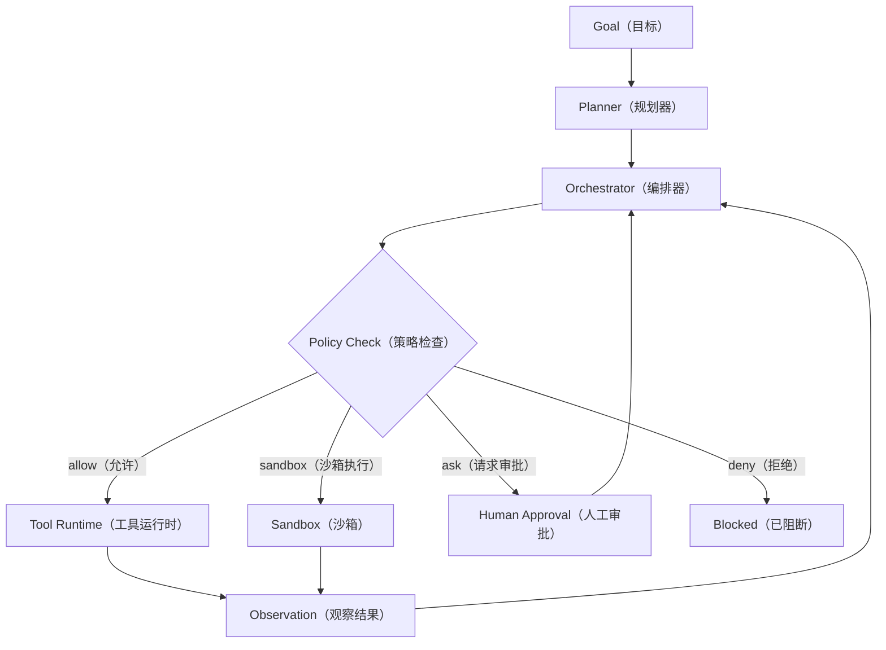
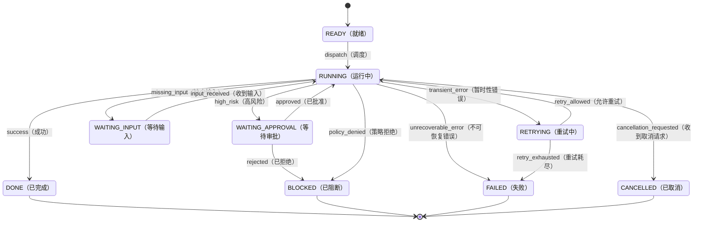
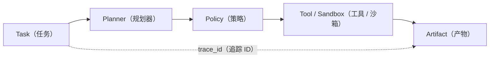
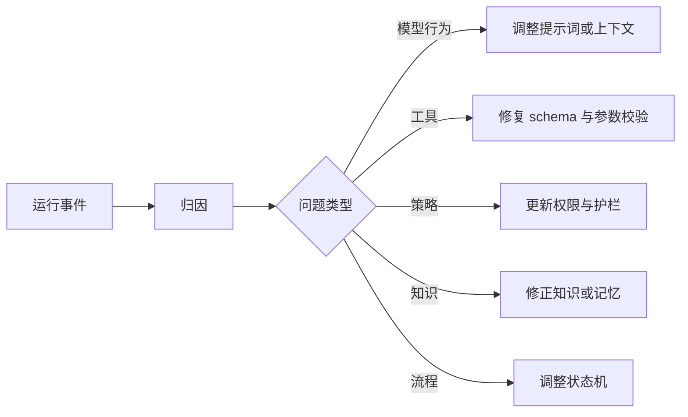

## 第一部分：核心运行机制
**Agent Harness** 是 Agent 的**运行与控制环境**。它把模型、上下文、工具和外部系统组织成一个**可持续、可约束、可恢复、可审计**的任务系统。

> **Agent Harness = 模型推理 + 任务状态 + 执行控制 + 运行证据。**
>

模型负责提出判断和动作候选；**Harness** 决定输入如何进入系统、动作能否执行、结果如何写回状态，以及任务何时结束。

从系统层次看，**模型是推理部件，Harness 是运行控制层，具体 Agent 则是模型、Harness、领域规则和业务能力的组合**。因此，Harness 讨论的重点不是模型“会不会做”，而是系统能否保证任务**沿合法路径、以适当权限、在有限资源内**完成。

### 1. Harness 的边界
| **对象** | **核心作用** | **与 Harness 的关系** |
| --- | --- | --- |
| **Prompt** | 规定模型如何理解和表达 | 是模型输入，不是运行控制系统 |
| **Context** | 提供当前任务需要的信息 | 是运行材料，不是可靠状态存储 |
| **RAG** | 检索并注入资料 | 是上下文来源之一 |
| **Tool** | 暴露外部能力 | 是执行接口，调用权仍由 Harness 管理 |
| **Workflow** | 固定步骤和分支 | 可作为 Harness 的确定性骨架 |
| **Harness** | 管理任务全生命周期 | 统筹状态、路径、权限、恢复和审计 |


**Prompt 和 Context 主要改善模型输入；Harness 负责系统运行质量。**

### 2. 最小架构
<!-- 这是一个文本绘图，源码为：flowchart TB
  A["目标输入"] --> B["任务建模"]
  B --> C["任务状态"]
  C --> D["规划与编排"]
  D --> E["权限与策略"]
  E --> F["工具 / 沙箱执行"]
  F --> G["结果与证据"]
  G --> C
  C --> H{"完成、等待或阻断？"}
  H -- "继续" --> D
  H -- "结束" --> I["交付结果"] -->


一个最小可用 Harness 包含**五类能力**：

+ **任务建模**：把自然语言目标转成目标、约束、输入和完成条件。
+ **状态管理**：保存当前步骤、已完成事项、待解决问题和产物索引。
+ **循环驱动**：组织规划、执行、观察和下一轮决策。
+ **执行控制**：处理权限、审批、超时、重试和终止。
+ **运行证据**：记录关键输入、动作、结果、错误和策略判定。

### 3. 任务状态是核心对象
**Harness 不应只围绕消息运行，而应围绕显式任务状态运行。**

```json
{
  "goal": "分析本月销售异常",
  "constraints": [
    "只使用已授权数据",
    "结论必须引用证据"
  ],
  "current_step": "clarify_baseline",
  "completed_steps": [],
  "pending_questions": [
    "对比基线是上月、去年同期还是预算？"
  ],
  "artifacts": [],
  "status": "waiting_user_input"
}
```

状态至少需要回答：**当前目标是什么、已经完成什么、下一步是什么、为什么停下、需要什么输入、产生了哪些证据。**

任务状态还应记录**状态版本、计划版本、剩余预算、权限主体和已发生的外部副作用**。其中，状态数据库是任务事实的权威来源；模型上下文只是从状态中组装出的临时视图，不能反向充当事实来源。

### 4. 核心闭环
<!-- 这是一个文本绘图，源码为：flowchart LR
  A["感知"] --> B["规划"]
  B --> C["行动"]
  C --> D["观察"]
  D --> E{"下一状态是什么？"}
  E -- "继续执行" --> B
  E -- "等待条件" --> F["等待输入 / 审批 / 外部事件"]
  E -- "终止运行" --> G["完成 / 失败 / 阻断 / 取消"]
  F --> A -->


| **阶段** | **Harness 的工作** | **关键产物** |
| --- | --- | --- |
| **感知** | 识别目标、输入、约束和缺失条件 | 初始任务状态 |
| **规划** | 把目标拆成有依赖、完成条件和风险级别的步骤 | 结构化计划 |
| **行动** | 在策略允许的范围内执行当前步骤 | 工具结果或中间产物 |
| **观察** | 解释执行结果，更新状态并决定下一步 | 状态变化与运行证据 |


> **规划的价值**不是让模型"想得更多"，而是让任务可检查、可中断、可恢复。**观察**也不是把工具输出原样塞回上下文，而是把结果转换成下一轮可用的状态变化。
>

闭环中的“终止”不等于“成功”。任务至少应区分 **completed（完成）**、**failed（失败）**、**blocked（被策略或条件阻断）**和 **cancelled（取消）**；等待输入或审批则是可恢复的暂停状态，不应被误判为任务结束。

### 5. 三类流向
| **流向** | **内容** | **典型载体** | **主要约束** |
| --- | --- | --- | --- |
| **数据流** | 输入、中间结果、最终产物 | message、file、artifact | 来源、格式、版本 |
| **控制流** | 下一步做什么、何时结束 | state、plan、condition | 分支、终止、重试 |
| **执行流** | 动作在哪里、以什么权限发生 | runtime、worker、tool call | 隔离、权限、超时 |


> **三类流向不能全部塞进 Prompt。** 数据应进入状态和产物系统，路径应由编排器管理，真实动作应由运行时和策略系统裁决。
>

### 6. 失败、重试与终止
| **结果类型** | **处理方式** |
| --- | --- |
| 临时网络错误、限流 | **限次重试并退避** |
| 信息缺失 | **等待用户或外部系统补充** |
| 计划或语义错误 | **修改输入或重新规划** |
| 权限拒绝 | **申请审批或终止** |
| 用户取消、预算耗尽 | **安全中止并保留当前状态** |
| 部分步骤成功 | **标记已发生副作用，再决定补偿、续跑或人工处理** |
| 不可恢复错误 | **保留证据并明确阻断原因** |


每个任务都应具备**步数、时间、成本和重试上限**。写操作只有在具备**幂等键**或**补偿机制**时才适合自动重放。

分布式执行通常无法仅靠重试保证“恰好一次”。Harness 应以**至少一次调用 + 幂等处理 + 副作用台账**为基础，避免超时后重复写入或把“未知是否成功”误判为失败。

> **人工介入是正常控制路径**，适用于目标含糊、高风险动作、口径冲突、对外发布和连续失败等场景。
>

### 7. 核心判断
+ **模型可以提出下一步，系统必须保留裁决权。**
+ **上下文可以压缩，关键任务状态和证据不能丢失。**
+ 工具越多不等于 Agent 越可靠；可靠性来自**闭环、边界和恢复机制**。
+ 能回答问题的系统不一定是 Harness；能把目标转成**受控任务链**，并支持**记录、恢复、终止和审计**，才具备 Harness 的基本形态。

---

## 第二部分：控制与执行平面
**控制平面**决定下一步做什么，**执行平面**负责动作在哪里、以什么权限运行。二者共同把模型提出的候选动作转成**受控执行**。

### 1. 组件与边界
| **组件** | **职责** |
| --- | --- |
| **Planner** | 把目标拆成候选步骤 |
| **Orchestrator** | 维护状态机和步骤依赖 |
| **Scheduler** | 处理队列、并发、优先级和取消 |
| **Policy Engine** | 决定允许、审批、隔离或拒绝 |
| **State Store** | 持久化任务状态、版本和 Checkpoint |
| **Tool Runtime** | 调用函数、API 和 MCP 工具 |
| **Sandbox** | 隔离文件、命令、代码和网络访问 |
| **Artifact Store** | 保存大型输入、中间结果和最终产物 |


这些是**逻辑职责**，不要求每项都部署成独立服务。关键是职责边界明确：Planner 提建议，Orchestrator 决定合法转移，Policy Engine 裁决权限，Runtime 执行动作，State Store 保存权威状态。



### 2. 结构化计划
计划应包含**步骤类型、依赖、前置条件、输入输出、风险等级、副作用类型、超时和完成条件**。工具步骤与模型步骤应分离。

```json
{
  "goal": "生成客户流失分析报告",
  "steps": [
    {
      "id": "inspect_schema",
      "type": "tool",
      "tool": "db_schema",
      "risk": "low",
      "outputs": ["schema_summary"]
    },
    {
      "id": "query_churn",
      "type": "tool",
      "tool": "sql_readonly",
      "depends_on": ["inspect_schema"],
      "risk": "medium",
      "outputs": ["churn_rows"]
    },
    {
      "id": "write_report",
      "type": "model",
      "depends_on": ["query_churn"],
      "outputs": ["report_md"]
    }
  ]
}
```

长任务通常采用**短计划滚动推进**。每轮观察后可以调整后续步骤，但**已经执行的动作和证据不能被静默改写**。

计划本身也要版本化。重新规划只能替换尚未执行的部分，并记录**变更原因、旧计划版本和新计划版本**；涉及外部写入的步骤还应声明幂等键或补偿动作。

### 3. 状态机与调度


**状态机限制合法路径**，模型**不能绕过审批、直接修改状态图或跳到未声明的节点**。

可并行的步骤必须**没有写入冲突和顺序依赖**。每个步骤应绑定 `trace_id`、`cancellation_token`、超时、重试上限和幂等键。

### 4. 沙箱是执行边界
**沙箱**负责把高风险动作限制在可控环境，而不是依赖模型自律。

```latex
/mnt/user-data/
  uploads/      # 用户输入，只读
  workspace/    # Agent 工作目录，可读写
  outputs/      # 最终产物，可导出
/mnt/skills/    # 技能定义，按策略读取
```

核心控制包括：

+ 路径解析后再校验允许根目录，防止 `../`、软链接和快捷方式越界。
+ 文件、网络、CPU、内存、磁盘和执行时间均设**配额**。
+ **上传、工作区和输出目录分离**。
+ 凭据**按需注入、短期有效，用后回收**。
+ 网络出口采用**域名或服务白名单**。
+ 命令使用**参数数组执行**，避免不必要的 shell 解释。

| **动作** | **默认策略** |
| --- | --- |
| 文件读取、检索 | 允许，但受目录边界约束 |
| 构建与测试 | 项目内允许，设置超时 |
| 文件修改与删除 | 参数校验，必要时审批 |
| 外部网络访问 | 目标受限并记录审计 |
| 凭据、生产环境操作 | **默认审批或拒绝** |


### 5. Tool、Skill 与 MCP
| **类型** | **作用** |
| --- | --- |
| **Tool** | 提供一个可调用动作，如函数或 API |
| **Skill** | 描述完成一类任务的方法、约束和资源 |
| **MCP Server** | 以统一协议暴露外部工具服务 |


工具必须有明确的**输入 schema**、**结构化输出**、**超时**、**风险等级**、**副作用声明**和**审计标识**。工具返回值与检索内容都属于不可信输入，进入模型上下文前仍需进行格式、来源和敏感信息检查。

```json
{
  "name": "sql_readonly",
  "input_schema": {
    "type": "object",
    "properties": {
      "query": {"type": "string"},
      "max_rows": {"type": "integer", "default": 1000}
    },
    "required": ["query"]
  },
  "policy": {
    "readonly": true,
    "timeout_ms": 30000
  }
}
```

**Skill 和工具应按需加载**，避免把完整工具说明一次性放进上下文。MCP 扩大能力面时，也必须进入**统一权限、超时和审计体系**。

### 6. 权限策略
**权限必须由系统执行，而不是只写进 System Prompt。**

```yaml
permissions:
  allow:
    - "Read"
    - "Grep"
    - "sql_readonly"
  ask:
    - "Bash(npm run *)"
    - "Write(/mnt/user-data/outputs/**)"
  deny:
    - "Bash(rm -rf *)"
    - "sql_write"
    - "WebFetch(*://169.254.169.254/*)"
```

一次权限判定至少包含五个要素：**主体（谁）**、**动作（做什么）**、**资源（对什么）**、**环境（在何处、何时）**和**任务依据（为什么）**。身份认证只确认主体是谁，授权策略才决定该主体是否能执行当前动作。

策略通常从**组织、租户、会话、步骤和工具五层叠加**。判定顺序采用 `deny → ask → allow → default deny`，高层禁令不能被低层授权覆盖。策略决策应记录匹配规则、策略版本和理由，使同一输入可以复核。

### 7. 核心要求
+ **每个步骤**都有状态、输入、输出、错误和完成条件。
+ **每次工具调用**都有 schema、超时、权限判定和 `trace_id`。
+ 高风险动作可被策略系统**阻断或转入人工审批**。
+ 文件和网络访问**不能越过沙箱边界**。
+ 执行**可取消、可审计、可恢复**；工具失败不会破坏主循环。

---

## 第三部分：状态与治理平面
**状态与治理平面**保证任务可恢复、动作有边界、运行可追踪。上下文和记忆只是其中的数据来源，不能替代可靠状态、权限和审计系统。

### 1. 状态分层
| **层级** | **内容** | **生命周期** | **典型存储** |
| --- | --- | --- | --- |
| **Turn State** | 当前输入与工具结果 | 单轮 | 内存 |
| **Thread State** | 消息、计划、checkpoint | 多轮 | DB / Checkpointer |
| **Task State** | 步骤、审批、错误、产物 | 任务周期 | DB |
| **Memory** | 稳定偏好、业务事实、工作流模式 | 长期 | 关系库 / 向量库 / 文件 |
| **Audit State** | 权限判定、工具调用、数据访问 | 合规周期 | 日志仓库 / 审计库 |


> **模型上下文可以压缩，系统状态不能丢失。**
>

大型结果放入文件或对象存储，状态只保存**索引、摘要和校验信息**。

Thread State 表示交互容器，Task State 表示可执行任务；二者不是简单的上下级关系：一个会话可以发起多个任务，一个长任务也可以跨越多轮交互。发生冲突时，应以带版本号的 Task State 和审计事件为准，而不是以对话中的自然语言摘要为准。

### 2. 上下文与记忆的最小接口
每一轮只组装当前决策需要的信息：

1. 系统规则和权限边界。
2. 当前目标、约束和完成条件。
3. 当前计划与下一步候选。
4. 最近的必要交互。
5. 工具结果摘要与产物索引。
6. 与任务直接相关的记忆和 Skill。

长期记忆只保存**稳定、可复用、可追溯**的信息。每条记忆应标明**来源、范围、置信度、敏感级别和有效期**。**未经筛选的历史对话不应直接成为长期记忆。**

```json
{
  "memory_id": "mem_metric_001",
  "scope": "tenant",
  "type": "business_metric",
  "content": "GMV 使用 paid_amount，并排除已退款订单",
  "source": "approved_by:finance_ops",
  "confidence": 0.95,
  "expires_at": null
}
```

### 3. Checkpoint 与恢复
**Checkpoint** 至少覆盖**用户输入后、工具调用前后、文件写入后、人工审批后、上下文压缩前和最终交付前**。

Checkpoint 是某一时刻可恢复的**状态快照**，事件日志则记录状态为何发生变化。前者解决快速恢复，后者解决追溯与审计；仅保存快照会丢失变化原因，仅保存事件则会增加恢复成本。

```json
{
  "event_id": "evt_0007",
  "run_id": "run_001",
  "type": "tool_result",
  "step_id": "query_churn",
  "timestamp": "2026-07-14T10:20:31+08:00",
  "payload": {
    "tool": "sql_readonly",
    "status": "success",
    "artifact": "/outputs/churn_rows.csv"
  }
}
```

恢复时遵循**四条规则**：

+ 纯推理步骤可以**重新生成**。
+ 只读工具可以**重跑**，但原始证据仍需保留。
+ 写操作**默认不重放**，除非具备幂等键或补偿逻辑。
+ **审批结果必须持久化**，恢复后不得绕过或重复执行。

### 4. System Prompt 与 Guardrails
**System Prompt** 定义模型行为边界，但**不是安全系统本身**。真正的安全边界由策略引擎、工具校验和沙箱执行。

| **层级** | **检查对象** | **示例** |
| --- | --- | --- |
| **Input Guardrail** | 用户输入 | 注入攻击、恶意 URL、越权要求 |
| **Plan Guardrail** | 计划步骤 | 生产库写入、批量删除、高风险外发 |
| **Tool Guardrail** | 工具参数 | SQL 只读、路径边界、域名白名单 |
| **Output Guardrail** | 最终输出 | PII、密钥、受限数据和错误引用 |


```latex
你是企业数据分析 Agent，只能使用已授权数据源。
数据库查询必须先通过只读 SQL 策略检查。
不得输出手机号、身份证号、访问令牌或私钥。
证据不足时列出缺失信息，不得编造指标口径。
```

**提示词**负责让模型遵循规则；**Guardrail** 负责检查模型意图；**Policy 与 Sandbox** 负责强制限制真实动作。

来自网页、文档、邮件、检索结果和工具返回的内容都可能包含提示注入。系统必须区分**指令与数据**：外部内容只能作为证据参与推理，不能自行提升权限、修改系统规则或授权工具调用。

### 5. 可观测性
可观测性需要回答：**任务为何这样执行、哪一步失败、哪个工具慢、哪些策略被触发、失败应如何改进。**



#### Trace
**Trace** 串联一次请求的模型调用、计划、策略、工具、沙箱、记忆检索和输出护栏。每个 span 至少记录**父子关系、步骤、状态、耗时和关键属性**。

#### Logs
日志至少包含 `timestamp`、`level`、`trace_id`、`run_id`、`step_id`、用户或租户、事件类型、决策和原因。

> **密钥不得进入日志**；文件只记录 hash、大小和类型；大型工具返回写入 artifact，日志只保存摘要和路径。
>

#### Metrics
核心指标包括**任务成功率、平均步骤数、重试次数、策略拒绝次数、审批等待时间、工具错误率、模型成本、沙箱超时和上下文压缩次数**。

可观测性用于理解系统运行，审计用于证明关键动作符合规则。两者可以共享 `trace_id`，但审计记录应具备更严格的**访问控制、保留周期、完整性保护和不可抵赖性**，不能直接等同于普通日志。

### 6. Feedback Loop
反馈闭环把**用户评价、人工审核、失败 trace、策略命中和返工记录**转成系统改进。



> **反馈必须落到可验证的改动。** 仅保存"用户不满意"无法形成治理闭环，应同时记录**症状、根因、修复项和验证指标**。
>

提示词、模型、工具、策略和知识库的变更都应带版本，并先通过固定评测集和历史失败样本验证。反馈闭环的目标不是持续“调模型”，而是找到故障所属层级，以最小范围修复并防止回归。

### 7. 核心要求
+ 上下文**可重建**，不依赖模型"记住"历史。
+ Checkpoint 覆盖**关键状态转移和副作用边界**。
+ 记忆有**来源、范围、权限和失效机制**。
+ Guardrails 覆盖**输入、计划、工具和输出**。
+ Trace 串起**模型、策略、工具、沙箱和产物**。
+ 失败案例能够转化为**明确、可验证的改进项**。

---

## 第四部分：参考架构——从理论模型到系统分层
前三部分回答的是 Agent Harness **由什么构成、如何运行、如何受控**。本部分进一步说明这些理论对象如何映射为系统边界，但不展开具体产品选型和部署细节。

企业级 Harness 的重点不是增加模型能力，而是把**渠道、控制、执行和治理解耦**，让同一套任务系统可以安全接入 Web、IM、CLI 和 API。

### 1. 分层架构
<!-- 这是一张图片，ocr 内容为： -->


**渠道**只传递用户、消息、附件和展示偏好；**接入层**处理认证、路由、流式返回和限流；**Harness** 管理状态、计划、权限和审计；**执行层**承载沙箱、工具、文件和外部系统。

### 2. 统一任务协议
多渠道请求应先转换成**统一任务对象**，避免 Agent 逻辑散落在不同前端。

```json
{
  "request_id": "req_001",
  "channel": "web",
  "user": {
    "user_id": "u_1001",
    "tenant_id": "acme",
    "roles": ["analyst"]
  },
  "goal": "按 SOP 处理退款申请",
  "constraints": [
    "不得跳过退款规则检查",
    "高风险申请必须人工审批"
  ],
  "completion_criteria": [
    "生成可追溯的处理决定",
    "决定已进入合法终止状态"
  ],
  "inputs": [
    {"type": "text", "content": "订单号 O-2026-001"}
  ],
  "runtime": {
    "stream": true,
    "max_steps": 20,
    "timeout_seconds": 300,
    "max_cost": 2.0
  }
}
```

运行事件同样保持**统一**：

```json
{
  "event": "step.completed",
  "event_id": "evt_001",
  "state_version": 7,
  "trace_id": "tr_001",
  "run_id": "run_001",
  "step_id": "check_order",
  "status": "success",
  "summary": "订单存在，金额 129.00，未超过退款上限",
  "evidence": ["artifact://order/O-2026-001"]
}
```

统一协议不是简单统一字段名，而是建立稳定的**语义边界**：渠道提交意图和输入，Harness 生成并维护任务状态，执行层返回结构化结果，治理层记录策略判定和证据。任何渠道都不能直接修改任务状态、绕过策略或自行宣告任务完成。

### 3. 架构不变量
参考架构可以有不同实现，但应始终保持以下不变量：

+ **状态唯一性**：关键任务事实有明确的权威来源和版本，不能由模型文本或多个组件分别维护。
+ **转移合法性**：所有状态变化都经过编排器校验，并记录触发条件、原因和证据。
+ **执行可裁决**：模型提出的是候选动作，策略系统对真实执行保留最终裁决权。
+ **副作用可追踪**：外部写入具有幂等标识或补偿路径，并能区分未执行、已执行和结果未知。
+ **暂停可恢复**：等待输入、等待审批和系统中断不会丢失任务状态，也不会绕过原有约束。
+ **证据可关联**：计划、策略、工具调用、状态变化和产物能通过统一标识形成完整因果链。
+ **资源有上限**：步骤数、运行时间、成本、重试和并发均受预算约束，不能形成无界循环。

参考架构的价值不在于给出唯一实现，而在于确保前三部分定义的**任务状态、控制平面、执行边界和治理机制**在不同渠道下仍保持一致。

> **最终判断：Agent Harness 的本质不是一组工具或一段 Agent 循环，而是一套围绕任务状态建立的受控运行协议。** 模型能力决定系统可能做到什么，Harness 决定这些能力能否以可验证、可恢复和可治理的方式发生。
>

