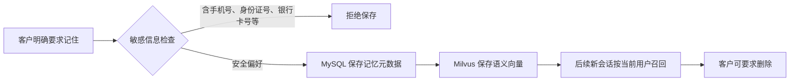

## 1. 阶段定位
第二阶段完整继承第一阶段的智能投保、订单支付、电子保单、推广归因和双人格 Agent Harness，并解决两个新问题：

1. Agent 如何基于保险条款和服务规则回答复杂问题，而不是依赖模型已有知识。
2. Agent 如何跨会话记住客户偏好，同时避免保存敏感信息。

> **本阶段主题**
>
> 构建“**有依据的保险知识服务**”和“**可持续的客户上下文**”。
>

## 2. 本阶段新增业务
### 2.1 H5 用户端
+ **有依据问答**：使用 Agentic RAG 咨询保障责任、等待期、报销比例、免责范围和服务规则。
+ **来源展示**：查看聚合后的知识来源、文档版本和直接支持结论的条款片段。
+ **拒绝推测**：知识库没有明确规定时，返回“当前知识库无法确定”。
+ **授权记忆**：明确要求“请记住”时保存家庭保障背景、预算和产品偏好。
+ **跨会话召回**：在新会话中召回当前客户自己的长期记忆，也可以要求删除。
+ **材料识别**：从有效保单发起服务，上传医疗票据图片并核对模型识别字段。
+ **服务记录**：在“保单服务”中查看本人已经提交的服务记录。

### 2.2 PC 运营端
+ **知识治理**：管理保险知识文档，执行“上传 → 索引 → 检索测试 → 发布”。
+ **检索审计**：查看问题、召回数量、最高得分、测试人员和时间。
+ **材料受理**：查看原始材料、识别字段和模型置信度，并决定受理或不受理。
+ **趋势分析**：使用运营 Agent 查询最近 7、30、90 天的核心经营指标。
+ **分析维度**：按日期或产品查看趋势图和分析结论。
+ **会话隔离**：按用户身份隔离查看 Agent 历史会话。

## 3. Agentic RAG 执行流程
<!-- 这是一张图片，ocr 内容为： -->


<!-- 这是一张图片，ocr 内容为： -->


> **核心原则**
>
> Agent 最多执行受控的多轮检索。检索工具只返回**候选证据**，最终回答还必须判断**证据是否直接支持结论**。
>

## 4. RAG 的关键设计
### 4.1 只检索已发布知识
知识文档不是上传后立即对 Agent 生效，而是经过：

```latex
上传草稿 → 切分与索引 → 检索测试 → 发布
```

文档重新索引后，旧测试记录失效；至少产生一条新的有效检索记录才能发布。

> 知识上线是一个**可审计的发布流程**，而不是一次不可见的向量写入。
>

### 4.2 混合检索与降级
+ **文档切分**：按段落切分，并使用有限长度和重叠窗口保留上下文。
+ **向量召回**：BGE-M3 生成向量并写入 Milvus。
+ **关键词召回**：BM25 补充产品名、责任名称和数字条款等精确匹配。
+ **结果融合**：RRF 融合向量与关键词排序。
+ **语义重排**：BGE Reranker 对候选片段再次排序。
+ **降级策略**：Reranker 不可用时回退到融合结果，避免知识问答完全不可用。

### 4.3 引用聚合与拒绝推测
同一文档、同一版本和同一核心依据只展示一次，避免用户看到重复引用。

> **检索到相关文档，不等于证据足以支持结论。** 没有直接证据时，Agent 必须拒绝推测。
>

## 5. 客户长期记忆
> **长期记忆不是聊天记录归档。**
>
> 只有客户明确表达“请记住”时，Agent 才能调用记忆工具保存授权偏好。
>



关键约束：

+ **用户隔离**：每条记忆绑定 H5 用户 ID，不能跨用户召回。
+ **记录管理**：MySQL 保存可管理、可删除的记忆记录。
+ **语义索引**：Milvus 只承担语义召回。
+ **敏感拦截**：手机号、身份证号、银行卡号等敏感标识禁止写入长期记忆。
+ **能力边界**：记忆用于个性化沟通，不能替代保险条款和真实业务数据。

## 6. 多模态服务材料
客户上传医疗费用发票图片后，原始文件不会直接交给模型：

1. **基础校验**：校验文件类型和大小。
2. **安全解码**：使用 Pillow 解码图片、修正 EXIF 方向并限制像素尺寸。
3. **格式标准化**：将图片统一转换为 JPEG。
4. **模型识别**：通过阿里百炼调用 **Qwen3.5-Plus**。
5. **结构化提取**：按固定 Schema 提取票据号、医院、日期和金额等字段。
6. **客户确认**：核对识别结果后提交服务申请。
7. **运营审核**：PC 端查看原始材料、识别字段和置信度。

> **安全边界**
>
> 材料中的文字被视为不可信输入，不能改变模型任务；识别置信度只用于运营审核，不向客户展示技术判断细节。
>

## 7. 运营 Agent 趋势分析
运营 Agent 不接收任意 SQL。模型只能选择：

+ **指标**：订单量、订单保费、有效保单量、有效保单保费。
+ **时间范围**：最近 7、30、90 天。
+ **分析维度**：按日期或按产品。

后端把 Core 业务事实同步到 Analytics 库，再通过白名单查询生成指标和图表。这样既保留自然语言分析能力，也避免模型构造危险或口径不一致的 SQL。

## 8. 关键设计
### 8.1 RAG 是 Agent 的工具，不是另一套聊天系统
第二阶段继续使用第一阶段的 LangChain Agent Kernel。知识检索、长期记忆和趋势分析作为新的受控工具注册到原有 Harness，因此人格、权限、Trace 和结构化输出保持一致。

### 8.2 知识、记忆和业务事实分开
+ **知识库**回答保险条款和服务规则。
+ **长期记忆**保存客户明确授权的偏好。
+ **业务工具**查询真实订单、保单和产品。

> 三类上下文的**来源、可信度和生命周期不同**，不能混成一段无来源的模型上下文。
>

### 8.3 模型能力通过网关隔离
文本咨询继续使用 DeepSeek；图片材料通过独立的百炼多模态网关调用 Qwen3.5-Plus。领域服务依赖统一接口，不直接依赖具体厂商 SDK，便于替换模型和测试。

### 8.4 评测覆盖“回答”和“依据”
真实模型评测不仅检查是否出现关键结论，还检查是否调用正确工具、是否返回结构化区块、是否存在有效引用和 LangSmith Trace。

## 9. 本阶段使用的主要技术
| Agent 技术 | 在本阶段的作用 |
| --- | --- |
| **Agentic RAG** | 多问题、多轮检索与证据充分性判断 |
| **BGE-M3** | 知识和长期记忆的向量表示 |
| **Milvus** | 保险知识与客户记忆的向量索引 |
| **BM25 + RRF** | 关键词召回和多路结果融合 |
| **BGE Reranker / FlagEmbedding** | 候选证据语义重排 |
| **Query Rewrite / Multi-query** | 将复杂问题拆成原问题和受控改写问题 |
| **元数据过滤** | 按产品、文档类型和发布状态限定知识范围 |
| **引用聚合与拒绝推测** | 保证回答与证据一致 |
| **长期记忆工具** | 保存、召回和删除客户授权偏好 |
| **Qwen3.5-Plus / 阿里百炼** | 医疗票据多模态识别 |
| **结构化输出** | 返回知识引用、趋势图表和票据字段 |
| **LangSmith / LLM 评测** | 观察检索工具调用并执行真实模型回归 |


业务底座继续使用第一阶段的 **Vue 3、FastAPI、MySQL 和 Redis**。新增的知识中心、服务申请中心和分析库，主要用于支撑 Agent 获取**可治理的知识、材料和经营事实**。

## 10. 关键代码导航
以下路径均相对于第二阶段项目根目录：

| 相对路径 | 用途 |
| --- | --- |
| `backend/src/zbt/domains/agent/tools.py` | 在原 Agent Harness 中注册知识检索、长期记忆和运营趋势分析工具，并实现受控 Multi-query |
| `backend/src/zbt/harness/kernel.py` | 聚合 Agent 引用的知识片段，生成去重后的结构化来源区块 |
| `backend/src/zbt/domains/knowledge/service.py` | 实现知识文档上传、索引、检索测试、发布以及只检索已发布版本的治理流程 |
| `backend/src/zbt/domains/knowledge/chunking.py` | 按段落、长度与重叠窗口切分保险条款 |
| `backend/src/zbt/domains/knowledge/retrieval.py` | 实现 BM25、RRF 融合和重排协议 |
| `backend/src/zbt/infrastructure/embedding/bge_model.py` | 封装 BGE-M3 向量模型及本地模型加载 |
| `backend/src/zbt/infrastructure/embedding/reranker.py` | 封装 BGE Reranker，并向上层提供统一语义重排能力 |
| `backend/src/zbt/infrastructure/milvus/knowledge_index.py` | 保存和检索保险知识向量，并执行元数据过滤 |
| `backend/src/zbt/domains/agent/memory.py` | 管理客户授权记忆、敏感标识拦截、用户隔离、召回和删除 |
| `backend/src/zbt/infrastructure/milvus/memory_index.py` | 按用户保存和召回长期记忆向量 |
| `backend/src/zbt/domains/service_request/preprocessing.py` | 在模型识别前完成真实图片解码、方向修正、尺寸限制和格式标准化 |
| `backend/src/zbt/infrastructure/bailian/vision_gateway.py` | 通过阿里百炼调用 Qwen3.5-Plus，并按固定 Schema 提取医疗材料字段 |
| `backend/src/zbt/infrastructure/mysql/analytics_queries.py` | 将 Core 数据同步到 Analytics，并向运营 Agent 提供白名单趋势查询 |
| `backend/src/zbt/api/v1/admin_knowledge.py` | 提供知识上传、索引、检索测试和发布接口 |
| `frontend/apps/h5/src/App.vue` | H5 有依据问答、历史会话、记忆交互和保单服务入口 |
| `frontend/apps/admin/src/App.vue` | PC 知识中心、材料审核、趋势图表和运营 Agent 历史入口 |


## 11. 第二阶段边界
> **第二阶段结论**
>
> 系统已经能够处理复杂知识问答、客户长期记忆、材料识别和经营趋势；需要暂停、人工审批、恢复执行和异步退款的长流程，由第三阶段完成。
>

