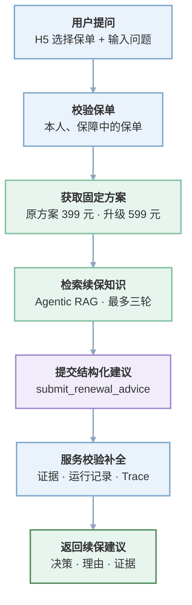

## 一、功能概述
现有客户保障顾问能做的：产品咨询、保费测算、投保引导、查自己的订单和保单、退保进度、知识问答、长期记忆等。它基于同一个 Agent Kernel，通过 `customer` 人格的白名单决定能用哪些工具。

本次新增一个“续保规划”能力：用户从自己的保单里选一张保障中的保单，提出续保问题（比如“我的医疗险快到期了，原方案 399 元、升级方案 599 元，哪个更适合我？升级后等待期要不要重新算？”），系统在现有 Agent 能力之上，给出结构化建议。

几条基本设定：

+ 原方案续保 399 元、升级保障方案 599 元，由后端提供，**请求方不能传入**。预算不预设，用户可以在问题里说明自己的预算（比如“我每年 1000 元预算”）。
+ 建议必须能说清“选哪个方案、为什么、还缺什么信息”，有知识依据时给出证据；没有依据时明确说无法确定，**不能编造**。
+ 本次只做后端接口，不做前端页面，也不创建真实续保订单、不执行支付、不修改原保单状态。

这里不把边界列得太细，接口路径、字段命名、响应格式这些可以按项目现有风格自己定，后面验证要点能对上就行。

## 二、用户提问后，系统会做什么


1. 用户（当前登录的 H5 用户）调用续保接口，带上保单 ID 和问题。
2. 后端先确认这张保单存在、属于当前用户、且处于保障中；不是的话直接返回**统一错误**，**不区分“不存在”和“属于别人”**，避免泄露信息。
3. Agent 拿到保单信息后，再取两个候选方案。
4. 问题里如果涉及等待期、保障责任、报销范围这类事实，Agent 调用现有的知识检索工具（Agentic RAG）去已发布的知识里找依据；复杂问题可以先拆成几个子问题再检索。
5. Agent 综合保单、方案、知识和用户关注点，得出建议，并调用一个提交工具把结构化结果交回来。
6. 后端应用服务校验这份结构化结果（方案必须是候选里的、引用必须来自本次检索、知识不足时不能编造），再补上保单信息、运行记录和 Trace，组成接口响应返回。

## 三、开发步骤
下面按依赖顺序一步一步来。每一步给出涉及的文件、要做什么，以及一个只有轮廓的代码骨架——**骨架里的逻辑需要自己补全**，注释里写明了要补什么。建议每完成一步就检查一遍相关功能没有受影响。

### 步骤 1：定义接口请求参数
这一步的目的：先固定接口入口（保单 ID + 问题两个入参），后面路由、服务和测试都要围绕它展开。

新增文件：`backend/src/zbt/api/v1/renewal_advice.py`

接口至少需要两个入参：保单 ID 和问题文本。这两个字段是前端或 API 调用方传进来的参数，不是后端返回的字段。骨架：

```python
from pydantic import BaseModel, Field


class RenewalAdviceRequest(BaseModel):
    policy_id: str = Field(min_length=16, max_length=64)
    question: str = Field(min_length=5, max_length=500)
```

**需要补充的逻辑**：

+ 本步骤先只放请求模型；路由工厂函数和处理函数放到步骤 9。

### 步骤 2：定义响应类型
这一步的目的：确定后端返回前端的格式。请求参数（步骤 1）定义前端传什么，这里定义后端回什么，两者正好相对。

响应类型要自己定义，建议放在 `backend/src/zbt/api/v1/renewal_advice.py` 里，和步骤 1 的请求参数放同一个文件；单独建一个模块文件放也可以。

有一点要特别注意：项目里有个公共文件 `backend/src/zbt/api/responses.py`，里面的 `success_response` 函数是所有接口共用的返回包装（统一包成 `success / data / meta` 三层）。你定义自己的响应类型时，**不要往这个文件里加内容，也不要改动或删除 **`success_response`，否则其他接口都会受影响、后端无法启动。

完整代码（放在 `backend/src/zbt/api/v1/renewal_advice.py` 里，与步骤 1 的请求类型放在同一个文件）：

```python
from typing import Literal

from pydantic import BaseModel, ConfigDict, Field


class RenewalResponseBase(BaseModel):
    model_config = ConfigDict(extra="forbid")


class RenewalPolicyResponse(RenewalResponseBase):
    policy_id: str
    policy_no: str
    product_name: str
    plan_name: str
    coverage_end: str


class RenewalRecommendationResponse(RenewalResponseBase):
    decision: Literal[
        "RENEW_ORIGINAL",
        "UPGRADE",
        "NEED_MORE_INFORMATION",
        "CANNOT_DETERMINE",
    ]
    selected_option_code: Literal["RENEW_ORIGINAL", "UPGRADE"] | None = None
    selected_option_name: str | None = None
    premium_cents: int | None = Field(default=None, ge=0)
    summary: str = Field(min_length=1, max_length=500)
    reasons: list[str] = Field(default_factory=list, max_length=3)


class RenewalEvidenceResponse(RenewalResponseBase):
    document_id: str
    document_version: int = Field(ge=1)
    title: str
    source_name: str
    excerpt: str


class RenewalAdviceData(RenewalResponseBase):
    run_id: str
    thread_id: str
    status: Literal["COMPLETED"] = "COMPLETED"
    policy: RenewalPolicyResponse
    recommendation: RenewalRecommendationResponse
    missing_information: list[str] = Field(default_factory=list, max_length=3)
    evidence: list[RenewalEvidenceResponse] = Field(default_factory=list, max_length=5)
    invoked_tools: list[str]
    trace_id: str | None = None
    trace_url: str | None = None


class RenewalResponseMeta(RenewalResponseBase):
    request_id: str
    server_time: str


class RenewalAdviceResponse(RenewalResponseBase):
    success: Literal[True] = True
    data: RenewalAdviceData
    meta: RenewalResponseMeta
```

几点说明：`RenewalResponseBase` 统一加了 `extra="forbid"`，返回多余字段会被拒绝；`decision` 也可以用步骤 4 定义的 `RenewalDecision` 代替这里的字面量；`coverage_end` 对应项目现有保单数据的 `coverage_end` 字段（不要写成 `coverage_end_date`）；后续步骤 9 在路由上声明 `response_model=RenewalAdviceResponse` 即可。另外注意：响应类型是后端返回前端的格式，和步骤 1 的请求类型是两个方向，不要混在一起。

### 步骤 3：定义 Agent 内部提交结构
这一步的目的：让 Agent 交回的结果有固定形状，服务才能校验；这个结构也是步骤 6 提交工具的参数来源。

修改文件：`backend/src/zbt/harness/schemas.py`

Agent 结合保单信息、候选方案和检索到的知识，判断应该维持原方案还是升级、证据够不够、还缺哪些信息。判断完成后，它把决策、选中的方案、理由和知识引用作为参数传给提交工具；提交工具把这些参数整理成一个 `RenewalAdviceBlock` 对象，放进 Agent 的运行结果里，应用服务之后会从结果中取出来用。提交工具到步骤 6 才实现，所以本步骤先把结构定好。先分清前三个步骤定义的三种格式：

+ 步骤 1 是请求类型：前端传给后端的（`policy_id`、`question`）；
+ 步骤 2 是响应类型：后端返回前端的；
+ 步骤 3 是内部提交结构：Agent 提交给应用服务用的，不经过 HTTP，前端看不到，也不会直接收到它。

参考现有 `backend/src/zbt/harness/schemas.py` 里 `QuoteBlock`、`KnowledgeSourcesBlock` 的写法，骨架：

```python
class RenewalAdviceBlock(StrictModel):
    # 需要补充的字段：
    # - type 固定为 "renewal_advice"，version 固定为 "1.0"
    # - decision：建议的决策类型，至少覆盖“维持原方案 / 升级 / 信息不足 / 无法确定”四类
    # - selected_option：选中的方案（代号、名称、价格），信息不足或无法确定时可以为空
    # - summary：给用户的一句话结论
    # - reasons：理由列表，最多 3 条
    # - missing_information：还缺哪些信息，最多 3 条
    # - cited_chunk_ids：本次引用的知识切片 ID，最多 5 个
    ...
```

然后把 `RenewalAdviceBlock` 加进 `UiBlock` 联合类型，让 Harness 能识别和校验它。`StrictModel` 自带 `extra="forbid"`，模型填多余字段会被拒绝，**这一点要保留**。

**需要补充的逻辑**：

+ 决策枚举建议用 `Literal` 定义，和项目里其他 Block 风格一致。

### 步骤 4：定义固定续保数据
这一步的目的：把候选方案做成可信的数据源，工具从这里取值，模型不能自己编造价格和方案。

新增文件：`backend/src/zbt/domains/renewal/__init__.py`（领域包入口）和 `backend/src/zbt/domains/renewal/models.py`

两个候选方案是固定业务数据，放在领域模型里，由工具返回给 Agent，不要写死在 Prompt 里。代码：

```python
from dataclasses import dataclass
from typing import Literal

# 决策枚举：供提交工具和应用服务引用，步骤 3 的 Block 里保持一致
RenewalDecision = Literal[
    "RENEW_ORIGINAL",
    "UPGRADE",
    "NEED_MORE_INFORMATION",
    "CANNOT_DETERMINE",
]


@dataclass(frozen=True)
class RenewalOption:
    option_code: str
    option_name: str
    premium_cents: int


# 两个候选续保方案
RENEWAL_OPTIONS = (
    RenewalOption(
        option_code="RENEW_ORIGINAL",
        option_name="原方案续保",
        premium_cents=39_900,
    ),
    RenewalOption(
        option_code="UPGRADE",
        option_name="升级保障方案",
        premium_cents=59_900,
    ),
)


def find_renewal_option(option_code: str) -> RenewalOption | None:
    """按代号查找候选方案，供提交工具校验使用；找不到返回 None。"""
    for option in RENEWAL_OPTIONS:
        if option.option_code == option_code:
            return option
    return None
```

说明一下定位：本次练的是 Agent 开发——模型检索知识、判断证据、生成并提交结构化建议。金额计算、预算比较属于传统业务开发，不是重点，所以这里只提供数据结构和简单的查找逻辑（`find_renewal_option` 供提交工具校验方案用），不实现“选哪个方案”这类计算判断，那部分由 Agent 结合用户问题里的预算和知识判断，不由后端 if/else 决定。

### 步骤 5：实现保单上下文工具
这一步的目的：让 Agent 能拿到用户本人的保单信息，同时保证数据隔离——别人和失效的保单一律不可用。

修改文件：`backend/src/zbt/domains/agent/tools.py`

工具命名和注册沿用现有 `backend/src/zbt/domains/agent/tools.py`：参数模型继承 `ToolArguments`，处理函数签名固定，最后在 `build_agent_tool_registry()` 的 `definitions` 元组里注册。骨架：

```python
class GetPolicyContextArgs(ToolArguments):
    policy_id: str = Field(min_length=16, max_length=64)


def get_policy_context(
    context: ToolExecutionContext,
    arguments: BaseModel,
) -> HarnessToolResult:
    # **需要补充的逻辑**：
    # 1. 通过 context.h5_user 拿当前登录用户，没有用户时抛 401
    # 2. 用 enrollment.list_policies(user) 查当前用户的保单列表，再按 policy_id
    #    匹配（现有服务没有按保单 ID 单查的公开方法，列表过滤即可）
    # 3. 只允许 ACTIVE 状态的保单参与续保规划
    # 4. 保单不存在、不属于当前用户、已失效时，统一抛 RENEWAL_POLICY_NOT_AVAILABLE，
    #    不要分别提示，避免泄露其他用户保单的存在性
    # 5. 返回保单号、产品名、计划名、coverage_end 等必要字段（与现有
    #    policy_data 的字段命名一致），不要返回身份证号等敏感字段
    return HarnessToolResult(summary=..., data=...)
```

注册项骨架：

```python
ToolDefinition(
    name="get_policy_context",
    description="查询当前登录用户本人保障中的保单信息，供续保规划使用",
    arguments=GetPolicyContextArgs,
    policy=ToolPolicy(personas=("customer",), effect="read"),
    handler=get_policy_context,
)
```

`effect="read"` 表示只读工具，`personas=("customer",)` 表示只给客户人格用。

**需要补充的逻辑**：

+ 返回值里的 `policy_id` 要和后续提交结果里的保单 ID 一致，方便校验。
+ 保单校验会在两处各做一次：接口路径由服务层预校验（步骤 8），校验不过不启动 Agent；工具里的校验保留，供对话入口（用户直接在聊天里提问）使用，两处错误码一致。
+ 现有 `EnrollmentService` 没有按保单 ID 单查的公开方法，`get_policy_context` 用 `list_policies(user)` 的结果按 `policy_id` 过滤即可（本地数据量小，够用）。

### 步骤 6：实现方案工具和提交工具
这一步的目的：给 Agent 提供可比较的方案数据，并强制它在最后交回一份可校验的结构化建议，而不是一段自然语言。

继续修改 `backend/src/zbt/domains/agent/tools.py`。

#### get_renewal_options
这个工具做什么：不需要参数，从步骤 4 的领域模型读取两个候选方案返回给 Agent，是 Agent 比较方案时的可信数据来源，模型不能自己编价格和方案。

```python
def get_renewal_options(
    context: ToolExecutionContext,
    arguments: BaseModel,
) -> HarnessToolResult:
    # **需要补充的逻辑**：
    # 1. 从步骤 4 的领域模型读取方案，不要在这里重新写死
    # 2. 返回结构里带 options 列表，方便 Agent 比较
    return HarnessToolResult(summary=..., data=...)
```

#### submit_renewal_advice
这个工具做什么：Agent 判断完成后**必须调用它**，把决策、选中的方案、理由、缺失信息和知识引用作为参数传上来。它负责校验——前置工具是否调用过、方案是否在候选里、引用是否来自本次检索、事实性结论是否有直接证据——校验通过后把参数整理成 `RenewalAdviceBlock` 返回给应用服务。**Agent 不能只返回一段自然语言代替它**。参数直接对应步骤 3 的内部结构：

```python
class SubmitRenewalAdviceArgs(ToolArguments):
    # 需要补充：policy_id、decision、selected_option_code、summary、
    # reasons、missing_information、cited_chunk_ids 等字段及长度限制
    ...


def submit_renewal_advice(
    context: ToolExecutionContext,
    arguments: BaseModel,
) -> HarnessToolResult:
    # 需要补充的校验逻辑：
    # 1. 本次运行必须已经调用过 get_policy_context（检查 context.executions）
    # 2. 本次运行必须已经调用过 get_renewal_options
    # 3. selected_option_code 必须是候选方案之一，不能接受 Agent 编造的新方案
    # 4. cited_chunk_ids 必须来自本次 search_insurance_knowledge 的返回结果，
    #    不能引用没检索过的切片
    # 5. 涉及等待期、保障责任、报销范围等事实性结论时，必须有直接证据；
    #    没有证据的结论要拒绝
    # 6. “无法确定”可以没有引用，但 missing_information 不能为空
    # 7. 校验通过后，把参数构造成步骤 3 的 RenewalAdviceBlock 返回
    ...
```

注册项（两个工具都像步骤 5 那样注册，`get_renewal_options` 是只读、`submit_renewal_advice` 是提交内部结果）：

```python
ToolDefinition(
    name="get_renewal_options",
    description="返回续保两个候选方案，供续保规划比较使用",
    arguments=EmptyArgs,
    policy=ToolPolicy(personas=("customer",), effect="read"),
    handler=get_renewal_options,
),
ToolDefinition(
    name="submit_renewal_advice",
    description="校验并提交续保规划的结构化建议，Agent 完成判断后必须调用",
    arguments=SubmitRenewalAdviceArgs,
    policy=ToolPolicy(personas=("customer",), effect="draft"),
    handler=submit_renewal_advice,
),
```

**需要补充的逻辑**：

+ 校验失败抛 `AppError`，参考现有工具（`backend/src/zbt/domains/agent/tools.py`）的错误码风格（比如 `AGENT_TOOL_ARGUMENTS_INVALID`）。
+ `search_insurance_knowledge` 是现有工具，直接复用；复杂问题可以用改写问题一次检索多路。

### 步骤 7：编写续保 Skill 并注册到客户人格
这一步的目的：把“先查保单、再取方案、证据不足不编造、最后必须提交”的流程写进提示词，并让 `customer` 人格真正能调用这些工具。

新增文件：`backend/src/zbt/harness/assets/skills/renewal-planning/SKILL.md`

动手前先做一件事：把你拉下来的项目（智保通一个项目、三个分支 `phaseOne` / `phaseTwo` / `phaseThree`，本次开发在第三阶段）交给 Claude/Codex 通读一遍（README、`backend/src/zbt` 目录、Agent Kernel 相关代码），理解现有结构后再让它生成 Skill。

这个 Skill 不直接给完整内容，而是用提示词让 AI 生成，校验后保存为 `SKILL.md`。下面给两段提示词，分别用于学习阶段和真实项目阶段。

**学习用提示词**

把下面内容发给 AI（DeepSeek / ChatGPT 均可），让它生成完整的 `SKILL.md`：

```latex
我在智保通第三阶段项目里新增“续保规划”Agent 能力，需要你帮我生成一个续保规划的 Skill 文件（SKILL.md），要求如下：

1. 输出完整 Markdown 文件，带 front matter（以 --- 开头），front matter 至少包含 id、name、personas、tools 四个字段（id 用 renewal-planning，tools 用 get_policy_context、get_renewal_options、search_insurance_knowledge、submit_renewal_advice）。
2. 正文覆盖这几个核心点，具体写法由你组织：
   - 先确认保单是当前用户本人的保障中保单
   - 方案和价格以工具返回为准，不能自己编
   - 涉及保险条款事实要检索知识，证据不足不编造
   - 最终必须调用 submit_renewal_advice 提交结构化建议
3. 正文用简洁的中文分条写，直接可用。
```

**真实项目用提示词**

约束更严格、更完整，直接发给 AI 生成 `SKILL.md`：

```latex
我在智保通第三阶段项目里新增“续保规划”Agent 能力，项目已有 Agent Kernel、customer 人格和四个工具：get_policy_context（查本人保单）、get_renewal_options（取固定候选方案）、search_insurance_knowledge（检索已发布知识）、submit_renewal_advice（提交结构化建议）。请帮我生成一个续保规划的 SKILL.md，要求：

1. 带 front matter（id、name、personas、tools），tools 与上面四个工具名完全一致。
2. 正文必须逐条写明以下严格约束：
   - 身份与数据隔离：只能处理当前登录用户本人的保单；保单不存在、属于他人或已失效时统一说明不可用，不得泄露他人保单信息。
   - 可信数据源：方案和价格只能来自 get_renewal_options；预算不预设，以用户在问题中说明的为准。
   - 证据约束：涉及等待期、保障责任、报销范围、免责范围等事实，必须检索已发布知识；引用只能来自本次检索返回的切片；知识库未明确的内容不得凭常识补齐。
   - 检索上限：证据不足最多检索三轮，超过后不再检索，返回 CANNOT_DETERMINE 并说明缺失的知识。
   - 决策约束：决策只能是 RENEW_ORIGINAL、UPGRADE、NEED_MORE_INFORMATION、CANNOT_DETERMINE 四种之一；选方案只能从两个候选方案中选；用户需求不明确时返回 NEED_MORE_INFORMATION。
   - 提交约束：最终必须调用 submit_renewal_advice 提交结构化建议，不能只返回自然语言；事实性结论必须有直接证据。
   - 业务边界：不得创建订单、执行支付或修改保单状态；需要办理续保时引导客户前往“我的保障”。
3. 正文用正式、清晰的中文分条写，输出可直接保存使用。
```

**两种用法的区别**：

+ 学习用：约束已经列好，AI 的输出不容易跑偏，适合现在练习时对照理解；
+ 真实项目用：约束更严格、更完整，因为真实项目对业务行为和数据安全的要求更高；提示词里把约束逐条写明，AI 生成后仍需你逐条校验再使用。

**生成后校验**：检查 AI 输出的 `SKILL.md` 几点——front matter 的 `id` 是 `renewal-planning` 且与目录名一致、`tools` 与代码里注册的工具名完全一致、正文覆盖了上面的核心约束；确认无误后保存到 `backend/src/zbt/harness/assets/skills/renewal-planning/SKILL.md`。

修改文件：`backend/src/zbt/harness/registries.py`

把 `renewal-planning` 加进 `customer` 人格的 `skill_ids`，把三个新工具加进 `customer` 的 `tool_names`。修改后的 `customer` 定义如下（直接替换 `PersonaRegistry` 里的 `customer` 项即可，`operation` 保持不动）：

```python
"customer": PersonaDefinition(
    id="customer",
    name="客户保障顾问",
    prompt_id="customer",
    skill_ids=(
        "insurance-consultation",
        "insurance-knowledge",
        "enrollment-guidance",
        "customer-memory",
        "policy-lifecycle",
        "renewal-planning",
        "partner-medical-resources",
    ),
    tool_names=(
        "list_available_products",
        "calculate_insurance_quote",
        "prepare_enrollment",
        "list_my_orders",
        "list_my_policies",
        "list_my_surrenders",
        "search_insurance_knowledge",
        "get_policy_context",
        "get_renewal_options",
        "submit_renewal_advice",
        "remember_customer_preference",
        "recall_customer_memories",
        "forget_customer_memory",
        "search_partner_institutions",
    ),
),
```

两点注意：front matter 里的 `tools` 必须和代码里注册的工具名完全一致，否则注册解析会失败；Skill 目录名（`renewal-planning`）要和 `id` 一致。**不要把续保 Skill 和工具加进 **`operation`** 人格**。

### 步骤 8：实现续保应用服务
这一步的目的：把“Agent 执行”和“对外响应”衔接起来——服务负责创建会话、发送消息、从结果里找到结构化建议，再补全成响应数据。

新增文件：`backend/src/zbt/domains/renewal/service.py`

应用服务负责编排，不做决策判断。骨架：

```python
class RenewalAdviceService:
    def __init__(
        self,
        thread_service: AgentThreadService,
        # 需要补充：enrollment 服务（预校验保单用）、知识服务（把切片 ID
        # 还原成文档信息）等依赖
    ) -> None: ...

    def get_advice(
        self,
        user: H5User,
        *,
        policy_id: str,
        question: str,
    ) -> dict:
        # **需要补充的逻辑**：
        # 1. 先确定性校验保单：属于当前登录用户且保障中（用
        #    enrollment.list_policies(user) 匹配 policy_id，或新增按 ID 查询方法）；
        #    校验不过直接抛
        #    RENEWAL_POLICY_NOT_AVAILABLE（404），不启动 Agent
        # 2. 调用 thread_service.create_customer_thread(user, title="续保规划")
        #    创建会话，返回结构里 thread id 在 "id" 字段
        # 3. 把保单 ID 和用户问题组装成任务消息（必须带上保单 ID，
        #    Agent 只能通过工具查保单，不能凭空知道用户选了哪张），
        #    调用 thread_service.send_customer_message(user, thread_id=..., text=...)
        # 4. send_customer_message 返回结构里有 run_id、thread_id、assistant_message、
        #    invoked_tools、trace_id、trace_url；
        #    从 assistant_message["cards"] 里找 type 为 "renewal_advice" 的块
        # 5. 没有找到结构化块时抛 RENEWAL_ADVICE_NOT_SUBMITTED（502）
        # 6. 把 Block、保单信息、固定方案、运行记录、Trace 补全成对外响应数据；
        #    知识引用要从 cited_chunk_ids 还原成文档标题、版本、摘录（现有
        #    KnowledgeService 没有这个方法，需要新增一个，例如
        #    resolve_chunks(chunk_ids)：从 chunk_id 解析文档 ID → 取文档 →
        #    重新切分 → 按序号取对应段落）
        ...
```

**需要补充的逻辑**：

+ 服务里**不要写“原方案还是升级”的 if/else**，选哪个方案由 Agent 结合知识决定；服务只负责校验和补全。
+ 按步骤 2 定义的响应类型组装字段。

### 步骤 9：实现路由并装配
这一步的目的：把整个功能暴露成 HTTP 接口，并接上现有的鉴权、会话服务和工具依赖。

继续修改 `backend/src/zbt/api/v1/renewal_advice.py`，补上路由工厂函数：

```python
def create_renewal_advice_router(
    service: RenewalAdviceService,
    h5_auth_service: H5AuthService,
) -> APIRouter:
    # **需要补充的逻辑**：
    # 1. 用 HTTPBearer 取 H5 Token，参考 backend/src/zbt/api/v1/agent.py
    #    里 current_h5_user 的写法
    # 2. POST 路径（比如 /h5/agent/renewal-advice），声明 response_model
    # 3. 调用 service.get_advice(user, policy_id=..., question=...)
    # 4. 用 success_response(request, data) 返回统一包络
    ...
```

修改文件：`backend/src/zbt/main.py`

**需要补充的逻辑**：

+ 创建 `RenewalAdviceService`（需要 `thread_service` 等依赖，`thread_service` 在 `main.py` 里已经创建）。
+ 续保工具要用的服务（比如 enrollment 服务）已经传给 `build_agent_tool_registry(...)`，确认签名里能拿到；需要新增依赖时按现有方式加参数。
+ 创建续保 Router 并用 `/api/v1` 前缀注册，方式和现有 `backend/src/zbt/api/v1/agent.py` 的 `create_agent_router(...)` 一致。
+ 不要在 Router 里新建 Agent Kernel，也不要复制一份 Agent ThreadService。

### 步骤 10：准备并发布续保知识
这一步的目的：给 Agent 提供续保规则的证据来源；没有发布的知识，Agent 检索不到，“无法确定”会变成常态。

新增文件：`knowledge/seed/安心医疗险续保与保障调整规则.md`

这是 Agent 判断续保问题的证据来源，完整内容如下（直接保存为该文件即可）：

```markdown
# 安心医疗险续保与保障调整规则

## 一、续保基本规则

1. 安心医疗险基础计划（原保障方案，续保费 399 元）在保障到期前可以申请续保。连续续保时，保障责任与上一保障年度保持一致，不重新计算等待期。
2. 升级保障方案（续保费 599 元）在原保障责任基础上增加以下内容：
   - 住院医疗费用报销比例由 80% 提高至 90%；
   - 新增住院津贴：按实际住院天数给付，每天 100 元，单次住院最多给付 30 天；
   - 新增门诊手术医疗费用报销，报销比例为 70%。
3. 从原保障方案升级到升级保障方案时，新增的保障责任需要重新计算等待期，等待期为 30 天；原有的保障责任部分不重新计算等待期。

## 二、方案选择建议

1. 关注住院报销比例和住院津贴、且预算允许的用户，适合选择升级保障方案。
2. 只需要基础住院医疗报销、希望控制续保支出的用户，适合继续选择原保障方案。

## 三、需要联系人工服务确认的情况

1. 保障期间发生过理赔且理赔尚未结案的保单，续保前需要联系人工服务确认。
2. 投保人、被保险人的年龄或职业发生变化的，续保前需要联系人工服务确认。
3. 条款未明确说明的其他续保问题，请联系人工服务确认，不要自行推断。
```

修改文件：`backend/src/zbt/commands/seed_knowledge.py`

把新文档加进 `SEED_DOCUMENTS`，修改后的完整元组如下（直接替换文件里的 `SEED_DOCUMENTS` 即可）：

```python
SEED_DOCUMENTS: tuple[SeedDocumentConfig, ...] = (
    {
        "file_name": "安心医疗险保险条款.md",
        "title": "安心医疗险保险条款",
        "document_type": "INSURANCE_TERMS",
        "product_code": "MED-BASIC",
    },
    {
        "file_name": "医疗费用报销协助服务规则.md",
        "title": "医疗费用报销协助服务规则",
        "document_type": "SERVICE_RULES",
        "product_code": None,
    },
    {
        "file_name": "家庭意外保障常见问题.md",
        "title": "家庭意外保障常见问题",
        "document_type": "FAQ",
        "product_code": "ACC-FAMILY",
    },
    {
        "file_name": "安心医疗险续保与保障调整规则.md",
        "title": "安心医疗险续保与保障调整规则",
        "document_type": "PRODUCT_GUIDE",
        "product_code": "MED-BASIC",
    },
)
```

说明：`seed_documents` 会自动走“创建 → 索引 → 检索测试 → 发布”流程，发布后 Agent 才能检索到；`document_type` 用 `PRODUCT_GUIDE`（产品指南），`product_code` 用 `MED-BASIC`（安心医疗险），后续检索时可按这两个条件过滤。

### 步骤 11：接口联调验证
代码编写完成后，启动后端，用真实请求把整条链路走一遍。

续保功能可以用两种方式调用，两边用的是同一套 Agent 和工具，只是返回格式不同：

方式一：对话方式（用户平时就是这么用的）

1. 创建会话：

```latex
POST /api/v1/agent/threads
Authorization: Bearer <token>
{"title": "续保规划"}
```

2. 发送问题：

```latex
POST /api/v1/agent/threads/{thread_id}/messages
Authorization: Bearer <token>
{"content": {"text": "我的医疗险快到期了，请比较原方案和升级方案，结合我的预算给出建议。"}}
```

Agent 会自动调用续保工具（`get_policy_context`、`get_renewal_options`、`search_insurance_knowledge`、`submit_renewal_advice`），返回结果里的 `assistant_message.text` 是回答，`cards` 里有推荐卡片；也可以走 `/messages/stream` 看 SSE 事件。

方式二：接口方式（程序调用和联调验证用）

```latex
POST /api/v1/h5/agent/renewal-advice
Authorization: Bearer <token>
{"policy_id": "保单ID", "question": "续保问题"}
```

返回固定 JSON：`decision`、`selected_option`、`summary`、`reasons`、`missing_information`、`evidence`、`invoked_tools`、`trace_id` / `trace_url`。

下面按方式二做联调验证，因为返回结构固定，方便核对。

启动后端（和项目其他接口一样的方式）：

```powershell
Set-Location backend
uv run uvicorn zbt.main:app --reload --host 127.0.0.1 --port 8000
```

启动后打开 Swagger：[http://127.0.0.1:8000/docs](http://127.0.0.1:8000/docs)

调用续保接口前先登录拿 token：

1. 调 `POST /api/v1/h5/auth/request-code` 获取验证码（本地验证码固定 `147258`）；
2. 调 `POST /api/v1/h5/auth/login`，用测试手机号 `18800000001` 登录，拿到 `access_token`；
3. 后续请求带 `Authorization: Bearer <access_token>`。

要联调的接口：

```latex
POST /api/v1/h5/agent/renewal-advice
Authorization: Bearer <H5_ACCESS_TOKEN>
Content-Type: application/json
```

请求参数：

```json
{
  "policy_id": "当前用户保障中的保单 ID（从“我的保障”或数据库取）",
  "question": "用户提出的续保问题"
}
```

典型问题与预期结果：

| 问题 | 预期结果 |
| --- | --- |
| 我的医疗险快到期了，请比较原方案 399 元和升级方案 599 元，结合我的预算给出建议 | HTTP 200，`recommendation.decision` 为 `RENEW_ORIGINAL` 或 `UPGRADE`，带 `reasons` 和 `evidence` |
| 升级后等待期要重新计算吗？住院报销范围增加了什么 | HTTP 200，Agent 调用了 `search_insurance_knowledge`，结论有知识依据 |
| 升级后海外治疗一定赔吗 | 知识库没有依据时返回 `CANNOT_DETERMINE`，`evidence` 为空、`missing_information` 有内容 |
| 传一张不属于当前用户的保单 ID | 返回统一错误（如 `RENEWAL_POLICY_NOT_AVAILABLE`），不泄露保单信息 |
| 让 Agent 不要查资料直接给结论 | Agent 仍按 Skill 先调用工具，`submit_renewal_advice` 拒绝无依据结论 |


检查响应里是否完整：`decision`、`selected_option`、`summary`、`reasons`、`missing_information`、`evidence`、`invoked_tools`、`trace_id` / `trace_url`。配置了 LangSmith 后，可以在 Trace 里看到工具调用顺序（先查保单、再取方案、再检索、最后提交）。


## 四、验证要点
写完功能后，可以从下面几个角度检查自己的实现，不需要全部自动化，但行为上应该能对上。

行为上的核心约束：

+ 候选方案只能来自后端固定数据，请求不能传入；预算不预设，由用户在问题里说明。
+ 保单必须是当前登录用户本人、保障中的；不存在、别人的、已失效返回同一个错误，不泄露信息。
+ 决策至少能表达四种情况：维持原方案、升级、信息不足、无法确定。
+ 信息不足和无法确定是两种状态：前者是用户没说清楚，后者是知识没有依据；**不能混用**。
+ 知识不足时**不能编造理由、不能生成虚假引用**；无法确定必须说明缺什么。
+ 最终**必须有结构化结果**，不能只返回一段模型文本。
+ 引用**只能来自本次检索返回的切片**。
+ 整个链路要能关联到一次运行（run）、会话（thread）、调用过的工具列表，最好还有 LangSmith Trace。


想让 LangSmith Trace 生效需要做这些：

+ 在 `backend/.env` 里配置 `LANGSMITH_TRACING=true`、`LANGSMITH_API_KEY` 和第三阶段项目的 `LANGSMITH_PROJECT`。
+ 项目现有的 Agent Kernel 在运行时已经会上报 Trace，续保功能只要走同一个 Kernel 就能自动获得。
+ 响应里的 `trace_id` / `trace_url` 来自 `send_customer_message` 的返回结果，把它们放进对外响应即可。

## 五、总结
先看调用 `POST /api/v1/h5/agent/renewal-advice` 后整条代码运转链路：

<!-- 这是一个文本绘图，源码为：flowchart TD
    A["<b>客户端调用接口</b><br/>POST /api/v1/h5/agent/renewal-advice"] --> B["<b>Router：鉴权 + 参数校验</b>"]
    B -->|未登录 / 参数错误| B1["<b>401 / 400 错误响应</b>"]
    B -->|通过| C["<b>RenewalAdviceService.get_advice</b>"]
    C --> D{"<b>服务层预校验保单</b><br/>属于当前用户且保障中?"}
    D -->|否| D1["<b>404 RENEWAL_POLICY_NOT_AVAILABLE</b><br/>不启动 Agent"]
    D -->|是| E["<b>创建续保会话</b><br/>create_customer_thread"]
    E --> F["<b>发送任务消息</b><br/>send_customer_message"]
    F --> G1["<b>AgentKernel 组装 Prompt</b><br/>customer 提示词 + 续保 Skill 指令"]
    G1 --> G2["<b>模型多轮推理</b><br/>理解问题 → 调用工具 → 查看结果 → 继续判断<br/>工具调用通常按下列顺序"]
    G2 --> H["<b>get_policy_context 查保单</b>"]
    H --> I["<b>get_renewal_options 取候选方案</b>"]
    I --> J["<b>search_insurance_knowledge 检索知识</b>"]
    J --> K{"<b>证据充分?</b>"}
    K -->|不足，继续检索<br/>最多三轮| J
    K -->|三轮仍不足<br/>工具拒绝继续检索| K1["<b>决策 CANNOT_DETERMINE</b>"]
    K -->|充分| L["<b>submit_renewal_advice 提交</b>"]
    K1 --> L
    L --> M{"<b>提交校验</b><br/>前置工具 / 候选方案 / 引用白名单 / 直接证据"}
    M -->|不通过，模型修正后重提| L
    M -->|不通过且不再重试| P1["<b>502 RENEWAL_ADVICE_NOT_SUBMITTED</b>"]
    M -->|通过| N["<b>submit 工具生成 RenewalAdviceBlock</b><br/>放进工具结果"]
    N --> G3["<b>Kernel 归一化输出并组装回复</b><br/>透传工具卡片、提取引用、生成 Trace"]
    G3 --> O["<b>服务从 cards 提取 renewal_advice 块</b>"]
    O --> P{"<b>找到结构化块?</b>"}
    P -->|否| P1["<b>502 RENEWAL_ADVICE_NOT_SUBMITTED</b>"]
    P -->|是| Q["<b>补全证据 / 运行记录 / Trace</b>"]
    Q --> R["<b>200 响应</b><br/>decision / reasons / evidence / invoked_tools / trace<br/>知识不足时为 CANNOT_DETERMINE，需求不明时为 NEED_MORE_INFORMATION"]

    classDef http fill:#EAF2FB,stroke:#7FA8CC,stroke-width:2px
    classDef kernel fill:#F1ECFA,stroke:#9F86D0,stroke-width:2px
    classDef tool fill:#E7F5EE,stroke:#7FBF9F,stroke-width:2px
    classDef decision fill:#FFF3CD,stroke:#D9B44A,stroke-width:2px
    classDef error fill:#FDE8E8,stroke:#D98880,stroke-width:2px
    classDef result fill:#E7F5EE,stroke:#4F8A5B,stroke-width:2px

    class A,B,C,E,F,O,Q http
    class G1,G2,G3 kernel
    class H,I,J,L,N tool
    class D,K,M,P decision
    class B1,D1,P1 error
    class K1,R result

    linkStyle default stroke:#8FA6BF,stroke-width:2px -->


实现这个功能，其实是在现有 Harness 的基础上走一遍同样的流程：

1. 数据从哪来：保单、方案、知识，全部来自受控工具，模型不持有业务事实。
2. 模型做什么：拆解问题、改写检索、判断证据、组织语言，最后通过提交工具给出结构化结果。
3. 服务做什么：校验内部结果、补全响应字段、关联运行和 Trace。
4. 怎么约束：Skill 规定流程，Persona 白名单规定能用哪些工具，Pydantic 严格模型规定数据形状。

本次改动涉及的文件：

**新增文件**

| 文件 | 用途 | 对应步骤 |
| --- | --- | --- |
| `backend/src/zbt/api/v1/renewal_advice.py` | 请求模型与路由 | 步骤 1、9 |
| `backend/src/zbt/domains/renewal/__init__.py` | 续保领域包入口 | — |
| `backend/src/zbt/domains/renewal/models.py` | 候选方案、决策枚举、查找逻辑 | 步骤 4 |
| `backend/src/zbt/domains/renewal/service.py` | `RenewalAdviceService` 应用编排 | 步骤 8 |
| `backend/src/zbt/harness/assets/skills/renewal-planning/SKILL.md` | 续保 Skill | 步骤 7 |
| `knowledge/seed/安心医疗险续保与保障调整规则.md` | 续保知识文档 | 步骤 10 |


**修改文件**

| 文件 | 改动内容 | 对应步骤 |
| --- | --- | --- |
| `backend/src/zbt/harness/schemas.py` | 新增 `RenewalAdviceBlock` 并加入 `UiBlock` 联合类型 | 步骤 3 |
| `backend/src/zbt/domains/agent/tools.py` | 新增 `get_policy_context`、`get_renewal_options`、`submit_renewal_advice` 三个工具 | 步骤 5、6 |
| `backend/src/zbt/harness/registries.py` | `customer` 人格注册续保 Skill 和工具 | 步骤 7 |
| `backend/src/zbt/main.py` | 创建服务、注入依赖、注册路由 | 步骤 9 |
| `backend/src/zbt/commands/seed_knowledge.py` | `SEED_DOCUMENTS` 追加续保文档 | 步骤 10 |


**复用不动**

| 文件 | 说明 |
| --- | --- |
| `backend/src/zbt/harness/kernel.py` | Agent 内核：工具返回的卡片会自动透传，无需改动 |
| `backend/src/zbt/api/responses.py` | 只沿用其中的 `success_response`，不在里面新增响应类型 |
| `backend/src/zbt/core/errors.py`、现有知识服务、LangSmith 可观测性 | 直接沿用 |


